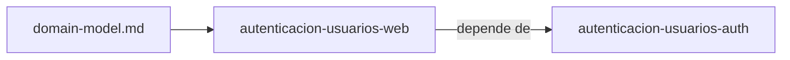

# Specs: Web (apps/web)

> SPA React del portal de pagos: pantallas y cliente de la API.

## Grafo de specs

## Tabla de specs

| Spec | Estado | Creación | Paralelizable con | Ruta | Depende de |
|---|:---:|:---:|:---:|---|---|
| autenticacion-usuarios-web | `Pendiente` | `Aprobado` | `—` | `autenticacion-usuarios-web/summary.md` | [autenticacion-usuarios-auth](../../services/auth/autenticacion-usuarios-auth/summary.md) |

> `domain-model.md` es el de Pagos que usa apps/web (`../../services/payments/domain-model.md`). El spec pertenece a la feature `autenticacion-usuarios-web`; los demás specs de la capacidad viven en los `INDEX.md` de sus propias unidades. `Paralelizable con` es `—` porque comparte `package-lock.json` con los otros specs del Grupo B.
