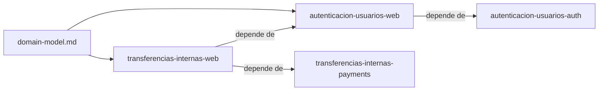

# Specs: Web (apps/web)

> SPA React del portal de pagos: pantallas y cliente de la API.

## Grafo de specs

## Tabla de specs

| Spec | Estado | Creación | Paralelizable con | Ruta | Depende de |
|---|:---:|:---:|:---:|---|---|
| autenticacion-usuarios-web | `Pendiente` | `Aprobado` | `—` | `autenticacion-usuarios-web/summary.md` | [autenticacion-usuarios-auth](../../services/auth/autenticacion-usuarios-auth/summary.md) |
| transferencias-internas-web | `Pendiente` | `Aprobado` | [transferencias-externas-payments](../../services/payments/transferencias-externas-payments/summary.md) | `transferencias-internas-web/summary.md` | [transferencias-internas-payments](../../services/payments/transferencias-internas-payments/summary.md) y [autenticacion-usuarios-web](autenticacion-usuarios-web/summary.md) |

> `domain-model.md` es el de Pagos que usa apps/web (`../../services/payments/domain-model.md`). El spec pertenece a la feature `autenticacion-usuarios-web`; los demás specs de la capacidad viven en los `INDEX.md` de sus propias unidades. `autenticacion-usuarios-web` mantiene `—` porque comparte `package-lock.json` con el Grupo B. `transferencias-internas-web` no modifica `package-lock.json`.
