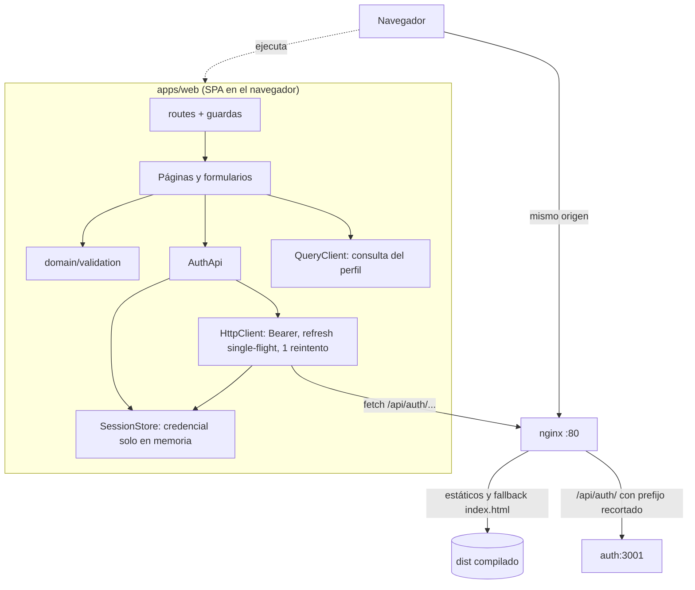

# Technical Design Document: Autenticación de usuarios (aplicación web `apps/web`)

## 1. Metadata & Traceability
- **Spec:** `autenticacion-usuarios-web`
- **Requirements Ref:** `requirements.md` (spec: `autenticacion-usuarios-web`)
- **Contrato del servicio de identidad (fuente de verdad de endpoints, errores y cookie):** [design.md de autenticacion-usuarios-auth](../../../services/auth/autenticacion-usuarios-auth/design.md) §4.2 y [domain-model.md de Identidad](../../../services/auth/domain-model.md).
- **Modelo de negocio compartido de la capacidad:** [domain-model.md de Pagos](../../../services/payments/domain-model.md). `apps/web` no crea `domain-model.md` ni `db-design.dbml`.
- **Target Stack:** Node.js 24.22.0 (`node:24.22.0-alpine`), TypeScript 6.0.3 estricto, React 19.3.1, react-dom 19.3.1, react-router 8.4.0, @tanstack/react-query 5.104.3, Vite 8.3.4, @vitejs/plugin-react 6.1.2, @types/react 19.3.0, @types/react-dom 19.3.0, Vitest 5.0.5, @testing-library/react 16.3.3, @testing-library/dom 10.4.1, @testing-library/user-event 14.6.8, @testing-library/jest-dom 6.9.1, jsdom 30.1.3, eslint-plugin-react-hooks 7.1.1, eslint-plugin-react-refresh 0.5.7. Herramientas de la raíz que este spec solo consume (las crea `autenticacion-usuarios-auth`): ESLint 10.12.0, @eslint/js 10.0.1, typescript-eslint 8.71.2, eslint-config-prettier 10.1.8, globals 17.13.0, Prettier 3.9.10, lefthook 2.1.12, @types/node 24.19.2, typescript 6.0.3.
- **Contenedores:** `node:24.22.0-alpine` (etapa `dev` con `git` y etapa `build`), `nginx:1.30.6-alpine` (etapa final), y para la integración `postgres:18.6-alpine` y la imagen runtime de `services/auth`, orquestados con Docker Compose.
- **Host:** solo Docker y Git; todo comando de instalación, compilación, verificación, prueba y ejecución corre en contenedores.
- **Versiones:** exactas, sin `^` ni `~`, en `apps/web/package.json`.

---

## 2. Architecture & System Overview

### 2.1 Architectural Approach
SPA de React servida por nginx desde un único origen. Capas simples y de dependencia unidireccional (`ui → app → api → session`; `domain` lo usan `api` y `ui`):

- `src/domain`: reglas puras y tipos (validación de formularios, `AuthUser`, `Credentials`). Sin React, sin `fetch`, sin importar otras capas.
- `src/session`: `SessionStore`, estado de sesión en memoria (credencial de acceso, usuario, aviso para el inicio de sesión). Sin React.
- `src/api`: `HttpClient` (Bearer, renovación single-flight, un reintento, mapeo de errores) y `AuthApi` (registro, inicio, cierre, perfil, restauración). Sin React; usa el `fetch` global.
- `src/app`: composición (`createAppServices`), contexto, hook `useSession` y `AppProviders`.
- `src/ui`: páginas, componentes de guarda y formulario. Solo accede a servicios mediante `useAppServices`.

Convenciones: ESM con `module ESNext` y `moduleResolution Bundler` (los imports relativos van sin extensión, a diferencia de los servicios); `verbatimModuleSyntax` obliga a `import type`; identificadores en inglés y textos de usuario en español; sin `dangerouslySetInnerHTML`, sin `console.*` y sin estilos ni scripts en línea (RN-11).

El servidor web (nginx) sirve el build con fallback a `index.html` y reenvía únicamente `/api/auth/` al servicio de identidad con el prefijo recortado. La credencial de acceso solo existe en una variable de `SessionStore`; la cookie `refresh_token` la gestiona el navegador.

### 2.2 Component Diagram / Module Interaction


### 2.3 Entorno de ejecución en contenedores

El host solo tiene Docker y Git. El Compose de esta unidad es `apps/web/compose.dev.yaml` (proyecto `fluxone-web-dev`), independiente de cualquier otro Compose del repositorio (no depende del Compose del portal completo). La tarea 1.1 lo crea con el servicio `dev`; la tarea 4.2 le añade `postgres`, `auth` y `web` y las dependencias de `dev`. Para la integración reutiliza, de `autenticacion-usuarios-auth`, la etapa runtime de `services/auth/Dockerfile` y el script `services/auth/docker/postgres-init/` (ambos ya existentes cuando se implementa este spec).

**Servicios**

| Servicio | Imagen / build | Puertos | Volúmenes | Healthcheck | Propósito |
|:---|:---|:---|:---|:---|:---|
| `dev` | build de `apps/web/Dockerfile`, etapa `dev` (`node:24.22.0-alpine` + `git`), contexto = raíz del repositorio | ninguno | raíz del repositorio en `/app` (bind mount); volúmenes con nombre `node_modules_root`, `node_modules_web`, `npm_cache` | ninguno | Ejecuta instalación, lint, formato, tipos, pruebas y build |
| `postgres` (4.2) | `postgres:18.6-alpine` | ninguno publicado | `tmpfs` en `/var/lib/postgresql`; `../../services/auth/docker/postgres-init` en `/docker-entrypoint-initdb.d` (solo lectura) | `pg_isready` cada 5 s | Base de datos efímera del servicio de identidad |
| `auth` (4.2) | build de `services/auth/Dockerfile` (etapa runtime), contexto = raíz | ninguno publicado | ninguno | `wget` a `/health/ready` cada 5 s (`start_period` 10 s, 10 reintentos) | Servicio de identidad real detrás de nginx |
| `web` (4.2) | build de `apps/web/Dockerfile` (etapa final nginx), contexto = raíz | `8080:80` | ninguno | `wget` a `http://127.0.0.1:80/` cada 5 s | Servidor web bajo prueba |

**Comandos.** Prefijo: `docker compose -f apps/web/compose.dev.yaml`. Sin servicios auxiliares: `run --rm --no-deps dev <cmd>`; con `web`, `auth` y `postgres`: `run --rm dev <cmd>`. Toda instalación se limita al workspace (`--workspace=apps/web --include-workspace-root`) para no escribir `node_modules` de otros workspaces en el árbol del host.

| Acción | Comando |
|:---|:---|
| Instalar y generar lockfile (tarea 1.2) | `docker compose -f apps/web/compose.dev.yaml run --rm --no-deps dev npm install --workspace=apps/web --include-workspace-root` |
| Instalación reproducible | `docker compose -f apps/web/compose.dev.yaml run --rm --no-deps dev npm ci --workspace=apps/web --include-workspace-root` |
| Lint | `docker compose -f apps/web/compose.dev.yaml run --rm --no-deps dev npm run lint -w apps/web` |
| Formato | `docker compose -f apps/web/compose.dev.yaml run --rm --no-deps dev npm run format:check -w apps/web` |
| Tipos | `docker compose -f apps/web/compose.dev.yaml run --rm --no-deps dev npm run typecheck -w apps/web` |
| Pruebas `unit` + `component` | `docker compose -f apps/web/compose.dev.yaml run --rm --no-deps dev npm run test -w apps/web` |
| Solo `unit` / solo `component` | `docker compose -f apps/web/compose.dev.yaml run --rm --no-deps dev npm run test:unit -w apps/web` / `... npm run test:component -w apps/web` |
| Build de Vite | `docker compose -f apps/web/compose.dev.yaml run --rm --no-deps dev npm run build -w apps/web` |
| Compatibilidad del build con CSP (AC-WEB-31) | `docker compose -f apps/web/compose.dev.yaml run --rm --no-deps dev sh -c "npm run build -w apps/web && npm run check:csp -w apps/web"` |
| Pruebas `integration` (levanta `postgres`, `auth`, `web`) | `docker compose -f apps/web/compose.dev.yaml run --rm dev npm run test:integration -w apps/web` |
| Evidencia de `X-Request-Id` (AC-WEB-28; tras la integración) | `docker compose -f apps/web/compose.dev.yaml logs auth \| grep -Eq '"reqId":"[0-9a-f]{32}"'` |
| Construir la imagen (AC-WEB-32) | `docker compose -f apps/web/compose.dev.yaml build web` |
| Etapas del Dockerfile (AC-WEB-32) | `docker compose -f apps/web/compose.dev.yaml run --rm --no-deps dev sh -c "grep -qE '^FROM node:24.22.0-alpine AS build$' apps/web/Dockerfile && grep -qE '^FROM nginx:1.30.6-alpine$' apps/web/Dockerfile"` |
| Contenido de la imagen (AC-WEB-32) | `docker compose -f apps/web/compose.dev.yaml run --rm --no-deps --entrypoint sh web -c "test -f /usr/share/nginx/html/index.html && test ! -e /app && test ! -e /usr/share/nginx/html/node_modules && nginx -v 2>&1 \| grep -q 1.30.6"` y `docker image inspect fluxone-web-dev-web --format '{{json .Config.ExposedPorts}}'` (contiene `80/tcp`) |
| Levantar `web` con `auth` | `docker compose -f apps/web/compose.dev.yaml up -d --wait web` |
| Limpiar contenedores y volúmenes | `docker compose -f apps/web/compose.dev.yaml down -v` |

**Ownership y volúmenes.** `node_modules` vive en volúmenes con nombre (`node_modules_root` en `/app/node_modules`, `node_modules_web` en `/app/apps/web/node_modules`) y la caché de npm en `npm_cache`: no se escriben binarios Linux en el árbol del host. Los archivos que `dev` escribe en el árbol (lockfile, `dist`) los crea `root` dentro del contenedor.

**Contenido exacto de `apps/web/compose.dev.yaml`.** YAML con comillas simples (por `singleQuote: true` de `.prettierrc`). Las credenciales son valores de desarrollo desechables, sobreescribibles por variable de entorno; no son secretos del proyecto porque la DB no publica puertos ni persiste datos.

Tarea 1.1 (solo `dev` y volúmenes):

```yaml
name: fluxone-web-dev

services:
  dev:
    build:
      context: ../..
      dockerfile: apps/web/Dockerfile
      target: dev
    working_dir: /app
    volumes:
      - ../..:/app
      - node_modules_root:/app/node_modules
      - node_modules_web:/app/apps/web/node_modules
      - npm_cache:/root/.npm

volumes:
  node_modules_root:
  node_modules_web:
  npm_cache:
```

Tarea 4.2 (archivo final completo; añade `postgres`, `auth`, `web` y, en `dev`, `environment` y `depends_on`):

```yaml
name: fluxone-web-dev

services:
  postgres:
    image: postgres:18.6-alpine
    environment:
      POSTGRES_USER: postgres
      POSTGRES_PASSWORD: ${POSTGRES_PASSWORD:-postgres_dev_pw}
      POSTGRES_DB: fluxone
      AUTH_DB_PASSWORD: ${AUTH_DB_PASSWORD:-auth_dev_pw}
    tmpfs:
      - /var/lib/postgresql
    volumes:
      - ../../services/auth/docker/postgres-init:/docker-entrypoint-initdb.d:ro
    healthcheck:
      test: ['CMD-SHELL', 'pg_isready -U $${POSTGRES_USER} -d $${POSTGRES_DB} -h 127.0.0.1 -p 5432']
      interval: 5s
      timeout: 3s
      retries: 5
      start_period: 10s

  auth:
    build:
      context: ../..
      dockerfile: services/auth/Dockerfile
    environment:
      PORT: '3001'
      DATABASE_URL: postgres://auth_svc:${AUTH_DB_PASSWORD:-auth_dev_pw}@postgres:5432/fluxone
      COOKIE_SECRET: ${COOKIE_SECRET:-dev_cookie_secret_0123456789abcdef0123}
      COOKIE_SECURE: 'false'
      DEMO_USERS_PASSWORD: ${DEMO_USERS_PASSWORD:-demo_password_123}
    depends_on:
      postgres:
        condition: service_healthy
    healthcheck:
      test: ['CMD-SHELL', 'wget -q -O /dev/null http://127.0.0.1:3001/health/ready']
      interval: 5s
      timeout: 3s
      retries: 10
      start_period: 10s

  web:
    build:
      context: ../..
      dockerfile: apps/web/Dockerfile
    ports:
      - '8080:80'
    depends_on:
      auth:
        condition: service_healthy
    healthcheck:
      test: ['CMD-SHELL', 'wget -q -O /dev/null http://127.0.0.1:80/']
      interval: 5s
      timeout: 3s
      retries: 10
      start_period: 5s

  dev:
    build:
      context: ../..
      dockerfile: apps/web/Dockerfile
      target: dev
    working_dir: /app
    environment:
      WEB_BASE_URL: http://web
    volumes:
      - ../..:/app
      - node_modules_root:/app/node_modules
      - node_modules_web:/app/apps/web/node_modules
      - npm_cache:/root/.npm
    depends_on:
      web:
        condition: service_healthy

volumes:
  node_modules_root:
  node_modules_web:
  npm_cache:
```

**Contenido exacto de `apps/web/Dockerfile`.** Tres etapas; `dev` es la primera (tarea 1.1) y la imagen final es la última (tarea 4.1). El contexto es la raíz del repositorio, filtrado por el `.dockerignore` de la raíz (de modo que `COPY . .` incluye los `package.json` de todos los workspaces que exige `npm ci` y el `.npmrc` aplica `ignore-scripts`).

```dockerfile
FROM node:24.22.0-alpine AS dev
RUN apk add --no-cache git \
  && git config --system --add safe.directory /app
WORKDIR /app

FROM node:24.22.0-alpine AS build
WORKDIR /app
COPY . .
RUN npm ci --workspace=apps/web --include-workspace-root
RUN npm run build -w apps/web

FROM nginx:1.30.6-alpine
COPY apps/web/nginx/default.conf /etc/nginx/conf.d/default.conf
COPY --from=build /app/apps/web/dist /usr/share/nginx/html
EXPOSE 80
```

Contingencia: si aparece el bug de npm "Exit handler never called" en Alpine, usar `node:24.22.0-bookworm-slim` en la etapa `build`.

### 2.5 Decisiones cerradas (heredadas de IDEA)
- SPA React 19.3.1 con react-router 8.4.0 (`createBrowserRouter` desde `react-router`, `RouterProvider` desde `react-router/dom`; `react-router-dom` no se usa) y @tanstack/react-query 5.104.3 como capa de datos remotos; Vite 8.3.4 con @vitejs/plugin-react 6.1.2; TypeScript estricto.
- nginx 1.30.6-alpine como único origen: sirve la SPA y reenvía `/api/auth/` con el prefijo recortado; solo declara upstreams de servicios que existen en ese momento (nginx no arranca si un host upstream no resuelve).
- Credencial de acceso solo en memoria; renovación silenciosa al cargar y ante 401; botón de envío deshabilitado mientras la solicitud está en curso; errores de API en lenguaje claro.
- Cabeceras de seguridad de nginx: `X-Content-Type-Options: nosniff`, `X-Frame-Options: DENY`, `Referrer-Policy: no-referrer`, `Content-Security-Policy: default-src 'self'`; `X-Request-Id` hacia el servicio.
- Imagen multi-stage `node:24.22.0-alpine` → `nginx:1.30.6-alpine`, contexto = raíz del repositorio; puerto 80 del contenedor (8080 en el host).
- Pruebas con Vitest + Testing Library + jsdom; ESLint con `eslint-plugin-react-hooks` y `eslint-plugin-react-refresh` para esta unidad.
- Monorepo con npm workspaces `apps/*` y `services/*`; versiones exactas; saltos de línea LF; ambiente 100 % Docker (constitución).

### 2.6 Riesgos y mitigaciones

| Riesgo | Impacto | Mitigación |
|:---|:---|:---|
| Versiones del stack no verificadas localmente | La instalación o el typecheck fallan al empezar | Primera instalación con `npm ci` y `tsc --noEmit` en el contenedor `dev` antes de escribir código de producto (tarea 1.2) |
| Un 401 repetido provoca bucle de renovaciones | Tormenta de solicitudes al servicio de identidad | Solo las solicitudes `authenticated: true` renuevan; un único reintento por solicitud; `retry: false` en React Query; tras cerrar la sesión se descarta la caché |
| Varias solicitudes con 401 renuevan a la vez y el servicio detecta reutilización | Cierre de sesión espurio | Renovación single-flight: todas las solicitudes comparten una sola promesa (§4.1) |
| React `StrictMode` ejecuta el efecto de arranque dos veces | Dos renovaciones al cargar y revocación por reutilización | `restoreSession` memoizado (una sola vez por instancia) y renovación single-flight |
| Doble clic antes de que React Query publique `isPending` | Doble envío | Cerrojo síncrono con `useRef` en `useSingleSubmit` (§4.1), independiente del estado de React Query |
| Dos pestañas renuevan con la misma cookie | Una pestaña recibe `REFRESH_TOKEN_REUSED` | Comportamiento aceptado y especificado (EC-08): esa pestaña cierra sesión con el mensaje del servicio |
| Credencial en memoria expuesta a XSS | Robo del token de acceso | CSP `default-src 'self'`, build sin scripts ni estilos en línea (`check:csp`), sin `dangerouslySetInnerHTML`, cookie de sesión `httpOnly` |
| nginx no arranca si el host `auth` no resuelve | Contenedor web caído | Único upstream `auth`; en Compose `web` depende de `auth` saludable |
| `add_header` en un `location` anula los heredados del `server` | Respuestas sin cabeceras de seguridad | Todas las cabeceras se declaran en `server` con `always` y ningún `location` declara `add_header` |
| CSP bloquea recursos incrustados (`data:`) | La aplicación no carga estilos o imágenes | `build.assetsInlineLimit: 0`; sin imágenes ni fuentes externas |
| La config de ESLint de `apps/web` extiende la de la raíz y la búsqueda de configuración varía por versión | Lint de la unidad sin reglas de React | El lint de la unidad se ejecuta con el directorio de trabajo `apps/web` (`npm run lint -w apps/web`), que siempre toma `apps/web/eslint.config.js` |
| `npm install` con `--workspace` podría no completar el lockfile | `npm ci` falla | La tarea 1.2 verifica `npm ci --workspace=apps/web --include-workspace-root` tras `npm install` |
| El compose de la unidad consume la etapa runtime de `services/auth/Dockerfile` y `docker/postgres-init` | Falla de integración si cambian | Son artefactos de `autenticacion-usuarios-auth`, spec previo ya completo; no se copian |
| Límite de login de 5/min por IP en el servicio | Pruebas de integración repetidas devuelven 429 | La integración hace un solo inicio de sesión por ejecución; si se repite en menos de un minuto, esperar o ejecutar `down -v` |
| CRLF de Windows rompe Dockerfiles | Fallos de ejecución en contenedor | `.gitattributes` raíz fuerza LF |
| Bind mount en Docker Desktop (rendimiento) | Instalaciones y pruebas lentas | `node_modules` y caché de npm en volúmenes con nombre |

### 2.7 Directrices del proyecto
- `Unidad: apps/web`: todo comando de instalación, compilación, prueba y ejecución de la unidad corre en contenedores con `docker compose -f apps/web/compose.dev.yaml` (servicio `dev`); la integración levanta `postgres`, `auth` y `web` de ese Compose.
- `Unidad: apps/web`: la credencial de acceso vive solo en memoria de la página; nunca en `localStorage`, `sessionStorage`, IndexedDB, cookies legibles ni la URL, y ninguna credencial se escribe en consola.
- `Unidad: apps/web`: nginx es el único origen del navegador; solo declara upstreams de servicios existentes y envía siempre las cuatro cabeceras de seguridad con `Content-Security-Policy: default-src 'self'` (sin scripts ni estilos en línea).
- `Unidad: apps/web`: no crea `domain-model.md`; referencia el de Pagos y el de Identidad por ruta relativa.

### 2.8 Sujeto a actualización futura
- `transferencias-internas-web` — §5 Implementation Target Structure (`nginx/default.conf` añadirá `location /api/payments/`) — el cliente autenticado consume la API de Pagos desde el mismo origen.
- `auditoria-transferencias-web` — §5 Implementation Target Structure (`nginx/default.conf` añadirá `location /api/audit/`) — línea de tiempo de auditoría de las transferencias.

---

## 3. Data Models & Schema Design

> `apps/web` no tiene base de datos ni esquema propio: no hay `db-design.dbml`. Los tipos del cliente se derivan del contrato del servicio de identidad ([design.md §4.2](../../../services/auth/autenticacion-usuarios-auth/design.md), [domain-model.md de Identidad](../../../services/auth/domain-model.md)); un cambio de ese contrato entra primero en esos documentos.

### 3.1 Domain Entities (Core Business Objects)

```typescript
// src/domain/types.ts
export interface AuthUser {
  id: string; // uuid; claim `sub` del servicio de identidad
  email: string; // normalizado por el servicio
}

export interface Credentials {
  email: string;
  password: string;
}

export interface SessionPayload {
  accessToken: string;
  tokenType: 'Bearer';
  expiresIn: number; // 900
  user: AuthUser;
}

export interface RegisterResult {
  id: string;
  email: string;
}
```

**Pertenencia y aislamiento.** `apps/web` no almacena ni particiona datos por Cuenta ni por tenant: no tiene tablas ni almacenamiento persistente. Todo su estado es memoria de la página: la credencial de acceso y el usuario autenticado (`SessionStore`) y la caché de React Query (la consulta del perfil), que se vacía al cerrar la sesión. Los datos que muestra pertenecen al usuario del token de acceso, y el servicio de identidad es quien los determina. **Valores centinela, casos especiales y excepciones: ninguno** (no existe usuario, cuenta ni id reservado en la aplicación).

### 3.2 Database Schema & Persistence
- **Target Database / Storage:** ninguna. Estado en memoria; sin migraciones. La única credencial persistente es la cookie `refresh_token` (`httpOnly`), que gestiona el navegador y que el código no lee ni escribe.

---

## 4. Interfaces, Contracts & API Specifications

### 4.1 Internal Service Interfaces / Ports

**Validación (`src/domain/validation.ts`)** — funciones puras; devuelven `{}` si no hay errores.

```typescript
export const EMAIL_MAX_LENGTH = 254;
export const PASSWORD_MIN_LENGTH = 12;
export const PASSWORD_MAX_LENGTH = 128;

export interface FieldErrors {
  email?: string;
  password?: string;
}

export function validateRegistration(input: Credentials): FieldErrors;
export function validateLogin(input: Credentials): FieldErrors;
```

| Función | Regla (en orden) | Mensaje (campo) |
|:---|:---|:---|
| `validateRegistration` | `email.trim()` con más de 254 caracteres | `El correo no puede superar 254 caracteres.` (`email`) |
| | `email.trim()` no cumple `/^[^\s@]+@[^\s@]+\.[^\s@]+$/` (mismo patrón que el servicio) o está vacío | `Ingresa un correo válido.` (`email`) |
| | `[...password].length` < 12 o > 128 (caracteres, no bytes; sin `trim`) | `La contraseña debe tener entre 12 y 128 caracteres.` (`password`) |
| `validateLogin` | `email.trim()` vacío | `Ingresa tu correo.` (`email`) |
| | `password` vacía (`''`) | `Ingresa tu contraseña.` (`password`) |

Límites: 11 y 129 caracteres producen error; 12 y 128 son válidos.

**Errores del cliente (`src/api/api-error.ts`)**

```typescript
export const NETWORK_ERROR_MESSAGE = 'No se pudo conectar con el servidor. Intenta de nuevo.';
export const SERVICE_UNAVAILABLE_MESSAGE = 'El servicio no está disponible. Intenta de nuevo más tarde.';

export class ApiError extends Error {
  constructor(
    readonly status: number, // 0 si no hubo respuesta
    readonly code: string, // código del servicio, o NETWORK_ERROR / SERVICE_UNAVAILABLE (locales)
    message: string, // siempre apto para mostrar al usuario, en español
  ) {
    super(message);
    this.name = 'ApiError';
  }
}

export function errorMessage(error: unknown): string; // ApiError → message; cualquier otro → SERVICE_UNAVAILABLE_MESSAGE
```

Regla de construcción de `ApiError` (RN-09): `fetch` rechaza (sin respuesta) → `ApiError(0, 'NETWORK_ERROR', NETWORK_ERROR_MESSAGE)`. Respuesta no 2xx cuyo cuerpo JSON es `{error:{code:string,message:string}}` → `ApiError(status, code, message)` con el `message` del servicio, sin traducirlo. Respuesta no 2xx cuyo cuerpo no cumple ese formato (p. ej. 502 HTML de nginx), o respuesta 2xx con cuerpo JSON ilegible → `ApiError(status, 'SERVICE_UNAVAILABLE', SERVICE_UNAVAILABLE_MESSAGE)`. Nunca se muestran tokens, trazas ni códigos internos como único mensaje.

**Estado de sesión (`src/session/session-store.ts`)**

```typescript
export type SessionStatus = 'loading' | 'authenticated' | 'anonymous';

export interface SessionSnapshot {
  status: SessionStatus;
  user: AuthUser | null;
  loginNotice: string | null; // aviso que muestra la pantalla de inicio de sesión
}

export interface SessionStore {
  getSnapshot(): SessionSnapshot; // inmutable; se reemplaza el objeto en cada cambio; nunca contiene la credencial
  subscribe(listener: () => void): () => void;
  getAccessToken(): string | null; // la credencial solo se lee aquí
  setSession(accessToken: string, user: AuthUser): void; // status 'authenticated', loginNotice null
  clearSession(options?: { loginNotice?: string }): void; // descarta token y usuario, status 'anonymous', loginNotice = options.loginNotice ?? null, invoca onCleared y luego notifica
  setLoginNotice(notice: string | null): void;
}

export function createSessionStore(options: { onCleared: () => void }): SessionStore;
```

Estado inicial: `{status: 'loading', user: null, loginNotice: null}` y token `null`. La credencial es una variable local de la clausura de `createSessionStore`; nunca se escribe en almacenamiento del navegador (RN-01). `clearSession` es el único punto de "sesión cerrada" (RN-06, REQ-5); es idempotente.

**Cliente HTTP (`src/api/http-client.ts`)**

```typescript
export const AUTH_API_BASE = '/api/auth';

export interface RequestOptions {
  method: 'GET' | 'POST';
  path: string; // ruta del servicio, p. ej. '/auth/login'; la URL final es AUTH_API_BASE + path
  body?: unknown;
  authenticated: boolean; // true solo para solicitudes que requieren Bearer (hoy: GET /auth/me)
}

export interface HttpClient {
  request<T>(options: RequestOptions): Promise<T>; // T = void en respuestas 204; lanza ApiError
  refreshSession(): Promise<void>; // single-flight; lanza ApiError
}

export function createHttpClient(session: SessionStore): HttpClient;
```

Envío (`send`): `fetch(AUTH_API_BASE + path, {method, credentials: 'same-origin', headers, body})`. Cabecera `Accept: application/json` siempre; `Content-Type: application/json` y cuerpo `JSON.stringify(body)` **solo si hay `body`** (el servicio rechaza `Content-Type` JSON con cuerpo vacío, así que refresh y logout van sin esa cabecera); `Authorization: Bearer <token>` solo si `authenticated` y `getAccessToken()` no es `null` (REQ-1.2: nunca en registro, inicio de sesión, renovación ni cierre de sesión). El token se lee en cada envío, de modo que el reintento usa el token renovado.

Algoritmo de `request`:
1. `first = send(...)`. Si `fetch` rechaza → `ApiError NETWORK_ERROR`.
2. Si `first.status !== 401` o `authenticated` es `false` → resultado final (2xx → cuerpo; otro → `ApiError`). Así, un 401 de `/auth/login`, `/auth/register`, `/auth/refresh` o `/auth/logout` nunca renueva (RN-07, REQ-2.7).
3. Si `authenticated` y 401: `await refreshSession()`. Si lanza, la solicitud original rechaza con ese error (los 401 de la renovación ya cerraron la sesión dentro de `refreshSession`).
4. `retry = send(...)` exactamente una vez. Si `retry.status === 401` → `session.clearSession()` y `ApiError` (RN-06; sin más reintentos). En otro caso, resultado final.

`refreshSession` (RN-05): mantiene `inFlight: Promise<void> | null`. Si es `null`, lo crea con `performRefresh()` y lo pone de nuevo en `null` al terminar (éxito o error); todas las llamadas concurrentes devuelven la misma promesa. `performRefresh`: `POST /auth/refresh` sin cuerpo y `authenticated: false`; 200 → `session.setSession(accessToken, user)`; 401 → `session.clearSession(code === 'REFRESH_TOKEN_REUSED' ? {loginNotice: message} : undefined)` y lanza el `ApiError`; cualquier otro fallo (red, 5xx) lanza el `ApiError` sin cerrar la sesión.

**API de identidad (`src/api/auth-api.ts`)**

```typescript
export interface AuthApi {
  restoreSession(): Promise<void>; // memoizado: una sola renovación al cargar; nunca rechaza
  register(credentials: Credentials): Promise<RegisterResult>;
  login(credentials: Credentials): Promise<void>; // en 200 guarda token y usuario en SessionStore
  logout(): Promise<void>; // nunca rechaza; siempre cierra la sesión local
  getProfile(): Promise<AuthUser>;
}

export function createAuthApi(client: HttpClient, session: SessionStore): AuthApi;
```

| Operación | Entrada | Salida | Comportamiento | Errores |
|:---|:---|:---|:---|:---|
| `restoreSession` | — | `void` | `await client.refreshSession()`; éxito → sesión guardada (REQ-2.1). Un 401 ya dejó la sesión cerrada (con aviso solo si `REFRESH_TOKEN_REUSED`, REQ-2.2/2.5). Cualquier otro fallo (red, 5xx) → `session.clearSession({loginNotice: errorMessage(e)})` | ninguno (los captura) |
| `register` | `{email, password}` (ya validados; el email se envía con `trim()`) | `{id, email}` | `POST /auth/register`, `authenticated: false` | `ApiError` |
| `login` | `{email, password}` (email con `trim()`) | `void` | `POST /auth/login`, `authenticated: false`; 200 → `session.setSession(accessToken, user)` | `ApiError` |
| `logout` | — | `void` | `POST /auth/logout`, `authenticated: false`, errores ignorados; luego `session.clearSession()` | ninguno |
| `getProfile` | — | `{id, email}` | `GET /auth/me`, `authenticated: true` (con renovación y reintento) | `ApiError` |

**Composición (`src/app/create-app-services.ts`, `src/app/app-services-context.ts`, `src/app/app-providers.tsx`)**

```typescript
export interface AppServices {
  session: SessionStore;
  api: AuthApi;
  queryClient: QueryClient;
}

export function createAppServices(): AppServices;
// queryClient = new QueryClient({defaultOptions: {queries: {retry: false}}});
// session = createSessionStore({onCleared: () => queryClient.clear()});
// api = createAuthApi(createHttpClient(session), session);

export function useAppServices(): AppServices; // lanza Error si falta el proveedor
export function useSession(): SessionSnapshot; // useSyncExternalStore(session.subscribe, session.getSnapshot)
```

`AppProviders({services, children})`: provee el contexto y `QueryClientProvider`, y en un `useEffect` llama una vez `void services.api.restoreSession()` (REQ-2.1).

**Cerrojo de envío (`src/ui/use-single-submit.ts`)**

```typescript
export function useSingleSubmit(): {
  pending: boolean; // deshabilita el botón de envío (RN-08)
  run: (action: () => Promise<void>) => Promise<void>; // no hace nada si ya hay una acción en curso
};
```

`run` usa un `useRef<boolean>` como cerrojo síncrono (se activa antes de cualquier `await`) y `useState` para `pending`; libera ambos en `finally`. Cada acción gestiona sus propios errores.

### 4.2 External API / RPC / Event Schemas

El cliente solo consume el servicio de identidad, siempre en el mismo origen bajo `/api/auth` (nginx recorta el prefijo: `/api/auth/auth/login` llega al servicio como `/auth/login`). Contrato completo en [design.md de autenticacion-usuarios-auth §4.2](../../../services/auth/autenticacion-usuarios-auth/design.md); aquí se declara lo que la aplicación envía, recibe y cómo reacciona.

**Mapeo de errores a mensajes en español.** La aplicación muestra el `message` del servicio tal como llega (RN-09); no duplica sus textos. Los códigos y mensajes que el servicio devuelve, y los dos locales, son:

| `code` | Status | Mensaje mostrado |
|:---|:---|:---|
| `VALIDATION_ERROR` | 400 | `Solicitud inválida: <detalle>` (del servicio) |
| `EMAIL_TAKEN` | 409 | `El correo ya está registrado.` |
| `INVALID_CREDENTIALS` | 401 | `Correo o contraseña incorrectos.` |
| `RATE_LIMITED` | 429 | `Demasiados intentos. Intenta de nuevo en un minuto.` |
| `REFRESH_TOKEN_INVALID` | 401 | `La sesión no es válida o expiró.` (no se muestra: la sesión se cierra en silencio) |
| `REFRESH_TOKEN_REUSED` | 401 | `La sesión fue revocada por seguridad. Inicia sesión de nuevo.` |
| `UNAUTHORIZED` | 401 | `Token de acceso ausente o inválido.` (dispara renovación; no se muestra si se resuelve) |
| `INTERNAL_ERROR` | 500 | `Error interno del servidor.` |
| `NETWORK_ERROR` (local) | — | `No se pudo conectar con el servidor. Intenta de nuevo.` |
| `SERVICE_UNAVAILABLE` (local) | cualquiera | `El servicio no está disponible. Intenta de nuevo más tarde.` |

#### `POST /api/auth/auth/register`
- **Request:** `{"email": "nuevo@fluxone.test", "password": "una-clave-segura-123"}` (sin cookie ni Bearer).
- **Response 201:** `{"id": "<uuid>", "email": "nuevo@fluxone.test"}` → la aplicación guarda `loginNotice = 'Cuenta creada. Inicia sesión.'` y navega a `/login`; no inicia sesión ni guarda credenciales (REQ-3.2).
- **Errores:** `400 VALIDATION_ERROR` (mensaje del servicio, datos conservados); `409 EMAIL_TAKEN` (`El correo ya está registrado.`, email conservado); `429 RATE_LIMITED` (mensaje de espera, permite reintentar); `500 INTERNAL_ERROR`; sin respuesta → `NETWORK_ERROR`; respuesta sin formato (p. ej. 502) → `SERVICE_UNAVAILABLE`.

#### `POST /api/auth/auth/login`
- **Request:** `{"email": "alice@fluxone.test", "password": "..."}` (sin cookie ni Bearer).
- **Response 200:** `{"accessToken": "<jwt>", "tokenType": "Bearer", "expiresIn": 900, "user": {"id": "<uuid>", "email": "alice@fluxone.test"}}` y `Set-Cookie: refresh_token=...; Path=/api/auth; HttpOnly; SameSite=Strict` (la gestiona el navegador). La aplicación guarda `accessToken` y `user` en memoria; el guard de `/login` lleva a `/` (REQ-4.1).
- **Errores:** `401 INVALID_CREDENTIALS` (mensaje, se vacía solo la contraseña, no hay renovación); `429 RATE_LIMITED`; `400 VALIDATION_ERROR` (cuerpo fuera del esquema, p. ej. más de 1024 caracteres; mensaje del servicio); `500 INTERNAL_ERROR`; `NETWORK_ERROR`; `SERVICE_UNAVAILABLE`.

#### `POST /api/auth/auth/refresh`
- **Request:** sin cuerpo, sin `Content-Type`, sin Bearer; el navegador envía la cookie `refresh_token`.
- **Response 200:** mismo cuerpo que login (la cookie rota la gestiona el navegador).
- **Errores:** `401 REFRESH_TOKEN_INVALID` → sesión cerrada sin aviso; `401 REFRESH_TOKEN_REUSED` → sesión cerrada con `loginNotice` = mensaje del servicio; red o 5xx → no cierra la sesión: al cargar la aplicación queda sin sesión con `loginNotice` = mensaje de error (conexión o servicio no disponible); ante un 401 de una solicitud autenticada, esa solicitud rechaza con el error.

#### `POST /api/auth/auth/logout`
- **Request:** sin cuerpo ni `Content-Type`, sin Bearer; cookie gestionada por el navegador.
- **Response 204** sin cuerpo (siempre). La aplicación descarta token y usuario, vacía la caché y lleva a `/login`.
- **Errores:** cualquier fallo (red, 5xx) se ignora y se cierra igualmente la sesión local (REQ-5.2).

#### `GET /api/auth/auth/me`
- **Request:** `Authorization: Bearer <accessToken>`.
- **Response 200:** `{"id": "<uuid>", "email": "alice@fluxone.test"}`; la pantalla muestra `email`.
- **Errores:** `401 UNAUTHORIZED` → renovación single-flight y un reintento; si el reintento vuelve a dar 401 → sesión cerrada, sin más reintentos; red o 5xx → la pantalla muestra el mensaje de error y conserva la sesión.

### 4.3 Router, pantallas y formularios

**Rutas (`src/routes.tsx`, export `appRoutes: RouteObject[]`).** `main.tsx` usa `createBrowserRouter(appRoutes)` y `RouterProvider` de `react-router/dom`; las pruebas usan `createMemoryRouter(appRoutes, {initialEntries})`.

| Ruta | Elemento | Regla |
|:---|:---|:---|
| `/` | `<RequireSession><HomePage /></RequireSession>` | Ruta protegida (REQ-6.1, 6.2) |
| `/login` | `<PublicOnly><LoginPage /></PublicOnly>` | Pública (REQ-6.3) |
| `/register` | `<PublicOnly><RegisterPage /></PublicOnly>` | Pública (REQ-6.3) |
| `*` | `<Navigate to="/" replace />` | Ruta desconocida → `/` (REQ-6.4) |

**Guardas** (`useSession()`):
- `RequireSession`: `loading` → `LoadingScreen`; `authenticated` → hijos; `anonymous` → `<Navigate to="/login" replace />`.
- `PublicOnly`: `loading` → `LoadingScreen`; `authenticated` → `<Navigate to="/" replace />`; `anonymous` → hijos.
- `LoadingScreen`: `<p role="status">Cargando…</p>`. Mientras `status` es `loading` no se muestra ni la pantalla protegida ni el inicio de sesión (REQ-2.1).

**Componentes y textos** (los textos son contrato de las pruebas):

| Componente (archivo) | Contenido |
|:---|:---|
| `FormField` (`ui/components/form-field.tsx`) | Props `{id, label, type, value, onChange, error?, autoComplete}`; `<label htmlFor>`, `<input>` controlado, error en `<p role="alert" id="{id}-error">` y `aria-invalid`/`aria-describedby` cuando hay error |
| `LoginPage` | `<h1>Iniciar sesión</h1>`; `FormField` `Correo electrónico` (`type="email"`, `autoComplete="username"`) y `Contraseña` (`type="password"`, `autoComplete="current-password"`); botón `Iniciar sesión`; enlace `Crear una cuenta` → `/register`; `loginNotice` en `<p role="status">`; error de formulario en `<p role="alert">` |
| `RegisterPage` | `<h1>Crear cuenta</h1>`; mismos campos (contraseña con `autoComplete="new-password"`); botón `Registrarse`; enlace `Ya tengo una cuenta` → `/login`; error de formulario en `<p role="alert">` |
| `HomePage` | `<h1>FluxOne Payment</h1>`; `useQuery({queryKey: ['me'], queryFn: () => api.getProfile()})`: cargando → `LoadingScreen`; éxito → `<p>Sesión iniciada como <strong>{email}</strong></p>`; error → `<p role="alert">{message}</p>`; botón `Cerrar sesión` |

Los `<form>` llevan `noValidate` (la validación es la de `domain/validation`). Sin `style` en línea; los estilos están en `src/styles.css` por clases.

**Formulario de inicio de sesión.** Estado local `email`, `password`, `fieldErrors`, `formError`. Al enviar: (1) `validateLogin`; si hay errores se muestran junto al campo y no se envía nada (REQ-4.4); (2) `session.setLoginNotice(null)`; (3) `run(() => api.login({email, password}))`; en éxito el guard `PublicOnly` lleva a `/`; en `ApiError`, `formError = error.message`, y si `code === 'INVALID_CREDENTIALS'` se vacía solo `password` (REQ-4.2); el email se conserva siempre. Botón `disabled={pending}`.

**Formulario de registro.** Al enviar: (1) `validateRegistration`; si hay errores, se muestran junto al campo, no se envía ninguna solicitud y se conserva lo escrito (REQ-3.1); (2) `run(() => api.register({email, password}))`; éxito → `session.setLoginNotice('Cuenta creada. Inicia sesión.')` y `navigate('/login')`; `ApiError` → `formError = error.message` conservando lo escrito (REQ-3.3, 3.4, 3.5). Botón `disabled={pending}`.

**Cierre de sesión.** El botón `Cerrar sesión` llama `run(() => api.logout())`, `disabled={pending}`; al terminar, `RequireSession` lleva a `/login`.

### 4.4 Servidor web (nginx)

Contrato de `apps/web/nginx/default.conf` (contenido exacto en §5):
- `GET /` y cualquier ruta que no sea un archivo existente → 200 con el recurso o `index.html` (fallback de SPA).
- `/api/auth/<ruta>` → `http://auth:3001/<ruta>` (prefijo recortado, porque el `location` y el `proxy_pass` terminan en `/`); conserva método, cuerpo, `Authorization`, `Cookie`, código de estado y `Set-Cookie`; añade `Host`, `X-Real-IP` y `X-Request-Id` (`$request_id`).
- Único upstream: `auth`. No hay `location` para otros servicios.
- Cabeceras de seguridad en todas las respuestas (incluidas errores y respuestas reenviadas), declaradas a nivel `server` con `always`.

---

## 5. Implementation Target Structure (File Mapping)

Rutas relativas a la raíz del repositorio. Todos los archivos son "Crear", salvo los marcados "Modificar". Esta lista es exacta (ni un archivo más ni uno menos); `tasks.md` toca exactamente estos archivos. La columna Tarea indica la agrupación prevista.

**Footprint (para comparar con las demás unidades):** 45 archivos propios bajo `apps/web/` y 1 archivo compartido de la raíz (`package-lock.json`, Modificar). No se toca ningún archivo de la raíz creado por `autenticacion-usuarios-auth` (`package.json`, `tsconfig.base.json`, `eslint.config.js`, `.prettierrc`, `.prettierignore`, `.npmrc`, `.gitattributes`, `.dockerignore`, `lefthook.yml`, `.githooks/pre-commit`, `.gitignore`): este spec los consume y solo añade lo propio del workspace. **Overlap con hermanos del mismo grupo provisional:** `package-lock.json` también lo modifican `riel-bancario-simulado-bank-rail` y `transferencias-internas-payments`; el resto de archivos no se solapa (unidad distinta, y `apps/web/compose.dev.yaml` es propio). El lockfile se regenera de forma secuencial con `npm install` en el contenedor `dev`.

**Estructura de `apps/web/`:**
```
apps/web/
├── package.json, tsconfig.json, vite.config.ts, vitest.config.ts, eslint.config.js, index.html, Dockerfile, compose.dev.yaml, .gitignore
├── nginx/default.conf
├── scripts/check-build-csp.mjs
├── src/
│   ├── main.tsx, routes.tsx, styles.css
│   ├── domain/ (types, validation)
│   ├── session/ (session-store)
│   ├── api/ (api-error, http-client, auth-api)
│   ├── app/ (create-app-services, app-services-context, app-providers)
│   └── ui/ (use-single-submit, components/, pages/)
└── tests/ (setup.ts, support/, unit/, component/, integration/)
```

| Archivo | Acción | Propósito | Tarea |
|:---|:---|:---|:---|
| `apps/web/compose.dev.yaml` | Crear | Compose de la unidad: servicio `dev` y volúmenes | 1.1 |
| `apps/web/Dockerfile` | Crear | Etapa `dev` (Node + `git`) | 1.1 |
| `apps/web/.gitignore` | Crear | `node_modules/`, `dist/`, `coverage/`, `.env`, `*.log` (una por línea) | 1.1 |
| `apps/web/package.json` | Crear | Workspace `@fluxone/web`: dependencias exactas y scripts | 1.2 |
| `package-lock.json` | Modificar | Lockfile de la raíz regenerado con `npm install` en el contenedor `dev` al añadir el workspace | 1.2 |
| `apps/web/tsconfig.json` | Crear | TypeScript de la unidad (typecheck, sin emitir) | 1.2 |
| `apps/web/vite.config.ts` | Crear | Configuración de Vite (plugin React; sin inlining de recursos) | 1.2 |
| `apps/web/vitest.config.ts` | Crear | Proyectos Vitest `unit`, `component` e `integration` | 1.2 |
| `apps/web/eslint.config.js` | Crear | Config ESLint de la unidad: extiende la raíz y añade reglas de React | 1.2 |
| `apps/web/tests/setup.ts` | Crear | Setup de pruebas de componente (jest-dom, limpieza) | 1.2 |
| `apps/web/src/domain/types.ts` | Crear | Tipos `AuthUser`, `Credentials`, `SessionPayload`, `RegisterResult` | 1.3 |
| `apps/web/src/domain/validation.ts` | Crear | `validateRegistration` y `validateLogin` | 1.3 |
| `apps/web/tests/unit/validation.test.ts` | Crear | Pruebas de validación (AC-WEB-10, AC-WEB-18) | 1.3 |
| `apps/web/src/session/session-store.ts` | Crear | `SessionStore` en memoria | 2.1 |
| `apps/web/src/api/api-error.ts` | Crear | `ApiError`, mensajes locales y `errorMessage` | 2.1 |
| `apps/web/src/api/http-client.ts` | Crear | `HttpClient`: Bearer, single-flight, un reintento | 2.2 |
| `apps/web/src/api/auth-api.ts` | Crear | `AuthApi`: registro, inicio, cierre, perfil, restauración | 2.3 |
| `apps/web/tests/support/fake-auth-server.ts` | Crear | Doble de `fetch` a nivel de red para las pruebas (registra llamadas, respuestas por ruta y diferidas) | 2.2 |
| `apps/web/tests/unit/session-store.test.ts` | Crear | Pruebas de `SessionStore` (AC-WEB-01) | 2.1 |
| `apps/web/tests/unit/http-client.test.ts` | Crear | Pruebas del cliente (AC-WEB-01, 02, 05, 06, 07, 08, 09, 26) | 2.2 |
| `apps/web/tests/unit/auth-api.test.ts` | Crear | Pruebas de `AuthApi` (AC-WEB-03, 04, 15, 19, 20) | 2.3 |
| `apps/web/src/app/create-app-services.ts` | Crear | `createAppServices` | 3.1 |
| `apps/web/src/app/app-services-context.ts` | Crear | Contexto, `useAppServices`, `useSession` | 3.1 |
| `apps/web/src/app/app-providers.tsx` | Crear | `AppProviders` (contexto, React Query, arranque de la restauración) | 3.1 |
| `apps/web/src/ui/use-single-submit.ts` | Crear | Cerrojo de envío | 3.1 |
| `apps/web/src/ui/components/form-field.tsx` | Crear | Campo de formulario con etiqueta y error | 3.1 |
| `apps/web/src/ui/components/loading-screen.tsx` | Crear | Estado de carga | 3.1 |
| `apps/web/src/ui/components/require-session.tsx` | Crear | Guarda de ruta protegida | 3.1 |
| `apps/web/src/ui/components/public-only.tsx` | Crear | Guarda de rutas públicas | 3.1 |
| `apps/web/src/ui/pages/login-page.tsx` | Crear | Pantalla de inicio de sesión | 3.2 |
| `apps/web/src/ui/pages/register-page.tsx` | Crear | Pantalla de registro | 3.2 |
| `apps/web/src/ui/pages/home-page.tsx` | Crear | Pantalla protegida con el correo y cierre de sesión | 3.2 |
| `apps/web/src/routes.tsx` | Crear | `appRoutes` | 3.2 |
| `apps/web/src/main.tsx` | Crear | Punto de entrada | 3.2 |
| `apps/web/src/styles.css` | Crear | Estilos por clase (sin recursos externos) | 3.2 |
| `apps/web/index.html` | Crear | Documento HTML de Vite | 3.2 |
| `apps/web/tests/support/render-app.tsx` | Crear | Helper que renderiza la aplicación real con router en memoria y doble de red | 3.2 |
| `apps/web/tests/component/login-page.test.tsx` | Crear | Pruebas de inicio de sesión (AC-WEB-15, 16, 17, 18, 25, 26) | 3.3 |
| `apps/web/tests/component/register-page.test.tsx` | Crear | Pruebas de registro (AC-WEB-10, 11, 12, 13, 14, 25) | 3.3 |
| `apps/web/tests/component/home-page.test.tsx` | Crear | Pruebas de la pantalla protegida (AC-WEB-01, 05, 19, 20, 22, 25) | 3.3 |
| `apps/web/tests/component/restore-session.test.tsx` | Crear | Pruebas de restauración al cargar (AC-WEB-03, 04, 07) | 3.3 |
| `apps/web/tests/component/routing.test.tsx` | Crear | Pruebas de guardas y rutas (AC-WEB-21, 23, 24) | 3.3 |
| `apps/web/nginx/default.conf` | Crear | Configuración de nginx | 4.1 |
| `apps/web/Dockerfile` | Modificar | Añadir las etapas `build` y final nginx | 4.1 |
| `apps/web/scripts/check-build-csp.mjs` | Crear | Verifica que el build cumple `default-src 'self'` (AC-WEB-31) | 4.1 |
| `apps/web/compose.dev.yaml` | Modificar | Añadir `postgres`, `auth`, `web` y las dependencias de `dev` | 4.2 |
| `apps/web/tests/integration/web-server.test.ts` | Crear | Integración contra nginx real (AC-WEB-27, 28, 29, 30) | 4.2 |
| `apps/web/tests/integration/auth-flow.test.ts` | Crear | Flujo registro → login → perfil → renovación → logout por el origen de nginx (AC-WEB-34) | 4.2 |

La tarea 4.3 no crea archivos (verificación global).

### Contenido exacto de la configuración del workspace (tarea 1.2)

**`apps/web/package.json`:**
```json
{
  "name": "@fluxone/web",
  "private": true,
  "type": "module",
  "scripts": {
    "build": "vite build",
    "typecheck": "tsc --noEmit -p tsconfig.json",
    "lint": "eslint . --max-warnings 0",
    "format:check": "prettier --check .",
    "test": "vitest run --project unit --project component",
    "test:unit": "vitest run --project unit",
    "test:component": "vitest run --project component",
    "test:integration": "vitest run --project integration",
    "check:csp": "node scripts/check-build-csp.mjs"
  },
  "dependencies": {
    "@tanstack/react-query": "5.104.3",
    "react": "19.3.1",
    "react-dom": "19.3.1",
    "react-router": "8.4.0"
  },
  "devDependencies": {
    "@testing-library/dom": "10.4.1",
    "@testing-library/jest-dom": "6.9.1",
    "@testing-library/react": "16.3.3",
    "@testing-library/user-event": "14.6.8",
    "@types/react": "19.3.0",
    "@types/react-dom": "19.3.0",
    "@vitejs/plugin-react": "6.1.2",
    "eslint-plugin-react-hooks": "7.1.1",
    "eslint-plugin-react-refresh": "0.5.7",
    "jsdom": "30.1.3",
    "vite": "8.3.4",
    "vitest": "5.0.5"
  }
}
```

**`apps/web/tsconfig.json`:**
```json
{
  "extends": "../../tsconfig.base.json",
  "compilerOptions": {
    "module": "ESNext",
    "moduleResolution": "Bundler",
    "jsx": "react-jsx",
    "lib": ["ES2024", "DOM", "DOM.Iterable"],
    "types": ["node", "vite/client"],
    "noEmit": true
  },
  "include": ["src", "tests", "vite.config.ts", "vitest.config.ts"]
}
```

**`apps/web/vite.config.ts`:**
```typescript
import react from '@vitejs/plugin-react';
import { defineConfig } from 'vite';

export default defineConfig({
  plugins: [react()],
  build: { assetsInlineLimit: 0 },
});
```
`assetsInlineLimit: 0` evita URIs `data:` que `default-src 'self'` bloquearía. No hay carpeta `public/`.

**`apps/web/vitest.config.ts`:** sin `globals` (las pruebas importan de `vitest`).
```typescript
import react from '@vitejs/plugin-react';
import { defineConfig } from 'vitest/config';

export default defineConfig({
  plugins: [react()],
  test: {
    projects: [
      {
        extends: true,
        test: { name: 'unit', environment: 'node', include: ['tests/unit/**/*.test.ts'] },
      },
      {
        extends: true,
        test: {
          name: 'component',
          environment: 'jsdom',
          include: ['tests/component/**/*.test.tsx'],
          setupFiles: ['./tests/setup.ts'],
        },
      },
      {
        extends: true,
        test: {
          name: 'integration',
          environment: 'node',
          include: ['tests/integration/**/*.test.ts'],
          testTimeout: 30000,
          fileParallelism: false,
        },
      },
    ],
  },
});
```

**`apps/web/tests/setup.ts`:**
```typescript
import '@testing-library/jest-dom/vitest';
import { cleanup } from '@testing-library/react';
import { afterEach, vi } from 'vitest';

afterEach(() => {
  cleanup();
  vi.unstubAllGlobals();
});
```

**`apps/web/eslint.config.js`:** importa la configuración de la raíz (con `ignores`, `js.configs.recommended`, `tseslint.configs.recommended`, globals de Node y `eslint-config-prettier`) y añade solo lo propio del workspace.
```javascript
import { defineConfig } from 'eslint/config';
import reactHooks from 'eslint-plugin-react-hooks';
import { reactRefresh } from 'eslint-plugin-react-refresh';
import rootConfig from '../../eslint.config.js';

export default defineConfig(
  rootConfig,
  reactHooks.configs.flat.recommended,
  reactRefresh.configs.vite(),
  { files: ['src/**/*.{ts,tsx}'], rules: { 'no-console': 'error' } },
);
```

**`apps/web/.gitignore`:** `node_modules/`, `dist/`, `coverage/`, `.env`, `*.log`.

### Contenido exacto de `index.html`, `nginx/default.conf` y `scripts/check-build-csp.mjs`

**`apps/web/index.html`** (tarea 3.2):
```html
<!doctype html>
<html lang="es">
  <head>
    <meta charset="UTF-8" />
    <meta name="viewport" content="width=device-width, initial-scale=1.0" />
    <title>FluxOne Payment</title>
  </head>
  <body>
    <div id="root"></div>
    <script type="module" src="/src/main.tsx"></script>
  </body>
</html>
```

**`apps/web/nginx/default.conf`** (tarea 4.1). Los `location` no declaran `add_header` (en nginx anularían los del `server`).
```nginx
server {
  listen 80;
  server_name _;
  root /usr/share/nginx/html;
  index index.html;

  add_header X-Content-Type-Options "nosniff" always;
  add_header X-Frame-Options "DENY" always;
  add_header Referrer-Policy "no-referrer" always;
  add_header Content-Security-Policy "default-src 'self'" always;

  location / {
    try_files $uri $uri/ /index.html;
  }

  location /api/auth/ {
    proxy_pass http://auth:3001/;
    proxy_set_header Host $host;
    proxy_set_header X-Real-IP $remote_addr;
    proxy_set_header X-Request-Id $request_id;
  }
}
```

**`apps/web/scripts/check-build-csp.mjs`** (tarea 4.1). Se ejecuta después de `vite build`; sale con código 1 y lista los hallazgos si el build no es compatible con `default-src 'self'`. Revisa `dist/index.html` y todos los `.css` de `dist/` (los recursos que el navegador carga); las cadenas de URL dentro de los `.js` (p. ej. namespaces SVG o enlaces de mensajes de React) no son cargas de recursos.
```javascript
import { readdirSync, readFileSync } from 'node:fs';
import { join } from 'node:path';
import { fileURLToPath } from 'node:url';

const dist = fileURLToPath(new URL('../dist/', import.meta.url));
const findings = [];

const cssFiles = readdirSync(join(dist, 'assets'))
  .filter((name) => name.endsWith('.css'))
  .map((name) => join('assets', name));

for (const file of ['index.html', ...cssFiles]) {
  const content = readFileSync(join(dist, file), 'utf8');
  if (/(?:https?:)?\/\/[a-z0-9.-]+/i.test(content)) findings.push(`${file}: referencia a otro origen`);
  if (/data:/i.test(content)) findings.push(`${file}: URI data:`);
}

const html = readFileSync(join(dist, 'index.html'), 'utf8');
if (/<style[\s>]/i.test(html)) findings.push('index.html: <style> en línea');
for (const [, attributes, body] of html.matchAll(/<script\b([^>]*)>([\s\S]*?)<\/script>/gi)) {
  if (!/\ssrc=/.test(attributes) || body.trim() !== '') findings.push('index.html: <script> en línea');
}

if (findings.length > 0) {
  console.error(findings.join('\n'));
  process.exitCode = 1;
} else {
  console.log('build compatible con default-src self');
}
```

### Validación de palabras reservadas (TypeScript/JavaScript)
Segmentos de ruta de paquete/módulo revisados: `apps`, `web`, `src`, `domain`, `session`, `api`, `app`, `ui`, `components`, `pages`, `scripts`, `tests`, `unit`, `component`, `integration`, `support`, y los nombres de archivo de módulo (`types`, `validation`, `session-store`, `api-error`, `http-client`, `auth-api`, `create-app-services`, `app-services-context`, `app-providers`, `use-single-submit`, `form-field`, `loading-screen`, `require-session`, `public-only`, `login-page`, `register-page`, `home-page`, `routes`, `main`, `setup`, `fake-auth-server`, `render-app`). Ninguno colisiona con palabras reservadas de TypeScript/JavaScript (no se usa `public/`, `default`, `new`, `import`, `export`, `static` ni `package` como segmento importable). `nginx/default.conf` y `package.json` llevan nombres impuestos por la herramienta (nginx y npm): son archivos de configuración, no módulos ni paquetes importables de TypeScript/JavaScript, por lo que la lista de reservadas no les aplica. No hubo renombres.

Todos los archivos son nuevos salvo `package-lock.json`, `apps/web/Dockerfile` y `apps/web/compose.dev.yaml` (modificados por tareas posteriores): no hay directivas de supresión (`eslint-disable`, `@ts-ignore`) preexistentes que revisar.

### 5.1 Barrido de términos críticos
sin términos críticos afectados

### 5.2 Tests afectados por un nuevo corte de migración
sin cortes de migración afectados

---

## 6. Traceability Matrix: Requirements to Design

Convención de rutas: las `src/`, `tests/`, `nginx/` y `scripts/` son relativas a `apps/web/`; `Dockerfile`, `compose.dev.yaml`, `package.json`, `tsconfig.json`, `vite.config.ts`, `vitest.config.ts`, `eslint.config.js` e `index.html` también; `package-lock.json` es de la raíz.

| Requirement ID | Design Section | Implementation File(s) |
|:---|:---|:---|
| REQ-1.1 | §3.1, §4.1 Estado de sesión, §7.2 | `src/session/session-store.ts`, `src/api/http-client.ts`, `src/app/create-app-services.ts` |
| REQ-1.2 | §4.1 Cliente HTTP | `src/api/http-client.ts`, `src/api/auth-api.ts` |
| REQ-2.1 | §4.1 `restoreSession`, `AppProviders`; §4.3 Guardas | `src/api/auth-api.ts`, `src/api/http-client.ts`, `src/session/session-store.ts`, `src/app/app-providers.tsx`, `src/ui/components/loading-screen.tsx`, `src/ui/components/require-session.tsx`, `src/ui/components/public-only.tsx` |
| REQ-2.2 | §4.1 `restoreSession`; §4.2 refresh; §4.3 Guardas | `src/api/auth-api.ts`, `src/api/http-client.ts`, `src/ui/components/require-session.tsx` |
| REQ-2.3 | §4.1 Cliente HTTP (algoritmo de `request`) | `src/api/http-client.ts` |
| REQ-2.4 | §4.1 Cliente HTTP (`refreshSession`) | `src/api/http-client.ts` |
| REQ-2.5 | §4.1 Cliente HTTP, Estado de sesión; §4.2 refresh | `src/api/http-client.ts`, `src/session/session-store.ts`, `src/ui/pages/login-page.tsx` |
| REQ-2.6 | §4.1 Cliente HTTP (paso 4) | `src/api/http-client.ts`, `src/session/session-store.ts` |
| REQ-2.7 | §4.1 Cliente HTTP (paso 2), `AuthApi` | `src/api/http-client.ts`, `src/api/auth-api.ts` |
| REQ-3.1 | §4.1 Validación; §4.3 Formulario de registro | `src/domain/validation.ts`, `src/ui/pages/register-page.tsx`, `src/ui/components/form-field.tsx` |
| REQ-3.2 | §4.2 register; §4.3 Formulario de registro | `src/ui/pages/register-page.tsx`, `src/session/session-store.ts`, `src/ui/pages/login-page.tsx` |
| REQ-3.3, REQ-3.4, REQ-3.5 | §4.1 Errores del cliente; §4.2 register | `src/ui/pages/register-page.tsx`, `src/api/api-error.ts`, `src/api/auth-api.ts` |
| REQ-4.1 | §4.2 login; §4.3 Formulario de inicio de sesión | `src/ui/pages/login-page.tsx`, `src/api/auth-api.ts`, `src/session/session-store.ts`, `src/ui/components/public-only.tsx` |
| REQ-4.2, REQ-4.3 | §4.2 login | `src/ui/pages/login-page.tsx`, `src/api/api-error.ts` |
| REQ-4.4 | §4.1 Validación | `src/domain/validation.ts`, `src/ui/pages/login-page.tsx` |
| REQ-5.1, REQ-5.2 | §4.1 `logout`; §4.2 logout; §4.3 Cierre de sesión | `src/ui/pages/home-page.tsx`, `src/api/auth-api.ts`, `src/session/session-store.ts`, `src/app/create-app-services.ts` |
| REQ-6.1 | §4.3 Rutas y guardas | `src/ui/components/require-session.tsx`, `src/routes.tsx` |
| REQ-6.2 | §4.2 me; §4.3 `HomePage` | `src/ui/pages/home-page.tsx`, `src/api/auth-api.ts` |
| REQ-6.3 | §4.3 Rutas y guardas | `src/ui/components/public-only.tsx`, `src/routes.tsx` |
| REQ-6.4 | §4.3 Rutas | `src/routes.tsx` |
| REQ-7.1 | §4.1 `useSingleSubmit`; §4.3 | `src/ui/use-single-submit.ts`, `src/ui/pages/login-page.tsx`, `src/ui/pages/register-page.tsx`, `src/ui/pages/home-page.tsx` |
| REQ-7.2 | §4.1 Errores del cliente; §4.2 Mapeo de errores | `src/api/api-error.ts`, `src/api/http-client.ts`, `src/ui/pages/login-page.tsx`, `src/ui/pages/register-page.tsx`, `src/ui/pages/home-page.tsx` |
| REQ-8.1 | §4.4, §5 `nginx/default.conf` | `nginx/default.conf`, `Dockerfile` |
| REQ-8.2 | §4.4, §5 `nginx/default.conf` | `nginx/default.conf` |
| REQ-8.3 | §2.3, §4.4 | `nginx/default.conf`, `compose.dev.yaml` |
| REQ-8.4 | §4.4, §7.2 | `nginx/default.conf` |
| REQ-8.5 | §5 `vite.config.ts`, `check-build-csp.mjs`, §7.2 | `vite.config.ts`, `index.html`, `src/styles.css`, `scripts/check-build-csp.mjs` |
| REQ-9.1 | §2.3 Dockerfile | `Dockerfile` |
| REQ-9.2 | §1, §2.3, §5 Configuración del workspace | `package.json`, `package-lock.json`, `tsconfig.json`, `vitest.config.ts`, `eslint.config.js`, `tests/setup.ts`, `compose.dev.yaml` |
| REQ-9.3 | §2.3, §4.4, §8.3 | `compose.dev.yaml`, `nginx/default.conf`, `tests/integration/auth-flow.test.ts` |

---

## 7. Error Handling, Edge Cases & Performance Constraints

### 7.1 Error Strategy & Failure Modes
- **`domain`:** funciones puras sin errores; devuelven `FieldErrors`.
- **`api`:** todo fallo de transporte o de servicio se convierte en `ApiError` con mensaje en español apto para el usuario (§4.1); nada se registra en consola. `AuthApi.restoreSession` y `AuthApi.logout` nunca rechazan.
- **`session`:** `clearSession` es idempotente y el único punto de cierre; vacía la caché de React Query mediante `onCleared`.
- **`ui`:** cada formulario muestra `ApiError.message` en `<p role="alert">` y conserva lo escrito; un error inesperado no controlado se muestra con `SERVICE_UNAVAILABLE_MESSAGE` (`errorMessage`).
- **Servidor web:** si `auth` no responde, nginx devuelve 502 con cuerpo HTML y las cabeceras de seguridad; el cliente lo muestra como `SERVICE_UNAVAILABLE`, y la aplicación sigue sirviéndose.
- **Sin bucles:** solo las solicitudes `authenticated` renuevan, una renovación a la vez y un reintento por solicitud; React Query no reintenta (`retry: false`).
- **Carga con fallo de red o 5xx en la renovación inicial:** la aplicación queda sin sesión y la pantalla de inicio de sesión muestra el mensaje de conexión o de servicio no disponible.
- **Rendimiento:** la restauración al cargar es una sola solicitud; mientras responde solo se ve `LoadingScreen` (sin parpadeo del inicio de sesión).

### 7.2 Security & Isolation
- **Credencial de acceso:** solo en la clausura de `SessionStore`; el snapshot que consume React nunca la contiene; sin `localStorage`, `sessionStorage`, IndexedDB, cookies legibles ni URL (RN-01). Sin `console.*` (regla `no-console` de ESLint) para no filtrarla en consola.
- **Cookie de sesión:** `httpOnly`, `SameSite=Strict`, `Path=/api/auth`; el código no la lee ni escribe; `credentials: 'same-origin'`. `SameSite=Strict` y el origen único mitigan CSRF sobre `refresh` y `logout`.
- **XSS:** React escapa el contenido; no hay `dangerouslySetInnerHTML`; CSP `default-src 'self'` bloquea scripts y estilos externos o en línea; el build se verifica con `check:csp` (sin `<script>` ni `<style>` en línea, sin recursos de otros orígenes ni `data:`); sin estilos en línea (`style`) en componentes.
- **Cabeceras:** `X-Content-Type-Options: nosniff`, `X-Frame-Options: DENY` (clickjacking), `Referrer-Policy: no-referrer`, `Content-Security-Policy: default-src 'self'` en toda respuesta de nginx, incluidas las de error y las reenviadas.
- **Mensajes:** no distinguen email inexistente de contraseña incorrecta (lo decide el servicio); no se muestran tokens ni trazas.
- **Redirecciones:** solo a rutas fijas (`/`, `/login`); no hay parámetros de redirección controlados por el usuario.
- **Aislamiento de datos:** `apps/web` no almacena datos por Cuenta ni tenant (§3.1); la caché de React Query se vacía al cerrar la sesión; sin valores centinela.
- **Cadena de suministro:** `.npmrc` raíz con `ignore-scripts=true` aplica a las instalaciones de esta unidad; versiones exactas.
- **Idempotencia por operación:**

| Operación | Mecanismo |
|:---|:---|
| Registro (`POST /auth/register`) | `useSingleSubmit` evita el doble envío; el servicio garantiza un solo alta por email único (un reenvío responde 409) |
| Inicio de sesión (`POST /auth/login`) | `useSingleSubmit` evita el doble envío; cada inicio crea una sesión nueva (efecto aditivo del servicio) |
| Renovación (`POST /auth/refresh`) | Single-flight en el cliente (una por vez); `restoreSession` memoizado; el servicio garantiza un solo uso por token |
| Cierre de sesión (`POST /auth/logout`) | `useSingleSubmit`; idempotente por definición del servicio (siempre 204) |
| Perfil (`GET /auth/me`), estáticos (`GET`) | Solo lectura, naturalmente idempotentes |

---

## 8. Testing Strategy & Verification Plan

Convención: el nombre de cada prueba incluye su ID, p. ej. `it('[AC-WEB-05] renueva y reintenta una vez ...')`; imports explícitos de `vitest` (sin globals). El servicio de identidad se simula solo en las pruebas, a nivel de `fetch` (`tests/support/fake-auth-server.ts` + `vi.stubGlobal('fetch', ...)`); `render-app.tsx` compone `createAppServices()` real, `AppProviders` y un `createMemoryRouter(appRoutes)`.

### 8.1 Unit Tests
Proyecto `unit` (entorno `node`, sin DOM). Comando: `docker compose -f apps/web/compose.dev.yaml run --rm --no-deps dev npm run test:unit -w apps/web`.

| Archivo | Cubre | ACs |
|:---|:---|:---|
| `validation.test.ts` | Contraseña 11/12/128/129 caracteres (por code points), email vacío, sin forma, de 255 caracteres; login con campos vacíos | AC-WEB-10, 18 |
| `session-store.test.ts` | Snapshot sin credencial; `getAccessToken` nulo tras `clearSession`; `onCleared` invocado; `clearSession` idempotente; estados | AC-WEB-01 |
| `http-client.test.ts` | Bearer solo en solicitudes autenticadas y no en register/login/refresh/logout; 401 → una renovación y un reintento con el token nuevo; tres solicitudes simultáneas con 401 → una sola renovación y tres reintentos; `REFRESH_TOKEN_REUSED` → sesión cerrada con aviso; `REFRESH_TOKEN_INVALID` → cerrada sin aviso; reintento con 401 → a lo sumo 1 renovación y 2 solicitudes, sesión cerrada; 401 de `/auth/login` sin renovación; mensajes: red, 502 HTML y `{error}`; refresh y logout sin `Content-Type` | AC-WEB-01, 02, 05, 06, 07, 08, 09, 26 |
| `auth-api.test.ts` | `restoreSession` envía una sola renovación aunque se llame dos veces, guarda sesión en 200, queda anónima en `REFRESH_TOKEN_INVALID` sin aviso y con aviso en red; `login` guarda token y usuario; `logout` cierra la sesión local aunque falle la red | AC-WEB-03, 04, 15, 19, 20 |

### 8.2 Component Tests e Integración
Proyecto `component` (entorno `jsdom`, Testing Library, `user-event`). Comando: `docker compose -f apps/web/compose.dev.yaml run --rm --no-deps dev npm run test:component -w apps/web`.

| Archivo | Cubre | ACs |
|:---|:---|:---|
| `restore-session.test.tsx` | Estado de carga mientras la renovación está pendiente (sin pantalla protegida ni inicio de sesión); recarga con cookie válida muestra `/`; sin cookie → inicio de sesión sin errores; `REFRESH_TOKEN_REUSED` → inicio de sesión con el mensaje del servicio | AC-WEB-03, 04, 07 |
| `routing.test.tsx` | Sin sesión `/` → `/login`; con sesión `/login` y `/register` → `/`; ruta desconocida → `/` (y con redirección a login sin sesión) | AC-WEB-21, 23, 24 |
| `login-page.test.tsx` | Login 200 → pantalla protegida con el correo; `INVALID_CREDENTIALS` (solo se vacía la contraseña y no hay renovación); 429; campos vacíos sin solicitud; doble clic = una solicitud con el botón deshabilitado; mensajes de red, 502 y `{error}` | AC-WEB-15, 16, 17, 18, 25, 26 |
| `register-page.test.tsx` | Validación 11/12/128/129 sin solicitud y con lo escrito conservado; 201 → `/login` con "Cuenta creada. Inicia sesión." y sin sesión; `EMAIL_TAKEN`; `VALIDATION_ERROR`; 429; doble clic | AC-WEB-10, 11, 12, 13, 14, 25 |
| `home-page.test.tsx` | Tras login, `localStorage`, `sessionStorage`, `document.cookie` y URL sin credenciales; perfil 401 y luego 200 → se muestra el perfil con 1 renovación y 2 solicitudes de perfil; el correo de `alice@fluxone.test`; cierre de sesión 204 vacía caché (`queryClient.getQueryCache()`) y lleva a `/login`; cierre fallido igual cierra la sesión; doble clic en "Cerrar sesión" = una solicitud | AC-WEB-01, 05, 19, 20, 22, 25 |

Proyecto `integration` (entorno `node`, archivos en secuencia): usa el contenedor `web` real y el servicio `auth` real con `postgres` de Compose, por `WEB_BASE_URL` (si falta, lanza `WEB_BASE_URL no definida: ejecuta las pruebas con docker compose run dev`). Comando: `docker compose -f apps/web/compose.dev.yaml run --rm dev npm run test:integration -w apps/web`.

| Archivo | Cubre | ACs |
|:---|:---|:---|
| `web-server.test.ts` | `GET /` y un recurso estático del build (`/assets/...` extraído de `index.html`) → 200; `GET /login` → 200 con el contenido de `index.html`; `GET /api/auth/.well-known/jwks.json` → 200 con `keys` del servicio; el archivo `nginx/default.conf` declara un único `proxy_pass` (`http://auth:3001/`) y los `proxy_set_header` de `Host`, `X-Real-IP` y `X-Request-Id`; el servidor responde con solo `auth` y `postgres` disponibles; las cuatro cabeceras de seguridad en `/`, en `/ruta-inexistente` y en `/api/auth/health/live` | AC-WEB-27, 28, 29, 30 |

### 8.3 Contract / E2E Tests
`auth-flow.test.ts` (proyecto `integration`): contra `WEB_BASE_URL`, sin cookie jar automático (la cookie se reenvía a mano desde `getSetCookie()`): `POST /api/auth/auth/register` con un email único por ejecución → 201; `POST /api/auth/auth/login` → 200 con `Set-Cookie` `refresh_token` con `Path=/api/auth` y `HttpOnly`; `GET /api/auth/auth/me` con Bearer → 200 con el email; `POST /api/auth/auth/refresh` con la cookie → 200; `POST /api/auth/auth/logout` con la cookie → 204. Un solo inicio de sesión por ejecución (límite de 5/min por IP del servicio). AC-WEB-34.

Los criterios de tipo Comando se verifican con los comandos de §2.3: AC-WEB-31 (`check:csp`), AC-WEB-32 (build de la imagen, etapas del Dockerfile y contenido de la imagen), AC-WEB-33 (`npm ci`, lint, formato, tipos, pruebas y build sin errores ni advertencias) y la evidencia de `X-Request-Id` de AC-WEB-28 (el `reqId` de 32 hex que genera nginx aparece en los logs de `auth`).

Comandos del proyecto (prefijo `docker compose -f apps/web/compose.dev.yaml`):
- `run --rm --no-deps dev npm ci --workspace=apps/web --include-workspace-root`
- `run --rm --no-deps dev npm run lint -w apps/web`
- `run --rm --no-deps dev npm run format:check -w apps/web`
- `run --rm --no-deps dev npm run typecheck -w apps/web`
- `run --rm --no-deps dev npm run test -w apps/web`
- `run --rm --no-deps dev npm run build -w apps/web`
- `run --rm dev npm run test:integration -w apps/web`

---

## 9. Design Review Checklist
- [ ] La arquitectura por capas (`domain`, `session`, `api`, `app`, `ui`) respeta la dirección de dependencias y no hay fugas de React o `fetch` a las capas inferiores.
- [ ] No hay sobre-ingeniería: la solución es la más simple que resuelve el requerimiento.
- [ ] El diseño no anticipa funcionalidad futura (sin mocks, stubs, puertos/inversiones de dependencia, flags, parámetros ni ramas "para cuando llegue X"); toda actualización futura figura solo en §2.8 y `nginx/default.conf` declara solo el upstream de `auth`.
- [ ] §3 no declara esquema de base de datos y los tipos del cliente se derivan del contrato de identidad.
- [ ] Todo requerimiento de `requirements.md` tiene un ítem correspondiente en la matriz de trazabilidad.
- [ ] La estrategia de seguridad cubre las amenazas relevantes del caso.
- [ ] Si el spec cambia la semántica de un término crítico, el barrido de §5.1 cubre TODAS sus menciones; si no, §5.1 declara "sin términos críticos afectados".
- [ ] §2.5 recoge todas las decisiones cerradas heredadas y ninguna se reabrió en el diseño; §2.6 mantiene los riesgos heredados vigentes más los que introduce el diseño.
- [ ] Si el spec añade o modifica un corte de migración, §5.2 lista los tests afectados; si no aplica, declara "sin cortes de migración afectados".
- [ ] La tabla de §5 coincide exactamente con los archivos que `tasks.md` toca.
