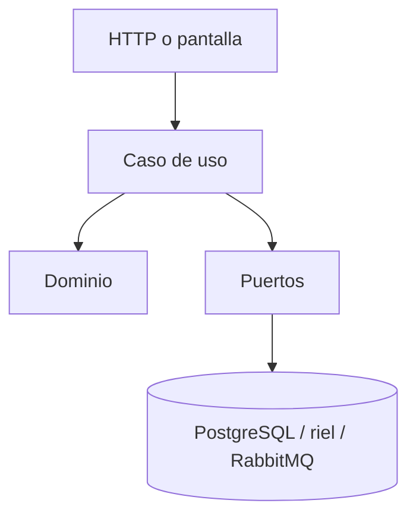

# Technical Design Document: Reversar desde el portal

## 1. Metadata & Traceability
- **Spec:** `reversos-transferencias-web`
- **Requirements Ref:** `requirements.md` (spec: `reversos-transferencias-web`)
- **Target Stack:** Node.js 24.22.0, TypeScript ESM, Fastify, PostgreSQL 18, RabbitMQ, React, Docker Compose

---

## 2. Architecture & System Overview

### 2.1 Architectural Approach
Arquitectura hexagonal. El dominio no conoce HTTP, SQL ni AMQP. Los casos de uso dependen de puertos. Los adaptadores viven en el borde.

### 2.2 Component Diagram / Module Interaction


### 2.5 Decisiones cerradas (heredadas de IDEA)
- RabbitMQ, no Kafka.
- Outbox por sondeo, no Debezium.
- El cliente consulta por sondeo, no por SSE ni WebSockets.
- Reverso solo total.
- El riel es idempotente por referencia y persiste un ledger JSONL.
- El dinero es COP numeric en base de datos y centavos enteros en dominio.

### 2.6 Riesgos y mitigaciones
| Riesgo | Impacto | Mitigación |
|:---|:---|:---|
| El banco no responde | El dinero quedaría en duda | El estado queda UNKNOWN y se concilia con la misma referencia |
| El mensajero no está | Se perdería el rastro | El evento queda en el outbox y se reintenta; la operación de dinero no se revierte |

### 2.7 Directrices del proyecto
sin directrices nuevas

### 2.8 Sujeto a actualización futura
sin actualizaciones futuras declaradas

---

## 3. Data Models & Schema Design

### 3.1 Domain Entities (Core Business Objects)
```typescript
export type TransferStatus = 'PENDING' | 'COMPLETED' | 'FAILED' | 'UNKNOWN' | 'REVERSED';
```

### 3.2 Database Schema & Persistence
Cada servicio usa solo su esquema (`payment_schema` o `audit_schema`) y su rol. No hay claves foráneas entre esquemas. El detalle de tablas de esta capacidad está en el modelo de datos de la idea y en las migraciones de la unidad.

---

## 4. Interfaces, Contracts & API Specifications

### 4.1 Internal Service Interfaces / Ports
Los casos de uso hablan con repositorios y con el puerto del riel o del publicador. La transacción de dinero y el registro del efecto ocurren juntos.

### 4.2 External API / RPC / Event Schemas
- `POST /transfers/{id}/reversals` se dispara desde la pantalla de estado con una `Idempotency-Key` nueva.
- El botón queda deshabilitado mientras la solicitud está en curso.
- El detalle muestra el objeto `reversal` cuando existe.

---

## 5. Implementation Target Structure (File Mapping)
- `apps/web/src/ui/pages/transfer-detail-page.tsx`
- `apps/web/src/ui/use-single-submit.ts`
- `apps/web/src/api/payments-api.ts`

### 5.1 Barrido de términos críticos
sin términos críticos afectados

### 5.2 Tests afectados por un nuevo corte de migración
sin cortes de migración afectados

---

## 6. Traceability Matrix: Requirements to Design
| Requirement ID | Design Section | Implementation File(s) |
|:---|:---|:---|
| REQ-1.1 | §4 | ver §5 |

---

## 7. Error Handling, Edge Cases & Performance Constraints

### 7.1 Error Strategy & Failure Modes
El dominio lanza errores con código. El adaptador HTTP los traduce a `{error:{code,message}}` en español. Un fallo del banco o del mensajero no deshace un débito ya decidido: lo deja retenido, reembolsado o pendiente de conciliación.

### 7.2 Security & Isolation
Toda lectura y mutación de dinero exige el JWT del cliente. La visibilidad filtra por el sujeto. Los secretos no se escriben en los registros. Las operaciones con efecto exigen `Idempotency-Key`.

---

## 8. Testing Strategy & Verification Plan

### 8.1 Unit Tests
Reglas de dominio de esta capacidad: estados, montos y una sola aplicación del efecto.

### 8.2 Integration Tests
Persistencia en el esquema de la unidad y, cuando aplica, publicación o consumo del evento.

### 8.3 Contract / E2E Tests
El flujo observable del cliente: crear o consultar y obtener el estado terminal correcto, sin segundo efecto al reintentar.

---

## 9. Design Review Checklist
- [x] La arquitectura respeta la separación domain/application/infra sin fugas de responsabilidad.
- [x] No hay sobre-ingeniería: la solución es la más simple que resuelve el requerimiento.
- [x] El diseño no anticipa funcionalidad futura; toda actualización futura figura solo en §2.8.
- [x] Todo modelo de datos de §3 está declarado en el modelo de la idea y el negocio de §4 y §7 se apoya en él.
- [x] Todo requerimiento de `requirements.md` tiene un ítem correspondiente en la matriz de trazabilidad.
- [x] La estrategia de seguridad cubre las amenazas relevantes del caso.
- [x] Si el spec cambia la semántica de un término crítico, el barrido de §5 cubre sus menciones. No aplica: sin términos críticos afectados.
- [x] §2.5 recoge las decisiones cerradas de `draft.md` y ninguna se reabrió.
- [x] §5.2 declara explícitamente que no hay cortes de migración afectados.
