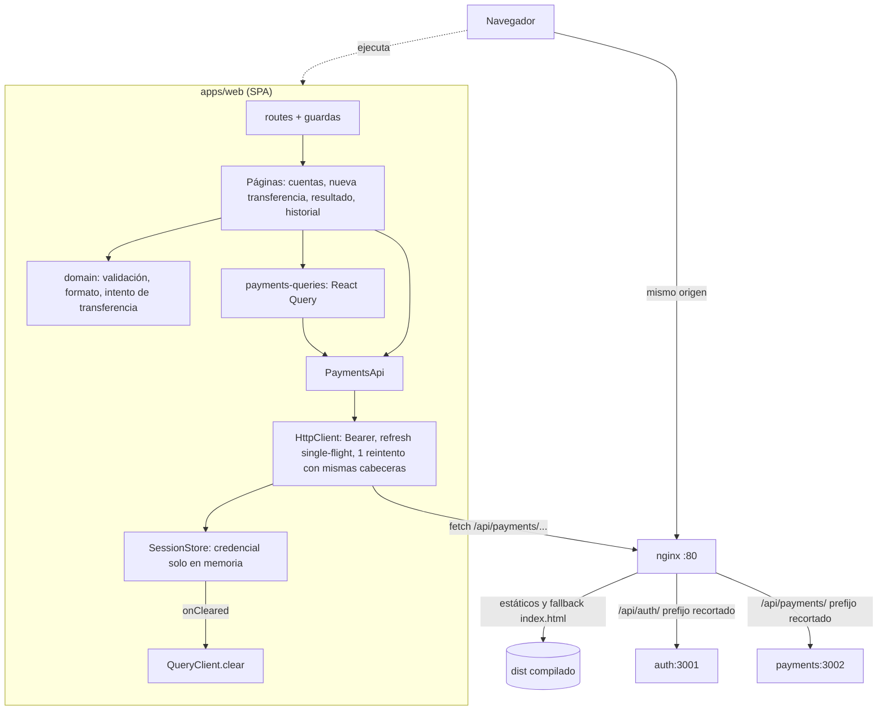

# Technical Design Document: Transferencias internas (aplicación web `apps/web`)

## 1. Metadata & Traceability
- **Spec:** `transferencias-internas-web`
- **Requirements Ref:** `requirements.md` (spec: `transferencias-internas-web`)
- **Contrato del servicio de Pagos (fuente de verdad de endpoints, esquemas, errores, `Idempotency-Key` y paginación):** [design.md de transferencias-internas-payments](../../../services/payments/transferencias-internas-payments/design.md) §4.2 y [domain-model.md de Pagos](../../../services/payments/domain-model.md).
- **Aplicación base que se amplía:** [design.md de autenticacion-usuarios-web](../autenticacion-usuarios-web/design.md) (capas, `HttpClient`, `SessionStore`, nginx, Compose, Dockerfile). Este diseño reutiliza sus módulos y convenciones y solo describe lo que añade o cambia.
- **Modelo de negocio:** `apps/web` no crea `domain-model.md` ni `db-design.dbml`; referencia el de Pagos.
- **Target Stack:** el de la aplicación base, sin dependencias nuevas: Node.js 24.22.0 (`node:24.22.0-alpine`), TypeScript 6.0.3 estricto, React 19.3.1, react-dom 19.3.1, react-router 8.4.0, @tanstack/react-query 5.104.3, Vite 8.3.4, Vitest 5.0.5, Testing Library, jsdom 30.1.3, nginx 1.30.6-alpine. `apps/web/package.json` y `package-lock.json` no cambian.
- **Contenedores:** `node:24.22.0-alpine` (etapas `dev` y `build`), `nginx:1.30.6-alpine`, y para la integración `postgres:18.6-alpine`, la imagen runtime de `services/auth` y la imagen runtime de `services/payments`, orquestados con Docker Compose.
- **Host:** solo Docker y Git; todo comando de instalación, compilación, verificación, prueba y ejecución corre en contenedores.

---

## 2. Architecture & System Overview

### 2.1 Architectural Approach
Se mantienen las capas de la aplicación base (`ui → app → api → session`; `domain` lo usan `api` y `ui`) y se añaden módulos en cada una:

- `src/domain`: formato de dinero y fecha (`format.ts`), validación del formulario (`transfer-validation.ts`), intento de transferencia con su clave de idempotencia (`transfer-attempt.ts`) y presentación de estado y sentido (`transfer-presentation.ts`). Puras, sin React ni `fetch`.
- `src/api`: `PaymentsApi` (cuentas, creación, consulta e historial de transferencias). `HttpClient` se amplía para aceptar otra base de URL y cabeceras adicionales; conserva Bearer, renovación single-flight y un único reintento (el reintento reutiliza las mismas cabeceras, incluida `Idempotency-Key`).
- `src/app`: `AppServices` incorpora `payments`; `payments-queries.ts` concentra las consultas de React Query (cuentas, transferencia, historial).
- `src/ui`: páginas `/transfers/new`, `/transfers/:id`, `/transfers` y ampliación de `/` con la lista de cuentas; componentes `ErrorPanel`, `SelectField`, `TransferNav` y `AccountList`.

Convenciones heredadas: ESM `Bundler`, `import type`, identificadores en inglés y textos de usuario en español, sin `dangerouslySetInnerHTML`, sin `console.*`, sin estilos ni scripts en línea.

La web nunca calcula ni conserva saldos: cada pantalla obtiene del servicio lo que muestra. Las consultas de datos financieros usan `gcTime: 0` (la entrada se descarta al desmontarse la pantalla), por lo que cada apertura de pantalla pide los datos de nuevo y nunca se muestra un saldo previo.

### 2.2 Component Diagram / Module Interaction


### 2.3 Entorno de ejecución en contenedores

El Compose es `apps/web/compose.dev.yaml` (proyecto `fluxone-web-dev`), el de la aplicación base ampliado. Para la integración reutiliza, de `autenticacion-usuarios-auth`, la etapa runtime de `services/auth/Dockerfile` y su script `services/auth/docker/postgres-init/01-auth-role-schema.sh`, y de `transferencias-internas-payments` la etapa runtime de `services/payments/Dockerfile` y su script `services/payments/docker/postgres-init/01-payments-role-schema.sh` (todos existentes cuando se implementa este spec; solo se leen, no se modifican).

**Servicios** (los marcados "nuevo" o "cambia" son lo que este spec añade o modifica en el Compose de la aplicación base)

| Servicio | Imagen / build | Puertos | Volúmenes | Healthcheck | Propósito |
|:---|:---|:---|:---|:---|:---|
| `dev` | build de `apps/web/Dockerfile`, etapa `dev` | ninguno | raíz en `/app`; `node_modules_root`, `node_modules_web`, `npm_cache` | ninguno | Instalación, lint, formato, tipos, pruebas y build. Sin cambios salvo `depends_on` |
| `postgres` (cambia) | `postgres:18.6-alpine` | ninguno publicado | `tmpfs` en `/var/lib/postgresql`; los dos scripts de inicialización montados por archivo (solo lectura) en `/docker-entrypoint-initdb.d` | `pg_isready` cada 5 s | DB efímera con los esquemas de identidad y de pagos |
| `auth` | build de `services/auth/Dockerfile` (runtime) | ninguno publicado | ninguno | `wget` a `/health/ready` | Identidad real. Sin cambios |
| `payments` (nuevo) | build de `services/payments/Dockerfile` (runtime), contexto = raíz | ninguno publicado | ninguno | `wget` a `http://127.0.0.1:3002/health/ready` cada 5 s (`start_period` 10 s, 10 reintentos) | Pagos real detrás de nginx |
| `web` (cambia) | build de `apps/web/Dockerfile` (etapa final nginx) | `8080:80` | ninguno | `wget` a `/` | Servidor web bajo prueba; ahora depende también de `payments` saludable (nginx no arranca si un host upstream no resuelve) |

**Comandos.** Prefijo: `docker compose -f apps/web/compose.dev.yaml`. Los de la aplicación base (instalación, lint, formato, tipos, pruebas `unit`/`component`, build, `check:csp`, imagen y contenido de la imagen) no cambian. Se añaden o cambian:

| Acción | Comando |
|:---|:---|
| Pruebas `integration` (levanta `postgres`, `auth`, `payments`, `web`; excluye `payments-down.test.ts` por su variable) | `docker compose -f apps/web/compose.dev.yaml run --rm dev npm run test:integration -w apps/web` |
| Pagos caído (AC-TIW-46) | `docker compose -f apps/web/compose.dev.yaml up -d --wait web && docker compose -f apps/web/compose.dev.yaml stop payments && docker compose -f apps/web/compose.dev.yaml run --rm --no-deps -e PAYMENTS_STOPPED=1 dev npm run test:integration -w apps/web -- tests/integration/payments-down.test.ts; docker compose -f apps/web/compose.dev.yaml start payments` |
| Evidencia de `X-Request-Id` hacia Pagos (AC-TIW-43; tras la integración) | `docker compose -f apps/web/compose.dev.yaml logs payments \| grep -Eq '"reqId":"[0-9a-f]{32}"'` |
| Levantar todo | `docker compose -f apps/web/compose.dev.yaml up -d --wait web` |
| Limpiar | `docker compose -f apps/web/compose.dev.yaml down -v` |

**Contenido exacto de `apps/web/compose.dev.yaml`** (archivo final completo; respecto de la aplicación base añade `payments`, la variable `PAYMENT_DB_PASSWORD` y los dos montajes por archivo en `postgres`, y la dependencia de `web` y `dev`). Los dos scripts se montan por archivo porque un mismo directorio de inicialización no puede recibir dos carpetas; se ejecutan por orden de nombre y sus `REVOKE` iniciales son idempotentes. Credenciales de desarrollo desechables, sobreescribibles por entorno.

```yaml
name: fluxone-web-dev

services:
  postgres:
    image: postgres:18.6-alpine
    environment:
      POSTGRES_USER: postgres
      POSTGRES_PASSWORD: ${POSTGRES_PASSWORD:-postgres_dev_pw}
      POSTGRES_DB: fluxone
      AUTH_DB_PASSWORD: ${AUTH_DB_PASSWORD:-auth_dev_pw}
      PAYMENT_DB_PASSWORD: ${PAYMENT_DB_PASSWORD:-payment_dev_pw}
    tmpfs:
      - /var/lib/postgresql
    volumes:
      - ../../services/auth/docker/postgres-init/01-auth-role-schema.sh:/docker-entrypoint-initdb.d/01-auth-role-schema.sh:ro
      - ../../services/payments/docker/postgres-init/01-payments-role-schema.sh:/docker-entrypoint-initdb.d/02-payments-role-schema.sh:ro
    healthcheck:
      test: ['CMD-SHELL', 'pg_isready -U $${POSTGRES_USER} -d $${POSTGRES_DB} -h 127.0.0.1 -p 5432']
      interval: 5s
      timeout: 3s
      retries: 5
      start_period: 10s

  auth:
    build:
      context: ../..
      dockerfile: services/auth/Dockerfile
    environment:
      PORT: '3001'
      DATABASE_URL: postgres://auth_svc:${AUTH_DB_PASSWORD:-auth_dev_pw}@postgres:5432/fluxone
      COOKIE_SECRET: ${COOKIE_SECRET:-dev_cookie_secret_0123456789abcdef0123}
      COOKIE_SECURE: 'false'
      DEMO_USERS_PASSWORD: ${DEMO_USERS_PASSWORD:-demo_password_123}
    depends_on:
      postgres:
        condition: service_healthy
    healthcheck:
      test: ['CMD-SHELL', 'wget -q -O /dev/null http://127.0.0.1:3001/health/ready']
      interval: 5s
      timeout: 3s
      retries: 10
      start_period: 10s

  payments:
    build:
      context: ../..
      dockerfile: services/payments/Dockerfile
    environment:
      PORT: '3002'
      DATABASE_URL: postgres://payment_svc:${PAYMENT_DB_PASSWORD:-payment_dev_pw}@postgres:5432/fluxone
      AUTH_JWKS_URL: http://auth:3001/.well-known/jwks.json
    depends_on:
      postgres:
        condition: service_healthy
    healthcheck:
      test: ['CMD-SHELL', 'wget -q -O /dev/null http://127.0.0.1:3002/health/ready']
      interval: 5s
      timeout: 3s
      retries: 10
      start_period: 10s

  web:
    build:
      context: ../..
      dockerfile: apps/web/Dockerfile
    ports:
      - '8080:80'
    depends_on:
      auth:
        condition: service_healthy
      payments:
        condition: service_healthy
    healthcheck:
      test: ['CMD-SHELL', 'wget -q -O /dev/null http://127.0.0.1:80/']
      interval: 5s
      timeout: 3s
      retries: 10
      start_period: 5s

  dev:
    build:
      context: ../..
      dockerfile: apps/web/Dockerfile
      target: dev
    working_dir: /app
    environment:
      WEB_BASE_URL: http://web
      DEMO_USERS_PASSWORD: ${DEMO_USERS_PASSWORD:-demo_password_123}
    volumes:
      - ../..:/app
      - node_modules_root:/app/node_modules
      - node_modules_web:/app/apps/web/node_modules
      - npm_cache:/root/.npm
    depends_on:
      web:
        condition: service_healthy

volumes:
  node_modules_root:
  node_modules_web:
  npm_cache:
```

`apps/web/Dockerfile` no cambia (el `COPY` del `default.conf` ya incluye el nuevo `location`).

### 2.5 Decisiones cerradas (heredadas de IDEA)
- SPA React 19.3.1, react-router 8.4.0, @tanstack/react-query 5.104.3, Vite 8.3.4, TypeScript estricto, nginx 1.30.6-alpine como único origen del navegador (stack y convenciones de la aplicación base).
- nginx reenvía `/api/auth/` y `/api/payments/` con el prefijo recortado; no existen otros upstreams.
- La credencial de acceso vive solo en memoria; el 401 sigue el mecanismo existente (una renovación compartida y un único reintento).
- Dinero en COP como `string` decimal, nunca `float`; la web no conserva ni calcula saldos.
- Cada intención de transferencia lleva su `Idempotency-Key` (UUID v4); se reutiliza al reintentar y se renueva al cambiar los datos o tras un efecto; el botón se bloquea mientras la solicitud está en curso.
- Los datos se obtienen al abrir cada pantalla y tras una transferencia; sin actualización automática ni polling.
- Pruebas con Vitest + Testing Library + jsdom y, en integración, nginx real con identidad y Pagos reales; todo en Docker (constitución).

### 2.6 Riesgos y mitigaciones

| Riesgo | Impacto | Mitigación |
|:---|:---|:---|
| Doble clic o Enter repetido antes de que React publique el estado | Dos solicitudes por intención | `useSingleSubmit` (cerrojo síncrono con `useRef`) y, ante cualquier repetición, la misma `Idempotency-Key` hace que Pagos no duplique el movimiento |
| Reintento tras corte de red con clave nueva | Doble débito | La clave se conserva mientras el cuerpo normalizado no cambie (§4.1 `TransferAttempt`); solo `reset()` o un cuerpo distinto la rotan |
| Reutilizar una clave con otro cuerpo | 422 `IDEMPOTENCY_KEY_PAYLOAD_MISMATCH` | `keyFor` compara el cuerpo normalizado y genera clave nueva si difiere |
| 401 durante la creación | Movimiento duplicado al reintentar | `HttpClient` reintenta una vez con las mismas cabeceras (misma clave) tras la renovación |
| `crypto.randomUUID` solo existe en contextos seguros | Sin clave en acceso por IP en HTTP | La clave se arma con `crypto.getRandomValues` (disponible en contextos no seguros) |
| Saldo previo visible tras transferir | El usuario ve un saldo desactualizado | `gcTime: 0` en consultas financieras e invalidación tras el 201; sin `refetchOnWindowFocus` |
| nginx no arranca si el host `payments` no resuelve | Contenedor web caído | En Compose `web` depende de `payments` saludable; con Pagos detenido en ejecución nginx responde 502 sin caer |
| Datos de un usuario visibles para el siguiente en el mismo navegador | Fuga entre usuarios | `SessionStore.onCleared` → `queryClient.clear()` al cerrar o perder la sesión; `gcTime: 0` |
| Un 502 con HTML se muestra como error técnico | Mensaje confuso | `ApiError` lo convierte en `SERVICE_UNAVAILABLE` (heredado) |
| Pruebas de integración repetidas agotan el límite de 5 inicios de sesión por minuto | 429 en la integración | Dos pruebas inician sesión una sola vez por ejecución (`auth-flow` y `transfer-flow`); si se repite en menos de un minuto, esperar o `down -v` |
| Las pruebas de integración previas asumen un único upstream | Fallos de regresión | `web-server.test.ts` se actualiza en este spec (§5) |
| `services/payments/Dockerfile` o su script de inicialización cambian en otro spec | Falla de integración | Se consumen tal como existen; son artefactos de `transferencias-internas-payments`; no se copian |

### 2.7 Directrices del proyecto
- `Unidad: apps/web`: toda operación monetaria de la interfaz genera una `Idempotency-Key` por intención (UUID v4), la conserva al reintentar y la renueva al cambiar los datos o tras un efecto, y bloquea el envío mientras la solicitud está en curso.
- `Unidad: apps/web`: los datos financieros (cuentas, saldos, transferencias) solo existen en memoria de la página, no se descartan solo por caducidad sino al desmontar la pantalla (`gcTime: 0`) y al cerrar la sesión; la web nunca calcula saldos.

### 2.8 Sujeto a actualización futura
- `transferencias-externas-web` — §4 Interfaces — el formulario de transferencia añade el tipo externo.
- `reversos-transferencias-web` — §4 Interfaces — la pantalla de estado añade la acción reversar.
- `auditoria-transferencias-web` — §4 Interfaces — la pantalla de estado añade la línea de tiempo de auditoría.

---

## 3. Data Models & Schema Design

> `apps/web` no tiene base de datos ni esquema propio: no hay `db-design.dbml`. Los tipos del cliente se derivan del contrato de Pagos ([design.md §3.1 y §4.1](../../../services/payments/transferencias-internas-payments/design.md), [domain-model.md](../../../services/payments/domain-model.md)); un cambio de ese contrato entra primero en esos documentos.

### 3.1 Domain Entities (Core Business Objects)

Se amplía `src/domain/types.ts`:

```typescript
// src/domain/types.ts (se añaden; los existentes no cambian)
export interface Account {
  id: string; // 'ACC-NNN'
  currency: 'COP';
  balance: string; // decimal con 2 decimales, p. ej. '1000000.00'
}

export type TransferStatus = 'COMPLETED' | 'FAILED';
export type FailureReason = 'INSUFFICIENT_FUNDS';

export interface Transfer {
  id: string; // uuid
  type: 'INTERNAL';
  fromAccountId: string;
  toAccountId: string;
  amount: string; // 2 decimales
  currency: 'COP';
  status: TransferStatus;
  failureReason?: FailureReason; // presente solo si status = 'FAILED'
  createdAt: string; // ISO 8601 UTC
  completedAt: string | null; // null si FAILED
}

export interface TransferPage {
  items: Transfer[];
  nextCursor: string | null; // opaco; null = no hay más páginas
}

export interface CreateTransferInput {
  type: 'INTERNAL';
  fromAccountId: string;
  toAccountId: string; // ya sin espacios sobrantes
  amount: string; // string decimal, nunca number
}

export interface TransferFormValues {
  fromAccountId: string;
  toAccountId: string; // tal como se escribió
  amount: string; // tal como se escribió
}

export interface TransferFieldErrors {
  toAccountId?: string;
  amount?: string;
}
```

**Pertenencia y aislamiento.** La web no envía nunca un identificador de usuario ni lo deduce: la pertenencia de cada dato la determina Pagos a partir del `sub` del JWT que viaja en `Authorization: Bearer`. En la web todo estado es memoria de la página (credencial y usuario en `SessionStore`; cuentas, transferencia e historial en la caché de React Query con `gcTime: 0`, vaciada al cerrar la sesión). Pertenencia en Pagos, tabla por tabla, y su efecto en la web:

| Tabla de Pagos | Cómo se determina la pertenencia (la impone Pagos) | Efecto en la web |
|:---|:---|:---|
| `accounts` | `owner_user_id = sub` en listado y como cuenta origen; cuenta inexistente y ajena son indistinguibles (404) | `GET /accounts` devuelve solo las cuentas del usuario; el selector de origen se llena con ellas; el destino puede ser cualquier cuenta del sistema |
| `transfers` | Visible si el usuario es dueño de la cuenta origen o de la destino (unión con `accounts`); sin columna de usuario consultable | La web rotula "Enviada" si `fromAccountId` está entre sus cuentas y "Recibida" en otro caso; una transferencia ajena responde 404 `TRANSFER_NOT_FOUND` idéntico al inexistente |
| `idempotency_keys` | Clave `(user_id = sub, operación, clave)`: independiente por usuario | La web genera claves aleatorias; no comparte ni persiste claves entre usuarios ni sesiones |

**Valores centinela y casos especiales (enumerados).** `nextCursor = null` significa que no hay más páginas (se oculta "Cargar más"); `completedAt = null` y `failureReason` presente solo ocurren en `FAILED`; `failureReason` ausente en `COMPLETED`; el único motivo de fallo es `INSUFFICIENT_FUNDS`. No existe usuario, cuenta, id ni cursor reservado en la aplicación, ni excepciones a la pertenencia: los ids `ACC-001`, `ACC-002` y `ACC-003` son solo datos semilla del servicio.

### 3.2 Database Schema & Persistence
- **Target Database / Storage:** ninguna. Estado en memoria; sin migraciones. No se escribe credencial, clave de idempotencia ni dato de transferencia en `localStorage`, `sessionStorage`, IndexedDB, cookies legibles ni URL (salvo el id de la ruta `/transfers/:id`).

---

## 4. Interfaces, Contracts & API Specifications

### 4.1 Internal Service Interfaces / Ports

**Formato (`src/domain/format.ts`)** — puras, sin `number` para dinero.

```typescript
// '1000000.00' -> '1.000.000,00 COP'; '0.01' -> '0,01 COP'. Parte entera agrupada de 3 en 3 con '.', decimales con ','.
// Opera sobre el string (sin Number/parseFloat); no altera el valor.
export function formatCop(amount: string): string;
// ISO 8601 -> texto legible local con Intl.DateTimeFormat('es-CO', {dateStyle: 'medium', timeStyle: 'short'}).
export function formatDateTime(iso: string): string;
```

**Validación (`src/domain/transfer-validation.ts`)**

```typescript
export const AMOUNT_PATTERN = /^(0|[1-9][0-9]{0,15})(\.[0-9]{1,2})?$/;
export const AMOUNT_ERROR = 'El monto es inválido: debe ser un número mayor que 0, con hasta 2 decimales y un máximo de 9999999999999999.99.';
export const DESTINATION_REQUIRED_ERROR = 'Indica la cuenta destino.';
export const SAME_ACCOUNT_ERROR = 'La cuenta destino debe ser distinta de la cuenta origen.';

// Devuelve {} si no hay errores. Sin trim del monto (se valida y envía tal como se escribió).
export function validateTransfer(values: TransferFormValues): TransferFieldErrors;
// Normaliza a la forma que se envía: toAccountId con trim().
export function toCreateTransferInput(values: TransferFormValues): CreateTransferInput;
```

| Regla (en orden) | Mensaje (campo) |
|:---|:---|
| `amount` no cumple `AMOUNT_PATTERN` o no tiene ningún dígito distinto de `0` (el patrón ya acota el máximo a 9999999999999999.99) | `AMOUNT_ERROR` (`amount`) |
| `toAccountId.trim()` vacío | `DESTINATION_REQUIRED_ERROR` (`toAccountId`) |
| `toAccountId.trim() === fromAccountId` | `SAME_ACCOUNT_ERROR` (`toAccountId`) |

El campo destino lleva `maxLength={64}`; no hay mensaje propio por longitud. Aceptan `100`, `100.5`, `100.50`, `0.01`, `9999999999999999.99`; rechazan `''`, `0`, `0.00`, `-1`, `1.234`, `abc`, `10000000000000000`.

**Intento de transferencia e `Idempotency-Key` (`src/domain/transfer-attempt.ts`)**

```typescript
// UUID v4 (36 caracteres ASCII imprimibles) generado con crypto.getRandomValues.
export function newIdempotencyKey(): string;

export interface TransferAttempt {
  // Devuelve la clave vigente. Si no hay clave, o el cuerpo normalizado difiere del de la última llamada
  // (fromAccountId, toAccountId o amount), genera una nueva. Con el mismo cuerpo devuelve la misma clave.
  keyFor(input: CreateTransferInput): string;
  // Descarta la clave y el cuerpo recordados: la siguiente llamada a keyFor genera una clave nueva.
  reset(): void;
}

export function createTransferAttempt(newKey?: () => string): TransferAttempt; // newKey por defecto: newIdempotencyKey
```

**Estrategia de `Idempotency-Key`.**

| Momento | Clave |
|:---|:---|
| Primer envío de un formulario (montaje de `/transfers/new`) | `keyFor` genera una clave nueva |
| Reintento sin cambiar origen, destino ni monto tras fallo de red, 5xx, respuesta sin formato o 409 `IDEMPOTENCY_KEY_IN_PROGRESS` | misma clave y mismo cuerpo |
| Reenvío tras 401 con renovación exitosa | misma clave (la reintenta `HttpClient` con las mismas cabeceras) |
| El usuario modifica origen, destino o monto | clave nueva en el siguiente envío (`keyFor` detecta el cuerpo distinto) |
| 201 recibido (COMPLETED, FAILED o repetición con `Idempotent-Replayed`) | `reset()`; además la página se desmonta al navegar y una nueva transferencia crea un intento nuevo |
| 400 `IDEMPOTENCY_KEY_REQUIRED` o 422 `IDEMPOTENCY_KEY_PAYLOAD_MISMATCH` | `reset()` (el reenvío usa clave nueva) |
| Validación local fallida | no se consume clave (no hay solicitud) |
| Otros 4xx (`INVALID_AMOUNT`, `VALIDATION_ERROR`, `ACCOUNT_NOT_FOUND`, `DESTINATION_NOT_FOUND`, `SAME_ACCOUNT`) | se conserva; si el usuario corrige, el cuerpo cambia y la clave rota; si reenvía idéntico, Pagos repite el mismo rechazo (no se almacena) |

La clave vive en un `TransferAttempt` creado una vez por montaje de la página (`useRef`/`useState` perezoso); nunca en almacenamiento del navegador ni en la URL.

**Presentación (`src/domain/transfer-presentation.ts`)**

```typescript
// 'COMPLETED' -> 'Completada'; 'FAILED' (INSUFFICIENT_FUNDS) -> 'No realizada: fondos insuficientes'. Siempre texto.
export function transferStatusLabel(transfer: Transfer): string;
// 'Enviada' si fromAccountId está en ownAccountIds (incluye origen y destino propios); 'Recibida' en otro caso.
export function transferDirectionLabel(transfer: Transfer, ownAccountIds: ReadonlySet<string>): 'Enviada' | 'Recibida';
```

**Cliente HTTP (`src/api/http-client.ts`, se modifica).** Se conservan Bearer, single-flight, un reintento y mapeo de errores de la aplicación base. Cambios:

```typescript
export interface RequestOptions {
  method: 'GET' | 'POST';
  path: string;
  body?: unknown;
  authenticated: boolean;
  base?: string; // por defecto AUTH_API_BASE; URL final = (base ?? AUTH_API_BASE) + path
  headers?: Record<string, string>; // cabeceras adicionales (p. ej. Idempotency-Key); no pueden sobreescribir Authorization
}
```

`send` añade `options.headers` a las cabeceras `Accept` / `Content-Type`; `Authorization` se fija después. El reintento tras la renovación vuelve a llamar a `send` con las mismas `options`, de modo que `Idempotency-Key` y cuerpo son idénticos. La web no lee `Idempotent-Replayed`: una respuesta 201 repetida es indistinguible de la original y se trata igual.

**API de Pagos (`src/api/payments-api.ts`)**

```typescript
export const PAYMENTS_API_BASE = '/api/payments';

export interface PaymentsApi {
  listAccounts(): Promise<Account[]>;
  createTransfer(input: CreateTransferInput, idempotencyKey: string): Promise<Transfer>;
  getTransfer(id: string): Promise<Transfer>;
  listTransfers(cursor: string | null): Promise<TransferPage>;
}

export function createPaymentsApi(client: HttpClient): PaymentsApi;
```

| Operación | Entrada | Solicitud (`authenticated: true`, `base: PAYMENTS_API_BASE`) | Salida | Errores |
|:---|:---|:---|:---|:---|
| `listAccounts` | — | `GET /accounts` | `Account[]` (puede ser `[]`) | `ApiError` |
| `createTransfer` | `CreateTransferInput`, clave | `POST /transfers`, cuerpo `{type, fromAccountId, toAccountId, amount}` (monto string), cabecera `Idempotency-Key: <clave>` | `Transfer` (201, COMPLETED o FAILED) | `ApiError` |
| `getTransfer` | `id` | `GET /transfers/${encodeURIComponent(id)}` (sin `Idempotency-Key`) | `Transfer` | `ApiError` |
| `listTransfers` | `cursor` o `null` | `GET /transfers` (primera página; límite por defecto 20, no se envía `limit`) o `GET /transfers?cursor=<URLSearchParams>` | `TransferPage` | `ApiError` |

**Consultas (`src/app/payments-queries.ts`).** Todas con `gcTime: 0`; el `QueryClient` de `createAppServices` pasa a `defaultOptions: {queries: {retry: false, refetchOnWindowFocus: false, refetchOnReconnect: false}}`.

```typescript
export const ACCOUNTS_KEY = ['accounts'] as const;
export const TRANSFERS_KEY = ['transfers'] as const; // historial (infinito)
export function transferKey(id: string): readonly ['transfer', string];

export function useAccounts(): UseQueryResult<Account[], Error>; // queryFn: payments.listAccounts()
export function useTransfer(id: string): UseQueryResult<Transfer, Error>; // queryFn: payments.getTransfer(id)
// useInfiniteQuery: initialPageParam null; queryFn ({pageParam}) => payments.listTransfers(pageParam);
// getNextPageParam: (last) => last.nextCursor ?? undefined
export function useTransferHistory(): UseInfiniteQueryResult<InfiniteData<TransferPage, string | null>, Error>;
// Marca como desactualizados cuentas e historial (refetchType: 'none': no refetch mientras la página se desmonta).
export function markMoneyDataStale(queryClient: QueryClient): void;
```

**Composición (`src/app/create-app-services.ts`, se modifica).** `AppServices` añade `payments: PaymentsApi`; `createAppServices` crea `const client = createHttpClient(session)` y construye `createAuthApi(client, session)` y `createPaymentsApi(client)` con el mismo cliente (la renovación single-flight es una sola para ambos servicios).

**Componentes reutilizables nuevos**

| Componente (archivo) | Contrato |
|:---|:---|
| `ErrorPanel` (`ui/components/error-panel.tsx`) | Props `{message: string, onRetry?: () => void}`; `<div role="alert"><p>{message}</p>` y, si hay `onRetry`, `<button type="button">Reintentar</button>` |
| `SelectField` (`ui/components/select-field.tsx`) | Props `{id, label, value, onChange, options: {value: string, label: string}[]}`; `<label htmlFor>` + `<select>` controlado |
| `TransferNav` (`ui/components/transfer-nav.tsx`) | Props `{hide?: 'accounts' \| 'new' \| 'history', canTransfer?: boolean}` (por defecto `true`); `<nav aria-label="Navegación">` con enlaces `Cuentas` (`/`), `Nueva transferencia` (`/transfers/new`) e `Historial` (`/transfers`); con `canTransfer={false}` el enlace a nueva transferencia se sustituye por `<p>No puedes transferir sin cuentas.</p>` |
| `AccountList` (`ui/components/account-list.tsx`) | Props `{accounts: Account[]}`; `<ul>` con un `<li>` por cuenta: identificador en `<strong>`, moneda y saldo con `formatCop` |

`LoadingScreen` (`<p role="status">Cargando…</p>`) y `useSingleSubmit` se reutilizan sin cambios.

### 4.2 External API / RPC / Event Schemas

El cliente consume el servicio de Pagos siempre en el mismo origen bajo `/api/payments` (nginx recorta el prefijo: `/api/payments/transfers` llega a Pagos como `/transfers`). Contrato completo en [design.md de transferencias-internas-payments §4.2](../../../services/payments/transferencias-internas-payments/design.md); aquí se declara lo que la aplicación envía, recibe y cómo reacciona. Todas las solicitudes llevan `Authorization: Bearer <credencial>`; un 401 aplica la renovación single-flight y un único reintento (§4.1); si la sesión no se puede renovar se cierra y la guarda lleva a `/login` sin mostrar mensaje.

**Mapeo de errores a mensajes en español.** Se muestra el `message` del servicio tal como llega (sin duplicar ni traducir); los dos locales son los de la aplicación base.

| `code` | Status | Mensaje mostrado | Dónde y qué hace la UI |
|:---|:---|:---|:---|
| `INVALID_AMOUNT` | 400 | `El monto es inválido: debe ser un texto decimal mayor que 0, con hasta 2 decimales y un máximo de 9999999999999999.99.` | Aviso del formulario (`role="alert"`); conserva lo escrito |
| `VALIDATION_ERROR` | 400 | `Solicitud inválida: <detalle>` | Aviso del formulario; en el historial, `ErrorPanel` con "Reintentar" |
| `IDEMPOTENCY_KEY_REQUIRED` | 400 | `El encabezado Idempotency-Key es obligatorio: de 1 a 255 caracteres ASCII imprimibles.` | Aviso del formulario; `reset()` de la clave |
| `IDEMPOTENCY_KEY_PAYLOAD_MISMATCH` | 422 | `La clave de idempotencia ya se usó con una solicitud distinta.` | Aviso del formulario; `reset()` de la clave |
| `ACCOUNT_NOT_FOUND` | 404 | `Cuenta no encontrada.` | Aviso del formulario y refetch de cuentas (si el origen elegido ya no está, se selecciona la primera cuenta) |
| `DESTINATION_NOT_FOUND` | 404 | `Cuenta destino no encontrada.` | Junto al campo "Cuenta destino" (`aria-describedby`); conserva lo escrito; se limpia al editar el destino |
| `SAME_ACCOUNT` | 422 | `La cuenta origen y la cuenta destino deben ser distintas.` | Junto al campo "Cuenta destino" |
| `IDEMPOTENCY_KEY_IN_PROGRESS` | 409 | `Hay otra solicitud en curso con la misma clave de idempotencia. Intenta de nuevo.` | Aviso del formulario; botón habilitado; misma clave |
| `TRANSFER_NOT_FOUND` | 404 | `Transferencia no encontrada.` | En `/transfers/:id`, con enlace a "Historial"; sin "Reintentar" |
| `NOT_FOUND` | 404 | `Recurso no encontrado.` | `ErrorPanel` (no ocurre con rutas correctas) |
| `UNAUTHORIZED` | 401 | `Token de acceso ausente o inválido.` | No se muestra: renovación y reintento; si no se puede renovar, sesión cerrada |
| `INTERNAL_ERROR` | 500 | `Error interno del servidor.` | Aviso del formulario más el aviso de incertidumbre (abajo) |
| `NETWORK_ERROR` (local) | — | `No se pudo conectar con el servidor. Intenta de nuevo.` | Ídem; en lecturas, `ErrorPanel` con "Reintentar" |
| `SERVICE_UNAVAILABLE` (local) | cualquiera | `El servicio no está disponible. Intenta de nuevo más tarde.` | Ídem (cubre el 502 de nginx con Pagos caído) |

**Aviso de incertidumbre.** Cuando la creación falla con `NETWORK_ERROR`, `SERVICE_UNAVAILABLE` o status >= 500, además del mensaje se muestra: `No pudimos confirmar si la transferencia se realizó. Si reintentas no se duplicará; también puedes revisar tu historial.` (con enlace a `/transfers`).

#### `GET /api/payments/accounts`
- **Request:** sin cuerpo ni query.
- **Response 200:** `[{"id":"ACC-001","currency":"COP","balance":"1000000.00"}]`; `[]` si el usuario no tiene cuentas.
- **Errores:** los del mapeo; en `/` y `/transfers/new` el fallo muestra `ErrorPanel` con "Reintentar" (`refetch`).

#### `POST /api/payments/transfers`
- **Request:** cabeceras `Authorization: Bearer <credencial>`, `Content-Type: application/json`, `Idempotency-Key: <UUID v4>`; cuerpo `{"type":"INTERNAL","fromAccountId":"ACC-001","toAccountId":"ACC-002","amount":"150000.50"}`.
- **Response 201:** `Transfer` (COMPLETED, o FAILED con `failureReason: "INSUFFICIENT_FUNDS"` y `completedAt: null`); también 201 con `Idempotent-Replayed: true` en una repetición. La UI invoca `attempt.reset()`, `markMoneyDataStale(queryClient)` y navega a `/transfers/{id}`.
- **Errores:** los del mapeo. Un 401 sin renovación posible cierra la sesión (no se muestra el formulario).

#### `GET /api/payments/transfers/{id}`
- **Request:** sin `Idempotency-Key`.
- **Response 200:** `Transfer`.
- **Errores:** 404 `TRANSFER_NOT_FOUND` (inexistente, id inválido o ajena; idéntico en todos los casos); los demás muestran `ErrorPanel` con "Reintentar".

#### `GET /api/payments/transfers`
- **Request:** sin `limit` (por defecto 20); páginas siguientes con `?cursor=<cursor opaco recibido en nextCursor>` (codificado con `URLSearchParams`).
- **Response 200:** `{"items":[Transfer...],"nextCursor":"<opaco>"|null}` ordenado por Pagos de la más reciente a la más antigua; la web conserva ese orden.
- **Errores:** primera página o página siguiente fallida → `ErrorPanel` con "Reintentar" (reintenta la página que falló) y las páginas ya cargadas se conservan.

**Actualización de datos y polling.** No hay polling ni actualización en tiempo real: todo estado de una transferencia recibido de Pagos es final (COMPLETED o FAILED), de modo que no hay nada que esperar. Los datos se piden al abrir cada pantalla, tras una transferencia (consultas con `gcTime: 0` e invalidación) y al pulsar "Reintentar" o "Cargar más". Sin intervalos, sin `refetchInterval`, sin límites de reintento automáticos (`retry: false`).

### 4.3 Router, pantallas y formularios

**Rutas (`src/routes.tsx`, `appRoutes`).** Se añaden a las existentes (`/login`, `/register`, `*` → `/` no cambian):

| Ruta | Elemento | Regla |
|:---|:---|:---|
| `/` | `<RequireSession><HomePage /></RequireSession>` | Se amplía con la lista de cuentas (REQ-1.1) |
| `/transfers/new` | `<RequireSession><NewTransferPage /></RequireSession>` | Protegida; la ruta estática prevalece sobre `/transfers/:id` |
| `/transfers/:id` | `<RequireSession><TransferDetailPage /></RequireSession>` | Protegida |
| `/transfers` | `<RequireSession><TransfersPage /></RequireSession>` | Protegida |

**Pantallas y textos** (los textos son contrato de las pruebas). Cada pantalla tiene un único `<h1>`.

| Pantalla | Contenido |
|:---|:---|
| `HomePage` (se amplía) | Conserva `<h1>FluxOne Payment</h1>`, la consulta del perfil (`Sesión iniciada como <strong>{email}</strong>`) y el botón `Cerrar sesión`. Añade `<section>` con `<h2>Mis cuentas</h2>`: cargando → `LoadingScreen`; error → `ErrorPanel` con "Reintentar"; lista vacía → `<p>No tienes cuentas.</p>` y `TransferNav` con `canTransfer={false}`; con cuentas → `AccountList` y `TransferNav` (enlaces `Nueva transferencia` e `Historial`, `hide="accounts"`) |
| `NewTransferPage` | `<h1>Nueva transferencia</h1>`. Cuentas cargando → `LoadingScreen`; error → `ErrorPanel` con "Reintentar" y sin formulario; sin cuentas → `<p>No tienes cuentas.</p>` con `TransferNav` (`canTransfer={false}`, `hide="new"`) y sin formulario. Con cuentas: `<form noValidate>` con `SelectField` `Cuenta origen` (opciones `{id} — {saldo formatCop}`, por defecto la primera), `FormField` `Cuenta destino` (`type="text"`, `autoComplete="off"`, `maxLength={64}`), `FormField` `Monto (COP)` (`type="text"`, `autoComplete="off"`, `inputMode="decimal"`), aviso de formulario en `<p role="alert">`, aviso de incertidumbre en `<p role="status">` con enlace a `/transfers`, y botón `Transferir` (`Procesando…` y `disabled` mientras `pending`) |
| `TransferDetailPage` | `<h1>Resultado de la transferencia</h1>`. Cargando → `LoadingScreen` (sin estado de resultado); 404 `TRANSFER_NOT_FOUND` → `<p role="alert">` con el mensaje y enlace `Historial`; otro error → `ErrorPanel` con "Reintentar"; éxito → `<dl>` con identificador, `Cuenta origen`, `Cuenta destino`, `Monto` (`formatCop`), `Fecha` (`<time dateTime={createdAt}>` con `formatDateTime`) y `Estado` (`transferStatusLabel`, siempre con texto). `TransferNav` completo en todos los casos |
| `TransfersPage` | `<h1>Historial de transferencias</h1>`. Usa `useTransferHistory()` y `useAccounts()` (los ids propios para rotular); cargando la primera página o las cuentas → `LoadingScreen`; error de primera página o de cuentas → `ErrorPanel` con "Reintentar"; sin elementos → `<p>Aún no tienes transferencias.</p>` y, si hay cuentas, enlace `Nueva transferencia`; con elementos → `<ul>` en el orden recibido, cada `<li>` con `<time>`, `Enviada`/`Recibida` (`transferDirectionLabel`), `{origen} → {destino}`, monto, estado y enlace `Ver detalle` a `/transfers/{id}`; si `hasNextPage` → botón `Cargar más` (`disabled` mientras `isFetchingNextPage`); error de página siguiente → `ErrorPanel` con "Reintentar" (llama `fetchNextPage`) bajo la lista ya cargada. `TransferNav` con `hide="history"` |

**Envío del formulario (`NewTransferPage`).** Estado local: `fromAccountId`, `toAccountId`, `amount`, `fieldErrors`, `formError`, `uncertain` (booleano). `attempt = useRef(createTransferAttempt())`; `useSingleSubmit()`. Origen efectivo: el seleccionado si sigue en la lista de cuentas; si no, la primera.
1. `preventDefault`; `validateTransfer(values)`; si hay errores → se muestran junto a cada campo, no se envía nada ni se consume clave, y se conserva lo escrito.
2. Limpia `fieldErrors`, `formError` y `uncertain`; `run(async () => { ... })` (REQ-3.2: el cerrojo síncrono hace que doble clic o Enter repetido envíe una sola solicitud).
3. `input = toCreateTransferInput(values)`; `key = attempt.keyFor(input)`; `transfer = await payments.createTransfer(input, key)`.
4. Éxito: `attempt.reset()`, `markMoneyDataStale(queryClient)`, `navigate('/transfers/' + transfer.id)`.
5. `ApiError`: si `status === 401` no muestra nada (la sesión ya se cerró y la guarda redirige); `ACCOUNT_NOT_FOUND` → `formError` y `refetch` de cuentas; `DESTINATION_NOT_FOUND` y `SAME_ACCOUNT` → `fieldErrors.toAccountId` con el mensaje; `IDEMPOTENCY_KEY_REQUIRED` y `IDEMPOTENCY_KEY_PAYLOAD_MISMATCH` → `formError` y `attempt.reset()`; cualquier otro → `formError` con `error.message`, y `uncertain = true` si `code` es `NETWORK_ERROR` o `SERVICE_UNAVAILABLE` o `status >= 500`.
6. Editar el destino limpia `fieldErrors.toAccountId`; cualquier edición conserva el resto de lo escrito. El botón se rehabilita al terminar.

**Accesibilidad (REQ-8).** Cada campo con `<label>`; los campos con error llevan `aria-invalid` y `aria-describedby` hacia su `<p role="alert" id="{id}-error">` (comportamiento de `FormField`); estados de carga con `role="status"`; errores con `role="alert"`; estado de transferencia siempre en texto; listas semánticas; formulario operable solo con teclado (campos nativos y botón `type="submit"`).

### 4.4 Servidor web (nginx)

Contrato de `apps/web/nginx/default.conf` (contenido exacto en §5), que amplía el de la aplicación base:
- `/api/payments/<ruta>` → `http://payments:3002/<ruta>` (prefijo recortado: `location` y `proxy_pass` terminan en `/`); conserva método, cuerpo, `Authorization`, `Idempotency-Key`, código de estado y la cabecera de respuesta `Idempotent-Replayed` (nginx reenvía cabeceras de solicitud y respuesta por defecto); añade `Host`, `X-Real-IP` y `X-Request-Id` (`$request_id`).
- `/api/auth/` y el servido de la SPA con fallback a `index.html` no cambian.
- Upstreams: exactamente `auth` y `payments`. Ningún `location` declara `add_header` (las cuatro cabeceras de seguridad siguen declaradas a nivel `server` con `always`, de modo que están en toda respuesta, incluidos el 502 y las reenviadas).
- Pagos sin respuesta → 502 con cuerpo HTML y cabeceras de seguridad; la aplicación y `/api/auth/` siguen operando.

---

## 5. Implementation Target Structure (File Mapping)

Rutas relativas a la raíz del repositorio. Esta lista es exacta (ni un archivo más ni uno menos); `tasks.md` toca exactamente estos archivos.

**Footprint y overlap.** El footprint de código y configuración está solo en `apps/web/` (31 archivos nuevos y 10 modificados) más 2 documentos del spec previo `autenticacion-usuarios-web` que este spec actualiza por ser su disparador declarado (`design.md` y `summary.md`). No se toca ningún archivo de `services/payments/` ni de `services/auth/` (solo se leen, p. ej. `services/payments/Dockerfile` y `services/payments/docker/postgres-init/01-payments-role-schema.sh` desde el Compose), por lo que no hay overlap con `transferencias-externas-payments` (mismo Grupo C, unidad `services/payments`, creado en paralelo). No se modifica `package-lock.json` (no hay dependencias nuevas) ni ningún otro archivo de la raíz, así que ningún archivo compartido se solapa con otros specs; `apps/web/compose.dev.yaml` y `apps/web/nginx/default.conf` son propios de la unidad `apps/web` (los modifican solo specs de esta unidad, no concurrentes con este).

**Estructura (solo lo nuevo o modificado):**
```
apps/web/
├── compose.dev.yaml (M), nginx/default.conf (M)
├── src/
│   ├── routes.tsx (M), styles.css (M)
│   ├── domain/ (types M; format, transfer-validation, transfer-attempt, transfer-presentation)
│   ├── api/ (http-client M; payments-api)
│   ├── app/ (create-app-services M; payments-queries)
│   └── ui/ (components/: error-panel, select-field, transfer-nav, account-list; pages/: home-page M, new-transfer-page, transfer-detail-page, transfers-page)
└── tests/ (support/, unit/, component/, integration/)
```

| Archivo | Acción | Propósito |
|:---|:---|:---|
| `apps/web/nginx/default.conf` | Modificar | Añade `location /api/payments/` con `proxy_pass http://payments:3002/` (contenido exacto abajo) |
| `apps/web/compose.dev.yaml` | Modificar | Añade `payments`, `PAYMENT_DB_PASSWORD`, montajes por archivo de ambos scripts de inicialización, dependencia de `web` en `payments` y `DEMO_USERS_PASSWORD` en `dev` (contenido exacto en §2.3) |
| `apps/web/src/domain/types.ts` | Modificar | Añade `Account`, `TransferStatus`, `FailureReason`, `Transfer`, `TransferPage`, `CreateTransferInput`, `TransferFormValues`, `TransferFieldErrors` |
| `apps/web/src/domain/format.ts` | Crear | `formatCop`, `formatDateTime` |
| `apps/web/src/domain/transfer-validation.ts` | Crear | `validateTransfer`, `toCreateTransferInput` y mensajes |
| `apps/web/src/domain/transfer-attempt.ts` | Crear | `newIdempotencyKey`, `createTransferAttempt` |
| `apps/web/src/domain/transfer-presentation.ts` | Crear | `transferStatusLabel`, `transferDirectionLabel` |
| `apps/web/src/api/http-client.ts` | Modificar | `RequestOptions` con `base` y `headers`; el reintento reutiliza las mismas opciones |
| `apps/web/src/api/payments-api.ts` | Crear | `PaymentsApi` y `PAYMENTS_API_BASE` |
| `apps/web/src/app/create-app-services.ts` | Modificar | `AppServices.payments`; cliente compartido; `QueryClient` sin refetch automático |
| `apps/web/src/app/payments-queries.ts` | Crear | Claves, `useAccounts`, `useTransfer`, `useTransferHistory`, `markMoneyDataStale` |
| `apps/web/src/ui/components/error-panel.tsx` | Crear | Mensaje de error con "Reintentar" |
| `apps/web/src/ui/components/select-field.tsx` | Crear | Selector con etiqueta |
| `apps/web/src/ui/components/transfer-nav.tsx` | Crear | Enlaces de navegación entre pantallas |
| `apps/web/src/ui/components/account-list.tsx` | Crear | Lista semántica de cuentas con saldo |
| `apps/web/src/ui/pages/home-page.tsx` | Modificar | Añade la sección de cuentas y la navegación |
| `apps/web/src/ui/pages/new-transfer-page.tsx` | Crear | Formulario de transferencia |
| `apps/web/src/ui/pages/transfer-detail-page.tsx` | Crear | Resultado de una transferencia |
| `apps/web/src/ui/pages/transfers-page.tsx` | Crear | Historial paginado |
| `apps/web/src/routes.tsx` | Modificar | Añade `/transfers/new`, `/transfers/:id`, `/transfers` |
| `apps/web/src/styles.css` | Modificar | Estilos por clase de las pantallas nuevas (sin recursos externos) |
| `apps/web/tests/support/fake-payments-server.ts` | Crear | Doble de `fetch` de Pagos a nivel de red (mismo patrón que `fake-auth-server.ts`: registra llamadas, respuestas por ruta y diferidas; por defecto `GET /accounts` responde `[]`) |
| `apps/web/tests/support/render-app.tsx` | Modificar | Acepta el doble de Pagos y enruta `fetch` por prefijo (`/api/auth/` al de identidad, `/api/payments/` al de Pagos) |
| `apps/web/tests/unit/format.test.ts` | Crear | Formato de dinero y fecha (AC-TIW-01, AC-TIW-25) |
| `apps/web/tests/unit/transfer-validation.test.ts` | Crear | Validación de monto, destino y misma cuenta (AC-TIW-07, 08, 09) |
| `apps/web/tests/unit/transfer-attempt.test.ts` | Crear | Clave por intento, reutilización y rotación (AC-TIW-13, 14) |
| `apps/web/tests/unit/transfer-presentation.test.ts` | Crear | Estado y sentido, incluido origen y destino propios (AC-TIW-25, 30) |
| `apps/web/tests/unit/payments-api.test.ts` | Crear | Solicitudes, Bearer, clave, renovación y mensajes (AC-TIW-11, 13, 24, 36, 38, 39) |
| `apps/web/tests/component/accounts.test.tsx` | Crear | Pantalla `/` de cuentas (AC-TIW-01, 02, 03, 04) |
| `apps/web/tests/component/transfer-routing.test.tsx` | Crear | Rutas protegidas y ruta desconocida (AC-TIW-05) |
| `apps/web/tests/component/new-transfer-form.test.tsx` | Crear | Formulario y validación previa (AC-TIW-06, 07, 08, 09, 10) |
| `apps/web/tests/component/new-transfer-submit.test.tsx` | Crear | Envío, idempotencia y errores (AC-TIW-11 a 24) |
| `apps/web/tests/component/transfer-detail-page.test.tsx` | Crear | Resultado de una transferencia (AC-TIW-25 a 29) |
| `apps/web/tests/component/transfers-history-page.test.tsx` | Crear | Historial y "Cargar más" (AC-TIW-30 a 35) |
| `apps/web/tests/component/session-isolation.test.tsx` | Crear | Caché vaciada y sin almacenamiento persistente (AC-TIW-37, 38) |
| `apps/web/tests/component/payments-errors.test.tsx` | Crear | Mensajes de error en las pantallas (AC-TIW-39) |
| `apps/web/tests/component/accessibility.test.tsx` | Crear | Etiquetas, roles, `<h1>` y teclado (AC-TIW-40, 41, 42) |
| `apps/web/tests/integration/web-server.test.ts` | Modificar | Actualiza, por este spec, las aserciones de la aplicación base: dos `proxy_pass` (`http://auth:3001/` y `http://payments:3002/`) con sus `proxy_set_header`, y el servidor operando con `auth`, `payments` y `postgres` (AC-WEB-27 a 30 siguen cubiertos; AC-TIW-44, 47) |
| `apps/web/tests/integration/payments-proxy.test.ts` | Crear | Proxy de Pagos con prefijo recortado, `/login` y `/api/auth/health/live` sin cambios, cabeceras de seguridad en `/`, ruta inexistente y `/api/payments/health/live` (AC-TIW-43, 44, 45) |
| `apps/web/tests/integration/payments-down.test.ts` | Crear | Con Pagos detenido (`PAYMENTS_STOPPED=1`): SPA e identidad operativas y 502 en `/api/payments/` (AC-TIW-46); sin esa variable se omite |
| `apps/web/tests/integration/transfer-flow.test.ts` | Crear | Flujo contra nginx: login de alice → cuentas → transferencia con `Idempotency-Key` → repetición con `Idempotent-Replayed: true` → FAILED por fondos insuficientes → detalle → historial → logout (AC-TIW-43, 49) |
| `.makia/docs/specs/apps/web/autenticacion-usuarios-web/design.md` | Modificar | Actualización incremental del spec previo (disparador: este spec): §2.3 (Compose y comandos), §2.8 (retira la entrada de este spec), §4.4 y §5 (`nginx/default.conf` con dos upstreams, `compose.dev.yaml`), §8.2 (`web-server.test.ts`) y el ítem del §9 sobre el único upstream |
| `.makia/docs/specs/apps/web/autenticacion-usuarios-web/summary.md` | Modificar | Registra la actualización en "Actualizaciones incrementales recibidas" |

**Contenido exacto de `apps/web/nginx/default.conf`** (se añade el segundo `location`; el resto no cambia; los `location` no declaran `add_header`):
```nginx
server {
  listen 80;
  server_name _;
  root /usr/share/nginx/html;
  index index.html;

  add_header X-Content-Type-Options "nosniff" always;
  add_header X-Frame-Options "DENY" always;
  add_header Referrer-Policy "no-referrer" always;
  add_header Content-Security-Policy "default-src 'self'" always;

  location / {
    try_files $uri $uri/ /index.html;
  }

  location /api/auth/ {
    proxy_pass http://auth:3001/;
    proxy_set_header Host $host;
    proxy_set_header X-Real-IP $remote_addr;
    proxy_set_header X-Request-Id $request_id;
  }

  location /api/payments/ {
    proxy_pass http://payments:3002/;
    proxy_set_header Host $host;
    proxy_set_header X-Real-IP $remote_addr;
    proxy_set_header X-Request-Id $request_id;
  }
}
```

### Validación de palabras reservadas (TypeScript/JavaScript)
Segmentos de ruta de módulo revisados contra la lista de TypeScript/JavaScript: `apps`, `web`, `src`, `domain`, `api`, `app`, `ui`, `components`, `pages`, `tests`, `unit`, `component`, `integration`, `support`, `nginx`, y los nombres de archivo nuevos (`format`, `transfer-validation`, `transfer-attempt`, `transfer-presentation`, `payments-api`, `payments-queries`, `error-panel`, `select-field`, `transfer-nav`, `account-list`, `new-transfer-page`, `transfer-detail-page`, `transfers-page`, `fake-payments-server`, `accounts`, `transfer-routing`, `new-transfer-form`, `new-transfer-submit`, `transfer-detail-page`, `transfers-history-page`, `session-isolation`, `payments-errors`, `accessibility`, `payments-proxy`, `payments-down`, `transfer-flow`). Ninguno colisiona con una palabra reservada (ningún segmento es `new`, `default`, `import`, `export`, `static`, `package`, `public` ni `interface`; la palabra `new` solo aparece como parte de nombres con guiones y como segmento de la URL `/transfers/new`, que no es una ruta de módulo). `nginx/default.conf` lleva el nombre impuesto por nginx y es configuración, no módulo importable. No hubo renombres.

Los archivos modificados provienen de la aplicación base, que no tiene directivas de supresión (`eslint-disable`, `@ts-ignore`); este spec no añade ninguna.

### 5.1 Barrido de términos críticos
sin términos críticos afectados

### 5.2 Tests afectados por un nuevo corte de migración
sin cortes de migración afectados

---

## 6. Traceability Matrix: Requirements to Design

Rutas relativas a `apps/web/` salvo indicación.

| Requirement ID | Design Section | Implementation File(s) |
|:---|:---|:---|
| REQ-1.1 | §4.1 `PaymentsApi`, `AccountList`, `TransferNav`; §4.3 `HomePage` | `src/api/payments-api.ts`, `src/app/payments-queries.ts`, `src/ui/pages/home-page.tsx`, `src/ui/components/account-list.tsx`, `src/ui/components/transfer-nav.tsx`, `src/domain/format.ts` |
| REQ-1.2 | §4.3 `HomePage` | `src/ui/pages/home-page.tsx`, `src/ui/components/loading-screen.tsx` (existente) |
| REQ-1.3 | §4.3 `HomePage`, `TransferNav` | `src/ui/pages/home-page.tsx`, `src/ui/components/transfer-nav.tsx` |
| REQ-1.4 | §4.2 `GET /accounts`; §4.3 `HomePage` | `src/ui/pages/home-page.tsx`, `src/ui/components/error-panel.tsx` |
| REQ-1.5 | §4.3 Rutas | `src/routes.tsx` |
| REQ-2.1 | §4.3 `NewTransferPage`; `SelectField` | `src/ui/pages/new-transfer-page.tsx`, `src/ui/components/select-field.tsx` |
| REQ-2.2, REQ-2.3, REQ-2.4 | §4.1 Validación | `src/domain/transfer-validation.ts`, `src/ui/pages/new-transfer-page.tsx` |
| REQ-2.5 | §4.3 `NewTransferPage` | `src/ui/pages/new-transfer-page.tsx`, `src/ui/components/error-panel.tsx` |
| REQ-3.1 | §4.1 `PaymentsApi`; §4.2 `POST /transfers` | `src/api/payments-api.ts`, `src/domain/transfer-validation.ts`, `src/domain/transfer-attempt.ts` |
| REQ-3.2 | §4.3 Envío del formulario (paso 2) | `src/ui/pages/new-transfer-page.tsx`, `src/ui/use-single-submit.ts` (existente) |
| REQ-3.3 | §4.1 `TransferAttempt` y estrategia de clave; §4.2 aviso de incertidumbre | `src/domain/transfer-attempt.ts`, `src/ui/pages/new-transfer-page.tsx` |
| REQ-3.4 | §4.1 `TransferAttempt` y estrategia de clave | `src/domain/transfer-attempt.ts`, `src/ui/pages/new-transfer-page.tsx` |
| REQ-3.5 | §4.1 Cliente HTTP (no lee `Idempotent-Replayed`); §4.2 `POST /transfers` | `src/api/payments-api.ts`, `src/ui/pages/new-transfer-page.tsx` |
| REQ-4.1 | §4.2 `POST /transfers`; §4.1 `markMoneyDataStale` | `src/ui/pages/new-transfer-page.tsx`, `src/app/payments-queries.ts` |
| REQ-4.2, REQ-4.6 | §4.2 mapeo; §4.3 Envío (paso 5) | `src/ui/pages/new-transfer-page.tsx`, `src/domain/transfer-attempt.ts` |
| REQ-4.3 | §4.2 mapeo; §4.3 Envío (paso 5) | `src/ui/pages/new-transfer-page.tsx`, `src/app/payments-queries.ts` |
| REQ-4.4, REQ-4.5 | §4.2 mapeo; §4.3 Envío (paso 5) | `src/ui/pages/new-transfer-page.tsx` |
| REQ-4.7 | §4.2 aviso de incertidumbre | `src/ui/pages/new-transfer-page.tsx` |
| REQ-4.8 | §4.1 Cliente HTTP; §4.2 | `src/api/http-client.ts`, `src/ui/pages/new-transfer-page.tsx` |
| REQ-4.9 | §4.1 Cliente HTTP (reintento con las mismas opciones) | `src/api/http-client.ts`, `src/api/payments-api.ts` |
| REQ-5.1 | §4.1 Presentación; §4.3 `TransferDetailPage` | `src/ui/pages/transfer-detail-page.tsx`, `src/domain/transfer-presentation.ts`, `src/domain/format.ts`, `src/app/payments-queries.ts` |
| REQ-5.2, REQ-5.4 | §4.3 `TransferDetailPage` | `src/ui/pages/transfer-detail-page.tsx`, `src/ui/components/error-panel.tsx` |
| REQ-5.3 | §4.2 `GET /transfers/{id}` | `src/ui/pages/transfer-detail-page.tsx` |
| REQ-5.5 | §4.3 `TransferDetailPage`; `TransferNav` | `src/ui/pages/transfer-detail-page.tsx`, `src/ui/components/transfer-nav.tsx` |
| REQ-6.1 | §4.1 Presentación, consultas; §4.3 `TransfersPage` | `src/ui/pages/transfers-page.tsx`, `src/app/payments-queries.ts`, `src/domain/transfer-presentation.ts` |
| REQ-6.2 | §4.1 consultas (`useTransferHistory`); §4.2 `GET /transfers` | `src/ui/pages/transfers-page.tsx`, `src/app/payments-queries.ts`, `src/api/payments-api.ts` |
| REQ-6.3, REQ-6.4, REQ-6.5 | §4.3 `TransfersPage` | `src/ui/pages/transfers-page.tsx`, `src/ui/components/error-panel.tsx` |
| REQ-6.6 | §4.1 `markMoneyDataStale`, `gcTime: 0` | `src/app/payments-queries.ts`, `src/app/create-app-services.ts` |
| REQ-7.1 | §4.1 Cliente HTTP y `createAppServices` (cliente compartido) | `src/api/http-client.ts`, `src/app/create-app-services.ts`, `src/api/payments-api.ts` |
| REQ-7.2 | §3.1 Pertenencia; §4.1 composición | `src/app/create-app-services.ts`, `src/app/payments-queries.ts` |
| REQ-7.3 | §3.2; §4.1 `TransferAttempt`; §7.2 | `src/domain/transfer-attempt.ts`, `src/api/payments-api.ts`, `src/app/payments-queries.ts` |
| REQ-7.4 | §4.2 mapeo | `src/api/api-error.ts` (existente), `src/ui/components/error-panel.tsx` |
| REQ-8.1, REQ-8.2, REQ-8.3 | §4.3 Accesibilidad y pantallas | `src/ui/pages/new-transfer-page.tsx`, `src/ui/pages/transfer-detail-page.tsx`, `src/ui/pages/transfers-page.tsx`, `src/ui/pages/home-page.tsx`, `src/ui/components/select-field.tsx`, `src/ui/components/error-panel.tsx`, `src/ui/components/account-list.tsx`, `src/ui/components/transfer-nav.tsx` |
| REQ-9.1 | §4.4 | `nginx/default.conf` |
| REQ-9.2 | §4.4 | `nginx/default.conf`, `tests/integration/web-server.test.ts`, `tests/integration/payments-proxy.test.ts` |
| REQ-9.3 | §4.4, §7.2 | `nginx/default.conf`, `tests/integration/payments-proxy.test.ts`, `scripts/check-build-csp.mjs` (existente) |
| REQ-9.4 | §4.4, §7.1 | `nginx/default.conf`, `tests/integration/payments-down.test.ts` |
| REQ-10.1 | §8 (no regresión) | `tests/integration/web-server.test.ts`, `tests/support/render-app.tsx`, pruebas de la aplicación base (sin cambios) |
| REQ-10.2 | §2.3, §8 | `compose.dev.yaml`, `Dockerfile` (sin cambios) |
| REQ-10.3 | §2.3, §8.3 | `compose.dev.yaml`, `tests/integration/transfer-flow.test.ts` |

---

## 7. Error Handling, Edge Cases & Performance Constraints

### 7.1 Error Strategy & Failure Modes
- **`domain`:** funciones puras; la validación devuelve `TransferFieldErrors`; `transferStatusLabel` cubre exhaustivamente los estados del tipo (sin rama por defecto).
- **`api`:** todo fallo se convierte en `ApiError` con mensaje en español apto para mostrar (§4.1 de la aplicación base); nada se registra en consola. Una respuesta no 2xx sin formato (p. ej. 502 de nginx con Pagos caído) es `SERVICE_UNAVAILABLE`.
- **`app`:** React Query sin reintentos ni refetch automáticos; el error llega a la pantalla como `Error` (`errorMessage`).
- **`ui`:** lecturas fallidas → `ErrorPanel` con "Reintentar"; la creación fallida conserva lo escrito, rehabilita el botón y sigue la tabla de §4.2. El estado FAILED por fondos insuficientes no es un error: llega con 201 y se presenta en `/transfers/:id`.
- **Servidor web:** con Pagos detenido, nginx responde 502 en `/api/payments/` y sigue sirviendo la SPA y `/api/auth/`.
- **Sin bucles:** solo se renuevan las solicitudes autenticadas, una renovación a la vez y un reintento por solicitud (heredado).
- **Rendimiento:** cada pantalla muestra su estado de carga al instante; una transferencia hace una solicitud de creación; tras ella las pantallas siguientes piden datos frescos.

### 7.2 Security & Isolation
- **Credencial y datos:** la credencial solo está en la clausura de `SessionStore`; la clave de idempotencia solo en el `TransferAttempt` de la página; cuentas, transferencias e historial solo en la caché en memoria (`gcTime: 0`, vaciada en `clearSession`). Nada en `localStorage`, `sessionStorage`, IndexedDB, cookies legibles ni URL (salvo el id de `/transfers/:id`). Sin `console.*` (regla `no-console`).
- **Aislamiento por usuario:** Pagos lo impone por el JWT (§3.1); la web nunca envía un id de usuario; una cuenta o transferencia ajena es un 404 idéntico al inexistente y la web no distingue.
- **XSS:** React escapa el contenido (ids, montos y mensajes del servicio se renderizan como texto); sin `dangerouslySetInnerHTML`; CSP `default-src 'self'` y `npm run check:csp` sobre el build; los estilos nuevos van en `src/styles.css` por clases, sin `style` en línea.
- **Cabeceras:** las cuatro cabeceras de seguridad en toda respuesta de nginx, incluidas las reenviadas a Pagos y los 502.
- **Redirecciones:** solo a rutas fijas (`/login`, `/`, `/transfers/{id}` con el id recibido de Pagos); sin parámetros de redirección controlados por el usuario. El id de la ruta se codifica con `encodeURIComponent` al consultar.
- **Montos:** siempre `string`; sin `Number`, `parseFloat` ni operaciones aritméticas.
- **Idempotencia por operación:**

| Operación | Mecanismo |
|:---|:---|
| `POST /transfers` (efecto monetario, reintentable) | `Idempotency-Key` UUID v4 por intención (§4.1); mismo cuerpo y misma clave en reintentos y en el reintento tras 401; `useSingleSubmit` evita el doble envío; Pagos repite la respuesta original (`Idempotent-Replayed`) sin segundo movimiento y rechaza una clave con otro cuerpo con 422 |
| `GET /accounts`, `GET /transfers`, `GET /transfers/{id}` | Solo lectura, naturalmente idempotentes (sin `Idempotency-Key`) |
| Renovación y cierre de sesión | Heredado de la aplicación base (single-flight; cierre idempotente) |

---

## 8. Testing Strategy & Verification Plan

Convención heredada: el nombre de cada prueba incluye su ID (`it('[AC-TIW-12] ...')`), imports explícitos de `vitest`. Pagos y la identidad se simulan solo en las pruebas, a nivel de `fetch` (`fake-payments-server.ts` junto a `fake-auth-server.ts`); `render-app.tsx` compone `createAppServices()` real, `AppProviders` y `createMemoryRouter(appRoutes)`. Las pruebas existentes de la aplicación base (unit, component e integration) se ejecutan sin cambios salvo `web-server.test.ts` (§5) y deben pasar (AC-TIW-47).

### 8.1 Unit Tests
Proyecto `unit` (entorno `node`). Comando: `docker compose -f apps/web/compose.dev.yaml run --rm --no-deps dev npm run test:unit -w apps/web`.

| Archivo | Cubre | ACs |
|:---|:---|:---|
| `format.test.ts` | `formatCop` (`1000000.00`, `0.01`, `9999999999999999.99` sin pérdida de precisión), `formatDateTime` | AC-TIW-01, 25 |
| `transfer-validation.test.ts` | Montos aceptados (`100`, `100.5`, `100.50`, `0.01`, máximo) y rechazados (`''`, `0`, `0.00`, `-1`, `1.234`, `abc`, `10000000000000000`); destino vacío o solo espacios; destino igual al origen; `toCreateTransferInput` recorta el destino | AC-TIW-07, 08, 09 |
| `transfer-attempt.test.ts` | Misma clave con el mismo cuerpo; clave nueva al cambiar origen, destino o monto; `reset()`; `newIdempotencyKey` es UUID v4 de 1 a 255 caracteres ASCII imprimibles | AC-TIW-13, 14 |
| `transfer-presentation.test.ts` | Etiquetas de estado; Enviada/Recibida, incluido origen y destino propios | AC-TIW-25, 30 |
| `payments-api.test.ts` | Cuerpo y cabeceras de `POST /transfers` (monto string, `Idempotency-Key`, Bearer); `GET` sin `Idempotency-Key`; URL de la página siguiente con cursor; 401 → una renovación y un reintento con la misma clave y cuerpo; tres solicitudes simultáneas con 401 → una sola renovación y un reintento cada una; la URL no contiene credencial ni clave; mensajes de red, 502 HTML y `{error}` | AC-TIW-11, 13, 24, 36, 38, 39 |

### 8.2 Integration Tests (componentes)
Proyecto `component` (jsdom, Testing Library, `user-event`). Comando: `docker compose -f apps/web/compose.dev.yaml run --rm --no-deps dev npm run test:component -w apps/web`.

| Archivo | Cubre | ACs |
|:---|:---|:---|
| `accounts.test.tsx` | `/` con cuentas, correo, cierre de sesión y enlaces; carga sin saldo parcial; vacío sin enlace a transferir; error con "Reintentar" | AC-TIW-01, 02, 03, 04 |
| `transfer-routing.test.tsx` | Sin sesión `/transfers/new`, `/transfers`, `/transfers/:id` → inicio de sesión; ruta desconocida → `/` | AC-TIW-05 |
| `new-transfer-form.test.tsx` | Campos y botón; monto, destino y misma cuenta bloqueados sin solicitud y con lo escrito conservado; carga y error de cuentas | AC-TIW-06, 07, 08, 09, 10 |
| `new-transfer-submit.test.tsx` | Cuerpo, Bearer y clave válida; doble clic y Enter repetido = una solicitud con "Procesando…"; reintento con la misma clave tras red, 5xx y 409; clave nueva tras editar y tras 201; `Idempotent-Replayed`; 201 → `/transfers/:id` y datos desactualizados; cada error de §4.2 (campo o formulario, refetch en `ACCOUNT_NOT_FOUND`); 401 sin renovación → inicio de sesión; 401 con renovación → un reintento con la misma clave | AC-TIW-11 a 24 |
| `transfer-detail-page.test.tsx` | COMPLETED y FAILED; carga; 404 idéntico; error con "Reintentar"; enlaces | AC-TIW-25 a 29 |
| `transfers-history-page.test.tsx` | Orden, Enviada/Recibida, estado y enlace; "Cargar más" con 25 transferencias (20 + 5, botón deshabilitado en carga y oculto al final, sin repetidos ni omitidos); vacío; carga; error de primera página y de página siguiente con páginas conservadas; datos nuevos tras transferir | AC-TIW-30 a 35 |
| `session-isolation.test.tsx` | Tras cerrar sesión de alice y entrar bob solo se ven los datos de bob (caché vaciada); `localStorage`, `sessionStorage`, `document.cookie` y URL sin credencial, clave ni datos de transferencias | AC-TIW-37, 38 |
| `payments-errors.test.tsx` | Fallo de red, 502 HTML y `{error:{code,message}}` en cada pantalla | AC-TIW-39 |
| `accessibility.test.tsx` | Etiquetas, `aria-invalid`, `aria-describedby`, formulario completado con teclado, `role="status"`, `role="alert"`, estado con texto, un solo `<h1>`, lista semántica | AC-TIW-40, 41, 42 |

### 8.3 Contract / E2E Tests
Proyecto `integration` (entorno `node`, en secuencia): contra el contenedor `web` real con `auth`, `payments` y `postgres` reales, por `WEB_BASE_URL` (si falta, lanza el error heredado). Sin cookie jar automático (la cookie se reenvía a mano). Comando: el de integración de §2.3.

| Archivo | Cubre | ACs |
|:---|:---|:---|
| `web-server.test.ts` (modificado) | Comportamiento heredado de nginx con los dos `proxy_pass` y los `proxy_set_header`; `/login` devuelve `index.html`; el servidor responde con `auth`, `payments` y `postgres` disponibles | AC-TIW-44, 47 |
| `payments-proxy.test.ts` | `GET /api/payments/health/live` devuelve el `{"status":"ok"}` de `GET /health/live` (prefijo recortado); `/login` y `/api/auth/health/live` como antes; las cuatro cabeceras de seguridad en `/`, `/ruta-inexistente` y `/api/payments/health/live`; `nginx/default.conf` sin `add_header` en los `location` | AC-TIW-43, 44, 45 |
| `payments-down.test.ts` | Con `PAYMENTS_STOPPED=1` (Pagos detenido): `GET /` → 200; `GET /api/auth/health/live` → 200; `GET /api/payments/health/live` → 502 con las cuatro cabeceras; sin la variable la suite se omite | AC-TIW-46 |
| `transfer-flow.test.ts` | Un solo inicio de sesión como `alice@fluxone.test` (contraseña de `DEMO_USERS_PASSWORD`); `GET /api/payments/accounts` incluye `ACC-001`; `POST /api/payments/transfers` de `ACC-001` a `ACC-002` por `1.00` con `Idempotency-Key` → 201 COMPLETED; repetición con la misma clave → mismo id con `Idempotent-Replayed: true`; transferencia por un monto mayor que el saldo → 201 FAILED `INSUFFICIENT_FUNDS`; `GET /api/payments/transfers/{id}` y `GET /api/payments/transfers` la incluyen; `POST /api/auth/auth/logout` → 204 | AC-TIW-43, 49 |

Criterios de tipo Comando (§2.3 y comandos de la aplicación base): AC-TIW-45 (`check:csp`), AC-TIW-48 (`npm ci`, lint, formato, tipos, pruebas, build, etapas del Dockerfile y contenido de la imagen) y la evidencia de `X-Request-Id` hacia Pagos (AC-TIW-43).

Comandos del proyecto (prefijo `docker compose -f apps/web/compose.dev.yaml`):
- `run --rm --no-deps dev npm ci --workspace=apps/web --include-workspace-root`
- `run --rm --no-deps dev npm run lint -w apps/web`
- `run --rm --no-deps dev npm run format:check -w apps/web`
- `run --rm --no-deps dev npm run typecheck -w apps/web`
- `run --rm --no-deps dev npm run test -w apps/web`
- `run --rm --no-deps dev npm run build -w apps/web`
- `run --rm dev npm run test:integration -w apps/web`

---

## 9. Design Review Checklist
- [ ] La arquitectura por capas (`domain`, `session`, `api`, `app`, `ui`) respeta la dirección de dependencias y no hay fugas de React o `fetch` a las capas inferiores.
- [ ] No hay sobre-ingeniería: la solución es la más simple que resuelve el requerimiento.
- [ ] El diseño no anticipa funcionalidad futura (sin mocks, stubs, puertos/inversiones de dependencia, flags, parámetros ni ramas "para cuando llegue X"); toda actualización futura figura solo en §2.8.
- [ ] §3 no declara esquema de base de datos y los tipos del cliente se derivan del contrato de Pagos; la pertenencia de los datos se determina por tabla y la web nunca envía un id de usuario.
- [ ] Todo requerimiento de `requirements.md` tiene un ítem correspondiente en la matriz de trazabilidad.
- [ ] La estrategia de seguridad cubre las amenazas relevantes (credencial solo en memoria, sin consola, sin HTML inyectado, CSP, aislamiento entre usuarios, idempotencia de la creación).
- [ ] §5.1 declara "sin términos críticos afectados" y §5.2 "sin cortes de migración afectados".
- [ ] §2.5 recoge las decisiones cerradas y ninguna se reabrió; §2.6 mantiene los riesgos vigentes más los que introduce el diseño.
- [ ] La tabla de §5 coincide exactamente con los archivos que `tasks.md` toca y declara el footprint solo en `apps/web` (más los dos documentos del spec previo actualizado) sin tocar `services/payments`.
