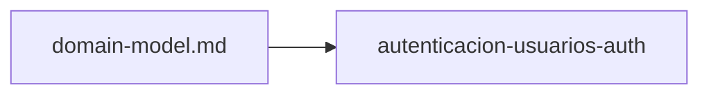

# Specs: Autenticación (services/auth)

> Servicio de identidad del portal de pagos: usuarios, credenciales, sesiones y credenciales verificables por otros servicios.

## Grafo de specs

## Tabla de specs

| Spec | Estado | Creación | Paralelizable con | Ruta | Depende de |
|---|:---:|:---:|:---:|---|---|
| autenticacion-usuarios-auth | `Pendiente` | `Aprobado` | `—` | `autenticacion-usuarios-auth/summary.md` | — |

> `domain-model.md` de este árbol ([domain-model.md](domain-model.md)) es el modelo del Contexto Delimitado de Identidad.
> El spec de la capacidad multi-unidad pertenece a la feature `autenticacion-usuarios` (unidad `services/auth`); los demás specs de la capacidad viven en los `INDEX.md` de sus propias unidades.
