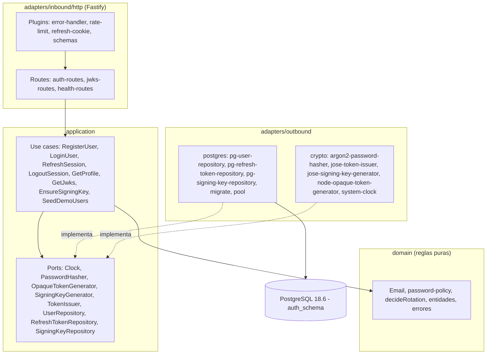

# Technical Design Document: Autenticación de usuarios (servicio de identidad `services/auth`)

## 1. Metadata & Traceability
- **Spec:** `autenticacion-usuarios-auth`
- **Requirements Ref:** `requirements.md` (spec: `autenticacion-usuarios-auth`)
- **Target Stack:** Node.js 24.22.0 (`node:24.22.0-alpine`), TypeScript 6.0.3 ESM estricto, Fastify 5.12.7, pg 8.23.1, node-pg-migrate 9.0.0, jose 6.2.12, @node-rs/argon2 2.2.2, @fastify/rate-limit 11.2.1, @fastify/cookie 11.1.3, PostgreSQL 18.6, Vitest 5.0.5, Testcontainers 12.2.1 (+ @testcontainers/postgresql 12.2.1), tsx 4.23.15, @types/pg 8.23.1. Raíz del monorepo: ESLint 10.12.0, @eslint/js 10.0.1, typescript-eslint 8.71.2, eslint-config-prettier 10.1.8, globals 17.13.0, Prettier 3.9.10, lefthook 2.1.12, @types/node 24.19.2, typescript 6.0.3.
- **Versiones:** exactas, sin `^` ni `~`, tanto en `package.json` de la raíz como en `services/auth/package.json`.
- **Modelo de dominio:** `../domain-model.md` (Contexto Delimitado de Identidad). **Esquema DB:** `db-design.dbml` (misma carpeta que este documento).

---

## 2. Architecture & System Overview

### 2.1 Architectural Approach
Arquitectura hexagonal. El dominio queda aislado de la infraestructura y del framework:

- `src/domain`: reglas puras (entidades, `Email`, política de contraseña, `decideRotation`, errores). Sin imports de Fastify, `pg`, `jose` ni `@node-rs/argon2`; el único módulo externo permitido es `node:crypto`.
- `src/application`: puertos en `ports/` (interfaces TypeScript, un archivo por puerto) y casos de uso en `use-cases/` (clases con método `execute`, dependencias inyectadas por constructor). Solo dependen de `src/domain` y de los puertos.
- `src/adapters/inbound/http`: adaptador de entrada Fastify (rutas, esquemas JSON, manejo de errores, cookie, rate limit).
- `src/adapters/outbound/postgres` y `src/adapters/outbound/crypto`: adaptadores de salida que implementan los puertos.
- `src/compose.ts`: raíz de composición (crea adaptadores, casos de uso y la app); lo usan `src/main.ts` y las pruebas de aceptación.
- `src/config.ts`: lectura y validación de variables de entorno. `src/main.ts`: arranque del proceso.

Las carpetas se llaman `inbound` y `outbound` (nunca `in`). No hay UnitOfWork: la atomicidad de la rotación de refresh tokens la implementa el adaptador Postgres dentro del método de repositorio `rotate` (una transacción).

Convenciones de código: ESM con `module NodeNext`, por lo que los imports relativos entre archivos `.ts` llevan la extensión `.js` (p. ej. `import { parseEmail } from '../domain/email.js'`); `verbatimModuleSyntax` obliga a `import type` para los tipos. Los identificadores de código van en inglés.

### 2.2 Component Diagram / Module Interaction


### 2.5 Decisiones cerradas
- Arquitectura hexagonal en todo servicio: aísla el dominio del framework y de la infraestructura.
- Stack y versiones exactas de §1: Node 24 LTS; TypeScript 6.0.3 por compatibilidad de typescript-eslint (`<6.1.0`).
- Fastify: esquemas JSON de entrada/salida y `inject` para pruebas sin red.
- `pg` sin ORM: control explícito de transacciones y locks (`FOR UPDATE`).
- `@node-rs/argon2`: binarios prebuilt para musl, sin compilación en Alpine.
- `jose`: soporte EdDSA y JWKS.
- Access token JWT EdDSA (Ed25519) de 15 min, `iss` = `urn:fluxone:auth`, `aud` = `urn:fluxone:api`, claim `email`.
- Llaves de firma generadas en el primer arranque y persistidas en `auth_schema.signing_keys`; una sola `SigningKey` activa y sin rotación.
- Hash de contraseñas Argon2id con `m=19456, t=2, p=1`.
- Refresh token opaco de 256 bits, solo su SHA-256 se almacena, vigencia de 7 días, rotación de un solo uso con detección de reutilización (revoca la familia).
- Cookie `refresh_token`: httpOnly, `SameSite=Strict`, `Secure` = `COOKIE_SECURE`, `Path=/api/auth`, `Max-Age=604800`.
- Rate limit por IP: login 5/min y registro 10/min.
- Esquema propio `auth_schema` con rol `auth_svc`, sin FK entre esquemas.
- Migraciones con node-pg-migrate 9 en SQL, ejecutadas al arrancar (tabla `pgmigrations` en `auth_schema`).
- Semilla de usuarios demo al arrancar (idempotente).
- OpenAPI 3.1 en `services/auth/openapi.yaml`.
- Puerto 3001.
- Errores con forma `{error:{code,message}}`.
- Logs JSON (pino de Fastify) con redacción de datos sensibles.
- Health `live` y `ready`.
- Contraseñas de 12 a 128 caracteres; email normalizado y único.
- Pruebas con Vitest y Testcontainers; el nombre de cada prueba incluye su ID `[AC-AUT-NN]`.
- Monorepo con npm workspaces `apps/*` y `services/*`.
- Saltos de línea LF en todo el repositorio.

### 2.6 Riesgos y mitigaciones

| Riesgo | Impacto | Mitigación |
|:---|:---|:---|
| Versiones del stack no verificadas localmente | La instalación o el typecheck fallan al empezar | Primera instalación con `npm ci` y `tsc --noEmit` antes de escribir código de producto (tareas 1.2 y 1.3) |
| CRLF de Windows rompe scripts y Dockerfiles | Fallos de ejecución en contenedor y diffs ruidosos | `.gitattributes` con LF forzado (REQ-10.4) |
| El límite por IP depende de la cabecera `x-real-ip` del proxy inverso; si el puerto del servicio se expone directamente, un cliente podría falsear la cabecera y evadir el límite | El rate limit de login/registro puede evadirse | El origen público del portal es el proxy inverso; el servicio usa `x-real-ip` si existe y, si no, la IP del socket |
| La llave privada de firma vive sin cifrar en `auth_schema.signing_keys` | Compromiso de la DB permitiría forjar access tokens | Rol exclusivo `auth_svc`, esquema aislado; la llave privada nunca se registra ni se publica (el JWKS solo expone la parte pública) |
| `refresh_tokens` crece sin depuración (la purga está fuera de alcance) | Bajo en este alcance | Se acepta; no se diseña purga |
| El contador de rate limit está en memoria por proceso | Con varias instancias el límite se multiplica | Válido para una sola instancia; queda documentado |
| El hash Argon2id es costoso en CPU | Abuso de login/registro podría saturar CPU | Límite por IP en login y registro |
| Compatibilidad del build en Docker con workspaces | La imagen no compila o no arranca | Verificado por la tarea del Dockerfile (AC-AUT-25) |

### 2.7 Directrices del proyecto
- `Global`: arquitectura hexagonal en todo servicio, con dominio sin dependencias de framework, DB, broker ni HTTP.
- `Global`: stack Node 24.22.0 + TypeScript 6.0.3 ESM con npm workspaces y versiones exactas fijadas en §1 y en las matrices de cada spec.
- `Global`: dinero en COP, `numeric(18,2)` en DB, `bigint` de centavos en dominio y `string` en JSON, nunca `float`.
- `Global`: toda operación monetaria con efecto exige `Idempotency-Key` con ámbito (usuario, operación) en la misma transacción.
- `Global`: cada servicio usa solo su esquema y su rol, sin FK entre esquemas.
- `Global`: cada cambio de estado publica evento vía Transactional Outbox y los consumidores son idempotentes por `eventId`.
- `Global`: logs JSON con `correlationId`, nunca secretos, tokens ni contraseñas.
- `Global`: `.makia/`, `.claude/`, `.cursor/`, `.agents/` quedan fuera de ESLint, Prettier y Docker; el repositorio usa saltos de línea LF.
- `Unidad: services/auth`: se crea el modelo de dominio de este BD en `../domain-model.md` (Contexto Delimitado de Identidad).

### 2.8 Sujeto a actualización futura
sin actualizaciones futuras declaradas

---

## 3. Data Models & Schema Design

> Los datos van primero: todo esquema de esta sección está declarado antes en `../domain-model.md` y `db-design.dbml`; un cambio de esquema entra primero en esos dos documentos.

### 3.1 Domain Entities (Core Business Objects)

Entidades en `src/domain` (un archivo por concepto, ver §5):

```typescript
// src/domain/user.ts
export interface User {
  id: string; // uuid; es el claim `sub` del access token
  email: string; // normalizado (trim + minúsculas)
  passwordHash: string; // Argon2id (cadena PHC)
  createdAt: Date;
  updatedAt: Date;
}

// src/domain/refresh-token.ts
export interface RefreshToken {
  id: string;
  userId: string;
  familyId: string;
  tokenHash: string; // SHA-256 hex, 64 caracteres
  expiresAt: Date;
  revokedAt: Date | null;
  replacedById: string | null;
  createdAt: Date;
}

export const ACCESS_TOKEN_TTL_SECONDS = 900;
export const REFRESH_TOKEN_TTL_SECONDS = 604800;

export type RotationDecision = 'ROTATE' | 'REUSED' | 'EXPIRED';

// Función pura. Orden de evaluación fijo.
export function decideRotation(
  token: { revokedAt: Date | null; expiresAt: Date },
  now: Date,
): RotationDecision {
  if (token.revokedAt !== null) return 'REUSED';
  if (token.expiresAt.getTime() <= now.getTime()) return 'EXPIRED';
  return 'ROTATE';
}

// src/domain/signing-key.ts
export interface PublicJwk {
  kty: 'OKP';
  crv: 'Ed25519';
  x: string;
  kid: string;
  alg: 'EdDSA';
  use: 'sig';
}

export interface SigningKey {
  kid: string; // uuid
  alg: 'EdDSA';
  publicJwk: PublicJwk;
  privateKeyPkcs8: string; // PEM PKCS#8; nunca sale del servicio
  active: boolean;
  createdAt: Date;
}
```

Value object `Email` y política de contraseña (reglas puras, lanzan `ValidationError`):

```typescript
// src/domain/email.ts
const EMAIL_PATTERN = /^[^\s@]+@[^\s@]+\.[^\s@]+$/;
const EMAIL_MAX_LENGTH = 254;

// Normaliza: trim + toLowerCase. Si la longitud > 254 o no cumple el patrón -> ValidationError.
export function parseEmail(raw: string): string;

// src/domain/password-policy.ts
// Longitud en caracteres (code points): [...plain].length debe estar entre 12 y 128 (inclusive).
// Fuera de rango -> ValidationError. No se hace trim ni se exigen otras reglas de composición.
export function assertValidPassword(plain: string): void;
```

Orden de evaluación de `parseEmail`: normalizar primero (`raw.trim().toLowerCase()`) y validar después longitud (≤ 254) y patrón sobre el valor normalizado; devuelve el valor normalizado.

Errores en `src/domain/errors.ts` (todos extienden `Error` y fijan `name` al nombre de la clase):

```typescript
export class ValidationError extends Error {}               // message = detalle de la violación
export class EmailAlreadyRegisteredError extends Error {}
export class InvalidCredentialsError extends Error {}
export class RefreshTokenInvalidError extends Error {}
export class RefreshTokenReusedError extends Error {
  constructor(readonly userId: string, readonly familyId: string) { super('refresh token reused'); }
}
export class AccessTokenInvalidError extends Error {}
```

**Pertenencia de datos, tabla por tabla:**

| Tabla | Dueño de cada fila |
|:---|:---|
| `users` | Cada fila es la identidad de su propio usuario (`id` = claim `sub`) |
| `refresh_tokens` | Pertenece al usuario de `user_id` |
| `signing_keys` | Sin dueño: recurso interno del servicio; solo la parte pública sale por el JWKS |

No hay valores centinela: los tres usuarios demo con ids fijos solo se crean en el arranque (semilla) y son usuarios normales después.

### 3.2 Database Schema & Persistence
- **Target Database / Storage:** PostgreSQL 18.6, esquema `auth_schema` (rol `auth_svc`), declarado en `db-design.dbml`.
- **Esquema y rol:** el servicio NO los crea (los provee el entorno; el rol no tiene permiso `CREATE` en la DB). El runner de migraciones se ejecuta con `createSchema: false`. En pruebas, `tests/global-setup.ts` ejecuta `CREATE SCHEMA IF NOT EXISTS auth_schema` antes de migrar.
- **Consultas:** todas usan nombres calificados `auth_schema.<tabla>` y parámetros posicionales (`$1`, `$2`, ...); nunca se concatenan valores en SQL.
- **Migración única:** `services/auth/migrations/1792022400000_create-auth-tables.sql`, formato node-pg-migrate SQL con marcadores `-- Up Migration` y `-- Down Migration`:

```sql
-- Up Migration
CREATE TABLE auth_schema.users (
  id uuid PRIMARY KEY,
  email varchar(254) NOT NULL UNIQUE,
  password_hash text NOT NULL,
  created_at timestamptz NOT NULL DEFAULT now(),
  updated_at timestamptz NOT NULL DEFAULT now(),
  CONSTRAINT users_email_lower_chk CHECK (email = lower(email))
);
CREATE TABLE auth_schema.refresh_tokens (
  id uuid PRIMARY KEY,
  user_id uuid NOT NULL REFERENCES auth_schema.users (id) ON DELETE CASCADE,
  family_id uuid NOT NULL,
  token_hash char(64) NOT NULL UNIQUE,
  expires_at timestamptz NOT NULL,
  revoked_at timestamptz,
  replaced_by_id uuid REFERENCES auth_schema.refresh_tokens (id),
  created_at timestamptz NOT NULL DEFAULT now()
);
CREATE INDEX refresh_tokens_user_id_idx ON auth_schema.refresh_tokens (user_id);
CREATE INDEX refresh_tokens_family_id_idx ON auth_schema.refresh_tokens (family_id);
CREATE TABLE auth_schema.signing_keys (
  kid uuid PRIMARY KEY,
  alg varchar(10) NOT NULL DEFAULT 'EdDSA',
  public_jwk jsonb NOT NULL,
  private_key_pkcs8 text NOT NULL,
  active boolean NOT NULL DEFAULT true,
  created_at timestamptz NOT NULL DEFAULT now(),
  CONSTRAINT signing_keys_alg_chk CHECK (alg = 'EdDSA')
);
CREATE UNIQUE INDEX signing_keys_one_active ON auth_schema.signing_keys (active) WHERE active;

-- Down Migration
DROP TABLE auth_schema.signing_keys;
DROP TABLE auth_schema.refresh_tokens;
DROP TABLE auth_schema.users;
```

- **Ejecución al arrancar** (`src/adapters/outbound/postgres/migrate.ts`, función `runMigrations(databaseUrl: string): Promise<void>`):

```typescript
import path from 'node:path';
import { runner } from 'node-pg-migrate';

await runner({
  databaseUrl,
  dir: path.resolve(import.meta.dirname, '../../../../migrations'),
  direction: 'up',
  schema: 'auth_schema',
  createSchema: false,
  migrationsTable: 'pgmigrations',
});
```

  La ruta relativa `../../../../migrations` resuelve a `services/auth/migrations` tanto desde `src/adapters/outbound/postgres/` como desde `dist/adapters/outbound/postgres/`.
- **Mapeo de errores PG:** violación `23505` (campo `code` del error de `pg`) con `constraint === 'users_email_key'` → `EmailAlreadyRegisteredError`. Cualquier otro error de DB se propaga sin traducir.
- **Mapeo fila ↔ entidad:** columnas `snake_case` ↔ propiedades `camelCase` (`password_hash` ↔ `passwordHash`, `family_id` ↔ `familyId`, `token_hash` ↔ `tokenHash`, `expires_at` ↔ `expiresAt`, `revoked_at` ↔ `revokedAt`, `replaced_by_id` ↔ `replacedById`, `private_key_pkcs8` ↔ `privateKeyPkcs8`, `public_jwk` ↔ `publicJwk`); `pg` devuelve `timestamptz` como `Date` y `jsonb` como objeto.

---

## 4. Interfaces, Contracts & API Specifications

### 4.1 Internal Service Interfaces / Ports

Un archivo por puerto en `src/application/ports/`:

```typescript
// clock.ts
export interface Clock {
  now(): Date;
}

// password-hasher.ts  (adaptador: Argon2id { memoryCost: 19456, timeCost: 2, parallelism: 1 })
export interface PasswordHasher {
  hash(plain: string): Promise<string>;
  verify(hash: string, plain: string): Promise<boolean>;
}

// opaque-token-generator.ts
// generate(): 32 bytes aleatorios codificados en base64url; tokenHash = SHA-256 hex (64 caracteres) del token.
// hash(token): SHA-256 hex (64 caracteres) del token recibido.
export interface OpaqueTokenGenerator {
  generate(): { token: string; tokenHash: string };
  hash(token: string): string;
}

// signing-key-generator.ts
export interface SigningKeyGenerator {
  generate(): Promise<SigningKey>;
}

// token-issuer.ts
export interface TokenIssuer {
  issueAccessToken(user: { id: string; email: string }): Promise<{ accessToken: string; expiresIn: number }>;
  // Lanza AccessTokenInvalidError ante cualquier fallo (ausente, expirado, firma, iss, aud, alg).
  verifyAccessToken(token: string): Promise<{ userId: string; email: string }>;
  getJwks(): { keys: PublicJwk[] };
}

// user-repository.ts
export interface UserRepository {
  insert(user: User): Promise<void>; // lanza EmailAlreadyRegisteredError
  insertIfAbsent(user: User): Promise<void>; // INSERT ... ON CONFLICT DO NOTHING
  findByEmail(email: string): Promise<User | null>; // recibe el email ya normalizado
  findById(id: string): Promise<User | null>;
}

// refresh-token-repository.ts
export type RotationOutcome =
  | { status: 'ROTATED'; userId: string; familyId: string }
  | { status: 'REUSED'; userId: string; familyId: string }
  | { status: 'EXPIRED' }
  | { status: 'NOT_FOUND' };

export interface RefreshTokenRepository {
  insert(token: RefreshToken): Promise<void>;
  rotate(input: {
    currentTokenHash: string;
    now: Date;
    next: { id: string; tokenHash: string; expiresAt: Date };
  }): Promise<RotationOutcome>;
  revokeFamilyByTokenHash(tokenHash: string, now: Date): Promise<void>;
}

// signing-key-repository.ts
export interface SigningKeyRepository {
  findActive(): Promise<SigningKey | null>;
  insertIfNoActive(key: SigningKey): Promise<void>; // INSERT ... ON CONFLICT DO NOTHING
  listAll(): Promise<SigningKey[]>;
}
```

**Semántica de `RefreshTokenRepository.rotate`** (atómica, una transacción `READ COMMITTED`, implementada en `pg-refresh-token-repository.ts` con un cliente tomado del `Pool`; el cliente se libera siempre en `finally`; ante excepción inesperada se hace `ROLLBACK` y se relanza):

1. `BEGIN`.
2. `SELECT id, user_id, family_id, expires_at, revoked_at FROM auth_schema.refresh_tokens WHERE token_hash = $1 FOR UPDATE`.
3. Sin fila → `COMMIT` y resultado `NOT_FOUND`.
4. Con fila → aplicar la función de dominio `decideRotation({revokedAt, expiresAt}, now)`:
   - `REUSED` → `UPDATE auth_schema.refresh_tokens SET revoked_at = $now WHERE family_id = $family AND revoked_at IS NULL`, `COMMIT` (la revocación se confirma aunque la capa superior devuelva error) → `{status:'REUSED', userId, familyId}`.
   - `EXPIRED` → `COMMIT` sin cambios → `{status:'EXPIRED'}`.
   - `ROTATE` → primero `INSERT` del token sucesor (`id`, `token_hash`, `expires_at` tomados de `next`; mismos `user_id` y `family_id` que el actual; `created_at = $now`); después `UPDATE auth_schema.refresh_tokens SET revoked_at = $now, replaced_by_id = $next.id WHERE id = $current.id` (el sucesor se inserta primero por la FK `replaced_by_id`); `COMMIT` → `{status:'ROTATED', userId, familyId}`.
5. Dos solicitudes simultáneas con el mismo token: la segunda espera el `FOR UPDATE`, ve el token ya revocado y obtiene `REUSED` (revoca la familia, incluido el sucesor).

**Semántica de `revokeFamilyByTokenHash(tokenHash, now)`** (una sola sentencia, sin transacción explícita):

```sql
UPDATE auth_schema.refresh_tokens
SET revoked_at = $2
WHERE revoked_at IS NULL
  AND family_id = (SELECT family_id FROM auth_schema.refresh_tokens WHERE token_hash = $1);
```

Si el `tokenHash` no existe, la subconsulta devuelve NULL y no se actualiza ninguna fila (no hace nada, no falla).

**Semántica de `SigningKeyRepository`:** `findActive` = `SELECT ... WHERE active`; `insertIfNoActive` = `INSERT INTO auth_schema.signing_keys (...) VALUES (...) ON CONFLICT DO NOTHING` (el índice único parcial `signing_keys_one_active` impide una segunda activa); `listAll` = todas las filas ordenadas por `created_at ASC, kid ASC`.

**Semántica de `UserRepository`:** `insert` = `INSERT` simple con mapeo `23505` sobre `users_email_key` → `EmailAlreadyRegisteredError` (otros errores se propagan); `insertIfAbsent` = `INSERT ... ON CONFLICT DO NOTHING`; `findByEmail`/`findById` devuelven `null` si no hay fila.

#### Casos de uso (`src/application/use-cases/`)

Clases con método `execute`; las dependencias entran por constructor (objeto con los puertos que cada caso necesita).

```typescript
export interface SessionResult {
  accessToken: string;
  tokenType: 'Bearer';
  expiresIn: 900;
  user: { id: string; email: string };
  refreshToken: string; // va a la cookie, nunca al cuerpo de la respuesta
  refreshTokenMaxAgeSeconds: 604800;
}
```

| Caso de uso | Entrada → Salida | Comportamiento (en orden) | Errores |
|:---|:---|:---|:---|
| `RegisterUser` | `{email, password}` → `{id, email}` | `parseEmail`; `assertValidPassword`; `hasher.hash`; `users.insert({id: randomUUID(), email, passwordHash, createdAt: now, updatedAt: now})` con `now = clock.now()` | `ValidationError`, `EmailAlreadyRegisteredError` |
| `LoginUser` | `{email, password}` → `SessionResult` | Normaliza el email (`trim().toLowerCase()`) SIN validar forma; `findByEmail`; si no existe: `hasher.verify(dummyPasswordHash, password)` (igualar tiempos) y lanza `InvalidCredentialsError`; si existe y `verify(user.passwordHash, password)` es `false`: `InvalidCredentialsError`; si ok: `tokenIssuer.issueAccessToken`; `tokens.generate()`; inserta `RefreshToken` con `familyId = randomUUID()`, `id = randomUUID()`, `expiresAt = now + 604800 s`, `revokedAt = null`, `replacedById = null`; devuelve `SessionResult` | `InvalidCredentialsError` |
| `RefreshSession` | `{refreshToken}` → `SessionResult` | `tokenHash = tokens.hash(refreshToken)`; `next = tokens.generate()`; `rotate({currentTokenHash: tokenHash, now, next: {id: randomUUID(), tokenHash: next.tokenHash, expiresAt: now + 604800 s}})`; `ROTATED` → `findById(userId)` (si no existe, `RefreshTokenInvalidError`), emite access token y devuelve `SessionResult` con `refreshToken = next.token`; `REUSED` → `RefreshTokenReusedError(userId, familyId)`; `EXPIRED` o `NOT_FOUND` → `RefreshTokenInvalidError` | `RefreshTokenInvalidError`, `RefreshTokenReusedError` |
| `LogoutSession` | `{refreshToken?}` → `void` | Si hay token: `revokeFamilyByTokenHash(tokens.hash(refreshToken), now)`; si no hay token no hace nada. Nunca falla por token desconocido | ninguno |
| `GetProfile` | `{accessToken}` → `{id, email}` | `tokenIssuer.verifyAccessToken`; devuelve `{id: userId, email}` de los claims (sin consultar la DB) | `AccessTokenInvalidError` |
| `GetJwks` | `()` → `{keys: PublicJwk[]}` | `tokenIssuer.getJwks()` | ninguno |
| `EnsureSigningKey` | `()` → `SigningKey[]` | Si `findActive()` es `null`: `generator.generate()` y `insertIfNoActive`; devuelve `listAll()` (garantiza una activa aunque otra instancia haya ganado la carrera) | errores de DB se propagan |
| `SeedDemoUsers` | `{password}` → `void` | Por cada usuario demo: `hasher.hash(password)` e `insertIfAbsent` con `createdAt = updatedAt = now` | errores de DB se propagan |

Usuarios demo (ids y emails fijos, constante en `seed-demo-users.ts`):

| Email | `id` |
|:---|:---|
| `alice@fluxone.test` | `11111111-1111-4111-8111-111111111111` |
| `bob@fluxone.test` | `22222222-2222-4222-8222-222222222222` |
| `carol@fluxone.test` | `33333333-3333-4333-8333-333333333333` |

Dependencias por constructor: `RegisterUser({users, hasher, clock})`; `LoginUser({users, refreshTokens, hasher, tokenIssuer, tokens, clock, dummyPasswordHash})`; `RefreshSession({users, refreshTokens, tokenIssuer, tokens, clock})`; `LogoutSession({refreshTokens, tokens, clock})`; `GetProfile({tokenIssuer})`; `GetJwks({tokenIssuer})`; `EnsureSigningKey({signingKeys, generator})`; `SeedDemoUsers({users, hasher, clock})`. Cada caso de uso toma `now` de `clock.now()` una sola vez por ejecución.

#### Adaptadores crypto (`src/adapters/outbound/crypto/`)

- **`Argon2PasswordHasher`** (`argon2-password-hasher.ts`): `@node-rs/argon2` con `algorithm: Algorithm.Argon2id`, `memoryCost: 19456`, `timeCost: 2`, `parallelism: 1`. `hash` produce cadena PHC con prefijo `$argon2id$v=19$m=19456,t=2,p=1$`. `verify(hash, plain)` devuelve `false` (no lanza) si el hash es inválido o no coincide.
- **`JoseTokenIssuer`** (`jose-token-issuer.ts`), constructor `{keys: SigningKey[], issuer: string, audience: string, clock: Clock}`:
  - Firma con la llave activa (`keys.find(k => k.active)`), importada con `importPKCS8(privateKeyPkcs8, 'EdDSA')`:

```typescript
const now = Math.floor(clock.now().getTime() / 1000);
new SignJWT({ email })
  .setProtectedHeader({ alg: 'EdDSA', kid })
  .setSubject(id)
  .setIssuer(issuer)
  .setAudience(audience)
  .setIssuedAt(now)
  .setExpirationTime(now + 900)
  .sign(privateKey);
```

  - `issueAccessToken` devuelve `{accessToken, expiresIn: 900}`.
  - Verificación: `createLocalJWKSet({keys: publicJwks})` y `jwtVerify(token, jwks, {issuer, audience, algorithms: ['EdDSA'], clockTolerance: '5s', currentDate: clock.now()})`; devuelve `{userId: payload.sub, email: payload.email}`; si `sub` o `email` no son `string` o cualquier paso falla → `AccessTokenInvalidError`.
  - `getJwks()` devuelve `{keys: keys.map(k => k.publicJwk)}`.
- **`JoseSigningKeyGenerator`** (`jose-signing-key-generator.ts`): `generateKeyPair('EdDSA', {crv: 'Ed25519', extractable: true})`; `kid = randomUUID()`; `publicJwk = {...(await exportJWK(publicKey)), kid, alg: 'EdDSA', use: 'sig'}`; `privateKeyPkcs8 = await exportPKCS8(privateKey)`; `active: true`; `alg: 'EdDSA'`; `createdAt` = `clock.now()` (recibe `Clock` por constructor).
- **`NodeOpaqueTokenGenerator`** (`node-opaque-token-generator.ts`): `randomBytes(32).toString('base64url')`; `hash` = `createHash('sha256').update(token).digest('hex')`.
- **`SystemClock`** (`system-clock.ts`): `now()` = `new Date()`.

### 4.2 External API / RPC / Event Schemas

**Reglas comunes**
- Formato de error siempre `{"error":{"code":"...","message":"..."}}`.
- Esquemas JSON de entrada con `additionalProperties: false`; también hay esquemas de respuesta por código de estado (para que jamás se serialicen campos no declarados, como `passwordHash`).
- Cuerpos y respuestas `application/json`. El servicio escucha en el puerto 3001; el proxy inverso del portal expone las rutas bajo `/api/auth` (por eso `Path=/api/auth` en la cookie); las rutas del servicio no llevan ese prefijo.

**Mensajes de error (español)**

| `code` | Status | `message` |
|:---|:---|:---|
| `VALIDATION_ERROR` | 400 | `Solicitud inválida: <detalle de la primera violación>` |
| `EMAIL_TAKEN` | 409 | `El correo ya está registrado.` |
| `INVALID_CREDENTIALS` | 401 | `Correo o contraseña incorrectos.` |
| `RATE_LIMITED` | 429 | `Demasiados intentos. Intenta de nuevo en un minuto.` |
| `REFRESH_TOKEN_INVALID` | 401 | `La sesión no es válida o expiró.` |
| `REFRESH_TOKEN_REUSED` | 401 | `La sesión fue revocada por seguridad. Inicia sesión de nuevo.` |
| `UNAUTHORIZED` | 401 | `Token de acceso ausente o inválido.` |
| `NOT_FOUND` | 404 | `Recurso no encontrado.` |
| `INTERNAL_ERROR` | 500 | `Error interno del servidor.` |

#### `POST /auth/register`
- **Request** (esquema: `email` y `password` ambos `string`, `required`, `additionalProperties:false`, `maxLength: 1024` para acotar; la validación de email y de 12–128 caracteres la hace el dominio):
```json
{ "email": "nuevo@fluxone.test", "password": "una-clave-segura-123" }
```
- **Response 201:**
```json
{ "id": "7d0f2c0e-6a54-4c4e-9d5e-0a7d2b9b8f10", "email": "nuevo@fluxone.test" }
```
- **Errores:** `400 VALIDATION_ERROR` (cuerpo no cumple el esquema, email inválido o contraseña fuera de 12–128 caracteres); `409 EMAIL_TAKEN`; `429 RATE_LIMITED`.
- **Límite:** 10/min por IP.

#### `POST /auth/login`
- **Request** (mismo esquema que registro; NO valida forma de email ni longitud de contraseña):
```json
{ "email": "alice@fluxone.test", "password": "clave-demo-123456" }
```
- **Response 200:** cabecera `Set-Cookie: refresh_token=<valor firmado>; Max-Age=604800; Path=/api/auth; HttpOnly; Secure; SameSite=Strict` y cuerpo:
```json
{
  "accessToken": "<jwt>",
  "tokenType": "Bearer",
  "expiresIn": 900,
  "user": { "id": "11111111-1111-4111-8111-111111111111", "email": "alice@fluxone.test" }
}
```
- **Errores:** `400 VALIDATION_ERROR` (cuerpo no cumple el esquema); `401 INVALID_CREDENTIALS` (email inexistente o contraseña incorrecta, mismo mensaje); `429 RATE_LIMITED`.
- **Límite:** 5/min por IP (el 6.º intento en la ventana → 429).
- **Logs:** éxito `request.log.info({event: 'auth.login_succeeded', userId})`; fallo `request.log.info({event: 'auth.login_failed', emailHash})` donde `emailHash` = SHA-256 hex del email normalizado (`trim().toLowerCase()`).

#### `POST /auth/refresh`
- **Request:** sin cuerpo; lee la cookie firmada `refresh_token`.
- **Response 200:** mismo cuerpo que login + nueva cookie `refresh_token` (vigencia renovada a 7 días desde la rotación).
- **Errores:** `401 REFRESH_TOKEN_INVALID` (cookie ausente, firma inválida, token desconocido o expirado); `401 REFRESH_TOKEN_REUSED` (token ya rotado o revocado). En ambos casos de 401 se limpia la cookie.
- **Log:** en reutilización `request.log.warn({event: 'auth.refresh_reuse_detected', userId, familyId})`.
- **Límite:** sin límite de intentos.

#### `POST /auth/logout`
- **Request:** sin cuerpo; lee la cookie `refresh_token` si existe.
- **Response 204** sin cuerpo, siempre (con o sin cookie, con token válido, desconocido o ya revocado); limpia la cookie.
- **Errores:** ninguno controlado.

#### `GET /auth/me`
- **Request:** cabecera `Authorization: Bearer <jwt>`.
- **Response 200:** `{ "id": "<sub>", "email": "<claim email>" }` tomados de los claims, sin consultar la DB.
- **Errores:** `401 UNAUTHORIZED` (cabecera ausente, esquema distinto de `Bearer`, token expirado, firma, `iss` o `aud` inválidos).

#### `GET /.well-known/jwks.json`
- **Response 200:** `{ "keys": [PublicJwk] }` con todas las llaves de `signing_keys` (hoy una):
```json
{ "keys": [ { "kty": "OKP", "crv": "Ed25519", "x": "<base64url>", "kid": "<uuid>", "alg": "EdDSA", "use": "sig" } ] }
```
- **Errores:** ninguno controlado.

#### `GET /health/live` y `GET /health/ready`
- `GET /health/live` → 200 `{"status":"ok"}`.
- `GET /health/ready` → 200 `{"status":"ok"}` si `SELECT 1` funciona; si no, 503 `{"status":"unavailable"}`.

#### Rutas inexistentes y errores no controlados
- Ruta inexistente → 404 `NOT_FOUND`.
- Error no controlado → 500 `INTERNAL_ERROR`: se registra el error en el log y el cuerpo es genérico.

#### Cookie de refresh (`src/adapters/inbound/http/refresh-cookie.ts`)
- Nombre `refresh_token`. Opciones al escribir: `httpOnly: true, sameSite: 'strict', secure: config.cookieSecure, path: '/api/auth', maxAge: 604800, signed: true`. Se firma con `COOKIE_SECRET` mediante `@fastify/cookie`; el valor firmado envuelve el token opaco.
- Lectura con `request.unsignCookie(raw)`: cookie ausente, firma inválida (`valid === false`) o valor vacío equivale a "sin token" → `REFRESH_TOKEN_INVALID` en refresh; no-op en logout.
- Limpieza con `reply.clearCookie('refresh_token', {path: '/api/auth', httpOnly: true, sameSite: 'strict', secure: config.cookieSecure})` (mismos atributos que al escribir).
- Funciones exportadas: `setRefreshCookie(reply, token, config)`, `readRefreshCookie(request): string | undefined`, `clearRefreshCookie(reply, config)`.
- Nota: `Path=/api/auth` corresponde al prefijo del proxy inverso; en pruebas con `inject` la cookie se envía manualmente en la cabecera `cookie`.

#### Rate limit (`src/adapters/inbound/http/rate-limit.ts`)
- `@fastify/rate-limit` con `global: false` y configuración por ruta mediante `config.rateLimit`: login `{max: 5, timeWindow: '1 minute'}`, registro `{max: 10, timeWindow: '1 minute'}`.
- `keyGenerator: req => (typeof req.headers['x-real-ip'] === 'string' && req.headers['x-real-ip'] ? req.headers['x-real-ip'] : req.ip)`.
- `errorResponseBuilder` produce el cuerpo `RATE_LIMITED` (status 429; la cabecera `retry-after` la añade la librería).
- Los contadores de login y registro son independientes entre sí y por IP; almacenamiento en memoria.

#### Logging y Fastify
```typescript
Fastify({
  logger: {
    level: config.logLevel,
    redact: ['req.headers.authorization', 'req.headers.cookie', 'res.headers["set-cookie"]'],
    stream: logStream, // opcional, solo para que las pruebas capturen logs
  },
  requestIdHeader: 'x-request-id',
  genReqId: (req) => (typeof req.headers['x-request-id'] === 'string' && req.headers['x-request-id'] ? req.headers['x-request-id'] : randomUUID()),
});
```
Los eventos `auth.*` los registran los handlers HTTP con `request.log.info({event, ...})` (excepto la reutilización, que usa `warn`). Nunca se registran contraseñas, tokens, cookies ni emails en claro en login fallido. Si `logStream` es `undefined` no se pasa la propiedad `stream`.

### 4.3 Configuración (`src/config.ts`)

`loadConfig(env: NodeJS.ProcessEnv): Config` falla con un `Error` claro (nombra la variable, sin imprimir valores secretos) si falta algo obligatorio o es inválido.

| Variable | Obligatoria | Default | Regla |
|:---|:---|:---|:---|
| `PORT` | No | `3001` | entero 1–65535 |
| `DATABASE_URL` | Sí | — | la compone el entorno con el rol `auth_svc` |
| `JWT_ISSUER` | No | `urn:fluxone:auth` | no vacío |
| `JWT_AUDIENCE` | No | `urn:fluxone:api` | no vacío |
| `COOKIE_SECRET` | Sí | — | ≥ 32 caracteres |
| `COOKIE_SECURE` | No | `true` | `"true"` o `"false"` |
| `DEMO_USERS_PASSWORD` | Sí | — | cumple la política de contraseña (12–128 caracteres) |
| `LOG_LEVEL` | No | `info` | nivel válido de pino |

```typescript
export interface Config {
  port: number;
  databaseUrl: string;
  jwtIssuer: string;
  jwtAudience: string;
  cookieSecret: string;
  cookieSecure: boolean;
  demoUsersPassword: string;
  logLevel: string;
}
export function loadConfig(env: NodeJS.ProcessEnv): Config;
```

**Composición (`src/compose.ts`):** `composeApp({config, pool, logStream?}): Promise<FastifyInstance>`:
1. Crea `SystemClock`, `Argon2PasswordHasher`, `NodeOpaqueTokenGenerator`, `JoseSigningKeyGenerator(clock)` y los repositorios Postgres sobre `pool`.
2. Ejecuta `EnsureSigningKey` y conserva el resultado (`keys`).
3. Ejecuta `SeedDemoUsers` con `config.demoUsersPassword`.
4. Calcula `dummyPasswordHash = await hasher.hash(randomUUID())`.
5. Construye `JoseTokenIssuer({keys, issuer: config.jwtIssuer, audience: config.jwtAudience, clock})`.
6. Instancia los casos de uso y llama `buildApp({config, useCases, isDatabaseReady, logStream})` con `isDatabaseReady = async () => { try { await pool.query('SELECT 1'); return true; } catch { return false; } }`.

**Arranque (`src/main.ts`):** `loadConfig(process.env)` → `runMigrations(config.databaseUrl)` → `new Pool({connectionString})` (`pool.ts`) → `composeApp` → `app.listen({host: '0.0.0.0', port: config.port})` → cierre ordenado (`await app.close()` y luego `await pool.end()`) en `SIGINT`/`SIGTERM`. Si cualquier paso del arranque falla, se escribe el error (sin secretos) y `process.exit(1)`.

**`buildApp` (`src/adapters/inbound/http/app.ts`):** `buildApp(deps)` con `deps = {config, useCases, isDatabaseReady: () => Promise<boolean>, logStream?}`; crea la instancia Fastify (ver "Logging y Fastify"), registra `@fastify/cookie` (con `secret: config.cookieSecret`), `@fastify/rate-limit`, el manejador de errores y de rutas inexistentes, y las rutas (`auth-routes`, `jwks-routes`, `health-routes`). `useCases` es el objeto `{registerUser, loginUser, refreshSession, logoutSession, getProfile, getJwks}`.

---

## 5. Implementation Target Structure (File Mapping)

Rutas relativas a la raíz del repositorio. Todos los archivos son "Crear", salvo los marcados "Modificar". Esta lista es exacta (ni un archivo más ni uno menos).

**Estructura de `services/auth/`:**
```
services/auth/
├── package.json, tsconfig.json, tsconfig.build.json, vitest.config.ts, openapi.yaml, Dockerfile
├── migrations/1792022400000_create-auth-tables.sql
├── src/
│   ├── config.ts, compose.ts, main.ts
│   ├── domain/ (errors, email, password-policy, user, refresh-token, signing-key)
│   ├── application/ports/ (8 puertos) y use-cases/ (8 casos de uso)
│   └── adapters/
│       ├── inbound/http/ (app, error-handler, schemas, rate-limit, refresh-cookie, routes/)
│       └── outbound/ (postgres/, crypto/)
└── tests/ (global-setup.ts, support/, unit/, integration/, acceptance/)
```

| Archivo | Acción | Propósito | Tarea |
|:---|:---|:---|:---|
| `lefthook.yml` | Crear | Hooks pre-commit (ESLint, Prettier, typecheck) | 1.1 |
| `package.json` | Crear | Raíz del monorepo: workspaces, scripts y devDependencies exactas | 1.2 |
| `tsconfig.base.json` | Crear | Opciones base de TypeScript | 1.2 |
| `eslint.config.js` | Crear | Flat config de ESLint (sin plugins de React) | 1.2 |
| `.prettierrc` | Crear | Reglas de Prettier | 1.2 |
| `.prettierignore` | Crear | Exclusiones de Prettier | 1.2 |
| `.gitattributes` | Crear | Saltos de línea LF (CRLF solo `.cmd`, `.bat`, `.ps1`) | 1.2 |
| `.gitignore` | Modificar | Añadir bloque `# Proyecto` al final | 1.2 |
| `.dockerignore` | Crear | Exclusiones del contexto Docker | 1.2 |
| `package-lock.json` | Crear | Lockfile generado por `npm install` | 1.3 |
| `services/auth/package.json` | Crear | Workspace `@fluxone/auth`: dependencias y scripts | 1.3 |
| `services/auth/tsconfig.json` | Crear | TypeScript del servicio (typecheck, sin emitir) | 1.3 |
| `services/auth/tsconfig.build.json` | Crear | Compilación a `dist` | 1.3 |
| `services/auth/vitest.config.ts` | Crear | Proyectos Vitest `unit` y `db` | 1.3 |
| `services/auth/migrations/1792022400000_create-auth-tables.sql` | Crear | Migración única de `auth_schema` | 1.4 |
| `services/auth/tests/global-setup.ts` | Crear | Contenedor PostgreSQL de pruebas, esquema y migraciones | 1.4 |
| `services/auth/tests/support/db.ts` | Crear | Helpers de `Pool` y `truncateAll()` | 1.4 |
| `services/auth/tests/integration/migrations.test.ts` | Crear | Verifica la migración | 1.4 |
| `services/auth/src/domain/errors.ts` | Crear | Errores tipados | 1.5 |
| `services/auth/src/domain/email.ts` | Crear | `parseEmail` | 1.5 |
| `services/auth/src/domain/password-policy.ts` | Crear | `assertValidPassword` | 1.5 |
| `services/auth/src/domain/user.ts` | Crear | Entidad `User` | 1.5 |
| `services/auth/src/domain/refresh-token.ts` | Crear | Entidad `RefreshToken`, TTLs y `decideRotation` | 1.5 |
| `services/auth/src/domain/signing-key.ts` | Crear | `SigningKey` y `PublicJwk` | 1.5 |
| `services/auth/tests/unit/domain/email.test.ts` | Crear | Pruebas de `parseEmail` | 1.5 |
| `services/auth/tests/unit/domain/password-policy.test.ts` | Crear | Pruebas de la política de contraseña | 1.5 |
| `services/auth/tests/unit/domain/refresh-token.test.ts` | Crear | Pruebas de `decideRotation` | 1.5 |
| `services/auth/src/application/ports/clock.ts` | Crear | Puerto `Clock` | 2.1 |
| `services/auth/src/application/ports/password-hasher.ts` | Crear | Puerto `PasswordHasher` | 2.1 |
| `services/auth/src/application/ports/opaque-token-generator.ts` | Crear | Puerto `OpaqueTokenGenerator` | 2.1 |
| `services/auth/src/application/ports/signing-key-generator.ts` | Crear | Puerto `SigningKeyGenerator` | 2.1 |
| `services/auth/src/application/ports/token-issuer.ts` | Crear | Puerto `TokenIssuer` | 2.1 |
| `services/auth/src/application/ports/user-repository.ts` | Crear | Puerto `UserRepository` | 2.1 |
| `services/auth/src/application/ports/refresh-token-repository.ts` | Crear | Puerto `RefreshTokenRepository` y `RotationOutcome` | 2.1 |
| `services/auth/src/application/ports/signing-key-repository.ts` | Crear | Puerto `SigningKeyRepository` | 2.1 |
| `services/auth/src/application/use-cases/register-user.ts` | Crear | Caso de uso `RegisterUser` | 2.1 |
| `services/auth/src/application/use-cases/login-user.ts` | Crear | Caso de uso `LoginUser` y `SessionResult` | 2.1 |
| `services/auth/src/application/use-cases/refresh-session.ts` | Crear | Caso de uso `RefreshSession` | 2.1 |
| `services/auth/src/application/use-cases/logout-session.ts` | Crear | Caso de uso `LogoutSession` | 2.1 |
| `services/auth/src/application/use-cases/get-profile.ts` | Crear | Caso de uso `GetProfile` | 2.1 |
| `services/auth/src/application/use-cases/get-jwks.ts` | Crear | Caso de uso `GetJwks` | 2.1 |
| `services/auth/src/application/use-cases/ensure-signing-key.ts` | Crear | Caso de uso `EnsureSigningKey` | 2.1 |
| `services/auth/src/application/use-cases/seed-demo-users.ts` | Crear | Caso de uso `SeedDemoUsers` | 2.1 |
| `services/auth/tests/support/fakes.ts` | Crear | Fakes en memoria de los puertos | 2.1 |
| `services/auth/tests/unit/application/register-user.test.ts` | Crear | Pruebas de `RegisterUser` | 2.1 |
| `services/auth/tests/unit/application/login-user.test.ts` | Crear | Pruebas de `LoginUser` | 2.1 |
| `services/auth/tests/unit/application/refresh-session.test.ts` | Crear | Pruebas de `RefreshSession` | 2.1 |
| `services/auth/tests/unit/application/logout-session.test.ts` | Crear | Pruebas de `LogoutSession` | 2.1 |
| `services/auth/tests/unit/application/ensure-signing-key.test.ts` | Crear | Pruebas de `EnsureSigningKey` | 2.1 |
| `services/auth/tests/unit/application/seed-demo-users.test.ts` | Crear | Pruebas de `SeedDemoUsers` | 2.1 |
| `services/auth/src/adapters/outbound/crypto/argon2-password-hasher.ts` | Crear | Adaptador Argon2id | 2.2 |
| `services/auth/src/adapters/outbound/crypto/jose-token-issuer.ts` | Crear | Emisión y verificación de JWT EdDSA | 2.2 |
| `services/auth/src/adapters/outbound/crypto/jose-signing-key-generator.ts` | Crear | Generación de llaves Ed25519 | 2.2 |
| `services/auth/src/adapters/outbound/crypto/node-opaque-token-generator.ts` | Crear | Token opaco y SHA-256 | 2.2 |
| `services/auth/src/adapters/outbound/crypto/system-clock.ts` | Crear | Reloj del sistema | 2.2 |
| `services/auth/tests/unit/adapters/argon2-password-hasher.test.ts` | Crear | Pruebas del hasher | 2.2 |
| `services/auth/tests/unit/adapters/jose-token-issuer.test.ts` | Crear | Pruebas del emisor JWT | 2.2 |
| `services/auth/tests/unit/adapters/jose-signing-key-generator.test.ts` | Crear | Pruebas del generador de llaves | 2.2 |
| `services/auth/tests/unit/adapters/node-opaque-token-generator.test.ts` | Crear | Pruebas del generador de token opaco | 2.2 |
| `services/auth/src/adapters/outbound/postgres/pool.ts` | Crear | Creación del `Pool` de `pg` | 2.3 |
| `services/auth/src/adapters/outbound/postgres/migrate.ts` | Crear | `runMigrations` | 2.3 |
| `services/auth/src/adapters/outbound/postgres/pg-user-repository.ts` | Crear | `UserRepository` en Postgres | 2.3 |
| `services/auth/src/adapters/outbound/postgres/pg-refresh-token-repository.ts` | Crear | `RefreshTokenRepository` en Postgres | 2.3 |
| `services/auth/src/adapters/outbound/postgres/pg-signing-key-repository.ts` | Crear | `SigningKeyRepository` en Postgres | 2.3 |
| `services/auth/tests/integration/pg-user-repository.test.ts` | Crear | Integración de usuarios | 2.3 |
| `services/auth/tests/integration/pg-refresh-token-repository.test.ts` | Crear | Integración de refresh tokens | 2.3 |
| `services/auth/tests/integration/pg-signing-key-repository.test.ts` | Crear | Integración de llaves de firma | 2.3 |
| `services/auth/src/config.ts` | Crear | `loadConfig` | 3.1 |
| `services/auth/src/compose.ts` | Crear | `composeApp` | 3.1 |
| `services/auth/src/main.ts` | Crear | Arranque del proceso | 3.1 |
| `services/auth/src/adapters/inbound/http/app.ts` | Crear | `buildApp` con plugins y rutas de JWKS y health | 3.1 |
| `services/auth/src/adapters/inbound/http/error-handler.ts` | Crear | Tabla error → status/code | 3.1 |
| `services/auth/src/adapters/inbound/http/schemas.ts` | Crear | Esquemas JSON de entrada y salida | 3.1 |
| `services/auth/src/adapters/inbound/http/rate-limit.ts` | Crear | Plugin y configuración de rate limit | 3.1 |
| `services/auth/src/adapters/inbound/http/refresh-cookie.ts` | Crear | Helpers de la cookie `refresh_token` | 3.1 |
| `services/auth/src/adapters/inbound/http/routes/jwks-routes.ts` | Crear | `GET /.well-known/jwks.json` | 3.1 |
| `services/auth/src/adapters/inbound/http/routes/health-routes.ts` | Crear | `GET /health/live` y `/health/ready` | 3.1 |
| `services/auth/tests/support/build-test-app.ts` | Crear | Helper que compone la app real para pruebas | 3.1 |
| `services/auth/tests/acceptance/jwks.test.ts` | Crear | Aceptación de JWKS | 3.1 |
| `services/auth/src/adapters/inbound/http/routes/auth-routes.ts` | Crear | Rutas de registro y login | 3.2 |
| `services/auth/src/adapters/inbound/http/app.ts` | Modificar | Registrar `auth-routes` | 3.2 |
| `services/auth/tests/acceptance/register.test.ts` | Crear | Aceptación de registro | 3.2 |
| `services/auth/tests/acceptance/login.test.ts` | Crear | Aceptación de login | 3.2 |
| `services/auth/tests/acceptance/seed.test.ts` | Crear | Aceptación de la semilla de usuarios demo (incluye inicio de sesión demo) | 3.2 |
| `services/auth/src/adapters/inbound/http/routes/auth-routes.ts` | Modificar | Añadir refresh, logout y me | 3.3 |
| `services/auth/tests/acceptance/refresh.test.ts` | Crear | Aceptación de refresh | 3.3 |
| `services/auth/tests/acceptance/logout.test.ts` | Crear | Aceptación de logout | 3.3 |
| `services/auth/tests/acceptance/profile.test.ts` | Crear | Aceptación de `GET /auth/me` | 3.3 |
| `services/auth/tests/acceptance/operability.test.ts` | Crear | Aceptación de health, errores y logs (sin archivos de producción nuevos; solo ajustes si hay fallos) | 3.4 |
| `services/auth/openapi.yaml` | Crear | Contrato OpenAPI 3.1 | 4.1 |
| `services/auth/tests/acceptance/openapi.test.ts` | Crear | Verifica `openapi.yaml` | 4.1 |
| `services/auth/Dockerfile` | Crear | Imagen del servicio | 4.2 |

La tarea 4.3 no crea archivos (verificación global).

### Contenido exacto de `lefthook.yml` (tarea 1.1)
```yaml
pre-commit:
  parallel: true
  commands:
    eslint:
      glob: "*.{ts,tsx,js,mjs}"
      run: npx eslint --max-warnings 0 --fix {staged_files}
      stage_fixed: true
    prettier:
      glob: "*.{ts,tsx,js,mjs,json,yml,yaml,md,css}"
      run: npx prettier --write {staged_files}
      stage_fixed: true
    typecheck:
      glob: "*.{ts,tsx}"
      run: npm run typecheck --workspaces --if-present
```

### Configuración de raíz (tarea 1.2)
- **`package.json`:** `name: "fluxone-payment"`, `private: true`, `type: "module"`, `engines: {"node": "24.22.0"}`, `workspaces: ["apps/*", "services/*"]`; scripts `lint` = `eslint . --max-warnings 0`, `format` = `prettier --write .`, `format:check` = `prettier --check .`; devDependencies con las versiones exactas de §1 (raíz): `eslint`, `@eslint/js`, `typescript-eslint`, `eslint-config-prettier`, `globals`, `prettier`, `lefthook`, `@types/node`, `typescript`.
- **`tsconfig.base.json`:** `compilerOptions`: `target: "ES2024"`, `module: "NodeNext"`, `moduleResolution: "NodeNext"`, `strict: true`, `verbatimModuleSyntax: true`, `skipLibCheck: true`, `types: ["node"]`.
- **`eslint.config.js`:** flat config con `defineConfig` de `eslint/config`; `ignores`: `**/dist/**`, `**/node_modules/**`, `**/coverage/**`, `.makia/**`, `.claude/**`, `.cursor/**`, `.agents/**`; luego `js.configs.recommended`, `...tseslint.configs.recommended`, `{languageOptions: {globals: globals.node}}` y `prettierConfig` (`eslint-config-prettier`) al final. NO incluye plugins de React: este spec no tiene código React.
- **`.prettierrc`:** `{ "semi": true, "singleQuote": true, "trailingComma": "all", "printWidth": 100, "endOfLine": "lf" }`.
- **`.prettierignore`:** `node_modules`, `dist`, `coverage`, `package-lock.json`, `.makia`, `.claude`, `.cursor`, `.agents`, `CLAUDE.md`, `AGENTS.md` (una entrada por línea).
- **`.gitattributes`:** `* text=auto eol=lf`, `*.sh text eol=lf`, `Dockerfile* text eol=lf`, `*.cmd text eol=crlf`, `*.bat text eol=crlf`, `*.ps1 text eol=crlf`.
- **`.gitignore` (Modificar):** añadir al final un bloque que empieza con la línea `# Proyecto` seguido de `node_modules/`, `dist/`, `coverage/`, `.env`, `*.log`, una por línea; no tocar las líneas existentes.
- **`.dockerignore`:** `node_modules`, `**/node_modules`, `dist`, `**/dist`, `coverage`, `.git`, `.makia`, `.claude`, `.cursor`, `.agents`, `.env`, `*.log` (una por línea).

### Configuración del workspace (tarea 1.3)
- **`services/auth/package.json`:** `name: "@fluxone/auth"`, `private: true`, `type: "module"`; `dependencies`: `fastify`, `pg`, `node-pg-migrate`, `jose`, `@node-rs/argon2`, `@fastify/rate-limit`, `@fastify/cookie`; `devDependencies`: `vitest`, `testcontainers`, `@testcontainers/postgresql`, `tsx`, `@types/pg`; versiones exactas de §1. Scripts: `build` = `tsc -p tsconfig.build.json`, `dev` = `tsx watch src/main.ts`, `start` = `node dist/main.js`, `typecheck` = `tsc --noEmit -p tsconfig.json`, `test` = `vitest run`.
- **`services/auth/tsconfig.json`:** `extends: "../../tsconfig.base.json"`, `compilerOptions.noEmit: true`, `include: ["src", "tests", "vitest.config.ts"]`.
- **`services/auth/tsconfig.build.json`:** `extends: "./tsconfig.json"`, `compilerOptions: {noEmit: false, rootDir: "src", outDir: "dist"}`, `include: ["src"]`, `exclude: ["tests"]`.
- **`services/auth/vitest.config.ts`:** usa `test.projects` con dos proyectos: `unit` (`include: ['tests/unit/**/*.test.ts']`, sin Docker) y `db` (`include: ['tests/integration/**/*.test.ts', 'tests/acceptance/**/*.test.ts']`, `globalSetup: ['./tests/global-setup.ts']`, `testTimeout: 60000`, `hookTimeout: 120000`); `environment: 'node'` y sin `globals` (las pruebas importan de `vitest`).

### Soporte de pruebas (tarea 1.4)
- **`tests/global-setup.ts`:** inicia un contenedor `postgres:18.6-alpine` con `@testcontainers/postgresql`; ejecuta `CREATE SCHEMA IF NOT EXISTS auth_schema`; ejecuta las migraciones con `runner` (mismos parámetros que producción, apuntando a `services/auth/migrations`); expone la URL como `process.env.DATABASE_URL`; devuelve la función de teardown que detiene el contenedor.
- **`tests/support/db.ts`:** `createTestPool(): Pool` (usa `process.env.DATABASE_URL`) y `truncateAll(pool): Promise<void>` que ejecuta `TRUNCATE auth_schema.refresh_tokens, auth_schema.users, auth_schema.signing_keys CASCADE`.

### Dockerfile (tarea 4.2; descripción)
- Etapa `build`: `FROM node:24.22.0-alpine AS build`; `WORKDIR /app`; `COPY . .` (el contexto es la raíz del repositorio, filtrado por `.dockerignore`, de modo que están todos los `package.json` de los workspaces); `RUN npm ci --workspace=services/auth --include-workspace-root`; `RUN npm run build -w services/auth`; `RUN rm -rf node_modules && npm ci --omit=dev --workspace=services/auth --include-workspace-root=false`.
- Etapa runtime: `FROM node:24.22.0-alpine`; `ENV NODE_ENV=production`; `WORKDIR /app`; copia desde `build`: `node_modules`, `package.json`, `services/auth/package.json`, `services/auth/dist`, `services/auth/migrations`; `USER node`; `EXPOSE 3001`; `CMD ["node","services/auth/dist/main.js"]`.
- Contingencia: si aparece el bug de npm "Exit handler never called" en Alpine, usar `node:24.22.0-bookworm-slim` en ambas etapas.

### Validación de palabras reservadas (TypeScript/JavaScript)
Segmentos de ruta revisados: `services`, `auth`, `migrations`, `src`, `domain`, `application`, `ports`, `use-cases`, `adapters`, `inbound`, `outbound`, `http`, `routes`, `postgres`, `crypto`, `tests`, `unit`, `integration`, `acceptance`, `support`. Ninguno colisiona con palabras reservadas de TypeScript/JavaScript. Se usa `inbound`/`outbound` en lugar de `in` porque `in` es palabra reservada.

Todos los archivos son nuevos salvo `.gitignore`, `app.ts` y `auth-routes.ts` (modificados por tareas posteriores): no hay directivas de supresión (`eslint-disable`, `@ts-ignore`) preexistentes que revisar.

### 5.1 Barrido de términos críticos
sin términos críticos afectados

### 5.2 Tests afectados por un nuevo corte de migración
sin cortes de migración afectados

---

## 6. Traceability Matrix: Requirements to Design

Convención de rutas: las que empiezan por `src/`, `migrations/` o `tests/` son relativas a `services/auth/`; el resto son relativas a la raíz del repositorio.

| Requirement ID | Design Section | Implementation File(s) |
|:---|:---|:---|
| REQ-1.1 | §3.1, §3.2, §7.2 | `src/domain/email.ts`, `src/domain/password-policy.ts`, `src/domain/user.ts`, `src/adapters/outbound/crypto/argon2-password-hasher.ts`, `src/adapters/outbound/postgres/pg-user-repository.ts`, `migrations/1792022400000_create-auth-tables.sql` |
| REQ-1.2, REQ-1.3, REQ-1.4 | §4.1, §4.2 `POST /auth/register` | `src/application/use-cases/register-user.ts`, `src/adapters/inbound/http/routes/auth-routes.ts`, `src/adapters/inbound/http/schemas.ts`, `src/adapters/inbound/http/error-handler.ts` |
| REQ-1.5, REQ-2.3 | §4.2 Rate limit | `src/adapters/inbound/http/rate-limit.ts`, `src/adapters/inbound/http/routes/auth-routes.ts` |
| REQ-2.1, REQ-2.2, REQ-2.5 | §4.2 `POST /auth/login` | `src/application/use-cases/login-user.ts`, `src/adapters/inbound/http/routes/auth-routes.ts`, `src/adapters/inbound/http/refresh-cookie.ts`, `src/adapters/outbound/crypto/node-opaque-token-generator.ts`, `src/adapters/outbound/postgres/pg-refresh-token-repository.ts` |
| REQ-2.4 | §4.1 | `src/adapters/outbound/crypto/jose-token-issuer.ts` |
| REQ-3.1, REQ-3.2, REQ-3.3 | §4.1 `rotate`, §4.2 `POST /auth/refresh` | `src/application/use-cases/refresh-session.ts`, `src/domain/refresh-token.ts`, `src/adapters/outbound/postgres/pg-refresh-token-repository.ts`, `src/adapters/inbound/http/routes/auth-routes.ts` |
| REQ-3.4 | §3.1, §4.1 | `src/adapters/outbound/crypto/node-opaque-token-generator.ts`, `src/domain/refresh-token.ts`, `src/adapters/outbound/postgres/pg-refresh-token-repository.ts` |
| REQ-4.1, REQ-4.2 | §4.1 `revokeFamilyByTokenHash`, §4.2 `POST /auth/logout` | `src/application/use-cases/logout-session.ts`, `src/adapters/outbound/postgres/pg-refresh-token-repository.ts`, `src/adapters/inbound/http/routes/auth-routes.ts` |
| REQ-5.1, REQ-5.2 | §4.1 `TokenIssuer`, §4.2 `GET /auth/me` | `src/application/use-cases/get-profile.ts`, `src/adapters/outbound/crypto/jose-token-issuer.ts`, `src/adapters/inbound/http/routes/auth-routes.ts` |
| REQ-6.1 | §4.2 `GET /.well-known/jwks.json` | `src/application/use-cases/get-jwks.ts`, `src/adapters/inbound/http/routes/jwks-routes.ts` |
| REQ-6.2 | §4.1 `EnsureSigningKey`, §3.2 | `src/application/use-cases/ensure-signing-key.ts`, `src/adapters/outbound/crypto/jose-signing-key-generator.ts`, `src/adapters/outbound/postgres/pg-signing-key-repository.ts`, `src/compose.ts` |
| REQ-7.1 | §4.1 `SeedDemoUsers`, §4.3 | `src/application/use-cases/seed-demo-users.ts`, `src/compose.ts` |
| REQ-8.1 | §4.2 Health, §4.3 | `src/adapters/inbound/http/routes/health-routes.ts`, `src/compose.ts` |
| REQ-8.2 | §4.2 Errores, §7.1 | `src/adapters/inbound/http/error-handler.ts`, `src/domain/errors.ts` |
| REQ-8.3 | §4.2 Logging y Fastify, §7.2 | `src/adapters/inbound/http/app.ts`, `src/adapters/inbound/http/routes/auth-routes.ts` |
| REQ-8.4 | §5 Dockerfile | `services/auth/Dockerfile`, `.dockerignore` |
| REQ-9.1 | §4.2 | `services/auth/openapi.yaml` |
| REQ-10.1, REQ-10.2 | §1, §5 Configuración de raíz y del workspace | `package.json`, `services/auth/package.json`, `tsconfig.base.json`, `eslint.config.js`, `.prettierrc`, `.prettierignore` |
| REQ-10.3 | §5 `lefthook.yml` | `lefthook.yml` |
| REQ-10.4 | §5 Configuración de raíz | `.gitattributes` |

---

## 7. Error Handling, Edge Cases & Performance Constraints

### 7.1 Error Strategy & Failure Modes
- **Dominio y aplicación:** lanzan errores tipados (§3.1); no conocen HTTP ni códigos de estado.
- **Adaptador HTTP:** `error-handler.ts` traduce con una tabla `error → status/code` (usa `app.setErrorHandler` y `app.setNotFoundHandler`):

| Origen | Status | `code` |
|:---|:---|:---|
| `ValidationError` | 400 | `VALIDATION_ERROR` |
| `EmailAlreadyRegisteredError` | 409 | `EMAIL_TAKEN` |
| `InvalidCredentialsError` | 401 | `INVALID_CREDENTIALS` |
| `RefreshTokenInvalidError` | 401 | `REFRESH_TOKEN_INVALID` |
| `RefreshTokenReusedError` | 401 | `REFRESH_TOKEN_REUSED` |
| `AccessTokenInvalidError` | 401 | `UNAUTHORIZED` |
| Error de validación de esquema de Fastify (`error.validation`) | 400 | `VALIDATION_ERROR` |
| 429 de rate limit | 429 | `RATE_LIMITED` |
| Ruta inexistente | 404 | `NOT_FOUND` |
| Cualquier otro error | 500 | `INTERNAL_ERROR` (se registra el error en el log; cuerpo genérico) |

- **Cookie en errores de refresh:** los handlers de `POST /auth/refresh` limpian la cookie antes de responder `REFRESH_TOKEN_INVALID` o `REFRESH_TOKEN_REUSED`.
- **Infraestructura:** los adaptadores Postgres traducen `23505` sobre `users_email_key` a `EmailAlreadyRegisteredError`; los demás errores de DB se propagan como inesperados (500) sin filtrar detalles al cliente.
- **Configuración:** una validación de configuración fallida aborta el arranque con código de salida 1.
- **Readiness:** si `SELECT 1` falla, `/health/ready` responde 503 `{"status":"unavailable"}` sin detalle del error.

### 7.2 Security & Isolation
- **Contraseñas:** Argon2id (`m=19456, t=2, p=1`); en login se iguala el tiempo con `dummyPasswordHash` cuando el email no existe; mensajes de error genéricos (no distinguen email inexistente de contraseña incorrecta); límite por IP en login y registro.
- **Refresh token:** opaco de 256 bits; solo su SHA-256 se guarda en DB; cookie httpOnly, `SameSite=Strict`, `Secure` (según `COOKIE_SECURE`) y firmada; rotación atómica con `FOR UPDATE` y revocación de la familia ante reutilización.
- **Access token:** EdDSA con `algorithms: ['EdDSA']` fijado en la verificación (evita confusión de algoritmo), validación de `iss`, `aud` y `clockTolerance` de 5 s.
- **Llave privada:** solo vive en `auth_schema.signing_keys`; nunca en logs ni en el JWKS (que expone únicamente `publicJwk`).
- **Inyección:** consultas parametrizadas; esquemas JSON de entrada con `additionalProperties: false` y esquemas de respuesta que impiden serializar campos no declarados.
- **Logs:** redacción de `authorization`, `cookie` y `set-cookie`; sin contraseñas ni tokens. PII solo email; en login fallido solo su hash SHA-256.
- **Aislamiento de datos:** el servicio usa únicamente `auth_schema` con el rol `auth_svc`, sin FK entre esquemas; el rol no tiene `CREATE` en la DB.
- **Idempotencia por operación:**

| Operación | Mecanismo |
|:---|:---|
| `POST /auth/register` | Restricción única de email (`users_email_key`): la carrera concurrente produce un solo alta y un 409 |
| `POST /auth/login` | Cada login crea una sesión nueva (efecto aditivo; sin deduplicación por diseño) |
| `POST /auth/refresh` | Un solo uso garantizado por `FOR UPDATE` + revocación |
| `POST /auth/logout` | Idempotente por definición (revocar lo ya revocado no cambia nada; siempre 204) |
| Semilla de usuarios | `INSERT ... ON CONFLICT DO NOTHING` |
| Generación de llave | Índice único parcial `signing_keys_one_active` + `ON CONFLICT DO NOTHING` y relectura (dos instancias dejan una sola llave activa) |
| Migraciones | Tabla `pgmigrations` registra las ya aplicadas |
| `GET /auth/me`, `GET /.well-known/jwks.json`, `/health/*` | Solo lectura, naturalmente idempotentes |

---

## 8. Testing Strategy & Verification Plan

Convención: el nombre de cada prueba incluye su ID, p. ej. `it('[AC-AUT-02] registra ...')`; imports explícitos de `vitest` (sin globals).

### 8.1 Unit Tests
Proyecto `unit`, sin I/O ni Docker. Comando: `npm run test -w services/auth -- --project unit`.
- **Dominio:** `email` (normalización, longitud 254, patrón), `password-policy` (límites 12/128 válidos y 11/129 inválidos, conteo por code points), `decideRotation` (`REUSED` tiene prioridad sobre `EXPIRED`; `expiresAt == now` → `EXPIRED`).
- **Casos de uso:** con fakes en memoria de los puertos (`tests/support/fakes.ts`).
- **Adaptadores crypto:** hash Argon2id con prefijo `$argon2id$v=19$m=19456,t=2,p=1$`; token EdDSA firmado y verificado; token expirado, `iss`, `aud` y `alg` incorrectos rechazados; generador de llave; token opaco de 256 bits y hash SHA-256 hex de 64 caracteres.

### 8.2 Integration Tests
Proyecto `db`, PostgreSQL 18.6 real por Testcontainers desde `tests/global-setup.ts`, con el mismo SQL de migración que producción.
- `migrations.test.ts`: tablas, `users_email_lower_chk`, `signing_keys_one_active`, FKs, `token_hash` único.
- Repositorios: `insertIfAbsent`; `23505` → `EmailAlreadyRegisteredError`; `rotate` (incluido `REUSED` que revoca la familia y la rotación concurrente con `Promise.all` sobre el mismo token: exactamente un `ROTATED` y un `REUSED`); `revokeFamilyByTokenHash`; `insertIfNoActive` concurrente deja una sola llave activa.

### 8.3 Contract / E2E Tests
Proyecto `db`; `tests/acceptance/*.test.ts`; `composeApp` real + Fastify `inject`; limpieza con `truncateAll()` entre pruebas; variables de entorno de prueba para `COOKIE_SECRET`, `DEMO_USERS_PASSWORD`, etc.; para IPs distintas se usa `remoteAddress` o la cabecera `x-real-ip`.

| Archivo | Criterios |
|:---|:---|
| `register.test.ts` | AC-AUT-01..05 |
| `login.test.ts` | AC-AUT-06..10 |
| `refresh.test.ts` | AC-AUT-11..14 (incluye concurrencia) |
| `logout.test.ts` | AC-AUT-15..16 |
| `profile.test.ts` | AC-AUT-17..18 |
| `jwks.test.ts` | AC-AUT-19..20 (incluye "reinicio": componer la app dos veces sobre la misma DB) |
| `seed.test.ts` | AC-AUT-21 (incluye inicio de sesión de los tres usuarios demo con `DEMO_USERS_PASSWORD`) |
| `operability.test.ts` | AC-AUT-22..24 (captura logs con `logStream`) |
| `openapi.test.ts` | AC-AUT-26 (lee `openapi.yaml` y comprueba con expresiones regulares `openapi: 3.1` y cada ruta y método de §4.2) |

AC-AUT-25 y AC-AUT-27..30 se verifican con comandos (ver la tabla de trazabilidad de `requirements.md`). Comandos del proyecto: `npm run test --workspaces --if-present`, `npm run lint`, `npm run typecheck --workspaces --if-present`, `npm run format:check`.

---

## 9. Design Review Checklist
- [ ] La arquitectura respeta la separación domain/application/infra sin fugas de responsabilidad.
- [ ] No hay sobre-ingeniería: la solución es la más simple que resuelve el requerimiento.
- [ ] El diseño no anticipa funcionalidad futura (sin mocks, stubs, puertos/inversiones de dependencia, flags, parámetros ni ramas "para cuando llegue X"); toda actualización futura figura solo en §2.8.
- [ ] Todo modelo de datos de §3 está declarado en `../domain-model.md` y `db-design.dbml`, y el negocio de §4 y §7 se apoya en él.
- [ ] Todo requerimiento de `requirements.md` tiene un ítem correspondiente en la matriz de trazabilidad.
- [ ] La estrategia de seguridad cubre las amenazas relevantes del caso.
- [ ] Si el spec cambia la semántica de un término crítico, el barrido de §5 cubre TODAS sus menciones en contratos y plantillas y ninguna queda con el modelo viejo.
- [ ] §2.5 recoge todas las decisiones cerradas heredadas de la idea y ninguna se reabrió en el diseño; §2.6 mantiene los riesgos heredados vigentes más los que introduce el diseño.
- [ ] Si el spec añade o modifica un corte de migración, §5.2 lista TODOS los tests cuyo dato de versión queda por debajo del corte nuevo y ninguna fila queda sin marcar; si no aplica, §5.2 declara explícitamente "sin cortes de migración afectados".
