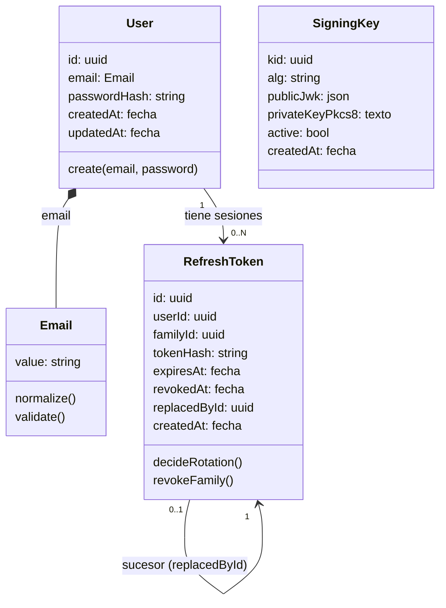

> Cada `app` o `extension` es un Contexto Delimitado (Bounded Context) y tiene su propio `domain-model.md`, su propio lenguaje ubicuo interno y sus propias reglas de negocio — no se comparte entre contextos. Este documento es la base para nombrar archivos, código y su estructura.

---

> **Nomenclatura obligatoria:** `DB` (inglés) se reserva siempre para base de datos/database; `BD`/`BDs` se reserva siempre para Contexto Delimitado/Bounded Context — nunca se usan de forma intercambiable ni se mezclan en el mismo documento.

---

# Modelo de dominio: Identidad (`services/auth`, Contexto Delimitado de Identidad)

## Resumen

El BD de Identidad es dueño de los usuarios, sus credenciales, las sesiones (familias de refresh tokens) y de la emisión/verificación de access tokens JWT firmados con EdDSA (Ed25519), publicando sus llaves públicas (JWKS). Sirve a los clientes del portal de pagos FluxOne (registro, inicio y cierre de sesión, renovación de sesión, perfil) y a los demás servicios, que verifican los tokens contra las llaves públicas publicadas. Su única responsabilidad es la identidad y la autenticación: no conoce cuentas bancarias ni transferencias. Su persistencia es propia, en el esquema `auth_schema` de PostgreSQL.

## Diagrama mermaid

## Glosario de lenguaje ubicuo

| Término | Definición |
|---------|-----------|
| Usuario | Persona registrada en el portal de pagos FluxOne, identificada por un id uuid y un email normalizado único. Es el agregado raíz `User`. |
| Email normalizado | Email con espacios laterales eliminados (trim) y en minúsculas, de máximo 254 caracteres y con forma `local@dominio`. Es el value object `Email`. |
| Credenciales | Par email + contraseña con el que un Usuario se autentica. |
| Contraseña | Secreto en claro del Usuario, de 12 a 128 caracteres. Se valida (value object transitorio `Password`), se hashea con Argon2id y se descarta; jamás se persiste ni se devuelve. |
| Access token | JWT firmado con EdDSA (Ed25519), de 15 minutos de vigencia, que acredita la identidad del Usuario ante los servicios. Sus claims son iss=`urn:fluxone:auth`, aud=`urn:fluxone:api`, sub=id del usuario y email. No se persiste. |
| Refresh token | Token opaco de 256 bits aleatorios, de 7 días de vigencia, de un solo uso, que permite obtener un nuevo access token. Solo se persiste su SHA-256 hexadecimal. Es la entidad `RefreshToken`. |
| Familia (sesión) | Conjunto de `RefreshToken` encadenados por rotación que comparten el mismo `familyId`. Representa una sesión del Usuario. |
| Rotación | Uso de un refresh token válido: se revoca y se emite un sucesor con el mismo `familyId`. |
| Reutilización | Presentación de un refresh token que ya fue revocado; se interpreta como posible robo y provoca la revocación de la familia. |
| Revocación | Marcado de un refresh token como inválido mediante `revokedAt`, de forma individual o de todos los tokens vigentes de una familia. |
| Llave de firma | Par de llaves Ed25519 (`SigningKey`) con la que se firman los access tokens. La privada nunca sale de este BD. |
| JWKS | Conjunto de llaves públicas (JSON Web Key Set) publicado por este BD para que los demás servicios verifiquen los access tokens. |
| Usuario demo (semilla) | Cada uno de los tres usuarios con ids fijos creados al arranque para demostración (alice, bob y carol en el dominio `fluxone.test`). |
| User (agregado raíz) | Agregado raíz de la identidad de un Usuario; contiene su `Email` y el hash de su contraseña, y es el propietario de sus `RefreshToken`. |
| SigningKey (agregado) | Agregado que representa una llave de firma de access tokens; sin relación con `User`. |

## Entidades

- **User** — agregado raíz. Representa a un Usuario con su email normalizado y el hash de su contraseña. Su creación valida y normaliza el email (`Email`) y exige una contraseña válida (`Password`) antes de hashearla.
- **RefreshToken** — entidad que representa un token de renovación de sesión de un `User`. Decide la rotación (resultado ROTATE / REUSED / EXPIRED) y permite revocar su familia.
- **SigningKey** — agregado. Representa una llave de firma de access tokens (alg siempre `EdDSA`).
- **Email** — value object. Email normalizado (trim + minúsculas, máximo 254 caracteres, forma `local@dominio`).
- **Password** — value object transitorio. Contraseña en claro (12 a 128 caracteres) que se valida y se descarta tras hashear; nunca se persiste ni se devuelve.
- **AccessToken** (no es entidad persistida) — JWT firmado con EdDSA de 15 minutos con claims iss=`urn:fluxone:auth`, aud=`urn:fluxone:api`, sub=id del usuario y email.
- **Sesión** (no es entidad persistida) — conjunto de `RefreshToken` con el mismo `familyId`.

## Atributos

### User

| Atributo | Tipo | Obligatorio |
|----------|------|-------------|
| id | uuid | Sí |
| email | string (normalizado, máximo 254, único) | Sí |
| passwordHash | string (formato PHC de Argon2id) | Sí |
| createdAt | fecha | Sí |
| updatedAt | fecha | Sí |

### RefreshToken

| Atributo | Tipo | Obligatorio |
|----------|------|-------------|
| id | uuid | Sí |
| userId | uuid | Sí |
| familyId | uuid (identifica la sesión: todos los tokens encadenados por rotación comparten familyId) | Sí |
| tokenHash | string (64 caracteres hexadecimales, SHA-256 del token opaco) | Sí |
| expiresAt | fecha | Sí |
| revokedAt | fecha | No |
| replacedById | uuid (id del token sucesor tras la rotación) | No |
| createdAt | fecha | Sí |

### SigningKey

| Atributo | Tipo | Obligatorio |
|----------|------|-------------|
| kid | uuid | Sí |
| alg | string (siempre `EdDSA`) | Sí |
| publicJwk | JSON | Sí |
| privateKeyPkcs8 | texto (PEM PKCS8) | Sí |
| active | bool | Sí |
| createdAt | fecha | Sí |

### Email

| Atributo | Tipo | Obligatorio |
|----------|------|-------------|
| value | string (normalizado: trim + minúsculas, máximo 254, forma `local@dominio`) | Sí |

### Password

| Atributo | Tipo | Obligatorio |
|----------|------|-------------|
| value | string (12 a 128 caracteres; transitorio, nunca se persiste ni se devuelve) | Sí |

## Relaciones y multiplicidad

- **User** `1:N` **RefreshToken** — un Usuario tiene muchas sesiones/tokens de renovación; si el Usuario se elimina, sus tokens se eliminan.
- **RefreshToken** `0..1:1` **RefreshToken** (sucesor, vía `replacedById`) — tras una rotación, el token usado apunta a su sucesor, formando una cadena de rotación dentro de la misma familia.
- **User** `1:1` **Email** — el email del Usuario es un value object `Email`.
- **SigningKey** — sin relación con `User`: firma los access tokens de todos los Usuarios; a lo sumo una `SigningKey` está activa.

## Reglas de negocio

- **RN-01 Email normalizado**: el email de un Usuario se guarda con trim y en minúsculas, con un máximo de 254 caracteres y con forma `local@dominio` (algo antes y después de una `@`, sin espacios, y un punto en el dominio). El email es único.
- **RN-02 Contraseña**: la contraseña tiene entre 12 y 128 caracteres (se cuentan caracteres, no bytes). Solo se conserva su hash Argon2id (memoria 19456 KiB, iteraciones 2, paralelismo 1); la contraseña nunca se almacena ni se devuelve en claro.
- **RN-03 Credenciales inválidas indistinguibles**: un email inexistente y una contraseña errónea producen exactamente el mismo resultado de rechazo.
- **RN-04 Refresh token**: es opaco, de 256 bits aleatorios; solo se persiste su SHA-256 hexadecimal; su vigencia es de 7 días desde su emisión.
- **RN-05 Rotación de un solo uso**: usar un refresh token válido lo revoca (`revokedAt`, `replacedById` = sucesor) y emite un sucesor con el mismo `familyId`.
- **RN-06 Reutilización**: presentar un refresh token ya revocado revoca todos los tokens aún vigentes de su familia.
- **RN-07 Cierre de sesión**: revoca los tokens vigentes de la familia del token presentado; es idempotente (sin token o con un token desconocido no falla).
- **RN-08 Refresh token expirado**: un refresh token no revocado pero expirado no sirve para rotar.
- **RN-09 Access token**: se firma con EdDSA (Ed25519), tiene una vigencia de 15 minutos, iss=`urn:fluxone:auth`, aud=`urn:fluxone:api`, sub=id del usuario y el claim email.
- **RN-10 Llave de firma**: existe a lo sumo una llave activa; se genera en el primer arranque si no hay ninguna; la llave privada nunca sale de este BD ni se publica; la llave pública se publica en el JWKS.
- **RN-11 Usuarios demo**: existen tres usuarios semilla con ids fijos — alice@fluxone.test (`11111111-1111-4111-8111-111111111111`), bob@fluxone.test (`22222222-2222-4222-8222-222222222222`) y carol@fluxone.test (`33333333-3333-4333-8333-333333333333`) — con la contraseña configurada en `DEMO_USERS_PASSWORD`; su creación es idempotente (nunca duplica ni modifica a un usuario existente).
