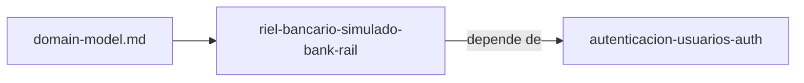

# Specs: Banco simulado (services/bank-rail)

> Banco externo simulado y poco fiable, usado por el portal de pagos para probar transferencias y reversos.

## Grafo de specs

## Tabla de specs

| Spec | Estado | Creación | Paralelizable con | Ruta | Depende de |
|---|:---:|:---:|:---:|---|---|
| riel-bancario-simulado-bank-rail | `Pendiente` | `Creado — pendiente aprobación` | `—` | `riel-bancario-simulado-bank-rail/summary.md` | [autenticacion-usuarios-auth](../auth/autenticacion-usuarios-auth/summary.md) |

> `domain-model.md` es el del Contexto Delimitado del banco simulado. El spec pertenece a la feature `riel-bancario-simulado`; los demás specs de la capacidad viven en los `INDEX.md` de sus unidades.
