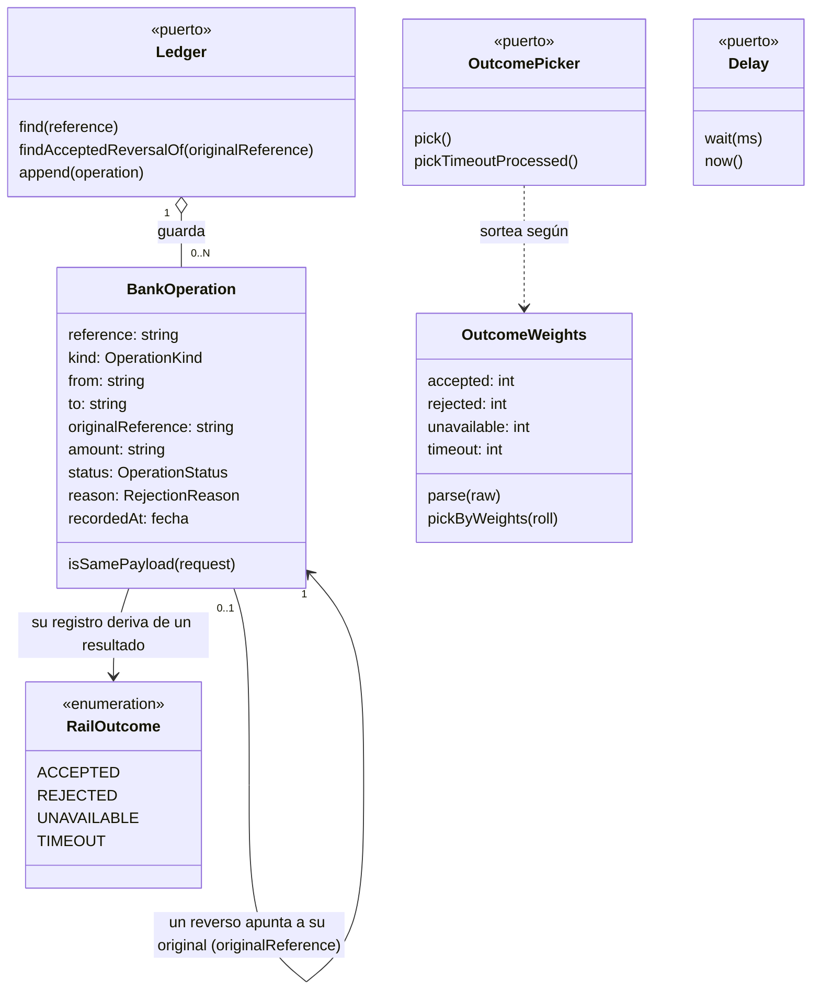

> Cada `app` o `extension` es un Contexto Delimitado (Bounded Context) y tiene su propio `domain-model.md`, su propio lenguaje ubicuo interno y sus propias reglas de negocio — no se comparte entre contextos. Este documento es la base para nombrar archivos, código y su estructura.

---

> **Nomenclatura obligatoria:** `DB` (inglés) se reserva siempre para base de datos/database; `BD`/`BDs` se reserva siempre para Contexto Delimitado/Bounded Context — nunca se usan de forma intercambiable ni se mezclan en el mismo documento.

---

# Modelo de dominio: Banco simulado (`services/bank-rail`, Contexto Delimitado de Banco simulado)

## Resumen

El BD de Banco simulado es dueño de las operaciones bancarias externas simuladas (transferencias y reversos) identificadas por una referencia (`reference`) y del libro (`Ledger`) donde quedan registradas. Sirve a un servicio cliente que envía dinero a un banco externo poco fiable: responde de forma aleatoria y configurable (aceptación, rechazo, indisponibilidad o timeout), es idempotente por `reference` y permite consultar el estado de una operación. Su única responsabilidad es simular al banco: no conoce usuarios, cuentas propias ni saldos. No tiene DB: su persistencia es un archivo JSONL de solo anexar.

## Diagrama mermaid

## Glosario de lenguaje ubicuo

| Término | Definición |
|---------|-----------|
| Banco simulado | El propio Contexto Delimitado: un banco externo ficticio que procesa transferencias y reversos con resultados no confiables. |
| Riel | Sinónimo operativo del servicio del Banco simulado (`services/bank-rail`): el canal por el que el servicio cliente envía dinero al banco. |
| Referencia (`reference`) | Identificador de una operación, de 1 a 255 caracteres ASCII imprimibles (0x21–0x7E), definido por el cliente. Transferencias y reversos comparten el mismo espacio de referencias: una referencia identifica a una sola operación. |
| Operación bancaria (`BankOperation`) | Operación registrada en el Ledger: una transferencia (`TRANSFER`) o un reverso (`REVERSAL`) con su resultado final (`ACCEPTED` o `REJECTED`). Es el agregado raíz. |
| Transferencia | Operación `TRANSFER` con `from`, `to` y `amount`. |
| Reverso | Operación `REVERSAL` que anula en su totalidad una transferencia aceptada; lleva `originalReference` y `amount`. |
| Monto (`amount`) | Cantidad en COP como cadena decimal `^(0\|[1-9][0-9]{0,15})(\.[0-9]{1,2})?$`, estrictamente mayor que 0. Se compara por valor (en centavos) y se registra siempre con dos decimales. Nunca es `float`. |
| Payload de una operación | Datos que la identifican junto a su `reference`: `from`, `to` y `amount` (transferencia) u `originalReference` y `amount` (reverso). Dos solicitudes con la misma `reference` tienen el mismo payload si coinciden el tipo de operación y todos esos datos (monto comparado por valor). |
| Resultado del sorteo (`RailOutcome`) | Uno de cuatro resultados posibles de una operación nueva: `ACCEPTED`, `REJECTED`, `UNAVAILABLE` o `TIMEOUT`. |
| Estado registrado (`OperationStatus`) | Estado final guardado en el Ledger: `ACCEPTED` o `REJECTED`. `UNAVAILABLE` nunca se registra. |
| Motivo de rechazo (`RejectionReason`) | Razón de un estado `REJECTED`: `REJECTED_BY_BANK` (resultado aleatorio) o una regla determinista de reverso: `ORIGINAL_NOT_FOUND`, `ORIGINAL_NOT_ACCEPTED`, `AMOUNT_MISMATCH`, `ALREADY_REVERSED`. |
| Pesos de resultados (`OutcomeWeights`) | Cuatro enteros no negativos, en el orden ACCEPTED, REJECTED, UNAVAILABLE, TIMEOUT, con suma mayor que 0. La probabilidad de cada resultado es su peso dividido entre la suma. Por defecto 25,25,25,25. |
| Timeout simulado | Resultado `TIMEOUT`: el banco tarda en responder `RAIL_TIMEOUT_DELAY_MS` ms (el cliente suele desistir antes) y puede haber procesado o no la operación. Una segunda consulta al `OutcomePicker` (`pickTimeoutProcessed`, 50/50 por defecto) decide si la procesó. Si la procesó, registra `ACCEPTED` antes de esperar y responde `ACCEPTED` tarde; si no, no registra nada y responde indisponible tras la espera. |
| Indisponibilidad | Resultado `UNAVAILABLE` (o `TIMEOUT` no procesado): el banco no atendió la operación y no deja rastro en el Ledger; la misma referencia puede reintentarse y sortearse de nuevo. |
| Idempotencia por referencia | Repetir una referencia ya registrada con el mismo payload devuelve el resultado guardado, sin nuevo sorteo ni nueva entrada; con payload distinto es un conflicto (`REFERENCE_CONFLICT`). |
| Ledger | Puerto de persistencia de las operaciones registradas. Su adaptador es un archivo JSONL de solo anexar, cargado completo en memoria al arrancar. |
| `OutcomePicker` | Puerto que sortea el resultado de una operación nueva (`pick`) y decide si un timeout procesó la operación (`pickTimeoutProcessed`). Inyectable para pruebas deterministas. |
| `Delay` | Puerto de reloj: espera una cantidad de milisegundos (`wait`) y entrega el instante actual (`now`). Inyectable para pruebas sin esperas reales. |
| BankOperation (agregado raíz) | Agregado de una operación registrada, identificado por su `reference`; es inmutable una vez registrado. |

## Entidades

- **BankOperation** — agregado raíz. Operación registrada (transferencia o reverso) con su estado final y, si fue rechazada, su motivo. Inmutable: una vez registrada nunca cambia ni se elimina.
- **RailOutcome** — value object (enumeración). Resultado del sorteo: `ACCEPTED`, `REJECTED`, `UNAVAILABLE`, `TIMEOUT`.
- **OutcomeWeights** — value object. Los cuatro pesos del sorteo; valida su formato y selecciona un resultado a partir de un número entero ya sorteado.
- **Reference** — value object. Referencia validada (1–255 caracteres ASCII imprimibles).
- **Amount** — value object. Monto validado, representado en centavos (`bigint`) y formateado con dos decimales.
- **Ledger**, **OutcomePicker**, **Delay** — puertos del dominio (no entidades); sus contratos se definen en el diseño del spec.

## Atributos

### BankOperation

| Atributo | Tipo | Obligatorio |
|----------|------|-------------|
| reference | string (1–255, ASCII 0x21–0x7E; única en el Ledger) | Sí |
| kind | `TRANSFER` \| `REVERSAL` | Sí |
| from | string (cuenta de origen; solo `TRANSFER`) | Solo en `TRANSFER` |
| to | string (cuenta de destino; solo `TRANSFER`) | Solo en `TRANSFER` |
| originalReference | string (referencia de la operación original; solo `REVERSAL`) | Solo en `REVERSAL` |
| amount | string decimal con dos decimales, > 0 | Sí |
| status | `ACCEPTED` \| `REJECTED` | Sí |
| reason | `RejectionReason` (solo si `status` es `REJECTED`) | Solo si `REJECTED` |
| recordedAt | fecha (ISO-8601) | Sí |

### OutcomeWeights

| Atributo | Tipo | Obligatorio |
|----------|------|-------------|
| accepted | entero ≥ 0 | Sí |
| rejected | entero ≥ 0 | Sí |
| unavailable | entero ≥ 0 | Sí |
| timeout | entero ≥ 0 | Sí |

### Reference

| Atributo | Tipo | Obligatorio |
|----------|------|-------------|
| value | string (1–255 caracteres ASCII imprimibles 0x21–0x7E) | Sí |

### Amount

| Atributo | Tipo | Obligatorio |
|----------|------|-------------|
| cents | bigint (> 0; máximo 999999999999999999, equivalente a 9999999999999999.99) | Sí |

## Relaciones y multiplicidad

- **Ledger** `1:N` **BankOperation** — el Ledger guarda todas las operaciones registradas; cada `reference` aparece una sola vez.
- **BankOperation (REVERSAL)** `0..1:1` **BankOperation (TRANSFER)** — un reverso apunta a la transferencia que anula mediante `originalReference`. A lo sumo un reverso `ACCEPTED` apunta a una misma transferencia.
- **OutcomePicker** `1:1` **OutcomeWeights** — el sorteo aleatorio se rige por los pesos configurados.

## Reglas de negocio

- **RN-01 Referencia única compartida**: transferencias y reversos comparten el espacio de referencias; una referencia identifica a una sola operación registrada.
- **RN-02 Monto**: cadena decimal `^(0|[1-9][0-9]{0,15})(\.[0-9]{1,2})?$` estrictamente mayor que 0; se compara y se opera como centavos enteros, nunca como `float`; se registra con dos decimales.
- **RN-03 Idempotencia por referencia**: una referencia registrada con el mismo payload devuelve el resultado guardado sin nuevo sorteo ni nueva entrada; con payload distinto (incluido otro tipo de operación) es un conflicto.
- **RN-04 Resultado aleatorio ponderado**: toda operación nueva que supera las reglas deterministas se sortea entre `ACCEPTED`, `REJECTED`, `UNAVAILABLE` y `TIMEOUT` según los pesos; un peso 0 impide ese resultado.
- **RN-05 Registro por resultado**: `ACCEPTED` se registra como `ACCEPTED`; `REJECTED` se registra como `REJECTED` con motivo `REJECTED_BY_BANK`; `UNAVAILABLE` no se registra.
- **RN-06 Timeout simulado**: `TIMEOUT` espera `RAIL_TIMEOUT_DELAY_MS` y una segunda consulta al `OutcomePicker` decide si el banco procesó la operación: si la procesó se registra `ACCEPTED` antes de esperar y la respuesta tardía es `ACCEPTED`; si no, no se registra nada y la respuesta tardía es de indisponibilidad.
- **RN-07 Reglas deterministas de reverso**, evaluadas en este orden y registradas como `REJECTED` con su motivo: (1) `ORIGINAL_NOT_FOUND` si `originalReference` no existe; (2) `ORIGINAL_NOT_ACCEPTED` si existe pero está `REJECTED` o es un `REVERSAL`; (3) `AMOUNT_MISMATCH` si el monto difiere del de la operación original; (4) `ALREADY_REVERSED` si ya existe un reverso `ACCEPTED` sobre esa original con otra referencia. Un reverso que las supera se sortea como una transferencia.
- **RN-08 Reverso total**: un reverso anula la totalidad de la transferencia original; no existen reversos parciales.
- **RN-09 Un reverso aceptado por original**: a lo sumo un reverso `ACCEPTED` por transferencia; un reverso `REJECTED` (aleatorio o por regla) no impide un nuevo intento con otra referencia.
- **RN-10 Ledger inmutable**: las operaciones registradas son de solo anexar; nunca se modifican ni se eliminan, y sobreviven a los reinicios del servicio.
- **RN-11 Pesos válidos**: los pesos son cuatro enteros no negativos en el orden ACCEPTED, REJECTED, UNAVAILABLE, TIMEOUT con suma mayor que 0; unos pesos inválidos impiden el arranque del servicio.
- **RN-12 Consulta de solo lectura**: consultar una referencia nunca sortea ni escribe en el Ledger.
