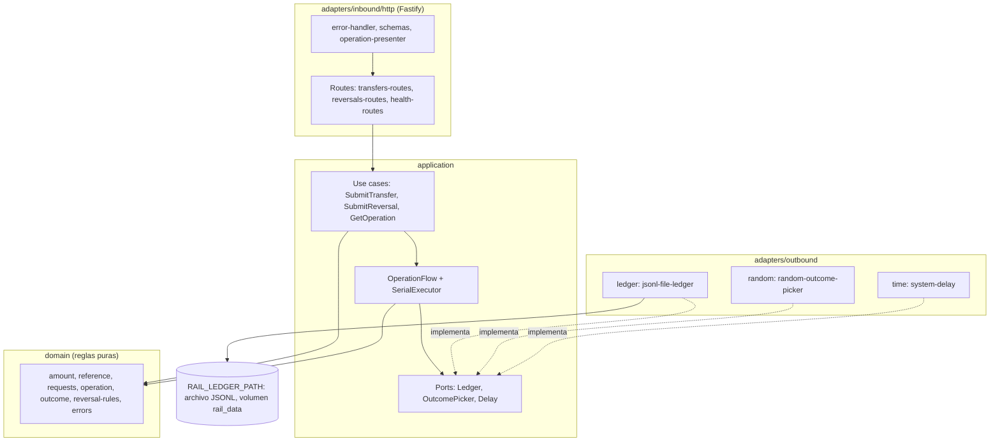

# Technical Design Document: Riel bancario simulado (servicio `services/bank-rail`)

## 1. Metadata & Traceability
- **Spec:** `riel-bancario-simulado-bank-rail`
- **Requirements Ref:** `requirements.md` (spec: `riel-bancario-simulado-bank-rail`)
- **Depende de:** `autenticacion-usuarios-auth` (ya entregado; no se reconstruye). Aporta los archivos de raíz `package.json` (workspaces `apps/*` y `services/*`), `tsconfig.base.json`, `eslint.config.js`, `.prettierrc`, `.prettierignore`, `.npmrc` (`ignore-scripts=true`), `.gitattributes`, `.dockerignore`, `lefthook.yml` y `.githooks/pre-commit`. Este spec no crea ni modifica ninguno de ellos; su único archivo de raíz tocado es `package-lock.json` (Modificar, regenerado al añadir el workspace).
- **Target Stack:** Node.js 24.22.0 (`node:24.22.0-alpine`), TypeScript 6.0.3 ESM estricto, Fastify 5.12.7, Vitest 5.0.5, tsx 4.23.15. Raíz del monorepo (ya instalada por el spec de auth): ESLint 10.12.0, @eslint/js 10.0.1, typescript-eslint 8.71.2, eslint-config-prettier 10.1.8, globals 17.13.0, Prettier 3.9.10, lefthook 2.1.12, @types/node 24.19.2, typescript 6.0.3.
- **Contenedores:** imagen `node:24.22.0-alpine` (derivada con `git` para la etapa `dev` del `Dockerfile`), orquestada con Docker Compose. No hay base de datos.
- **Host:** solo Docker y Git; todo comando de compilación, prueba y ejecución corre en contenedores.
- **Versiones:** exactas, sin `^` ni `~`, en `services/bank-rail/package.json`.
- **Modelo de dominio:** `../domain-model.md` (Contexto Delimitado de Banco simulado). **Esquema DB:** no aplica (el servicio no tiene DB; no existe `db-design.dbml`, ver §3.2).

---

## 2. Architecture & System Overview

### 2.1 Architectural Approach
Arquitectura hexagonal. El dominio queda aislado de la infraestructura y del framework:

- `src/domain`: reglas puras (tipos de operación, validación de referencia y monto, pesos y selección de resultado, reglas de reverso, errores). Sin imports de Fastify, `node:fs`, `node:http` ni ningún módulo de Node.
- `src/application`: puertos en `ports/` (interfaces TypeScript, un archivo por puerto: `Ledger`, `OutcomePicker`, `Delay`), casos de uso en `use-cases/` (clases con método `execute`, dependencias inyectadas por constructor), el flujo compartido `operation-flow.ts` y el `SerialExecutor`. Solo dependen de `src/domain` y de los puertos.
- `src/adapters/inbound/http`: adaptador de entrada Fastify (rutas, esquemas JSON, presentación de respuestas, manejo de errores, logs).
- `src/adapters/outbound/ledger`, `src/adapters/outbound/random` y `src/adapters/outbound/time`: adaptadores de salida que implementan los puertos (`JsonlFileLedger`, `RandomOutcomePicker`, `SystemDelay`).
- `src/compose.ts`: raíz de composición (crea adaptadores, casos de uso y la app); lo usan `src/main.ts` y las pruebas de aceptación, que sustituyen puertos por dobles deterministas.
- `src/config.ts`: lectura y validación de variables de entorno. `src/main.ts`: arranque del proceso.

Las carpetas se llaman `inbound` y `outbound` (nunca `in`). No hay UnitOfWork ni DB: la atomicidad de "decidir y registrar" la da el `SerialExecutor` (una sección crítica serializada) y la del archivo, un único escritor con cola de promesas dentro del adaptador del `Ledger`.

Convenciones de código: ESM con `module NodeNext`, por lo que los imports relativos entre archivos `.ts` llevan la extensión `.js` (p. ej. `import { parseAmount } from '../domain/amount.js'`); `verbatimModuleSyntax` obliga a `import type` para los tipos. Los identificadores de código van en inglés.

### 2.2 Component Diagram / Module Interaction


### 2.3 Entorno de ejecución en contenedores

El host solo tiene Docker y Git: no se instala nada en él y todo comando de compilación, prueba y ejecución corre dentro de contenedores. El Compose de este servicio es `services/bank-rail/compose.dev.yaml` (proyecto Compose `fluxone-bank-rail-dev`); es un archivo propio, independiente de cualquier otro Compose del repositorio. Lo crea la tarea 1.1 con el servicio `dev`; la tarea 4.2 le añade el servicio `bank-rail` y el volumen `rail_data`. El hook de commit versionado por el spec de auth ejecuta lefthook con el Compose de auth; este spec no lo toca.

**Servicios**

| Servicio | Imagen / build | Puertos | Volúmenes | Healthcheck | Propósito |
|:---|:---|:---|:---|:---|:---|
| `dev` | build de `services/bank-rail/Dockerfile`, etapa `dev` (`node:24.22.0-alpine` + `git`), contexto = raíz del repositorio | ninguno | raíz del repositorio en `/app` (bind mount); volúmenes con nombre `node_modules_root`, `node_modules_bank_rail`, `npm_cache` | ninguno | Ejecuta todos los comandos de compilación, lint, tipos, pruebas e instalación |
| `bank-rail` (tarea 4.2) | build de `services/bank-rail/Dockerfile` (etapa runtime), contexto = raíz del repositorio | `3004:3004` | volumen con nombre `rail_data` en `/data` | `wget` a `/health` cada 5 s (`start_period` 10 s, 10 reintentos) | Servicio del riel en ejecución |

**Comandos.** Prefijo de todo comando: `docker compose -f services/bank-rail/compose.dev.yaml`. Como no hay base de datos, todos los comandos de `dev` usan `run --rm --no-deps dev <cmd>`.

| Acción | Comando |
|:---|:---|
| Instalar dependencias (genera `package-lock.json` en la tarea 1.2; después `npm ci`) | `docker compose -f services/bank-rail/compose.dev.yaml run --rm --no-deps dev npm install` / `docker compose -f services/bank-rail/compose.dev.yaml run --rm --no-deps dev npm ci` |
| Compilar | `docker compose -f services/bank-rail/compose.dev.yaml run --rm --no-deps dev npm run build -w services/bank-rail` |
| Lint | `docker compose -f services/bank-rail/compose.dev.yaml run --rm --no-deps dev npm run lint` |
| Formato | `docker compose -f services/bank-rail/compose.dev.yaml run --rm --no-deps dev npm run format:check` |
| Tipos | `docker compose -f services/bank-rail/compose.dev.yaml run --rm --no-deps dev npm run typecheck --workspaces --if-present` |
| Pruebas `unit` | `docker compose -f services/bank-rail/compose.dev.yaml run --rm --no-deps dev npm run test -w services/bank-rail -- --project unit` |
| Pruebas `acceptance` | `docker compose -f services/bank-rail/compose.dev.yaml run --rm --no-deps dev npm run test -w services/bank-rail -- --project acceptance` |
| Todas las pruebas del servicio | `docker compose -f services/bank-rail/compose.dev.yaml run --rm --no-deps dev npm run test -w services/bank-rail` |
| Construir la imagen runtime (tarea 4.2) | `docker compose -f services/bank-rail/compose.dev.yaml build bank-rail` |
| Levantar `bank-rail` (tarea 4.2) | `docker compose -f services/bank-rail/compose.dev.yaml up -d --wait bank-rail` |
| Alcanzar `bank-rail` por la red de Compose (tarea 4.2) | `docker compose -f services/bank-rail/compose.dev.yaml run --rm --no-deps dev node -e "fetch('http://bank-rail:3004/health').then((r) => process.exit(r.ok ? 0 : 1))"` |
| Limpiar contenedores y volúmenes | `docker compose -f services/bank-rail/compose.dev.yaml down -v` |

**Red.** Los servicios comparten la red por defecto del proyecto Compose: cualquier otro contenedor llega al riel por `bank-rail:3004`. El puerto 3004 del host es solo para depuración.

**Ownership y volúmenes.** `node_modules` vive en volúmenes con nombre (`node_modules_root` en `/app/node_modules`, `node_modules_bank_rail` en `/app/services/bank-rail/node_modules`) y la caché de npm en `npm_cache` (`/root/.npm`): así no se escriben binarios Linux en el árbol del host y el bind mount es más rápido en Docker Desktop. Los archivos que el contenedor `dev` escribe en el árbol (lockfile, `dist`) los crea `root` dentro del contenedor; el `Dockerfile` registra `/app` como `safe.directory` de git. El libro del servicio vive en el volumen `rail_data` (`/data`); la imagen runtime crea `/data` con propietario `node` para que el volumen nuevo herede ese propietario y el usuario no administrador pueda escribir.

**Contenido exacto de `services/bank-rail/compose.dev.yaml` (tarea 1.1).**

```yaml
name: fluxone-bank-rail-dev

services:
  dev:
    build:
      context: ../..
      dockerfile: services/bank-rail/Dockerfile
      target: dev
    working_dir: /app
    volumes:
      - ../..:/app
      - node_modules_root:/app/node_modules
      - node_modules_bank_rail:/app/services/bank-rail/node_modules
      - npm_cache:/root/.npm

volumes:
  node_modules_root:
  node_modules_bank_rail:
  npm_cache:
```

**Servicio `bank-rail` y volumen `rail_data` (tarea 4.2).** El servicio se añade bajo `services:` y el volumen bajo `volumes:`:

```yaml
  bank-rail:
    build:
      context: ../..
      dockerfile: services/bank-rail/Dockerfile
    environment:
      PORT: '3004'
      RAIL_OUTCOME_WEIGHTS: ${RAIL_OUTCOME_WEIGHTS:-25,25,25,25}
      RAIL_TIMEOUT_DELAY_MS: ${RAIL_TIMEOUT_DELAY_MS:-15000}
      RAIL_LEDGER_PATH: /data/rail-ledger.jsonl
      LOG_LEVEL: ${LOG_LEVEL:-info}
    volumes:
      - rail_data:/data
    ports:
      - '3004:3004'
    healthcheck:
      test: ['CMD-SHELL', 'wget -q -O /dev/null http://127.0.0.1:3004/health']
      interval: 5s
      timeout: 3s
      retries: 10
      start_period: 10s
```

```yaml
  rail_data:
```

**Contenido exacto de la etapa `dev` de `services/bank-rail/Dockerfile` (tarea 1.1).** Es la primera etapa del archivo:

```dockerfile
FROM node:24.22.0-alpine AS dev
RUN apk add --no-cache git \
  && git config --system --add safe.directory /app
WORKDIR /app
```

### 2.5 Decisiones cerradas
- Arquitectura hexagonal en todo servicio: aísla el dominio del framework y de la infraestructura.
- Stack y versiones exactas de §1: Node 24 LTS; TypeScript 6.0.3 por compatibilidad de typescript-eslint (`<6.1.0`).
- Puerto 3004, sin autenticación; red interna de Compose (el puerto del host es solo para depuración).
- Sin DB: el ledger es un archivo JSONL de solo anexar, cargado completo en memoria al arrancar, con el volumen `rail_data` montado en `/data`.
- Aleatoriedad y reloj como puertos inyectables (`OutcomePicker`, `Delay`) y el ledger como puerto `Ledger`: pruebas deterministas.
- Operaciones idempotentes por `reference`; transferencias y reversos comparten el espacio de referencias; `GET /rail/transfers/{reference}` responde 404 `NOT_FOUND` si no hay registro.
- Resultado aleatorio de cuatro valores con pesos `RAIL_OUTCOME_WEIGHTS` (default 25,25,25,25) y espera `RAIL_TIMEOUT_DELAY_MS` (default 15000).
- Reglas deterministas de reverso `ORIGINAL_NOT_FOUND`, `ORIGINAL_NOT_ACCEPTED`, `AMOUNT_MISMATCH`, `ALREADY_REVERSED`; reverso total.
- Semántica de `TIMEOUT` (decisión cerrada de este diseño): el banco espera `RAIL_TIMEOUT_DELAY_MS` mediante el puerto `Delay` y la respuesta llega tarde. Una SEGUNDA consulta al puerto `OutcomePicker` (`pickTimeoutProcessed(): boolean`, 50/50 por defecto en el adaptador aleatorio) decide si el banco procesó la operación: si la procesó, registra `ACCEPTED` en el ledger ANTES de esperar el delay y responde 200 `{reference, status:"ACCEPTED"}` tras la espera; si no la procesó, no registra nada y responde 503 `UNAVAILABLE` tras la espera. Así existen los escenarios "timeout y el banco sí procesó" (`GET` posterior 200) y "timeout y el banco no procesó" (`GET` posterior 404).
- `UNAVAILABLE` (y `TIMEOUT` no procesado) nunca escribe en el ledger: la misma referencia puede reintentarse y sortearse de nuevo.
- Un único escritor serializado: la sección "consultar ledger, aplicar reglas, sortear y registrar" corre dentro de un `SerialExecutor` compartido por transferencias y reversos; la espera del timeout ocurre fuera de esa sección.
- Errores con forma `{error:{code,message}}`, mensajes en español.
- Logs JSON (pino de Fastify) con `reqId` = `X-Request-Id` y redacción de `authorization` y `cookie`.
- OpenAPI 3.1 en `services/bank-rail/openapi.yaml`.
- Ambiente 100 % Docker (constitución): compilación, pruebas y ejecución en contenedores con el Compose propio del servicio (`services/bank-rail/compose.dev.yaml`, §2.3).
- YAML versionado con comillas simples (por `singleQuote: true` de `.prettierrc`) para que `prettier --check .` pase.

### 2.6 Riesgos y mitigaciones

| Riesgo | Impacto | Mitigación |
|:---|:---|:---|
| Aleatoriedad del riel | Pruebas no deterministas | `OutcomePicker` y `Delay` inyectables; las pruebas usan un sorteo por secuencia y una espera simulada |
| Dos solicitudes simultáneas con la misma referencia (o dos reversos de la misma original) | Doble sorteo o doble registro | `SerialExecutor` serializa "consultar, decidir y registrar"; el ledger además serializa las escrituras |
| Corte durante la escritura del archivo deja una línea final incompleta | Ledger ilegible al reiniciar | La línea final truncada se ignora y se descarta del archivo con advertencia; cualquier otra línea corrupta hace fallar el arranque con mensaje claro |
| El ledger crece sin purga ni rotación (fuera de alcance) | Bajo en este alcance | Se acepta; se carga completo en memoria |
| Sin `fsync` al escribir | Un corte de energía del host podría perder la última línea | Se acepta: es un simulador; la línea final truncada se tolera al arrancar |
| El archivo del ledger admite un solo escritor | Dos instancias corromperían el libro | Una sola instancia por volumen; queda documentado |
| La respuesta tardía del timeout (15 s por defecto) puede llegar después de que el cliente cierre la conexión | El cliente no ve la respuesta | La operación ya está registrada si el banco la procesó; el cliente consulta con `GET` por la referencia |
| Ajv de Fastify, por defecto, elimina campos adicionales y convierte tipos (`removeAdditional`, `coerceTypes`) | Campos extra aceptados en silencio y números aceptados como texto | Se desactivan explícitamente en la instancia (§4.2 Logging y Fastify) y el dominio vuelve a validar |
| Permisos del volumen `rail_data` con el usuario `node` | El servicio no puede escribir el ledger | La imagen crea `/data` con propietario `node` antes de `USER node`; lo verifica AC-RIE-38 |
| Versiones del stack no verificadas localmente | La instalación o el typecheck fallan al empezar | Primera instalación con `npm install`, luego `npm ci` y `tsc --noEmit` en el contenedor `dev` antes de escribir código de producto (tarea 1.2) |
| Bind mount en Docker Desktop (rendimiento) | Instalaciones y pruebas lentas | `node_modules` y la caché de npm en volúmenes con nombre |
| Compatibilidad del build en Docker con workspaces | La imagen no compila o no arranca | Verificado por la tarea del Dockerfile (AC-RIE-38) |

### 2.7 Directrices del proyecto
- `Global`: arquitectura hexagonal en todo servicio, con dominio sin dependencias de framework, DB, broker ni HTTP.
- `Global`: stack Node 24.22.0 + TypeScript 6.0.3 ESM con npm workspaces y versiones exactas fijadas en §1 y en las matrices de cada spec.
- `Global`: dinero en COP, `bigint` de centavos en dominio y `string` en JSON, nunca `float`.
- `Global`: logs JSON con `correlationId`, nunca secretos, tokens ni contraseñas.
- `Unidad: services/bank-rail`: tras entregar este spec, el riel no se modifica para hacer pasar casos de otros specs; sus consumidores se adaptan a este contrato.
- `Unidad: services/bank-rail`: todo comando de compilación, prueba y ejecución de la unidad corre en contenedores con `docker compose -f services/bank-rail/compose.dev.yaml` (servicio `dev`).
- `Unidad: services/bank-rail`: se crea el modelo de dominio de este BD en `../domain-model.md` (Contexto Delimitado de Banco simulado).

### 2.8 Sujeto a actualización futura
sin actualizaciones futuras declaradas

---

## 3. Data Models & Schema Design

> Los datos van primero: todo modelo de esta sección está declarado antes en `../domain-model.md`; un cambio de modelo entra primero en ese documento.

### 3.1 Domain Entities (Core Business Objects)

Entidades y funciones puras en `src/domain` (un archivo por concepto, ver §5). Los errores de `src/domain/errors.ts` extienden `Error` y fijan `name` al nombre de la clase:

```typescript
// src/domain/errors.ts
export class ValidationError extends Error {}          // message = detalle de la violación (español, sin eco del valor)
export class ReferenceConflictError extends Error {}   // misma reference con payload distinto
export class LedgerUnavailableError extends Error {}   // falla de lectura o escritura del ledger (conserva `cause`)
```

Monto y referencia:

```typescript
// src/domain/amount.ts
const AMOUNT_PATTERN = /^(0|[1-9][0-9]{0,15})(\.[0-9]{1,2})?$/;
// typeof raw === 'string', cumple AMOUNT_PATTERN y el valor es > 0; devuelve centavos (parte entera * 100 + fracción
// completada a 2 dígitos). Si no -> ValidationError. Un número JSON, '0', '0.00', '-1', '1.234' son inválidos.
export function parseAmount(raw: unknown): bigint;
// 1000n -> '10.00'
export function formatAmount(cents: bigint): string;

// src/domain/reference.ts
const REFERENCE_PATTERN = /^[\x21-\x7E]{1,255}$/;
export function isValidReference(raw: unknown): raw is string;
// Devuelve raw si isValidReference; si no -> ValidationError('<field>: ...'). `field` por defecto 'reference'.
export function parseReference(raw: unknown, field?: string): string;
// from/to: string de 1 a 255 caracteres (sin más reglas; el banco no valida que la cuenta exista).
export function parseParty(raw: unknown, field: 'from' | 'to'): string;
```

Solicitudes (entrada ya validada):

```typescript
// src/domain/requests.ts
export interface TransferRequest {
  kind: 'TRANSFER';
  reference: string;
  from: string;
  to: string;
  amountCents: bigint;
}
export interface ReversalRequest {
  kind: 'REVERSAL';
  reference: string;
  originalReference: string;
  amountCents: bigint;
}
export type OperationRequest = TransferRequest | ReversalRequest;

// raw debe ser un objeto simple con EXACTAMENTE las claves {reference, from, to, amount}
// (faltante, adicional o de tipo incorrecto -> ValidationError). Valida con parseReference, parseParty, parseAmount.
export function parseTransferRequest(raw: unknown): TransferRequest;
// Ídem con las claves {reference, originalReference, amount}; originalReference se valida con parseReference.
export function parseReversalRequest(raw: unknown): ReversalRequest;
```

Operación registrada (misma forma que cada línea del ledger, §3.2):

```typescript
// src/domain/operation.ts
export type OperationKind = 'TRANSFER' | 'REVERSAL';
export type OperationStatus = 'ACCEPTED' | 'REJECTED';
export type RejectionReason =
  | 'REJECTED_BY_BANK'
  | 'ORIGINAL_NOT_FOUND'
  | 'ORIGINAL_NOT_ACCEPTED'
  | 'AMOUNT_MISMATCH'
  | 'ALREADY_REVERSED';

export interface BankOperation {
  reference: string;
  kind: OperationKind;
  from?: string;               // solo TRANSFER
  to?: string;                 // solo TRANSFER
  originalReference?: string;  // solo REVERSAL
  amount: string;              // dos decimales (formatAmount)
  status: OperationStatus;
  reason?: RejectionReason;    // solo si status = REJECTED
  recordedAt: string;          // ISO-8601 (Date.toISOString())
}

export type RecordedResult = { status: 'ACCEPTED' } | { status: 'REJECTED'; reason: RejectionReason };

// Construye la operación con las claves en este orden: reference, kind, from, to, originalReference, amount,
// status, reason, recordedAt (las ausentes se omiten).
export function buildOperation(request: OperationRequest, result: RecordedResult, recordedAt: Date): BankOperation;
// true si existing.kind === request.kind y coinciden todos los datos: TRANSFER -> from, to y monto por valor;
// REVERSAL -> originalReference y monto por valor (parseAmount(existing.amount) === request.amountCents).
export function isSamePayload(existing: BankOperation, request: OperationRequest): boolean;
// Valida un objeto leído de una línea del ledger (claves y tipos de §3.2, coherencia kind/campos, reason solo si
// REJECTED, amount con dos decimales, reference válida). Si no -> ValidationError.
export function parseStoredOperation(raw: unknown): BankOperation;
// Código HTTP de un rechazo en un POST: 'REJECTED_BY_BANK' -> 'REJECTED'; cualquier otro motivo -> el propio motivo.
export function rejectionCode(reason: RejectionReason): string;
```

Resultado del sorteo y pesos:

```typescript
// src/domain/outcome.ts
export type RailOutcome = 'ACCEPTED' | 'REJECTED' | 'UNAVAILABLE' | 'TIMEOUT';
export type OutcomeWeights = Record<RailOutcome, number>;
export const DEFAULT_OUTCOME_WEIGHTS: OutcomeWeights; // 25, 25, 25, 25

// raw debe cumplir /^[0-9]+(,[0-9]+){3}$/ (sin espacios), cada valor y su suma deben ser enteros seguros
// (Number.isSafeInteger) y la suma > 0; orden ACCEPTED,REJECTED,UNAVAILABLE,TIMEOUT. Si no -> ValidationError.
export function parseOutcomeWeights(raw: string): OutcomeWeights;
export function totalWeight(weights: OutcomeWeights): number;
// roll: entero en [0, totalWeight). Recorre ACCEPTED, REJECTED, UNAVAILABLE, TIMEOUT acumulando pesos y devuelve
// el primero cuyo acumulado supera roll (un peso 0 nunca se devuelve).
export function pickByWeights(weights: OutcomeWeights, roll: number): RailOutcome;
```

Reglas deterministas de reverso (orden fijo):

```typescript
// src/domain/reversal-rules.ts
// `original` = operación registrada con request.originalReference (o undefined);
// `acceptedReversalOfOriginal` = reverso ACCEPTED registrado sobre esa original (o undefined).
// Orden de evaluación:
//  1. original === undefined                                  -> 'ORIGINAL_NOT_FOUND'
//  2. original.status !== 'ACCEPTED' || original.kind !== 'TRANSFER' -> 'ORIGINAL_NOT_ACCEPTED'
//  3. parseAmount(original.amount) !== request.amountCents     -> 'AMOUNT_MISMATCH'
//  4. acceptedReversalOfOriginal !== undefined                 -> 'ALREADY_REVERSED'
//  5. en otro caso undefined (supera las reglas)
export function decideReversalRejection(
  request: ReversalRequest,
  original: BankOperation | undefined,
  acceptedReversalOfOriginal: BankOperation | undefined,
): RejectionReason | undefined;
```

**Pertenencia de datos:** no aplica: el riel no tiene tenants ni usuarios; ninguna tabla. Cada línea del ledger pertenece al riel y se identifica solo por su `reference`; no hay valores centinela.

### 3.2 Database Schema & Persistence
- **Target Database / Storage:** archivo JSONL de solo anexar en `RAIL_LEDGER_PATH` (default `/data/rail-ledger.jsonl`, volumen `rail_data`). El servicio no tiene DB: no existe `db-design.dbml`, ni migraciones, ni esquema, ni rol de DB. Las pruebas usan un archivo temporal.
- **Formato de línea:** una línea JSON por operación registrada, terminada en `\n`, con las claves de `BankOperation` en este orden (las ausentes se omiten):

```json
{"reference":"TRX-0001","kind":"TRANSFER","from":"ACC-001","to":"EXT-0001","amount":"1500.50","status":"ACCEPTED","recordedAt":"2026-10-15T14:00:00.000Z"}
{"reference":"TRX-0002","kind":"TRANSFER","from":"ACC-002","to":"EXT-0002","amount":"20.00","status":"REJECTED","reason":"REJECTED_BY_BANK","recordedAt":"2026-10-15T14:00:05.000Z"}
{"reference":"REV-0001","kind":"REVERSAL","originalReference":"TRX-0001","amount":"1500.50","status":"ACCEPTED","recordedAt":"2026-10-15T14:01:00.000Z"}
{"reference":"REV-0002","kind":"REVERSAL","originalReference":"TRX-0002","amount":"20.00","status":"REJECTED","reason":"ORIGINAL_NOT_ACCEPTED","recordedAt":"2026-10-15T14:01:10.000Z"}
```

- **Adaptador `JsonlFileLedger`** (`src/adapters/outbound/ledger/jsonl-file-ledger.ts`), implementa el puerto `Ledger`:
  - **Carga (`static open(filePath: string): Promise<JsonlFileLedger>`)**, con `node:fs/promises`:
    1. Crea el directorio padre (`mkdir` recursivo) y el archivo vacío si no existen.
    2. Lee el archivo completo en UTF-8 y lo divide por `\n`; las líneas vacías o solo con espacios se ignoran.
    3. Cada línea (número 1-based) se parsea con `JSON.parse` y `parseStoredOperation`. Una referencia repetida es inválida.
    4. **Línea final truncada:** si el contenido NO termina en `\n` y la última línea falla en `JSON.parse` (error de sintaxis), se ignora: se trunca el archivo (`fs.truncate`) hasta el último `\n` para que las escrituras posteriores no se concatenen a un fragmento, y se añade una advertencia a `loadWarnings` (`{event: 'rail.ledger_truncated_line_discarded', line, bytes}`). Una última línea sin `\n` que sí es JSON válido se acepta y la primera escritura posterior antepone `\n`.
    5. **Cualquier otra línea inválida** (no es JSON, `parseStoredOperation` falla, referencia repetida, o la última línea con `\n` que no es JSON) → `open` rechaza con `Error('Ledger corrupto en <ruta>: línea <n> inválida (<detalle>)')` sin eco del contenido y sin modificar el archivo; el proceso falla al arrancar.
    6. Construye el índice `Map<reference, BankOperation>` y el índice `Map<originalReference, BankOperation>` con los reversos `ACCEPTED` (para `findAcceptedReversalOf`). Expone `readonly loadWarnings` (lista de advertencias de la carga).
  - **`find(reference)` y `findAcceptedReversalOf(originalReference)`:** lecturas en memoria. Pueden lanzar `LedgerUnavailableError` (la lectura interna falló).
  - **`append(operation)`:** escritura serializada: una cola de promesas (`tail`) garantiza un solo escritor; cada escritura hace `appendFile(path, [\n si hace falta] + JSON.stringify(operation) + '\n')`; solo si la escritura termina bien se actualizan los índices en memoria (nunca antes) y la promesa resuelve (el servicio responde después). Si la escritura falla → `LedgerUnavailableError` (con `cause`), los índices no cambian y la cola sigue operativa. Una `reference` ya existente lanza `Error` (error de programación: el flujo la verifica dentro de la sección serializada).
  - Sin purga, rotación ni compactación; las líneas jamás se modifican (la única excepción es el truncado del fragmento final al arrancar).

---

## 4. Interfaces, Contracts & API Specifications

### 4.1 Internal Service Interfaces / Ports

Un archivo por puerto en `src/application/ports/`:

```typescript
// ledger.ts  (adaptador: JsonlFileLedger)
export interface Ledger {
  find(reference: string): Promise<BankOperation | undefined>;
  findAcceptedReversalOf(originalReference: string): Promise<BankOperation | undefined>;
  // Registra la operación; resuelve solo tras escribir. Falla con LedgerUnavailableError sin dejar la operación visible.
  append(operation: BankOperation): Promise<void>;
}

// outcome-picker.ts  (adaptador: RandomOutcomePicker)
export interface OutcomePicker {
  pick(): RailOutcome;                  // sortea según los pesos
  pickTimeoutProcessed(): boolean;      // segunda consulta tras TIMEOUT: ¿el banco procesó la operación? (50/50 por defecto)
}

// delay.ts  (adaptador: SystemDelay) - el reloj del riel
export interface Delay {
  wait(ms: number): Promise<void>;
  now(): Date;
}
```

**Tipos de aplicación** (`src/application/operation-result.ts`):

```typescript
export type OperationResponse =
  | { status: 'ACCEPTED'; reference: string }
  | { status: 'REJECTED'; reference: string; reason: RejectionReason }
  | { status: 'UNAVAILABLE' };

// Hooks que el adaptador HTTP implementa con el logger de la solicitud; la aplicación no conoce el logger.
export interface OperationObserver {
  outcomeChosen(event: { reference: string; kind: OperationKind; outcome: RailOutcome }): void;
  timeout(event: { reference: string; kind: OperationKind; processed: boolean; delayMs: number }): void;
}
export const NOOP_OBSERVER: OperationObserver;
```

**`SerialExecutor`** (`src/application/serial-executor.ts`): `run<T>(task: () => Promise<T>): Promise<T>` ejecuta las tareas de una en una, en orden de llegada. Mantiene una promesa de cola; `run` encadena `task` tras la cola y la nueva cola es el resultado ignorando su rechazo (un fallo de una tarea no bloquea las siguientes ni se oculta a quien la llamó). Una sola instancia compartida por `SubmitTransfer` y `SubmitReversal`.

**`OperationFlow`** (`src/application/operation-flow.ts`): constructor `{ledger, picker, delay, executor, timeoutDelayMs}`; método `run(request: OperationRequest, observer: OperationObserver, rules?: () => Promise<RejectionReason | undefined>): Promise<OperationResponse>`. Pasos, en este orden:

1. Dentro de `executor.run`:
   1. `existing = await ledger.find(request.reference)`. Si existe: si `!isSamePayload(existing, request)` lanza `ReferenceConflictError`; si no, devuelve el resultado guardado (`ACCEPTED` → `{status:'ACCEPTED', reference}`; `REJECTED` → `{status:'REJECTED', reference, reason: existing.reason}`) sin sorteo, sin espera y sin escribir.
   2. Si hay `rules` (reversos): `reason = await rules()`; si es un motivo, registra `REJECTED` con ese motivo (`ledger.append(buildOperation(request, {status:'REJECTED', reason}, delay.now()))`) y devuelve `REJECTED`, sin sortear.
   3. `outcome = picker.pick()`; `observer.outcomeChosen({reference, kind, outcome})`.
   4. `ACCEPTED` → registra `ACCEPTED` y devuelve `ACCEPTED`. `REJECTED` → registra `REJECTED` con motivo `REJECTED_BY_BANK` y devuelve `REJECTED`. `UNAVAILABLE` → no registra y devuelve `UNAVAILABLE`.
   5. `TIMEOUT` → `processed = picker.pickTimeoutProcessed()`; si `processed`, registra `ACCEPTED` (ANTES de esperar). Devuelve la respuesta (`ACCEPTED` si procesó, `UNAVAILABLE` si no) marcada como pendiente de espera.
2. Fuera de la sección serializada, si la respuesta quedó pendiente de espera: `observer.timeout({reference, kind, processed, delayMs: timeoutDelayMs})` y `await delay.wait(timeoutDelayMs)`; después devuelve la respuesta. Una repetición de una referencia ya registrada nunca espera.

Un `LedgerUnavailableError` lanzado por `find`, `findAcceptedReversalOf` o `append` se propaga sin registrar nada (el adaptador HTTP lo traduce a 503 `UNAVAILABLE`).

#### Casos de uso (`src/application/use-cases/`)

Clases con método `execute`; las dependencias entran por constructor.

| Caso de uso | Entrada → Salida | Comportamiento (en orden) | Errores |
|:---|:---|:---|:---|
| `SubmitTransfer({flow})` | `(body: unknown, observer: OperationObserver)` → `OperationResponse` | `parseTransferRequest(body)`; `flow.run(request, observer)` | `ValidationError`, `ReferenceConflictError`, `LedgerUnavailableError` |
| `SubmitReversal({flow, ledger})` | `(body: unknown, observer: OperationObserver)` → `OperationResponse` | `parseReversalRequest(body)`; `flow.run(request, observer, rules)` con `rules = async () => { const original = await ledger.find(request.originalReference); const reversal = original === undefined ? undefined : await ledger.findAcceptedReversalOf(original.reference); return decideReversalRejection(request, original, reversal); }` | `ValidationError`, `ReferenceConflictError`, `LedgerUnavailableError` |
| `GetOperation({ledger})` | `(reference: string)` → `OperationResponse \| undefined` | Si `!isValidReference(reference)` devuelve `undefined`; `op = await ledger.find(reference)`; sin registro → `undefined`; `ACCEPTED` → `{status:'ACCEPTED', reference}`; `REJECTED` → `{status:'REJECTED', reference, reason}`. Nunca sortea ni escribe | `LedgerUnavailableError` |

### 4.2 External API / RPC / Event Schemas

**Reglas comunes**
- Formato de error siempre `{"error":{"code":"...","message":"..."}}`.
- Esquemas JSON de entrada con `additionalProperties: false`; además el dominio revalida (`parseTransferRequest`, `parseReversalRequest`) con las reglas estrictas.
- Cuerpos y respuestas `application/json`. El servicio escucha en el puerto 3004 (`PORT`), sin autenticación; ninguna ruta lee `Authorization` ni cookies.
- Las rutas son exactamente `POST /rail/transfers`, `GET /rail/transfers/{reference}`, `POST /rail/reversals` y `GET /health`.

**Mensajes de error (español)**

| `code` | Status | `message` |
|:---|:---|:---|
| `VALIDATION_ERROR` | 400 | `Solicitud inválida: <detalle de la primera violación>` |
| `REFERENCE_CONFLICT` | 409 | `La referencia ya existe con datos distintos.` |
| `REJECTED` (POST, motivo `REJECTED_BY_BANK`) | 422 | `El banco rechazó la operación (REJECTED_BY_BANK).` |
| `ORIGINAL_NOT_FOUND` | 422 | `La operación original no existe.` |
| `ORIGINAL_NOT_ACCEPTED` | 422 | `La operación original no fue aceptada o no es una transferencia.` |
| `AMOUNT_MISMATCH` | 422 | `El monto no coincide con el de la operación original.` |
| `ALREADY_REVERSED` | 422 | `La operación original ya fue reversada.` |
| `REJECTED` (GET, cualquier motivo) | 422 | `La operación fue rechazada (<reason>).` |
| `NOT_FOUND` | 404 | `Recurso no encontrado.` |
| `UNAVAILABLE` | 503 | `El banco no está disponible. Reintenta más tarde.` |
| `INTERNAL_ERROR` | 500 | `Error interno del servidor.` |

#### `POST /rail/transfers`
- **Request** (esquema: `reference`, `from`, `to`, `amount` todos `string`, `required`, `additionalProperties:false`, `maxLength: 1024` para acotar; reglas estrictas en el dominio):
```json
{ "reference": "TRX-0001", "from": "ACC-001", "to": "EXT-0001", "amount": "1500.50" }
```
- **Response 200:** `{ "reference": "TRX-0001", "status": "ACCEPTED" }` (sorteo ACCEPTED; TIMEOUT procesado tras la espera; repetición de una ya aceptada).
- **Errores:** `400 VALIDATION_ERROR`; `409 REFERENCE_CONFLICT` (la referencia ya existe en el ledger, sea cual sea su resultado y su tipo, con payload distinto); `422 REJECTED` (sorteo REJECTED o repetición de una rechazada); `503 UNAVAILABLE` (sorteo UNAVAILABLE; TIMEOUT no procesado tras la espera; fallo del ledger).
- **Orden de evaluación:** (1) validación; (2) idempotencia por `reference`; (3) sorteo.

#### `GET /rail/transfers/{reference}`
- **Request:** parámetro de ruta `reference` (transferencias y reversos comparten espacio de referencias).
- **Response 200:** `{ "reference": "TRX-0001", "status": "ACCEPTED" }`.
- **Errores:** `422 REJECTED` (existe como `REJECTED`; el `message` incluye el motivo: `La operación fue rechazada (<reason>).`); `404 NOT_FOUND` (no existe, o la referencia no cumple el formato de RN-01 y por tanto no puede existir); `503 UNAVAILABLE` solo si falla la lectura interna del ledger (`LedgerUnavailableError`).
- Solo lectura: nunca sortea ni escribe. Un `GET` de un reverso rechazado por regla responde `422 REJECTED` (no el código de la regla; el motivo va en el `message`).

#### `POST /rail/reversals`
- **Request** (mismas validaciones; `reference`, `originalReference`, `amount` `string`, `required`, `additionalProperties:false`, `maxLength: 1024`):
```json
{ "reference": "REV-0001", "originalReference": "TRX-0001", "amount": "1500.50" }
```
- **Response 200:** `{ "reference": "REV-0001", "status": "ACCEPTED" }` (el reverso aceptado guarda `originalReference` en el ledger).
- **Errores:** `400 VALIDATION_ERROR`; `409 REFERENCE_CONFLICT` (la `reference` existe con payload distinto o pertenece a una transferencia); `422` con `code` = `ORIGINAL_NOT_FOUND`, `ORIGINAL_NOT_ACCEPTED`, `AMOUNT_MISMATCH` o `ALREADY_REVERSED` (reglas deterministas, registradas) o `REJECTED` (sorteo REJECTED); `503 UNAVAILABLE`.
- **Orden de evaluación:** (1) validación 400; (2) idempotencia por `reference` (mismo payload → resultado guardado, con el mismo status y `code` que la respuesta original; payload distinto → 409); (3) reglas deterministas en el orden `ORIGINAL_NOT_FOUND`, `ORIGINAL_NOT_ACCEPTED`, `AMOUNT_MISMATCH`, `ALREADY_REVERSED`, cada una registrada como `REJECTED` con su motivo y devuelta como 422; (4) el mismo sorteo de cuatro resultados que las transferencias, con idéntica semántica de registro y de `TIMEOUT`.

#### `GET /health`
- **Response 200:** `{ "status": "ok" }`.

#### Rutas inexistentes y errores no controlados
- Ruta o método inexistente → 404 `NOT_FOUND`.
- Error no controlado → 500 `INTERNAL_ERROR`: se registra el error en el log y el cuerpo es genérico.

**Tabla de caso especial por operación** (dónde se permiten y se prohíben):

| Caso especial | Permitido en | Prohibido en |
|:---|:---|:---|
| Escribir en el ledger | Solo dentro de `OperationFlow.run` (sección serializada) y solo vía `Ledger.append` | `GetOperation`, `GET /health`, repeticiones de una referencia existente, `UNAVAILABLE` y `TIMEOUT` no procesado (nunca escriben) |
| Sortear (`OutcomePicker`) | `OperationFlow.run`, tras validación, idempotencia y reglas | `GetOperation`, repeticiones, reversos rechazados por regla determinista |
| Esperar (`Delay.wait`) | Solo en `TIMEOUT`, fuera de la sección serializada, tras registrar si procesó | Repeticiones de una referencia registrada; cualquier otro resultado |
| Reglas de reverso | Solo `SubmitReversal` | Transferencias |
| 503 `UNAVAILABLE` | Sorteo UNAVAILABLE, `TIMEOUT` no procesado, `LedgerUnavailableError` | Cualquier otra condición (en `GET` solo por `LedgerUnavailableError`) |
| Mutar o borrar una línea del ledger | Nunca | Todo (la única excepción es truncar el fragmento final al arrancar) |

**Aislamiento por tenant:** no aplica: el riel no tiene tenants ni usuarios; ninguna tabla.

**Contrato de entradas, salidas y errores por caso de uso:** ver la tabla de §4.1; cada error de dominio se traduce en §7.1.

#### Presentación (`src/adapters/inbound/http/operation-presenter.ts`)
- `presentPost(reply, response: OperationResponse)`: `ACCEPTED` → 200 `{reference, status:'ACCEPTED'}`; `REJECTED` → 422 `{error:{code: rejectionCode(reason), message}}` con el mensaje de la tabla; `UNAVAILABLE` → 503 `UNAVAILABLE`.
- `presentGet(reply, response | undefined)`: `ACCEPTED` → 200; `REJECTED` → 422 `REJECTED` con `La operación fue rechazada (<reason>).`; `undefined` → 404 `NOT_FOUND`.

#### Logging y Fastify
```typescript
Fastify({
  logger: {
    level: config.logLevel,
    redact: ['req.headers.authorization', 'req.headers.cookie', 'res.headers["set-cookie"]'],
    stream: logStream, // opcional, solo para que las pruebas capturen logs
  },
  disableRequestLogging: true, // los eventos rail.request / rail.response los emite la app
  requestIdHeader: 'x-request-id',
  genReqId: (req) => (typeof req.headers['x-request-id'] === 'string' && req.headers['x-request-id'] ? req.headers['x-request-id'] : randomUUID()),
  ajv: { customOptions: { removeAdditional: false, coerceTypes: false, useDefaults: false } },
});
```
Si `logStream` es `undefined` no se pasa la propiedad `stream`. Eventos (`event` en el objeto del log, nivel `info` salvo indicación):
- `rail.request`: hook `onRequest`, con `method` y `url`.
- `rail.response`: hook `onResponse`, con `statusCode` y `responseTimeMs`.
- `rail.outcome_chosen`: `OperationObserver.outcomeChosen`, con `reference`, `kind` y `outcome` (solo cuando hubo sorteo).
- `rail.timeout` (`warn`): `OperationObserver.timeout`, con `reference`, `kind`, `processed` y `delayMs`, emitido antes de esperar.
- `rail.ledger_truncated_line_discarded` (`warn`): tras construir la app, uno por cada advertencia de `loadWarnings`.
Nunca se registran cabeceras `Authorization`/`Cookie` (redactadas), cuerpos, cuentas (`from`, `to`) ni montos.

### 4.3 Configuración (`src/config.ts`)

`loadConfig(env: NodeJS.ProcessEnv): Config` falla con un `Error` claro (nombra la variable) si algo es inválido. Una variable definida aunque sea vacía se valida (no toma el default).

| Variable | Obligatoria | Default | Regla |
|:---|:---|:---|:---|
| `PORT` | No | `3004` | entero 1–65535 |
| `RAIL_OUTCOME_WEIGHTS` | No | `25,25,25,25` | `parseOutcomeWeights`: cuatro enteros no negativos `a,b,c,d` en el orden ACCEPTED,REJECTED,UNAVAILABLE,TIMEOUT, sin espacios, suma > 0; el error se envuelve como `RAIL_OUTCOME_WEIGHTS inválido: <detalle>` |
| `RAIL_TIMEOUT_DELAY_MS` | No | `15000` | entero `^[0-9]+$` entre 0 y 2147483647 |
| `RAIL_LEDGER_PATH` | No | `/data/rail-ledger.jsonl` | texto no vacío |
| `LOG_LEVEL` | No | `info` | uno de `fatal`, `error`, `warn`, `info`, `debug`, `trace`, `silent` |

```typescript
export interface Config {
  port: number;
  outcomeWeights: OutcomeWeights;
  timeoutDelayMs: number;
  ledgerPath: string;
  logLevel: string;
}
export function loadConfig(env: NodeJS.ProcessEnv): Config;
```

**Adaptadores de azar y tiempo:**
- `RandomOutcomePicker` (`src/adapters/outbound/random/random-outcome-picker.ts`): constructor `(weights: OutcomeWeights, random: () => number = Math.random)`; `pick()` = `pickByWeights(weights, Math.floor(random() * totalWeight(weights)))`; `pickTimeoutProcessed()` = `random() < 0.5`.
- `SystemDelay` (`src/adapters/outbound/time/system-delay.ts`): `wait(ms)` = `setTimeout` de `node:timers/promises`; `now()` = `new Date()`.

**Composición (`src/compose.ts`):** `composeApp(options: {config: Config; outcomePicker?: OutcomePicker; delay?: Delay; ledger?: Ledger; logStream?: Writable}): Promise<FastifyInstance>`:
1. `ledger = options.ledger ?? await JsonlFileLedger.open(config.ledgerPath)`; `outcomePicker = options.outcomePicker ?? new RandomOutcomePicker(config.outcomeWeights)`; `delay = options.delay ?? new SystemDelay()`.
2. Crea un `SerialExecutor` y un `OperationFlow({ledger, picker: outcomePicker, delay, executor, timeoutDelayMs: config.timeoutDelayMs})`.
3. Instancia `SubmitTransfer({flow})`, `SubmitReversal({flow, ledger})` y `GetOperation({ledger})`.
4. Llama `buildApp({config, useCases: {submitTransfer, submitReversal, getOperation}, logStream})`.
5. Si abrió `JsonlFileLedger`, registra con `app.log.warn` cada elemento de `loadWarnings`.

**Arranque (`src/main.ts`):** `loadConfig(process.env)` → `composeApp({config})` → `app.listen({host: '0.0.0.0', port: config.port})` → cierre ordenado (`await app.close()`) en `SIGINT`/`SIGTERM`. Si cualquier paso del arranque falla (configuración inválida, ledger corrupto), escribe el mensaje del error en `stderr` y `process.exit(1)`.

**`buildApp` (`src/adapters/inbound/http/app.ts`):** `buildApp(deps)` con `deps = {config, useCases, logStream?}`; crea la instancia Fastify (ver "Logging y Fastify"), registra los hooks `rail.request`/`rail.response`, `setErrorHandler`, `setNotFoundHandler` y las rutas (`health-routes`, `transfers-routes`, `reversals-routes`). Los handlers de `POST` construyen el `OperationObserver` con `request.log`.

---

## 5. Implementation Target Structure (File Mapping)

Rutas relativas a la raíz del repositorio. Todos los archivos son "Crear", salvo los marcados "Modificar". Esta lista es exacta (ni un archivo más ni uno menos).

**Estructura de `services/bank-rail/`:**
```
services/bank-rail/
├── package.json, tsconfig.json, tsconfig.build.json, vitest.config.ts, openapi.yaml, Dockerfile, compose.dev.yaml
├── src/
│   ├── config.ts, compose.ts, main.ts
│   ├── domain/ (errors, amount, reference, requests, operation, outcome, reversal-rules)
│   ├── application/ (operation-result, serial-executor, operation-flow), ports/ (3 puertos) y use-cases/ (3 casos de uso)
│   └── adapters/
│       ├── inbound/http/ (app, error-handler, schemas, operation-presenter, routes/)
│       └── outbound/ (ledger/, random/, time/)
└── tests/ (support/, unit/, acceptance/)
```

| Archivo | Acción | Propósito | Tarea |
|:---|:---|:---|:---|
| `services/bank-rail/compose.dev.yaml` | Crear | Compose de desarrollo y pruebas del servicio: servicio `dev` | 1.1 |
| `services/bank-rail/Dockerfile` | Crear | Etapa `dev` (Node + `git`) | 1.1 |
| `services/bank-rail/package.json` | Crear | Workspace `@fluxone/bank-rail`: dependencias y scripts | 1.2 |
| `services/bank-rail/tsconfig.json` | Crear | TypeScript del servicio (typecheck, sin emitir) | 1.2 |
| `services/bank-rail/tsconfig.build.json` | Crear | Compilación a `dist` | 1.2 |
| `services/bank-rail/vitest.config.ts` | Crear | Proyectos Vitest `unit` y `acceptance` | 1.2 |
| `package-lock.json` | Modificar | Lockfile de la raíz regenerado por `npm install` en el contenedor `dev` al añadir el workspace | 1.2 |
| `services/bank-rail/src/domain/errors.ts` | Crear | Errores tipados | 1.3 |
| `services/bank-rail/src/domain/amount.ts` | Crear | `parseAmount`, `formatAmount` | 1.3 |
| `services/bank-rail/src/domain/reference.ts` | Crear | `isValidReference`, `parseReference`, `parseParty` | 1.3 |
| `services/bank-rail/src/domain/requests.ts` | Crear | `TransferRequest`, `ReversalRequest` y su parseo | 1.3 |
| `services/bank-rail/src/domain/operation.ts` | Crear | `BankOperation`, `buildOperation`, `isSamePayload`, `parseStoredOperation`, `rejectionCode` | 1.3 |
| `services/bank-rail/src/domain/outcome.ts` | Crear | `RailOutcome`, pesos, `parseOutcomeWeights`, `pickByWeights` | 1.3 |
| `services/bank-rail/src/domain/reversal-rules.ts` | Crear | `decideReversalRejection` | 1.3 |
| `services/bank-rail/tests/unit/domain/amount.test.ts` | Crear | Pruebas de `parseAmount` y `formatAmount` | 1.3 |
| `services/bank-rail/tests/unit/domain/reference.test.ts` | Crear | Pruebas de referencia y partes | 1.3 |
| `services/bank-rail/tests/unit/domain/requests.test.ts` | Crear | Pruebas del parseo de solicitudes | 1.3 |
| `services/bank-rail/tests/unit/domain/operation.test.ts` | Crear | Pruebas de `isSamePayload`, `buildOperation`, `parseStoredOperation`, `rejectionCode` | 1.3 |
| `services/bank-rail/tests/unit/domain/outcome.test.ts` | Crear | Pruebas de pesos y `pickByWeights` | 1.3 |
| `services/bank-rail/tests/unit/domain/reversal-rules.test.ts` | Crear | Pruebas de las reglas de reverso y su orden | 1.3 |
| `services/bank-rail/src/application/ports/ledger.ts` | Crear | Puerto `Ledger` | 2.1 |
| `services/bank-rail/src/application/ports/outcome-picker.ts` | Crear | Puerto `OutcomePicker` | 2.1 |
| `services/bank-rail/src/application/ports/delay.ts` | Crear | Puerto `Delay` | 2.1 |
| `services/bank-rail/src/application/operation-result.ts` | Crear | `OperationResponse`, `OperationObserver`, `NOOP_OBSERVER` | 2.1 |
| `services/bank-rail/src/application/serial-executor.ts` | Crear | `SerialExecutor` | 2.1 |
| `services/bank-rail/src/application/operation-flow.ts` | Crear | `OperationFlow` (idempotencia, reglas, sorteo, registro, espera) | 2.1 |
| `services/bank-rail/src/application/use-cases/submit-transfer.ts` | Crear | Caso de uso `SubmitTransfer` | 2.1 |
| `services/bank-rail/src/application/use-cases/submit-reversal.ts` | Crear | Caso de uso `SubmitReversal` | 2.1 |
| `services/bank-rail/src/application/use-cases/get-operation.ts` | Crear | Caso de uso `GetOperation` | 2.1 |
| `services/bank-rail/tests/support/fakes.ts` | Crear | Dobles: `SequenceOutcomePicker`, `FakeDelay`, `FlakyLedger` | 2.1 |
| `services/bank-rail/tests/unit/application/serial-executor.test.ts` | Crear | Pruebas de `SerialExecutor` | 2.1 |
| `services/bank-rail/src/adapters/outbound/ledger/jsonl-file-ledger.ts` | Crear | `Ledger` en archivo JSONL | 2.2 |
| `services/bank-rail/src/adapters/outbound/random/random-outcome-picker.ts` | Crear | `OutcomePicker` aleatorio | 2.2 |
| `services/bank-rail/src/adapters/outbound/time/system-delay.ts` | Crear | `Delay` con reloj del sistema | 2.2 |
| `services/bank-rail/tests/unit/adapters/jsonl-file-ledger.test.ts` | Crear | Pruebas del ledger con archivo temporal | 2.2 |
| `services/bank-rail/tests/unit/adapters/random-outcome-picker.test.ts` | Crear | Pruebas del sorteo aleatorio | 2.2 |
| `services/bank-rail/tests/unit/adapters/system-delay.test.ts` | Crear | Pruebas de `SystemDelay` | 2.2 |
| `services/bank-rail/src/config.ts` | Crear | `loadConfig` | 3.1 |
| `services/bank-rail/tests/unit/config.test.ts` | Crear | Pruebas de `loadConfig` | 3.1 |
| `services/bank-rail/src/compose.ts` | Crear | `composeApp` | 3.2 |
| `services/bank-rail/src/main.ts` | Crear | Arranque del proceso | 3.2 |
| `services/bank-rail/src/adapters/inbound/http/app.ts` | Crear | `buildApp` con hooks, manejadores y ruta de health | 3.2 |
| `services/bank-rail/src/adapters/inbound/http/error-handler.ts` | Crear | Tabla error → status/code | 3.2 |
| `services/bank-rail/src/adapters/inbound/http/schemas.ts` | Crear | Esquemas JSON de entrada | 3.2 |
| `services/bank-rail/src/adapters/inbound/http/operation-presenter.ts` | Crear | `presentPost` y `presentGet` | 3.2 |
| `services/bank-rail/src/adapters/inbound/http/routes/health-routes.ts` | Crear | `GET /health` | 3.2 |
| `services/bank-rail/tests/support/build-test-app.ts` | Crear | Helper que compone la app real con dobles y ledger temporal | 3.2 |
| `services/bank-rail/tests/acceptance/operability.test.ts` | Crear | Aceptación de health, errores, sin autenticación y logs | 3.2 |
| `services/bank-rail/tests/acceptance/composition.test.ts` | Crear | Aceptación de puertos sustituibles | 3.2 |
| `services/bank-rail/src/adapters/inbound/http/routes/transfers-routes.ts` | Crear | `POST /rail/transfers` y `GET /rail/transfers/{reference}` | 3.3 |
| `services/bank-rail/src/adapters/inbound/http/app.ts` | Modificar | Registrar `transfers-routes` | 3.3 |
| `services/bank-rail/tests/acceptance/transfers.test.ts` | Crear | Aceptación de transferencias y sus cuatro resultados | 3.3 |
| `services/bank-rail/tests/acceptance/idempotency.test.ts` | Crear | Aceptación de idempotencia, conflicto y concurrencia | 3.3 |
| `services/bank-rail/tests/acceptance/lookup.test.ts` | Crear | Aceptación de `GET` (con ledger sembrado) | 3.3 |
| `services/bank-rail/tests/acceptance/persistence.test.ts` | Crear | Aceptación de persistencia, línea truncada, línea corrupta y fallo de escritura | 3.3 |
| `services/bank-rail/src/adapters/inbound/http/routes/reversals-routes.ts` | Crear | `POST /rail/reversals` | 3.4 |
| `services/bank-rail/src/adapters/inbound/http/app.ts` | Modificar | Registrar `reversals-routes` | 3.4 |
| `services/bank-rail/tests/acceptance/reversals.test.ts` | Crear | Aceptación de reversos | 3.4 |
| `services/bank-rail/openapi.yaml` | Crear | Contrato OpenAPI 3.1 | 4.1 |
| `services/bank-rail/tests/acceptance/openapi.test.ts` | Crear | Verifica `openapi.yaml` | 4.1 |
| `services/bank-rail/Dockerfile` | Modificar | Añadir las etapas `build` y runtime (imagen del servicio) | 4.2 |
| `services/bank-rail/compose.dev.yaml` | Modificar | Añadir el servicio `bank-rail` y el volumen `rail_data` | 4.2 |

La tarea 4.3 no crea archivos (verificación global).

**Archivos compartidos con otros specs:** `package-lock.json` (raíz) es el único archivo de raíz compartido que toca este spec (Modificar, tarea 1.2); también lo modifica cualquier otro spec que añada un workspace o dependencias. Este spec no crea ni toca `lefthook.yml`, `.githooks/pre-commit`, `package.json` de la raíz, `tsconfig.base.json`, `eslint.config.js`, `.prettierrc`, `.prettierignore`, `.npmrc`, `.gitattributes`, `.dockerignore` ni `.gitignore`.

### Configuración del workspace (tarea 1.2)
- **`services/bank-rail/package.json`:** `name: "@fluxone/bank-rail"`, `private: true`, `type: "module"`; `dependencies`: `fastify` 5.12.7; `devDependencies`: `vitest` 5.0.5 y `tsx` 4.23.15 (versiones exactas, sin `^` ni `~`). Scripts: `build` = `tsc -p tsconfig.build.json`, `dev` = `tsx watch src/main.ts`, `start` = `node dist/main.js`, `typecheck` = `tsc --noEmit -p tsconfig.json`, `test` = `vitest run`.
- **`services/bank-rail/tsconfig.json`:** `extends: "../../tsconfig.base.json"`, `compilerOptions.noEmit: true`, `include: ["src", "tests", "vitest.config.ts"]`.
- **`services/bank-rail/tsconfig.build.json`:** `extends: "./tsconfig.json"`, `compilerOptions: {noEmit: false, rootDir: "src", outDir: "dist"}`, `include: ["src"]`, `exclude: ["tests"]`.
- **`services/bank-rail/vitest.config.ts`:** usa `test.projects` con dos proyectos: `unit` (`include: ['tests/unit/**/*.test.ts']`) y `acceptance` (`include: ['tests/acceptance/**/*.test.ts']`, `testTimeout: 30000`); ambos con `environment: 'node'`, sin `globals` (las pruebas importan de `vitest`) y sin `globalSetup`; ambos corren sus archivos en paralelo (cada prueba usa su propio directorio temporal).
- **Verificación de la tarea:** `npm install` (regenera `package-lock.json`), luego `npm ci`, `npm run typecheck --workspaces --if-present` y `npm run lint`, todo dentro del contenedor `dev`, antes de escribir código de producto.

### Soporte de pruebas
- **`tests/support/fakes.ts` (tarea 2.1):** `SequenceOutcomePicker` (constructor `{outcomes: RailOutcome[], timeoutProcessed?: boolean[]}`; `pick()` y `pickTimeoutProcessed()` consumen sus colas en orden y lanzan un `Error` si se agotan —detecta sorteos de más—; cuenta `pickCalls` y `timeoutCalls`); `FakeDelay` (`wait(ms)` registra `ms` en `waits` y resuelve de inmediato, o queda pendiente hasta `release()` si se creó con `{gated: true}`; `now()` devuelve un instante fijo configurable); `FlakyLedger` (envuelve otro `Ledger`; `failReads` / `failWrites` hacen lanzar `LedgerUnavailableError` en lectura / escritura).
- **`tests/support/build-test-app.ts` (tarea 3.2):** `buildTestApp(options?: {outcomes?, timeoutProcessed?, weights?, timeoutDelayMs?, ledgerPath?, ledger?, gatedDelay?, env?}): Promise<{app, picker, delay, ledgerPath, logs, ledgerLines(), close()}>`: crea un directorio temporal (`mkdtemp`) para `ledgerPath`, compone la app real con `composeApp` (config por defecto de pruebas, `SequenceOutcomePicker`, `FakeDelay`, un `logStream` que acumula las líneas JSON en `logs`), expone `ledgerLines()` (lee el archivo y devuelve las líneas parseadas) y `close()` (cierra la app y borra el directorio temporal). Permite componer de nuevo sobre el mismo `ledgerPath` para simular un reinicio.

### Dockerfile (tarea 4.2; descripción)
La etapa `dev` ya existe (tarea 1.1, contenido en §2.3) y es la primera del archivo; la tarea 4.2 añade, después de ella, las etapas `build` y runtime, de modo que `docker compose -f services/bank-rail/compose.dev.yaml build bank-rail` (servicio `bank-rail` sin `target`) produce la imagen runtime.
- Etapa `build`: `FROM node:24.22.0-alpine AS build`; `WORKDIR /app`; `COPY . .` (el contexto es la raíz del repositorio, filtrado por `.dockerignore`, de modo que están todos los `package.json` de los workspaces; el `.npmrc` copiado aplica `ignore-scripts`); `RUN npm ci --workspace=services/bank-rail --include-workspace-root`; `RUN npm run build -w services/bank-rail`; `RUN rm -rf node_modules && npm ci --omit=dev --workspace=services/bank-rail --include-workspace-root=false`.
- Etapa runtime (final): `FROM node:24.22.0-alpine`; `ENV NODE_ENV=production`; `WORKDIR /app`; copia desde `build`: `node_modules`, `package.json`, `services/bank-rail/package.json`, `services/bank-rail/dist`; `RUN mkdir -p /data && chown node:node /data`; `USER node`; `EXPOSE 3004`; `CMD ["node","services/bank-rail/dist/main.js"]`.
- Contingencia: si aparece el bug de npm "Exit handler never called" en Alpine, usar `node:24.22.0-bookworm-slim` en ambas etapas.

### Contrato OpenAPI (tarea 4.1; descripción)
`services/bank-rail/openapi.yaml` declara `openapi: 3.1.0`, `info`, los cuatro paths de §4.2 con sus métodos, esquemas de petición y de respuesta (`TransferRequest`, `ReversalRequest`, `OperationStatus`, `ErrorResponse`), todos los códigos de estado y `code` de error de la tabla de mensajes y ningún esquema de seguridad. YAML con comillas simples.

### Validación de palabras reservadas (TypeScript/JavaScript)
Segmentos de ruta revisados: `services`, `bank-rail`, `src`, `domain`, `application`, `ports`, `use-cases`, `adapters`, `inbound`, `outbound`, `http`, `routes`, `ledger`, `random`, `time`, `tests`, `unit`, `acceptance`, `support`. Ninguno colisiona con palabras reservadas de TypeScript/JavaScript. Se usa `inbound`/`outbound` en lugar de `in` porque `in` es palabra reservada.

Todos los archivos son nuevos salvo `package-lock.json`, `app.ts`, `Dockerfile` y `compose.dev.yaml` (modificados por tareas posteriores): no hay directivas de supresión (`eslint-disable`, `@ts-ignore`) preexistentes que revisar.

### 5.1 Barrido de términos críticos
sin términos críticos afectados

### 5.2 Tests afectados por un nuevo corte de migración
sin cortes de migración afectados

---

## 6. Traceability Matrix: Requirements to Design

Convención de rutas: las que empiezan por `src/` o `tests/` son relativas a `services/bank-rail/`; el resto son relativas a la raíz del repositorio.

| Requirement ID | Design Section | Implementation File(s) |
|:---|:---|:---|
| REQ-1.1, REQ-1.2, REQ-1.3, REQ-1.4, REQ-1.5 | §2.5 (semántica de `TIMEOUT`), §4.1 `OperationFlow`, §4.2 `POST /rail/transfers` | `src/application/operation-flow.ts`, `src/application/use-cases/submit-transfer.ts`, `src/adapters/inbound/http/routes/transfers-routes.ts`, `src/adapters/inbound/http/operation-presenter.ts` |
| REQ-1.6 | §3.1 `pickByWeights`, §4.3 `RandomOutcomePicker` | `src/domain/outcome.ts`, `src/adapters/outbound/random/random-outcome-picker.ts` |
| REQ-1.7 | §3.1 `parseAmount`, `parseReference`, `parseTransferRequest`, §4.2 reglas comunes | `src/domain/amount.ts`, `src/domain/reference.ts`, `src/domain/requests.ts`, `src/adapters/inbound/http/schemas.ts`, `src/adapters/inbound/http/error-handler.ts` |
| REQ-2.1, REQ-2.2 | §3.1 `isSamePayload`, §4.1 `OperationFlow` paso 1.1 | `src/domain/operation.ts`, `src/application/operation-flow.ts`, `src/adapters/inbound/http/error-handler.ts` |
| REQ-2.3 | §2.5 (un único escritor), §4.1 `SerialExecutor` | `src/application/serial-executor.ts`, `src/application/operation-flow.ts`, `src/adapters/outbound/ledger/jsonl-file-ledger.ts` |
| REQ-3.1, REQ-3.2, REQ-3.3, REQ-3.4, REQ-3.5 | §4.1 `GetOperation`, §4.2 `GET /rail/transfers/{reference}` | `src/application/use-cases/get-operation.ts`, `src/adapters/inbound/http/routes/transfers-routes.ts`, `src/adapters/inbound/http/operation-presenter.ts` |
| REQ-4.1, REQ-4.2, REQ-4.3, REQ-4.4, REQ-4.5, REQ-4.6, REQ-4.7, REQ-4.8 | §3.1 `decideReversalRejection`, §4.1 `SubmitReversal`, §4.2 `POST /rail/reversals` | `src/domain/reversal-rules.ts`, `src/application/use-cases/submit-reversal.ts`, `src/application/operation-flow.ts`, `src/adapters/inbound/http/routes/reversals-routes.ts` |
| REQ-5.1, REQ-5.2, REQ-5.3, REQ-5.4, REQ-5.5, REQ-5.6 | §3.2 | `src/adapters/outbound/ledger/jsonl-file-ledger.ts`, `src/domain/operation.ts`, `src/application/ports/ledger.ts`, `src/compose.ts` |
| REQ-6.1, REQ-6.2, REQ-6.3 | §4.3 | `src/config.ts`, `src/domain/outcome.ts`, `src/main.ts` |
| REQ-6.4 | §4.1 Ports, §4.3 Composición | `src/application/ports/ledger.ts`, `src/application/ports/outcome-picker.ts`, `src/application/ports/delay.ts`, `src/compose.ts`, `src/adapters/outbound/time/system-delay.ts` |
| REQ-7.1 | §4.2 `GET /health` | `src/adapters/inbound/http/routes/health-routes.ts` |
| REQ-7.2, REQ-7.3 | §4.2, §7.1 | `src/adapters/inbound/http/error-handler.ts`, `src/adapters/inbound/http/app.ts` |
| REQ-7.4 | §4.2 Logging y Fastify, §7.2 | `src/adapters/inbound/http/app.ts`, `src/adapters/inbound/http/routes/transfers-routes.ts`, `src/adapters/inbound/http/routes/reversals-routes.ts` |
| REQ-7.5 | §2.3, §5 Dockerfile | `services/bank-rail/Dockerfile`, `services/bank-rail/compose.dev.yaml` |
| REQ-8.1 | §4.2, §5 Contrato OpenAPI | `services/bank-rail/openapi.yaml` |
| REQ-9.1 | §1, §2.3, §5 Configuración del workspace | `services/bank-rail/compose.dev.yaml`, `services/bank-rail/Dockerfile`, `services/bank-rail/package.json`, `services/bank-rail/tsconfig.json`, `services/bank-rail/tsconfig.build.json`, `services/bank-rail/vitest.config.ts`, `package-lock.json` |

---

## 7. Error Handling, Edge Cases & Performance Constraints

### 7.1 Error Strategy & Failure Modes
- **Dominio y aplicación:** lanzan errores tipados (§3.1); no conocen HTTP ni códigos de estado. Los resultados de negocio (aceptada, rechazada, no disponible) son valores (`OperationResponse`), no excepciones.
- **Adaptador HTTP:** `error-handler.ts` traduce con una tabla `error → status/code` (usa `app.setErrorHandler` y `app.setNotFoundHandler`):

| Origen | Status | `code` |
|:---|:---|:---|
| `ValidationError` | 400 | `VALIDATION_ERROR` |
| Error de validación de esquema de Fastify (`error.validation`) | 400 | `VALIDATION_ERROR` (detalle en español: `campo "<ruta o propiedad>" no cumple el esquema (<keyword>)`, sin eco de valores) |
| Otro error 4xx de Fastify (cuerpo no JSON, vacío, tipo de contenido no soportado o demasiado grande) | 400 | `VALIDATION_ERROR` |
| `ReferenceConflictError` | 409 | `REFERENCE_CONFLICT` |
| `LedgerUnavailableError` | 503 | `UNAVAILABLE` |
| Ruta o método inexistente | 404 | `NOT_FOUND` |
| Cualquier otro error | 500 | `INTERNAL_ERROR` (se registra el error en el log; cuerpo genérico) |

- **Infraestructura:** el ledger traduce fallos de escritura a `LedgerUnavailableError` sin actualizar su índice; un fallo de lectura del ledger en `GET` produce 503 `UNAVAILABLE`.
- **Arranque:** configuración inválida (`loadConfig`) o ledger corrupto aborta el arranque con código de salida 1 y un mensaje claro en `stderr` (nunca el contenido de la línea corrupta).
- **Cierre:** `app.close()` espera las solicitudes en curso (incluida una espera de timeout en vuelo) antes de terminar.

### 7.2 Security & Isolation
- **Sin autenticación ni secretos:** el servicio no tiene credenciales, tokens, cookies ni secretos; solo es alcanzable por la red interna de Compose (el puerto 3004 del host es solo para depuración).
- **Sin DB:** no hay SQL ni inyección SQL; el único almacenamiento es un archivo JSONL que se escribe con `JSON.stringify` de un objeto construido por el dominio (nunca con concatenación de entrada).
- **Entrada:** esquemas JSON con `additionalProperties: false`, Ajv sin `removeAdditional` ni `coerceTypes`, y revalidación estricta en el dominio (referencia ASCII imprimible de 1 a 255, monto por patrón y > 0).
- **Logs:** redacción de `authorization`, `cookie` y `set-cookie`; ni cuerpos, ni cuentas, ni montos; solo `reference`, `kind`, `outcome`.
- **Contenedor:** la imagen runtime corre como `node` (no administrador); el volumen `rail_data` solo contiene el ledger.
- **Cadena de suministro:** `.npmrc` con `ignore-scripts=true` (aportado por el spec de auth) evita que las instalaciones npm ejecuten scripts de ciclo de vida.
- **Aislamiento de datos:** no aplica: el riel no tiene tenants ni usuarios; ninguna tabla.
- **Idempotencia por operación:**

| Operación | Mecanismo |
|:---|:---|
| `POST /rail/transfers` | Por `reference`: el `SerialExecutor` serializa "consultar el ledger, decidir y registrar"; mismo payload devuelve el resultado guardado sin sorteo ni entrada nueva; payload distinto → 409; `UNAVAILABLE` no registra (la referencia puede reintentarse); `TIMEOUT` procesado registra antes de esperar |
| `POST /rail/reversals` | Igual por `reference`; además las reglas deterministas se evalúan dentro de la misma sección serializada, de modo que dos reversos simultáneos de la misma original con distinta referencia producen un `ACCEPTED` como máximo y el otro `ALREADY_REVERSED` |
| Arranque / carga del ledger | Solo lee (y trunca un fragmento final incompleto); no duplica entradas |
| `GET /rail/transfers/{reference}`, `GET /health` | Solo lectura, naturalmente idempotentes |

---

## 8. Testing Strategy & Verification Plan

Convención: el nombre de cada prueba incluye su ID, p. ej. `it('[AC-RIE-01] responde 200 ...')`; imports explícitos de `vitest` (sin globals). Ninguna prueba usa red real, base de datos ni esperas reales (la espera del timeout se simula con `FakeDelay`).

### 8.1 Unit Tests
Proyecto `unit`, sin red ni servidor (corre en paralelo). Comando: `docker compose -f services/bank-rail/compose.dev.yaml run --rm --no-deps dev npm run test -w services/bank-rail -- --project unit`.
- **Dominio:** `amount` (`0`, `0.00`, `-1`, `1.234`, `01`, número JSON inválidos; `10` y `10.00` mismo valor; máximo `9999999999999999.99`; 17 dígitos enteros inválidos), `reference` (255 válido, 256 inválido, espacio, no ASCII, vacío), `requests` (campos faltantes, adicionales y de tipo incorrecto), `operation` (`isSamePayload` por tipo de operación y monto por valor; `buildOperation` con el orden de claves; `parseStoredOperation`; `rejectionCode`), `outcome` (`parseOutcomeWeights`: `1,2,3`, `a,b,c,d`, `-1,2,3,4`, `0,0,0,0`, `25, 25,25,25` inválidos; `100,0,0,0` válido; `pickByWeights` en los límites de cada tramo y con peso 0), `reversal-rules` (cada motivo y el orden de evaluación).
- **Aplicación:** `SerialExecutor` (orden de ejecución, un fallo no bloquea la cola).
- **Adaptadores:** `JsonlFileLedger` sobre archivo temporal real (crea directorio y archivo; una línea JSON por `append`; recarga tras reabrir; línea final truncada ignorada, truncada del archivo y con advertencia; línea final válida sin `\n` aceptada; otra línea corrupta o referencia repetida rechaza `open` con mensaje que indica el número de línea; fallo de escritura —reemplazar el archivo por un directorio— lanza `LedgerUnavailableError` y no deja la operación visible; escrituras concurrentes producen líneas íntegras); `RandomOutcomePicker` (con `random` inyectado: reparto por pesos, `pickTimeoutProcessed` en el umbral 0.5); `SystemDelay` (`wait` resuelve tras el tiempo indicado, `now` devuelve una fecha).
- **Config:** `loadConfig` (defaults, valores válidos, cada variable inválida con mensaje que nombra la variable).

### 8.2 Integration Tests
No hay integraciones externas (sin DB, sin red, sin otros servicios). El adaptador del ledger se prueba contra un archivo temporal real en el proyecto `unit` (§8.1) y la persistencia entre reinicios en el proyecto `acceptance` (§8.3).

### 8.3 Contract / E2E Tests
Proyecto `acceptance` (comando: `docker compose -f services/bank-rail/compose.dev.yaml run --rm --no-deps dev npm run test -w services/bank-rail -- --project acceptance`); `tests/acceptance/*.test.ts`; `composeApp` real + Fastify `inject`, `SequenceOutcomePicker` determinista, `FakeDelay` y ledger en archivo temporal (`buildTestApp`). Casos que exigen una verificación concreta:
- **Registro antes de la espera (AC-RIE-04):** con `FakeDelay` en modo `gated`, mientras el `POST` espera, un `GET` de la misma referencia ya responde 200 y el ledger ya tiene la línea; tras `release()` el `POST` responde 200 y `delay.waits` es `[timeoutDelayMs]`.
- **Concurrencia (AC-RIE-10):** dos `inject` simultáneos (`Promise.all`) con la misma referencia y payload: `pickCalls === 1`, una sola línea en el ledger y ambas respuestas iguales.
- **Solo lectura (AC-RIE-14):** `GET` repetido no cambia `pickCalls` ni el contenido del archivo.
- **Reinicio (AC-RIE-25):** registrar una aceptada y una rechazada, cerrar la app y componer de nuevo sobre el mismo `ledgerPath`: los `GET` y las repeticiones devuelven los mismos resultados con `pickCalls === 0` en la segunda composición.
- **Línea truncada y corrupta (AC-RIE-27, AC-RIE-28):** sembrar el archivo antes de componer; la primera arranca con advertencia en los logs, la segunda hace que `composeApp` rechace con mensaje que indica el número de línea.
- **Fallo de escritura y de lectura (AC-RIE-29, AC-RIE-15):** `FlakyLedger` con `failWrites` → 503 y `GET` posterior 404 (tras `failWrites = false`); `failReads` → `GET` 503.
- **Sorteo ponderado (AC-RIE-06):** `weights: '100,0,0,0'` con el `RandomOutcomePicker` real devuelve siempre 200 en varias solicitudes de referencias distintas.

| Archivo | Criterios |
|:---|:---|
| `transfers.test.ts` | AC-RIE-01..05, AC-RIE-06 (sorteo con pesos reales), AC-RIE-07 |
| `idempotency.test.ts` | AC-RIE-08..10 |
| `lookup.test.ts` | AC-RIE-11..15 |
| `reversals.test.ts` | AC-RIE-16..23 |
| `persistence.test.ts` | AC-RIE-24, AC-RIE-25, AC-RIE-27..29 |
| `composition.test.ts` | AC-RIE-33 |
| `operability.test.ts` | AC-RIE-34..37 (captura logs con `logStream`) |
| `openapi.test.ts` | AC-RIE-39 (lee `openapi.yaml` y comprueba con expresiones regulares `openapi: 3.1` y cada ruta y método de §4.2) |

Tabla criterio → archivo de test de los criterios restantes (verificados en `unit`):

| Criterio | Archivo |
|:---|:---|
| AC-RIE-06 | `tests/unit/domain/outcome.test.ts`, `tests/unit/adapters/random-outcome-picker.test.ts` |
| AC-RIE-07 | `tests/unit/domain/amount.test.ts`, `tests/unit/domain/reference.test.ts`, `tests/unit/domain/requests.test.ts` |
| AC-RIE-09 | `tests/unit/domain/operation.test.ts` |
| AC-RIE-10 | `tests/unit/application/serial-executor.test.ts` |
| AC-RIE-17..21 | `tests/unit/domain/reversal-rules.test.ts` |
| AC-RIE-24..29 | `tests/unit/adapters/jsonl-file-ledger.test.ts` |
| AC-RIE-30..32 | `tests/unit/config.test.ts` (AC-RIE-31 además por comando, ver `requirements.md`) |

AC-RIE-26, AC-RIE-38 y AC-RIE-40 se verifican sin pruebas de aceptación: AC-RIE-26 con `jsonl-file-ledger.test.ts`; AC-RIE-38 y AC-RIE-40 con comandos (ver la tabla de trazabilidad de `requirements.md`). Comandos del proyecto:
- `docker compose -f services/bank-rail/compose.dev.yaml run --rm --no-deps dev npm run test -w services/bank-rail`
- `docker compose -f services/bank-rail/compose.dev.yaml run --rm --no-deps dev npm run lint`
- `docker compose -f services/bank-rail/compose.dev.yaml run --rm --no-deps dev npm run typecheck --workspaces --if-present`
- `docker compose -f services/bank-rail/compose.dev.yaml run --rm --no-deps dev npm run format:check`

---

## 9. Design Review Checklist
- [ ] La arquitectura respeta la separación domain/application/infra sin fugas de responsabilidad.
- [ ] No hay sobre-ingeniería: la solución es la más simple que resuelve el requerimiento.
- [ ] El diseño no anticipa funcionalidad futura (sin mocks, stubs, puertos/inversiones de dependencia, flags, parámetros ni ramas "para cuando llegue X"); toda actualización futura figura solo en §2.8.
- [ ] Todo modelo de datos de §3 está declarado en `../domain-model.md` (el servicio no tiene DB ni `db-design.dbml`, §3.2), y el negocio de §4 y §7 se apoya en él.
- [ ] Todo requerimiento de `requirements.md` tiene un ítem correspondiente en la matriz de trazabilidad.
- [ ] La estrategia de seguridad cubre las amenazas relevantes del caso.
- [ ] Si el spec cambia la semántica de un término crítico, el barrido de §5 cubre TODAS sus menciones en contratos y plantillas y ninguna queda con el modelo viejo.
- [ ] §2.5 recoge todas las decisiones cerradas heredadas de la idea y ninguna se reabrió en el diseño; §2.6 mantiene los riesgos heredados vigentes más los que introduce el diseño.
- [ ] Si el spec añade o modifica un corte de migración, §5.2 lista TODOS los tests cuyo dato de versión queda por debajo del corte nuevo y ninguna fila queda sin marcar; si no aplica, §5.2 declara explícitamente "sin cortes de migración afectados".
