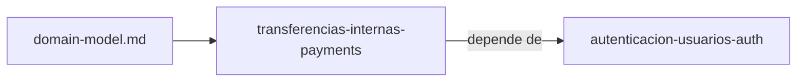

# Specs: Pagos (services/payments)

> Servicio de pagos del portal: cuentas, transferencias, idempotencia.

## Grafo de specs

## Tabla de specs

| Spec | Estado | Creación | Paralelizable con | Ruta | Depende de |
|---|:---:|:---:|:---:|---|---|
| transferencias-internas-payments | `Pendiente` | `Aprobado` | `—` | `transferencias-internas-payments/summary.md` | [autenticacion-usuarios-auth](../auth/autenticacion-usuarios-auth/summary.md) |
| transferencias-externas-payments | `Completado` | `Aprobado` | `—` | `transferencias-externas-payments/summary.md` | [transferencias-internas-payments](transferencias-internas-payments/summary.md), [riel-bancario-simulado-bank-rail](../bank-rail/riel-bancario-simulado-bank-rail/summary.md) |
| reversos-transferencias-payments | `Completado` | `Aprobado` | `—` | `reversos-transferencias-payments/summary.md` | [transferencias-externas-payments](transferencias-externas-payments/summary.md) |
| auditoria-transferencias-payments | `Completado` | `Aprobado` | `—` | `auditoria-transferencias-payments/summary.md` | [reversos-transferencias-payments](reversos-transferencias-payments/summary.md) |

Nota: [domain-model.md](domain-model.md) de este árbol es el modelo de negocio único de toda la capacidad (apps/web lo referencia); el spec pertenece a la feature `transferencias-internas` (unidad `services/payments`); los demás specs de la capacidad viven en los INDEX.md de sus propias unidades. La columna `Paralelizable con` queda en `—` porque aún no hay footprint de design.md de al menos dos specs del grupo para confirmarla.
