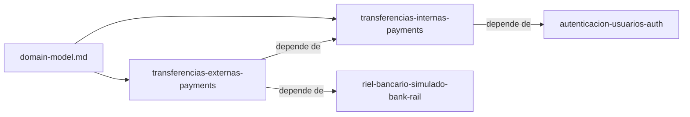

# Specs: Pagos (services/payments)

> Servicio de pagos del portal: cuentas, transferencias, idempotencia.

## Grafo de specs

## Tabla de specs

| Spec | Estado | Creación | Paralelizable con | Ruta | Depende de |
|---|:---:|:---:|:---:|---|---|
| transferencias-internas-payments | `Pendiente` | `Aprobado` | `—` | `transferencias-internas-payments/summary.md` | [autenticacion-usuarios-auth](../auth/autenticacion-usuarios-auth/summary.md) |
| transferencias-externas-payments | `Pendiente` | `Aprobado` | `transferencias-internas-web` | `transferencias-externas-payments/summary.md` | [transferencias-internas-payments](transferencias-internas-payments/summary.md), [riel-bancario-simulado-bank-rail](../bank-rail/riel-bancario-simulado-bank-rail/summary.md) |

Nota: [domain-model.md](domain-model.md) de este árbol es el modelo de negocio único de toda la capacidad (apps/web lo referencia). `transferencias-externas-payments` es paralelizable con `transferencias-internas-web`: el §5 de su design.md solo toca `services/payments/` y los documentos de este árbol (`transferencias-externas-payments` y `transferencias-internas-payments`); el §5 de `transferencias-internas-web` solo toca `apps/web/` y documentos de `apps/web`. No comparten archivos. La fila de `transferencias-internas-payments` conserva `Paralelizable con` en `—`.
