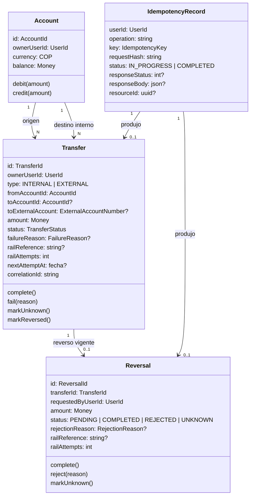

> **Alcance de este documento:** es el modelo de negocio COMPLETO y ÚNICO de la capacidad "Mini portal de pagos / FluxOne Payment". Su unidad dueña es `services/payments` (BC Pagos); `apps/web` lo referencia y no crea otro. Cada spec de la capacidad implementa solo la porción que le corresponde; lo que un spec no implementa sigue aquí como parte del modelo.

> **Nomenclatura obligatoria:** `DB` (inglés) se reserva siempre para base de datos/database; `BD`/`BDs` se reserva siempre para Contexto Delimitado/Bounded Context — nunca se usan de forma intercambiable ni se mezclan en el mismo documento.

---

# Modelo de dominio: Pagos (services/payments)

## Resumen

BC Pagos: mueve dinero en COP entre cuentas internas y hacia un banco externo no confiable, sin duplicar débitos, sin saldos negativos y sin perder dinero ni trazabilidad. Sirve al Cliente autenticado (transferir, consultar saldo e historial, reversar) y a los workers de Pagos. Es dueño de cuentas, transferencias, reversos e idempotencia. Los demás BCs (Identidad, Auditoría, Banco simulado) tienen su propio modelo y solo se relacionan con Pagos por el claim `sub` del JWT, eventos y el puerto del riel.

## Diagrama mermaid

## Glosario de lenguaje ubicuo

| Término | Definición |
|---------|-----------|
| Cuenta | Cuenta en COP de un usuario del portal, identificada por `ACC-NNN`. Solo existe por semilla; no hay alta, edición ni baja. |
| Transferencia | Movimiento de un importe desde una cuenta origen hacia una cuenta interna (INTERNAL) o hacia una cuenta de un banco externo (EXTERNAL). Es el agregado raíz. |
| Transferencia interna | Débito y crédito entre dos cuentas del portal en una sola transacción atómica. |
| Transferencia externa | Transferencia hacia una cuenta del banco simulado; avanza por el riel y puede quedar en estado incierto. |
| Retención | Débito de la cuenta origen al crear una transferencia externa; los fondos quedan retenidos mientras la transferencia está PENDING o UNKNOWN. |
| Reembolso | Crédito de vuelta a la cuenta origen de los fondos retenidos cuando una transferencia externa termina FAILED. |
| Reverso | Operación que devuelve el importe total de una transferencia COMPLETED a su cuenta origen. Solo total, una sola vez. |
| Riel | Banco simulado externo y no confiable al que Pagos despacha transferencias y reversos externos. |
| Referencia del riel | Identificador (`transfer.id` o `reversal.id` en texto) con el que el riel identifica y deduplica una operación. |
| Conciliación | Proceso que resuelve una operación en estado UNKNOWN consultando al riel por su referencia hasta conocer el resultado. |
| Despachador | Worker que envía al riel las operaciones externas pendientes. |
| Idempotency-Key | Clave que el cliente envía en toda operación monetaria para que repetirla no produzca un segundo efecto. |
| Respuesta almacenada | Respuesta (status y body) guardada junto al efecto y devuelta tal cual ante una repetición con la misma clave y mismo payload. |
| Semilla | Datos iniciales: tres cuentas demo y su saldo, que fijan el total del sistema. |
| Transferencia (agregado) | Agregado raíz que gobierna su máquina de estados, su motivo de falla y su seguimiento de riel; el Reverso le pertenece. |

## Entidades

- **Account** — entidad. Saldo en COP de un dueño; protege el invariante `balance >= 0`; expone `debit` y `credit`.
- **Transfer** — agregado raíz. Gobierna la máquina de estados, el motivo de falla y el seguimiento de riel (intentos, próximo intento, referencia).
- **Reversal** — entidad perteneciente a Transfer. Reverso total con su propio estado y seguimiento de riel.
- **IdempotencyRecord** — entidad. Registro por (usuario, operación, clave) con hash de solicitud y respuesta almacenada.
- **Money** — value object. Importe COP como `bigint` en centavos; nunca float.
- **AccountId** — value object. `ACC-` seguido de 3 o más dígitos.
- **ExternalAccountNumber** — value object. Cadena `^[A-Z0-9-]{6,34}$`.
- **IdempotencyKey** — value object. 1 a 255 caracteres ASCII imprimibles (0x21–0x7E).

## Atributos

### Account

| Atributo | Tipo | Obligatorio |
|----------|------|-------------|
| id | AccountId | Sí |
| ownerUserId | uuid (claim `sub`) | Sí |
| currency | COP | Sí |
| balance | Money | Sí |
| createdAt | fecha | Sí |
| updatedAt | fecha | Sí |

### Transfer

| Atributo | Tipo | Obligatorio |
|----------|------|-------------|
| id | uuid | Sí |
| ownerUserId | uuid (iniciador y dueño de la cuenta origen) | Sí |
| type | INTERNAL \| EXTERNAL | Sí |
| fromAccountId | AccountId | Sí |
| toAccountId | AccountId | Solo INTERNAL |
| toExternalAccount | ExternalAccountNumber | Solo EXTERNAL |
| amount | Money (> 0) | Sí |
| currency | COP | Sí |
| status | PENDING \| COMPLETED \| FAILED \| UNKNOWN \| REVERSED | Sí |
| failureReason | INSUFFICIENT_FUNDS \| RAIL_REJECTED \| RAIL_UNAVAILABLE | Solo si status = FAILED |
| railReference | string (= id en texto) | Solo EXTERNAL |
| railAttempts | int | Sí |
| nextAttemptAt | fecha | No |
| leaseUntil | fecha | No |
| lastRailOutcome | ACCEPTED \| REJECTED \| UNAVAILABLE \| TIMEOUT \| NETWORK_ERROR \| NOT_FOUND | No |
| correlationId | string | No |
| createdAt | fecha | Sí |
| updatedAt | fecha | Sí |
| completedAt | fecha | No |

### Reversal

| Atributo | Tipo | Obligatorio |
|----------|------|-------------|
| id | uuid | Sí |
| transferId | uuid | Sí |
| requestedByUserId | uuid | Sí |
| amount | Money (= amount de la transferencia) | Sí |
| status | PENDING \| COMPLETED \| REJECTED \| UNKNOWN | Sí |
| rejectionReason | RAIL_REJECTED \| RAIL_UNAVAILABLE | Solo si status = REJECTED |
| railReference | string (= id en texto) | Solo si la transferencia es EXTERNAL |
| railAttempts | int | Sí |
| nextAttemptAt | fecha | No |
| leaseUntil | fecha | No |
| lastRailOutcome | igual que Transfer | No |
| correlationId | string | No |
| createdAt | fecha | Sí |
| updatedAt | fecha | Sí |
| completedAt | fecha | No |

### IdempotencyRecord

| Atributo | Tipo | Obligatorio |
|----------|------|-------------|
| userId | uuid | Sí |
| operation | string (`CREATE_TRANSFER` o `CREATE_REVERSAL:<transferId>`) | Sí |
| key | IdempotencyKey | Sí |
| requestHash | sha256 hex del JSON canónico del body (claves ordenadas) concatenado con operation | Sí |
| status | IN_PROGRESS \| COMPLETED | Sí |
| responseStatus | int | No |
| responseBody | json | No |
| resourceId | uuid | No |
| createdAt | fecha | Sí |
| completedAt | fecha | No |

## Relaciones y multiplicidad

- **Account** `1:N` **Transfer** — una cuenta es origen de muchas transferencias; una cuenta interna también puede ser destino de muchas.
- **Transfer** `1:0..1` **Reversal** vigente — una transferencia se reversa una sola vez; un reverso REJECTED permite un nuevo intento, por lo que puede haber reversos REJECTED históricos además del vigente.
- **IdempotencyRecord** `1:0..1` **Transfer** o **Reversal** — el registro apunta al recurso que su efecto produjo.

## Eventos de dominio

Cada cambio de estado emite exactamente un evento, en la misma transacción del cambio.

| Evento | Se emite cuando |
|--------|-----------------|
| `transfer.created` | Se crea una transferencia. |
| `transfer.completed` | Una transferencia pasa a COMPLETED. |
| `transfer.failed` | Una transferencia pasa a FAILED. |
| `transfer.unknown` | Una transferencia externa pasa a UNKNOWN. |
| `transfer.reversal_requested` | Se solicita un reverso. |
| `transfer.reversed` | Una transferencia pasa a REVERSED. |
| `transfer.reversal_rejected` | Un reverso pasa a REJECTED. |

## Puertos

`AccountRepository`, `TransferRepository`, `ReversalRepository`, `IdempotencyStore`, `UnitOfWork`, `BankRailPort`, `OutboxPort`, `Clock`, `IdGenerator`.

## Reglas de negocio

- **RN-01 Idempotencia**: toda operación monetaria (crear transferencia, crear reverso) exige una `IdempotencyKey`. El ámbito de la clave es (usuario, operación, clave). Misma clave y mismo payload devuelven la respuesta almacenada, sin un segundo efecto, incluso en solicitudes concurrentes. Misma clave con payload distinto es un conflicto. El hash de solicitud es sha256 hex del JSON canónico (claves ordenadas) del body concatenado con la operación. El registro de idempotencia se escribe en la misma transacción que el efecto. Solo se almacenan respuestas de solicitudes que produjeron efecto; las rechazadas sin efecto no se almacenan. Las consultas (lectura) no requieren la clave.
- **RN-02 Montos**: el importe es COP, estrictamente mayor que 0 y como máximo 9999999999999999.99, con a lo sumo 2 decimales. En el dominio es `bigint` en centavos; nunca float. Fuera del dominio se expresa como string decimal con 2 decimales.
- **RN-03 Saldo nunca negativo**: un débito solo se aplica si `balance >= amount`. Las cuentas involucradas en una transacción se bloquean en orden ascendente de id para evitar interbloqueos.
- **RN-04 Cuentas**: la cuenta origen debe existir y pertenecer al usuario que opera; la cuenta destino interna debe existir; origen y destino deben ser distintos. El destino externo cumple `^[A-Z0-9-]{6,34}$` y su existencia la valida el banco (un rechazo del banco es REJECTED).
- **RN-05 Fondos insuficientes**: si el saldo de la cuenta origen es menor que el importe, la transferencia se registra FAILED con `failureReason = INSUFFICIENT_FUNDS`, sin mover saldos.
- **RN-06 Estados de transferencia**: PENDING, COMPLETED, FAILED, UNKNOWN, REVERSED. Terminales: FAILED y REVERSED; COMPLETED es terminal salvo reverso. Transiciones válidas: INTERNAL nace COMPLETED o FAILED; EXTERNAL: PENDING → COMPLETED | FAILED | UNKNOWN; UNKNOWN → COMPLETED | FAILED; COMPLETED → REVERSED. Cualquier otra transición es un error de dominio. FAILED siempre lleva `failureReason`, y solo FAILED lo lleva.
- **RN-07 Retención externa**: al crear una transferencia externa con saldo suficiente se debita la cuenta origen en la misma transacción (fondos retenidos) y queda PENDING. Rechazo del banco: FAILED `RAIL_REJECTED` con reembolso en la misma transacción. Banco no disponible: reintento con backoff `min(2^intentos, 30)` segundos, máximo 5 intentos; agotados, FAILED `RAIL_UNAVAILABLE` con reembolso. Fallo de conexión o resolución del host se trata como no disponible. Timeout de 10 s o error tras enviar: UNKNOWN con fondos retenidos. Aceptación del banco: COMPLETED.
- **RN-08 Conciliación**: una operación UNKNOWN se consulta al riel por su referencia con backoff `min(2^intentos, 30)` segundos, sin límite de intentos. Aceptada: COMPLETED. Rechazada: FAILED `RAIL_REJECTED` con reembolso. No encontrada: se reenvía la operación con la MISMA referencia y se aplica la regla de retención externa. No disponible o timeout: permanece UNKNOWN. El dinero nunca se pierde.
- **RN-09 Reverso**: solo una transferencia COMPLETED, solo por el dueño de la cuenta origen, una sola vez y por el monto total. Interna: en una transacción con bloqueo ordenado, si la cuenta destino tiene saldo suficiente el reverso nace COMPLETED y la transferencia pasa a REVERSED; si no, se rechaza sin crear registro. Externa: el reverso nace PENDING y el despachador lo envía al riel; aceptado: COMPLETED, se acredita la cuenta origen y la transferencia pasa a REVERSED; rechazado: reverso REJECTED `RAIL_REJECTED` (la transferencia sigue COMPLETED y se permite un nuevo intento con otra clave); no disponible tras agotar reintentos: REJECTED `RAIL_UNAVAILABLE`; timeout: UNKNOWN y conciliación con la referencia del reverso. Una transferencia no COMPLETED no es reversible; una ya reversada o con reverso en curso no admite otro.
- **RN-10 Auditoría**: cada cambio de estado emite exactamente un evento de dominio en la misma transacción (ver eventos). La entrega es at-least-once y se deduplica por `eventId`. Un fallo del broker no bloquea ni revierte la operación.
- **RN-11 Visibilidad**: una transferencia es visible para el dueño de la cuenta origen y, si es interna, también para el dueño de la cuenta destino; para cualquier otro usuario no existe.
- **RN-12 Semilla**: el sistema parte de tres cuentas en COP: ACC-001 de alice (`11111111-1111-4111-8111-111111111111`) con 1000000.00, ACC-002 de bob (`22222222-2222-4222-8222-222222222222`) con 500000.00 y ACC-003 de carol (`33333333-3333-4333-8333-333333333333`) con 0.00. Un usuario registrado nuevo no tiene cuentas.

## Invariantes

- `Account.balance >= 0` en todo momento.
- Suma de saldos de todas las cuentas = 1500000.00 COP (la semilla) en las transferencias internas, que solo mueven dinero entre cuentas.
- Invariante del sistema completo (con transferencias externas y reversos): suma de saldos + fondos retenidos (transferencias externas PENDING o UNKNOWN) + transferencias externas COMPLETED − reversos externos COMPLETED = 1500000.00 COP.
- Una transferencia tiene a lo sumo un reverso vigente (PENDING, UNKNOWN o COMPLETED).
- Una transferencia INTERNAL solo termina COMPLETED, FAILED o REVERSED; nunca PENDING ni UNKNOWN.
