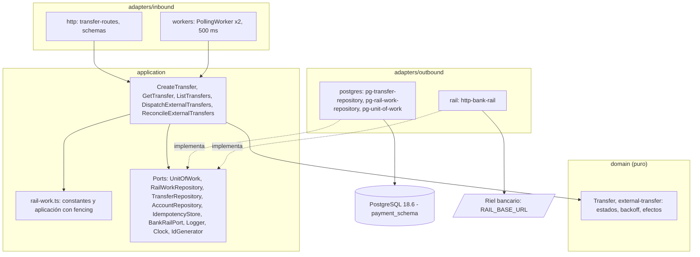

# Technical Design Document: Transferencias externas (servicio de pagos `services/payments`)

## 1. Metadata & Traceability
- **Spec:** `transferencias-externas-payments`
- **Requirements Ref:** `requirements.md` (spec: `transferencias-externas-payments`)
- **Target Stack:** el de [`transferencias-internas-payments`](../transferencias-internas-payments/design.md) §1, sin cambios: Node.js 24.22.0 (`node:24.22.0-alpine`), TypeScript 6.0.3 ESM estricto, Fastify 5.12.7, pg 8.23.1, node-pg-migrate 9.0.0, jose 6.2.12, PostgreSQL 18.6 (`postgres:18.6-alpine`), Vitest 5.0.5, tsx 4.23.15.
- **Dependencias nuevas:** ninguna. La llamada HTTP al riel usa `fetch` y `AbortSignal.timeout` nativos de Node 24. `package.json` y `package-lock.json` no cambian.
- **Host:** solo Docker y Git; todo comando de compilación, prueba y ejecución corre en contenedores.
- **Modelo de dominio:** [`../domain-model.md`](../domain-model.md) (Contexto Delimitado de Pagos). **Esquema DB:** [`db-design.dbml`](db-design.dbml). **Contrato del riel:** [`requirements`](../../bank-rail/riel-bancario-simulado-bank-rail/requirements.md) y [`design`](../../bank-rail/riel-bancario-simulado-bank-rail/design.md) del riel (`POST /rail/transfers`, `GET /rail/transfers/{reference}`).
- **Modelo de datos vigente:** el §3 de `transferencias-internas-payments` más los deltas de §3 de este spec. El §3 del spec previo no se edita. Ninguna otra parte del spec previo se refactoriza: solo cambia lo listado en §4.2 "Actualización incremental del spec previo".

---

## 2. Architecture & System Overview

### 2.1 Architectural Approach
Arquitectura hexagonal heredada del spec previo (capas, carpetas `inbound`/`outbound`, ESM `NodeNext`, `verbatimModuleSyntax`). Este spec añade:

- `src/domain`: funciones puras de la máquina de estados EXTERNAL (`external-transfer.ts`): creación con retención, siguiente acción, efecto de cada resultado del riel, backoff. Sin imports de Fastify, `pg` ni `node:*`.
- `src/application`: puertos nuevos `BankRailPort`, `RailWorkRepository` y `Logger`; casos de uso `DispatchExternalTransfers` y `ReconcileExternalTransfers`; la creación externa vive dentro de `CreateTransfer` (mismo caso de uso y mismo endpoint). Un caso de uso por responsabilidad.
- `src/adapters/outbound/rail`: `HttpBankRail` implementa `BankRailPort` con `fetch`.
- `src/adapters/outbound/postgres`: `PgRailWorkRepository` (reclamo con arrendamiento y guardado con fencing) y ajustes de `PgTransferRepository`/`PgUnitOfWork`.
- `src/adapters/inbound/workers`: `PollingWorker`, el bucle de 500 ms que invoca un caso de uso; despachador y conciliador corren en el mismo proceso que la API.
- `src/compose.ts`: `composeWorkers` arma los workers; `src/main.ts` los arranca tras `listen` y los detiene en el cierre.

Principios de diseño:
- **Llamadas al riel fuera de toda transacción de DB.** Se reclama en una transacción corta, se llama al riel sin transacción abierta y se aplica el resultado en una segunda transacción.
- **Fencing.** El resultado solo se aplica si la fila sigue en el estado y con el `lease_until` con que se reclamó; ningún resultado tardío se aplica dos veces.
- **Resultado desconocido = UNKNOWN conciliado.** Nunca se asume éxito ni fallo.

Puertos de este spec (todos los usa hoy): los 7 del spec previo más `BankRailPort`, `RailWorkRepository` y `Logger`. `Clock` e `IdGenerator` existentes.

### 2.2 Component Diagram / Module Interaction


### 2.3 Entorno de ejecución en contenedores
Sin cambios respecto de §2.3 del spec previo (servicios `postgres`, `dev`, `payments`; mismos comandos con el prefijo `docker compose -f services/payments/compose.dev.yaml`). Únicamente cambia el servicio `payments` de `services/payments/compose.dev.yaml`, que recibe `RAIL_BASE_URL`:

```yaml
  payments:
    environment:
      PORT: '3002'
      DATABASE_URL: postgres://payment_svc:${PAYMENT_DB_PASSWORD:-payment_dev_pw}@postgres:5432/fluxone
      AUTH_JWKS_URL: ${AUTH_JWKS_URL:-http://auth:3001/.well-known/jwks.json}
      RAIL_BASE_URL: ${RAIL_BASE_URL:-http://bank-rail:3004}
```

- El Compose de pagos no define un servicio de riel: el valor por defecto apunta al nombre `bank-rail` (puerto 3004 del riel) y es sobreescribible. `/health/ready` sigue consultando solo la DB; con el riel inalcanzable el servicio queda sano y las transferencias externas reintentan por indisponibilidad.
- El servicio `dev` no necesita `RAIL_BASE_URL`: las pruebas pasan la configuración explícita y usan un servidor HTTP de prueba (`tests/support/fake-rail.ts`) en el loopback del propio contenedor `dev`.

### 2.5 Decisiones cerradas (heredadas de IDEA)
- Servicio `services/payments`, stack y versiones exactas de §1; hexagonal con `src/domain`, `src/application`, `src/adapters/inbound/http`, `src/adapters/outbound/{postgres,rail}`; carpetas `inbound`/`outbound`, nunca `in`.
- `pg` sin ORM y `node-pg-migrate` 9 en SQL: control de transacciones y bloqueos.
- `BankRailPort` (puerto del modelo de dominio) con adaptador HTTP en `adapters/outbound/rail` usando `fetch` y `AbortSignal.timeout(10000)`; header `X-Request-Id` = `correlationId`; `reference` = id de la transferencia.
- Las llamadas al riel van fuera de la transacción de DB.
- Workers en el mismo proceso: despachador y conciliador, bucle de 500 ms, `SELECT ... FOR UPDATE SKIP LOCKED LIMIT 10` sobre `transfers` con el índice parcial `transfers_rail_work_idx`, arrendamiento de 30 s en `lease_until`.
- Reclamo en transacción corta; resultado aplicado en segunda transacción con guarda de estado y arrendamiento (fencing).
- Un caso de uso por responsabilidad; funciones de dominio puras para la máquina de estados; reembolso en la misma transacción que marca FAILED, con bloqueo de la cuenta origen y guarda anti doble reembolso.
- Backoff `min(2^n, 30)` s como función pura; `Clock` e `IdGenerator` existentes.
- `RAIL_BASE_URL` obligatoria (URL absoluta; el arranque falla nombrando la variable); intervalos, arrendamiento y timeout son constantes del código, no variables de entorno.
- Logs JSON con eventos `rail.request`, `rail.response`, `rail.timeout`, `rail.retry_scheduled`, `reconcile.result`, `transfer.status_changed`, con `transferId` y `correlationId`.
- Pruebas Vitest con la PostgreSQL real del Compose, un servidor HTTP de prueba que hace de riel controlable y un `Clock` controlable; los workers exponen `runOnce()`; el nombre de cada prueba lleva `[AC-TEX-NN]`.
- Ambiente 100 % Docker (constitución); saltos de línea LF.

### 2.6 Riesgos y mitigaciones

| Riesgo | Impacto | Mitigación |
|:---|:---|:---|
| Doble débito por reintento del cliente o solicitudes simultáneas | Pérdida de dinero | Misma clave de idempotencia en la misma transacción del débito y la inserción de la transferencia (§4.1 flujo externo) |
| Doble envío o doble reembolso por varios procesos o por una llamada tardía | Dinero duplicado o perdido | `FOR UPDATE SKIP LOCKED` + arrendamiento de 30 s; guardado con fencing (`status` y `lease_until` reclamados); el reembolso solo se aplica si el `UPDATE` guardado afectó 1 fila, en su misma transacción |
| Retener un bloqueo de cuenta mientras el riel tarda | Creaciones bloqueadas | La llamada al riel ocurre sin transacción abierta; el reclamo confirma antes de llamar |
| El arrendamiento de 30 s vence con un lote lento | Reenvío por otro proceso | Las llamadas de un lote son concurrentes (`Promise.all`, cada una vence a 10 s); un reenvío reutiliza la misma referencia, que el riel deduplica; el fencing descarta el resultado tardío |
| Pagar dos veces o reembolsar un pago hecho tras un resultado incierto | Pérdida de dinero | Resultado incierto = UNKNOWN con fondos retenidos; se resuelve consultando por la misma referencia; solo 404 provoca reenvío (con la misma referencia) |
| Una respuesta del riel que Pagos no interpreta de forma persistente (por ejemplo 400) | Transferencia UNKNOWN indefinida | Se acepta: los fondos quedan retenidos y la conciliación no tiene límite; el dinero nunca se pierde |
| Riel inalcanzable durante mucho tiempo | Transferencias PENDING/UNKNOWN acumuladas | Backoff acotado a 30 s; PENDING agota 5 intentos y reembolsa; UNKNOWN reintenta sin límite |
| Pérdida del lote en curso por caída del proceso | Transferencia abandonada | El arrendamiento vence a los 30 s y otro proceso (o el mismo al reiniciar) retoma la fila |
| `RAIL_BASE_URL` ausente o inválida | Servicio sin riel | `loadConfig` falla el arranque nombrando la variable |
| Fuga de cabeceras sensibles en logs de envío | Exposición de credenciales | El adaptador del riel nunca registra cabeceras; el logger redacta `authorization`, `cookie` y `set-cookie` en `req.headers`, `headers` y `res.headers` |
| Pool de DB compartido entre API y workers (`max: 10`) | Espera por conexión | El lote usa transacciones cortas; la llamada al riel no retiene conexión |

### 2.7 Directrices del proyecto
- `Global` y `Unidad: services/payments`: rigen sin cambios las directrices de §2.7 de [`transferencias-internas-payments`](../transferencias-internas-payments/design.md).
- `Unidad: services/payments`: toda llamada al riel se hace fuera de cualquier transacción de DB, con vencimiento de 10 s y sin retener bloqueos sobre cuentas durante la llamada.
- `Unidad: services/payments`: un resultado desconocido del riel (timeout, error tras enviar, respuesta inesperada) deja la operación en UNKNOWN y se concilia consultando al riel por la misma referencia; nunca se asume éxito ni fallo.

### 2.8 Sujeto a actualización futura
- `auditoria-transferencias-payments` — §5 Implementation Target Structure — el despachador y el conciliador insertarán un evento outbox en cada cambio de estado.

---

## 3. Data Models & Schema Design

> Los datos van primero: todo esquema de esta sección está declarado antes en [`../domain-model.md`](../domain-model.md) y [`db-design.dbml`](db-design.dbml); un cambio de esquema entra primero en esos dos documentos.

### 3.1 Domain Entities (Core Business Objects)

Delta sobre §3.1 del spec previo (`src/domain/transfer.ts` se modifica; `account.ts`, `money.ts`, `idempotency.ts` no cambian):

```typescript
// src/domain/transfer.ts
export type TransferType = 'INTERNAL' | 'EXTERNAL';
export type TransferStatus = 'PENDING' | 'COMPLETED' | 'FAILED' | 'UNKNOWN';
export type FailureReason = 'INSUFFICIENT_FUNDS' | 'RAIL_REJECTED' | 'RAIL_UNAVAILABLE';
// Último resultado observado del riel (columna last_rail_outcome).
// NETWORK_ERROR = resultado no concluyente distinto de timeout: error de comunicación tras enviar
// o respuesta no prevista (400, 409, 5xx distinto de 503, cuerpo no interpretable).
export type RailOutcome = 'ACCEPTED' | 'REJECTED' | 'UNAVAILABLE' | 'TIMEOUT' | 'NETWORK_ERROR' | 'NOT_FOUND';
export interface Transfer {
  id: string; // uuid
  ownerUserId: string; // iniciador = dueño de la cuenta origen
  type: TransferType;
  fromAccountId: string;
  toAccountId: string | null; // nulo solo en EXTERNAL
  toExternalAccount: string | null; // ^[A-Z0-9-]{6,34}$; solo EXTERNAL
  amount: Money;
  currency: 'COP';
  status: TransferStatus;
  failureReason: FailureReason | null; // no nulo si y solo si status = FAILED
  railReference: string | null; // = id; no nulo si y solo si type = EXTERNAL
  railAttempts: number; // INTERNAL: 0. Semántica en la tabla "Contadores y siguiente acción"
  nextAttemptAt: Date | null; // próximo intento de envío o consulta; nulo en INTERNAL y en estados terminales
  leaseUntil: Date | null; // arrendamiento del worker; también actúa como token de fencing
  lastRailOutcome: RailOutcome | null;
  correlationId: string | null;
  createdAt: Date;
  updatedAt: Date;
  completedAt: Date | null; // COMPLETED y FAILED por RAIL_*: fecha de finalización; nulo en PENDING, UNKNOWN y FAILED por INSUFFICIENT_FUNDS
}
// executeInternalTransfer (sin cambios de lógica) rellena toExternalAccount, railReference,
// nextAttemptAt, leaseUntil y lastRailOutcome con null y railAttempts con 0.
```

```typescript
// src/domain/external-transfer.ts  (funciones puras; sin I/O)
export const MAX_SUBMIT_ATTEMPTS = 5;
export const MAX_BACKOFF_SECONDS = 30;
// Valida ^[A-Z0-9-]{6,34}$ sobre un string; otro valor -> ValidationError('toExternalAccount: formato inválido').
export function parseExternalAccount(raw: unknown): string;
// min(2^attempts, 30) segundos. backoffSeconds(0)=1, (1)=2, (2)=4, (3)=8, (4)=16, (5 o más)=30.
export function backoffSeconds(attempts: number): number;
// Saldo suficiente -> PENDING con debit(from), railAttempts 0, nextAttemptAt = now (elegible de inmediato).
// Saldo menor -> FAILED INSUFFICIENT_FUNDS con from sin cambios, sin nextAttemptAt ni completedAt.
// En ambos casos railReference = id y toAccountId = null.
export function createExternalTransfer(input: {
  id: string; ownerUserId: string; from: Account; toExternalAccount: string;
  amount: Money; correlationId: string | null; now: Date;
}): { transfer: Transfer; from: Account };
// PENDING -> 'SUBMIT'. UNKNOWN con lastRailOutcome = 'NOT_FOUND' -> 'SUBMIT' (reenvío con la misma referencia).
// UNKNOWN en otro caso -> 'QUERY'. Cualquier otra fila (INTERNAL, COMPLETED, FAILED) -> InvalidTransferTransitionError.
export function nextRailAction(t: Transfer): 'SUBMIT' | 'QUERY';
export interface RailTransition { next: Transfer; refund: boolean }
// Resultado de un envío (POST). Exige nextRailAction(t) === 'SUBMIT'. NOT_FOUND no es un resultado de envío.
export function applySubmitOutcome(t: Transfer, outcome: Exclude<RailOutcome, 'NOT_FOUND'>, now: Date): RailTransition;
// Resultado de una consulta (GET). Exige nextRailAction(t) === 'QUERY'.
export function applyQueryOutcome(t: Transfer, outcome: RailOutcome, now: Date): RailTransition;
```

`next` conserva `id`, `ownerUserId`, cuentas, `amount`, `railReference`, `correlationId` y `createdAt`; actualiza `updatedAt = now` y siempre `leaseUntil = null`. `refund = true` solo cuando `next.status = 'FAILED'` por `RAIL_REJECTED` o `RAIL_UNAVAILABLE`. Las funciones lanzan `InvalidTransferTransitionError` (nuevo en `src/domain/errors.ts`) si la fila no está en el estado exigido: así solo existen las transiciones PENDING → COMPLETED | FAILED | UNKNOWN y UNKNOWN → COMPLETED | FAILED; COMPLETED y FAILED son terminales.

**Máquina de estados EXTERNAL:**

| Origen | Evento | Destino |
|:---|:---|:---|
| (creación) | saldo suficiente | PENDING |
| (creación) | saldo insuficiente | FAILED `INSUFFICIENT_FUNDS` |
| PENDING | aceptada | COMPLETED |
| PENDING | rechazada | FAILED `RAIL_REJECTED` (+ reembolso) |
| PENDING | 5.º intento indisponible | FAILED `RAIL_UNAVAILABLE` (+ reembolso) |
| PENDING | timeout, error tras enviar o respuesta inesperada | UNKNOWN |
| UNKNOWN | consulta aceptada | COMPLETED |
| UNKNOWN | consulta rechazada | FAILED `RAIL_REJECTED` (+ reembolso) |
| UNKNOWN | reenvío (tras 404) aceptado / rechazado / 5.º intento indisponible | COMPLETED / FAILED `RAIL_REJECTED` (+ reembolso) / FAILED `RAIL_UNAVAILABLE` (+ reembolso) |

**Contadores y siguiente acción** (única fuente: `nextRailAction`):

| status | `last_rail_outcome` | `rail_attempts` cuenta | Siguiente acción | Lo reclama |
|:---|:---|:---|:---|:---|
| PENDING | nulo o `UNAVAILABLE` | intentos de envío ya realizados (0 a 4) | `SUBMIT` (POST) | despachador |
| UNKNOWN | `NOT_FOUND` | intentos de reenvío ya realizados (0 a 4; el contador se reinició a 0 al recibir 404) | `SUBMIT` (POST con la misma referencia) | despachador |
| UNKNOWN | `TIMEOUT`, `NETWORK_ERROR` o `UNAVAILABLE` | consultas inconclusas ya realizadas (sin límite; se reinicia a 0 al entrar a UNKNOWN) | `QUERY` (GET) | conciliador |

**Efecto de cada resultado** (`attempts` = valor de `rail_attempts` antes de aplicar; `n = attempts + 1`; `completedAt` = `now` solo donde se indica; `nextAttemptAt` nulo en estados terminales):

| Resultado | Envío desde PENDING | Reenvío desde UNKNOWN (`NOT_FOUND`) | Consulta desde UNKNOWN |
|:---|:---|:---|:---|
| `ACCEPTED` | COMPLETED, `completedAt = now`, `lastRailOutcome = ACCEPTED` | igual | igual |
| `REJECTED` | FAILED `RAIL_REJECTED`, `completedAt = now`, reembolso | igual | igual |
| `UNAVAILABLE` | `railAttempts = n`; si `n >= 5`: FAILED `RAIL_UNAVAILABLE`, `completedAt = now`, reembolso; si no: sigue PENDING, `nextAttemptAt = now + backoff(n)` (2, 4, 8, 16 s), `lastRailOutcome = UNAVAILABLE` | igual, pero sigue UNKNOWN y conserva `lastRailOutcome = NOT_FOUND` (la siguiente acción sigue siendo reenviar) | sigue UNKNOWN, `railAttempts = n`, `nextAttemptAt = now + backoff(n)`, `lastRailOutcome = UNAVAILABLE` |
| `TIMEOUT` o `NETWORK_ERROR` | UNKNOWN, `railAttempts = 0`, `nextAttemptAt = now + backoff(0)` (1 s), `lastRailOutcome` = el resultado | igual (vuelve a consulta) | sigue UNKNOWN, `railAttempts = n`, `nextAttemptAt = now + backoff(n)`, `lastRailOutcome` = el resultado |
| `NOT_FOUND` | no aplica (el envío no produce este resultado) | no aplica | sigue UNKNOWN, `railAttempts = 0`, `nextAttemptAt = now`, `lastRailOutcome = NOT_FOUND` (el despachador reenvía de inmediato) |

Errores de dominio (`src/domain/errors.ts`, además de los del spec previo): `InvalidTransferTransitionError`. No hay errores HTTP nuevos; los de validación reutilizan `ValidationError` e `InvalidAmountError`.

**Pertenencia de datos, tabla por tabla** (actualiza la tabla de §3.1 del spec previo solo para `transfers` y las columnas nuevas):

| Tabla | Cómo se determina la pertenencia | Predicado SQL |
|:---|:---|:---|
| `accounts` | Sin cambios | Sin cambios |
| `transfers` | Sin columna de usuario consultable. Una EXTERNAL es visible solo para el dueño de la cuenta origen; una INTERNAL, para el dueño de la origen o de la destino. `owner_user_id` es el iniciador y no se usa para filtrar. Para cualquier otro usuario la transferencia no existe (404) | `WHERE EXISTS (SELECT 1 FROM payment_schema.accounts a WHERE a.owner_user_id = $sub AND (a.id = t.from_account_id OR (t.type = 'INTERNAL' AND a.id = t.to_account_id)))` |
| `transfers.to_account_id` | Nulo permitido SOLO en `type = 'EXTERNAL'` (`transfers_shape_chk`); en INTERNAL es obligatorio y distinto del origen | Las EXTERNAL se filtran solo por origen; ningún predicado compara `to_account_id` con `NULL` |
| `transfers.to_external_account` | Solo EXTERNAL; se expone únicamente al dueño de la cuenta origen (misma visibilidad de la fila). No es un dato personal del usuario autenticado y no se registra en logs | Hereda el predicado de `transfers` |
| `transfers.rail_reference`, `rail_attempts`, `next_attempt_at`, `lease_until`, `last_rail_outcome` | Datos operativos de los workers: no se exponen por la API; solo los lee y escribe el código de despacho y conciliación, que opera por `id` de la fila reclamada | Reclamo: predicados de §3.2 "Consultas de trabajo"; ningún endpoint los selecciona |
| `idempotency_keys` | Sin cambios; la operación `CREATE_TRANSFER` cubre las EXTERNAL | Sin cambios |
| `pgmigrations` | Sin cambios | Sin cambios |

No hay valores centinela: ni cuenta del sistema ni usuario nulo; `to_account_id` nulo es el valor real "no aplica" de una transferencia externa, garantizado por `transfers_shape_chk`.

### 3.2 Database Schema & Persistence
- **Target Database / Storage:** PostgreSQL 18.6, esquema `payment_schema` (rol `payment_svc`), declarado en `db-design.dbml`. Solo se altera `transfers`; `accounts` e `idempotency_keys` no cambian.
- **Migración 3** `services/payments/migrations/1792108800002_externalize-transfers.sql` (mismo formato `-- Up Migration` / `-- Down Migration`; la ejecuta `runMigrations` al arrancar sin cambios). Las filas INTERNAL existentes cumplen los nuevos CHECK:

```sql
-- Up Migration
ALTER TABLE payment_schema.transfers DROP CONSTRAINT transfers_type_chk;
ALTER TABLE payment_schema.transfers DROP CONSTRAINT transfers_status_chk;
ALTER TABLE payment_schema.transfers DROP CONSTRAINT transfers_failure_reason_chk;
ALTER TABLE payment_schema.transfers DROP CONSTRAINT transfers_distinct_chk;
ALTER TABLE payment_schema.transfers ALTER COLUMN to_account_id DROP NOT NULL;
ALTER TABLE payment_schema.transfers ADD COLUMN to_external_account varchar(34);
ALTER TABLE payment_schema.transfers ADD COLUMN rail_reference varchar(64) CONSTRAINT transfers_rail_reference_key UNIQUE;
ALTER TABLE payment_schema.transfers ADD COLUMN rail_attempts integer NOT NULL DEFAULT 0;
ALTER TABLE payment_schema.transfers ADD COLUMN next_attempt_at timestamptz;
ALTER TABLE payment_schema.transfers ADD COLUMN lease_until timestamptz;
ALTER TABLE payment_schema.transfers ADD COLUMN last_rail_outcome varchar(16);
ALTER TABLE payment_schema.transfers ADD CONSTRAINT transfers_type_chk CHECK (type IN ('INTERNAL', 'EXTERNAL'));
ALTER TABLE payment_schema.transfers ADD CONSTRAINT transfers_status_chk CHECK (status IN ('PENDING', 'COMPLETED', 'FAILED', 'UNKNOWN'));
ALTER TABLE payment_schema.transfers ADD CONSTRAINT transfers_failure_reason_chk CHECK (failure_reason IS NULL OR failure_reason IN ('INSUFFICIENT_FUNDS', 'RAIL_REJECTED', 'RAIL_UNAVAILABLE'));
ALTER TABLE payment_schema.transfers ADD CONSTRAINT transfers_external_account_chk CHECK (to_external_account IS NULL OR to_external_account ~ '^[A-Z0-9-]{6,34}$');
ALTER TABLE payment_schema.transfers ADD CONSTRAINT transfers_last_rail_outcome_chk CHECK (last_rail_outcome IS NULL OR last_rail_outcome IN ('ACCEPTED', 'REJECTED', 'UNAVAILABLE', 'TIMEOUT', 'NETWORK_ERROR', 'NOT_FOUND'));
ALTER TABLE payment_schema.transfers ADD CONSTRAINT transfers_shape_chk CHECK ((type = 'INTERNAL' AND to_account_id IS NOT NULL AND to_external_account IS NULL) OR (type = 'EXTERNAL' AND to_account_id IS NULL AND to_external_account IS NOT NULL));
ALTER TABLE payment_schema.transfers ADD CONSTRAINT transfers_distinct_chk CHECK (to_account_id IS NULL OR from_account_id <> to_account_id);
ALTER TABLE payment_schema.transfers ADD CONSTRAINT transfers_internal_status_chk CHECK (type = 'EXTERNAL' OR status IN ('COMPLETED', 'FAILED'));
ALTER TABLE payment_schema.transfers ADD CONSTRAINT transfers_rail_ref_chk CHECK ((type = 'EXTERNAL') = (rail_reference IS NOT NULL));
CREATE INDEX transfers_rail_work_idx ON payment_schema.transfers (next_attempt_at) WHERE type = 'EXTERNAL' AND status IN ('PENDING', 'UNKNOWN');

-- Down Migration
DROP INDEX payment_schema.transfers_rail_work_idx;
ALTER TABLE payment_schema.transfers DROP CONSTRAINT transfers_rail_ref_chk;
ALTER TABLE payment_schema.transfers DROP CONSTRAINT transfers_internal_status_chk;
ALTER TABLE payment_schema.transfers DROP CONSTRAINT transfers_distinct_chk;
ALTER TABLE payment_schema.transfers DROP CONSTRAINT transfers_shape_chk;
ALTER TABLE payment_schema.transfers DROP CONSTRAINT transfers_last_rail_outcome_chk;
ALTER TABLE payment_schema.transfers DROP CONSTRAINT transfers_external_account_chk;
ALTER TABLE payment_schema.transfers DROP CONSTRAINT transfers_failure_reason_chk;
ALTER TABLE payment_schema.transfers DROP CONSTRAINT transfers_status_chk;
ALTER TABLE payment_schema.transfers DROP CONSTRAINT transfers_type_chk;
ALTER TABLE payment_schema.transfers DROP COLUMN last_rail_outcome, DROP COLUMN lease_until, DROP COLUMN next_attempt_at, DROP COLUMN rail_attempts, DROP COLUMN rail_reference, DROP COLUMN to_external_account;
ALTER TABLE payment_schema.transfers ALTER COLUMN to_account_id SET NOT NULL;
ALTER TABLE payment_schema.transfers ADD CONSTRAINT transfers_type_chk CHECK (type = 'INTERNAL');
ALTER TABLE payment_schema.transfers ADD CONSTRAINT transfers_status_chk CHECK (status IN ('COMPLETED', 'FAILED'));
ALTER TABLE payment_schema.transfers ADD CONSTRAINT transfers_failure_reason_chk CHECK (failure_reason IS NULL OR failure_reason = 'INSUFFICIENT_FUNDS');
ALTER TABLE payment_schema.transfers ADD CONSTRAINT transfers_distinct_chk CHECK (from_account_id <> to_account_id);
```

  Sin cambios: `transfers_amount_chk`, `transfers_currency_chk`, `transfers_failure_chk`, los dos índices keyset y las FK a `accounts` (una FK admite `NULL` en `to_account_id`). El Down falla si existen filas EXTERNAL, por diseño: no se borran transferencias ni se pierde dinero.
- **Mapeo fila ↔ entidad:** el de §3.2 del spec previo más `to_external_account` ↔ `toExternalAccount`, `rail_reference` ↔ `railReference`, `rail_attempts` ↔ `railAttempts` (`integer` → número), `next_attempt_at` ↔ `nextAttemptAt`, `lease_until` ↔ `leaseUntil`, `last_rail_outcome` ↔ `lastRailOutcome`. `pg-transfer-repository.ts` exporta `TRANSFER_COLUMNS` (lista de columnas) y `mapTransferRow(row)` para que `pg-rail-work-repository.ts` los reutilice.
- **Consultas de trabajo** (`PgRailWorkRepository`; todas con `now` y `leaseUntil` como parámetros de la aplicación, nunca `now()` de la DB, para que el `Clock` de pruebas gobierne el tiempo):
  - Reclamo, parte 1: `SELECT <TRANSFER_COLUMNS> FROM payment_schema.transfers WHERE type = 'EXTERNAL' AND status IN ('PENDING', 'UNKNOWN') AND <variante> AND next_attempt_at <= $1 AND (lease_until IS NULL OR lease_until < $1) ORDER BY next_attempt_at, id LIMIT $2 FOR UPDATE SKIP LOCKED`. Variante `DISPATCH`: `(status = 'PENDING' OR last_rail_outcome = 'NOT_FOUND')`. Variante `RECONCILE`: `status = 'UNKNOWN' AND last_rail_outcome IS DISTINCT FROM 'NOT_FOUND'`. Los predicados `type` y `status IN (...)` repiten el del índice parcial `transfers_rail_work_idx`.
  - Reclamo, parte 2: `UPDATE payment_schema.transfers SET lease_until = $2 WHERE id = ANY($1::uuid[]) RETURNING <TRANSFER_COLUMNS>`. No toca `updated_at` (no es un cambio de estado).
  - Guardado con fencing: `UPDATE payment_schema.transfers SET status = $3, failure_reason = $4, rail_attempts = $5, next_attempt_at = $6, lease_until = NULL, last_rail_outcome = $7, updated_at = $8, completed_at = $9 WHERE id = $1 AND status = $2 AND lease_until = $10 RETURNING id`. Devuelve `true` si afectó 1 fila.
- **Mapeo de errores PG:** el de §3.2 del spec previo (solo `PgIdempotencyStore.begin`: `55P03`/`57014` → `IdempotencyKeyInProgressError`). En los workers, cualquier error de DB durante el reclamo o el guardado se propaga al caso de uso, que lo registra (`error`) sin traducirlo: la fila conserva su arrendamiento y la retoma cualquier proceso al vencer. Una violación de CHECK (`23514`) indica un defecto del código y se trata igual.

---

## 4. Interfaces, Contracts & API Specifications

### 4.1 Internal Service Interfaces / Ports

Un archivo por puerto en `src/application/ports/`. Los puertos del spec previo no cambian, salvo `unit-of-work.ts` (la `TransactionScope` añade `railWork`).

```typescript
// logger.ts  (subconjunto estructural de pino; lo satisface request.log / app.log)
export interface Logger {
  info(obj: object, msg?: string): void;
  warn(obj: object, msg?: string): void;
  error(obj: object, msg?: string): void;
}

// bank-rail-port.ts  (nunca lanza: todo fallo se traduce a un RailOutcome)
export interface RailSubmitInput { reference: string; from: string; to: string; amount: Money; correlationId: string | null }
export interface RailQueryInput { reference: string; correlationId: string | null }
export interface BankRailPort {
  submit(input: RailSubmitInput): Promise<Exclude<RailOutcome, 'NOT_FOUND'>>; // POST /rail/transfers
  query(input: RailQueryInput): Promise<RailOutcome>; // GET /rail/transfers/{reference}
}

// rail-work-repository.ts
export type RailWorkKind = 'DISPATCH' | 'RECONCILE';
export interface RailWorkRepository {
  // SELECT ... FOR UPDATE SKIP LOCKED + UPDATE lease_until (§3.2). Devuelve las filas ya con leaseUntil asignado.
  claim(kind: RailWorkKind, now: Date, leaseUntil: Date, limit: number): Promise<Transfer[]>;
  // UPDATE guardado de §3.2. true si la guarda (status y lease_until reclamados) se cumplió y la fila se actualizó.
  saveGuarded(next: Transfer, expected: { status: TransferStatus; leaseUntil: Date }): Promise<boolean>;
}

// unit-of-work.ts (modificado)
export interface TransactionScope {
  accounts: AccountRepository;
  transfers: TransferRepository;
  idempotency: IdempotencyStore;
  railWork: RailWorkRepository;
}
```

`TransferRepository` conserva su firma; su implementación Postgres inserta y lee las columnas nuevas y usa el predicado de visibilidad de §3.1 en `findVisibleById` y `listVisible`.

**Constantes** (`src/application/rail-work.ts`; no son variables de entorno): `POLL_INTERVAL_MS = 500` (en `polling-worker.ts`), `BATCH_SIZE = 10`, `LEASE_MS = 30000`. `RAIL_TIMEOUT_MS = 10000` vive en `http-bank-rail.ts`. `MAX_SUBMIT_ATTEMPTS = 5` y `MAX_BACKOFF_SECONDS = 30` viven en `external-transfer.ts`.

**Aplicación con fencing** (`src/application/rail-work.ts`, compartida por despacho y conciliación):

```typescript
// En una sola unitOfWork.run:
//   1. applied = railWork.saveGuarded(next, { status: claimed.status, leaseUntil: claimed.leaseUntil })
//   2. si !applied -> devuelve false (resultado tardío o fila ya resuelta: no se toca nada)
//   3. si refund -> accounts.lockByIds([claimed.fromAccountId]); accounts.credit(claimed.fromAccountId, claimed.amount, now)
//   4. devuelve true
// Fuera de la transacción: logs (transfer.status_changed, rail.retry_scheduled, rail.result_discarded).
export async function applyRailTransition(deps: { unitOfWork: UnitOfWork; logger: Logger }, claimed: Transfer, transition: RailTransition, now: Date): Promise<boolean>;
```

El orden de bloqueo es fila de `transfers` (por el `UPDATE`) y luego cuenta origen. La creación bloquea la cuenta e inserta una fila nueva; ninguna transacción toma esos recursos en orden inverso, por lo que no hay ciclos. El reembolso solo ocurre si el `UPDATE` guardado afectó 1 fila: con el estado y el arrendamiento reclamados, una fila ya FAILED, COMPLETED o retomada por otro proceso devuelve `false` y no reembolsa (guarda anti doble reembolso).

#### Casos de uso (`src/application/use-cases/`)

| Caso de uso | Entrada → Salida | Comportamiento (en orden) | Errores |
|:---|:---|:---|:---|
| `CreateTransfer({unitOfWork, clock, ids})` (modificado) | `{userId, idempotencyKey, body: CreateTransferBody, correlationId}` → `{replayed: boolean, status: 201 \| 202, transfer: TransferView}` | Ver flujos siguientes | `InvalidAmountError`, `ValidationError`, `SameAccountError` (solo INTERNAL), `AccountNotFoundError`, `DestinationNotFoundError` (solo INTERNAL), `IdempotencyKeyPayloadMismatchError`, `IdempotencyKeyInProgressError` |
| `DispatchExternalTransfers({unitOfWork, bank, clock, logger})` | `execute()` → número de transferencias procesadas | Ver flujo de despacho | ninguno (los errores por fila se registran) |
| `ReconcileExternalTransfers({unitOfWork, bank, clock, logger})` | `execute()` → número de transferencias procesadas | Ver flujo de conciliación | ninguno (los errores por fila se registran) |

```typescript
export type CreateTransferBody =
  | { type: 'INTERNAL'; fromAccountId: string; toAccountId: string; amount: unknown }
  | { type: 'EXTERNAL'; fromAccountId: string; toExternalAccount: string; amount: unknown };
```

**Flujo de `CreateTransfer.execute` para `type = 'INTERNAL'`:** el de §4.1 del spec previo, sin cambios de lógica; el resultado añade `status: 201`.

**Flujo de `CreateTransfer.execute` para `type = 'EXTERNAL'`:**
1. `amount = parseAmount(body.amount)` y `toExternalAccount = parseExternalAccount(body.toExternalAccount)` (fuera de la transacción; el monto se valida primero).
2. `requestHash = computeRequestHash(CREATE_TRANSFER_OPERATION, body)`; mismo `scope` de idempotencia que las internas.
3. `unitOfWork.run(async ({accounts, transfers, idempotency}) => ...)`:
   1. `idempotency.begin(scope, requestHash, clock.now())`. `MISMATCH` → `IdempotencyKeyPayloadMismatchError`. `REPLAY` → `{replayed: true, status: respuesta guardada, transfer: body guardado}` sin escribir.
   2. `accounts.lockByIds([fromAccountId])`. Ausente o con `ownerUserId !== userId` → `AccountNotFoundError`.
   3. `now = clock.now()` (tras el bloqueo); `createExternalTransfer({id: ids.newId(), ownerUserId: userId, from, toExternalAccount, amount, correlationId, now})`.
   4. Si el resultado es PENDING: `accounts.debit(from.id, amount, now)` (si devuelve `false`, error de invariante: 500). Si es FAILED: no se mueve ningún saldo.
   5. `transfers.insert(transfer)`.
   6. `idempotency.complete(scope, {status, body: view, resourceId: transfer.id}, now)` con `status = 202` si PENDING y `201` si FAILED `INSUFFICIENT_FUNDS`.
   7. Devuelve `{replayed: false, status, transfer: view}`.
4. Cualquier error dentro de `run` revierte la transacción: ni saldo, ni transferencia, ni clave quedan guardados (los rechazos sin efecto no se almacenan). La llamada al riel no ocurre aquí.

**Flujo de `DispatchExternalTransfers.execute`:**
1. `now = clock.now()`; `claimed = await unitOfWork.run(({railWork}) => railWork.claim('DISPATCH', now, now + LEASE_MS, BATCH_SIZE))`. La transacción confirma antes de llamar al riel.
2. Procesa todas las transferencias reclamadas de forma concurrente (`Promise.all`; cada tarea captura sus propios errores). Por cada `t`:
   1. `bank.submit({reference: t.railReference, from: t.fromAccountId, to: t.toExternalAccount, amount: t.amount, correlationId: t.correlationId})` sin transacción abierta.
   2. `now2 = clock.now()`; `transition = applySubmitOutcome(t, outcome, now2)`.
   3. `applied = applyRailTransition(..., t, transition, now2)`.
3. Registra: si `applied` y cambió el estado → `transfer.status_changed` (`from`, `to`, `failureReason`, `refunded`); si `applied` y el estado no cambió (reintento) → `rail.retry_scheduled` (`action: 'SUBMIT'`, `railAttempts`, `nextAttemptAt`); si `!applied` → `rail.result_discarded` (warn). Un error de DB por fila se registra (`error`) y la fila se retoma al vencer su arrendamiento.
4. Devuelve `claimed.length`.

**Flujo de `ReconcileExternalTransfers.execute`:** igual que el despacho con estas diferencias: reclama `'RECONCILE'`; llama `bank.query({reference, correlationId})`; aplica `applyQueryOutcome`; registra además `reconcile.result` (`outcome`, `resultingStatus`) por cada consulta; el reintento programado registra `rail.retry_scheduled` con `action: 'QUERY'`. Una consulta 404 deja la fila UNKNOWN con `lastRailOutcome = NOT_FOUND` y `nextAttemptAt = now`; el despachador la reclama y reenvía con la misma referencia.

```mermaid
sequenceDiagram
    participant W as PollingWorker (cada 500 ms)
    participant U as DispatchExternalTransfers
    participant T as UnitOfWork / Postgres
    participant R as Riel (HTTP)
    W->>U: execute()
    U->>T: tx corta: SELECT ... FOR UPDATE SKIP LOCKED LIMIT 10; UPDATE lease_until = now + 30 s; COMMIT
    par por cada transferencia reclamada
        U->>R: POST /rail/transfers (sin transacción abierta; vence a 10 s)
        R-->>U: resultado (200, 422, 503, timeout, ...)
        U->>U: applySubmitOutcome (pura)
        U->>T: tx: UPDATE guardado por status y lease_until
        alt 0 filas (resultado tardío)
            T-->>U: false: se descarta
        else 1 fila y FAILED por RAIL_*
            U->>T: lockByIds([origen]); credit(origen, monto); COMMIT
        else 1 fila
            U->>T: COMMIT
        end
    end
```

#### Worker (`src/adapters/inbound/workers/polling-worker.ts`)

```typescript
export interface WorkUnit { execute(): Promise<number> }
export class PollingWorker {
  constructor(opts: { name: string; useCase: WorkUnit; logger: Logger }); // intervalo fijo POLL_INTERVAL_MS = 500
  start(): void;            // bucle: runOnce(), luego espera 500 ms; un error se registra (event 'worker.tick_failed', error) y el bucle continúa
  stop(): Promise<void>;    // deja de programar ticks y espera al tick en curso
  runOnce(): Promise<number>; // una iteración (para pruebas y para el bucle); propaga el error del caso de uso
}
```
Un worker nunca ejecuta dos iteraciones solapadas (la siguiente espera a que termine la anterior). Despachador y conciliador son dos instancias independientes; pueden convivir varias instancias del servicio porque la coordinación está en la DB.

#### Adaptador del riel (`src/adapters/outbound/rail/http-bank-rail.ts`)
`class HttpBankRail implements BankRailPort`, constructor `{baseUrl: string, logger: Logger, timeoutMs?: number}` (`timeoutMs` por defecto `RAIL_TIMEOUT_MS = 10000`; `composeWorkers` no lo pasa en producción). Cada llamada:
- Envío: `POST {baseUrl}/rail/transfers`, cuerpo `{"reference": "<id>", "from": "ACC-001", "to": "<toExternalAccount>", "amount": "150000.50"}` (`formatMoney`), `Content-Type: application/json`.
- Consulta: `GET {baseUrl}/rail/transfers/{encodeURIComponent(reference)}`.
- Header `X-Request-Id` = `correlationId` (se omite si es `null`); `signal: AbortSignal.timeout(timeoutMs)` que cubre también la lectura del cuerpo; `redirect: 'error'`. No envía `Authorization` ni cookies.
- Registra `rail.request` antes de llamar y `rail.response` al resolver (`outcome`, `httpStatus` o `null`, `errorCode`, `durationMs`); en timeout registra `rail.timeout` (warn). Nunca registra cabeceras ni el cuerpo.

Traducción exacta de la respuesta del riel a `RailOutcome`:

| Respuesta del riel | Envío (POST) | Consulta (GET) |
|:---|:---|:---|
| 200 con JSON `{"reference": "<la misma>", "status": "ACCEPTED"}` | `ACCEPTED` | `ACCEPTED` |
| 422 con JSON `{"error": {"code": "REJECTED", ...}}` | `REJECTED` | `REJECTED` |
| 404 con JSON `{"error": {"code": "NOT_FOUND", ...}}` | `NETWORK_ERROR` (inesperada) | `NOT_FOUND` |
| 503 (cualquier cuerpo) | `UNAVAILABLE` | `UNAVAILABLE` |
| Fallo antes de enviar: `cause.code` en `ECONNREFUSED`, `ENOTFOUND`, `EAI_AGAIN` | `UNAVAILABLE` | `UNAVAILABLE` |
| Vencimiento de 10 s (`TimeoutError`), incluida la lectura del cuerpo | `TIMEOUT` | `TIMEOUT` |
| Otro error de comunicación tras enviar (por ejemplo `ECONNRESET`, `UND_ERR_SOCKET`) | `NETWORK_ERROR` | `NETWORK_ERROR` |
| 200 o 422 o 404 con cuerpo distinto del esperado o no JSON; 400; 409 `REFERENCE_CONFLICT`; 5xx distinto de 503; cualquier otro status | `NETWORK_ERROR` | `NETWORK_ERROR` |

Con `NETWORK_ERROR` y `TIMEOUT` la transferencia queda UNKNOWN con fondos retenidos (efectos en §3.1). Una transferencia solo se marca COMPLETED con la confirmación estricta de la primera fila.

### 4.2 External API / RPC / Event Schemas

Reglas comunes, tabla de mensajes y formato de error: los de §4.2 del spec previo, sin códigos nuevos. `TransferView` unificada (`src/application/views.ts`, que también expone el cuerpo guardado para idempotencia):

```typescript
export interface TransferView {
  id: string;
  type: 'INTERNAL' | 'EXTERNAL';
  fromAccountId: string;
  toAccountId: string | null; // string en INTERNAL; null en EXTERNAL
  toExternalAccount?: string; // presente solo en EXTERNAL
  amount: string; // 2 decimales
  currency: 'COP';
  status: 'PENDING' | 'COMPLETED' | 'FAILED' | 'UNKNOWN';
  failureReason?: 'INSUFFICIENT_FUNDS' | 'RAIL_REJECTED' | 'RAIL_UNAVAILABLE'; // presente solo si status = FAILED
  createdAt: string; // ISO 8601 UTC con milisegundos
  completedAt: string | null; // null en PENDING, UNKNOWN y FAILED por INSUFFICIENT_FUNDS
}
```
En una INTERNAL la vista es idéntica a la del spec previo (`toAccountId` string y sin `toExternalAccount`); los cuerpos de idempotencia ya almacenados siguen siendo válidos. La vista no expone `railReference`, `railAttempts`, `nextAttemptAt`, `leaseUntil` ni `lastRailOutcome`.

#### `POST /transfers`
- **Entrada:** header `Idempotency-Key` y cuerpo con una de dos formas:
```json
{ "type": "INTERNAL", "fromAccountId": "ACC-001", "toAccountId": "ACC-002", "amount": "150000.50" }
```
```json
{ "type": "EXTERNAL", "fromAccountId": "ACC-001", "toExternalAccount": "EXT-0001", "amount": "150000.50" }
```
  Esquema Fastify (`schemas.ts`; todos los subesquemas llevan `type: 'object'` para Ajv estricto): `type` con `enum: ['INTERNAL', 'EXTERNAL']`; `fromAccountId` y `toAccountId` `string` (1 a 64 caracteres); `toExternalAccount` `string` con `pattern: '^[A-Z0-9-]{6,34}$'`; `amount` sin restricción de tipo (lo valida el dominio para producir `INVALID_AMOUNT`); `additionalProperties: false`; `required: ['type', 'fromAccountId']`; condicional por `type`:
```typescript
export const createTransferBodySchema = {
  type: 'object',
  required: ['type', 'fromAccountId'],
  properties: {
    type: { type: 'string', enum: ['INTERNAL', 'EXTERNAL'] },
    fromAccountId: { type: 'string', minLength: 1, maxLength: 64 },
    toAccountId: { type: 'string', minLength: 1, maxLength: 64 },
    toExternalAccount: { type: 'string', pattern: '^[A-Z0-9-]{6,34}$' },
    amount: {},
  },
  additionalProperties: false,
  if: { type: 'object', required: ['type'], properties: { type: { const: 'EXTERNAL' } } },
  then: { type: 'object', required: ['toExternalAccount'], properties: { toAccountId: false } },
  else: { type: 'object', required: ['toAccountId'], properties: { toExternalAccount: false } },
} as const;
```
  Con ello son `VALIDATION_ERROR`: `toExternalAccount` ausente, no texto o fuera de formato (minúsculas, 5 o 35 caracteres, espacios); `toAccountId` en una externa; `toExternalAccount` en una interna; campos faltantes salvo `amount`; campos adicionales; `type` distinto de `INTERNAL` y `EXTERNAL`; cuerpo no objeto. El detalle del mensaje lo arma el manejador de errores existente (`required`, `additionalProperties` u otro → `valor inválido en "<ruta>"`); solo el status y el `code` son contrato. La existencia de la cuenta externa no se valida: la valida el riel.
- **Response 202** (externa con saldo suficiente; `TransferView` PENDING):
```json
{
  "id": "5b0b5f55-7f45-4b9a-bf0a-0a0f2f2a1d11",
  "type": "EXTERNAL",
  "fromAccountId": "ACC-001",
  "toAccountId": null,
  "toExternalAccount": "EXT-0001",
  "amount": "150000.50",
  "currency": "COP",
  "status": "PENDING",
  "createdAt": "2026-10-15T14:00:00.000Z",
  "completedAt": null
}
```
- **Response 201:** interna COMPLETED o FAILED (como en el spec previo) y externa FAILED por saldo insuficiente: `"status": "FAILED"`, `"failureReason": "INSUFFICIENT_FUNDS"`, `"completedAt": null`, sin movimiento de saldos y sin envío al riel.
- **Repetición** (misma clave y mismo payload): mismo status (202 o 201) y mismo body originales más `Idempotent-Replayed: true`, aunque la transferencia ya haya cambiado de estado. Las no repetidas no llevan el header.
- **Errores y precedencia** (la primera que aplica): `401 UNAUTHORIZED` → `400 IDEMPOTENCY_KEY_REQUIRED` (`preValidation`) → `400 VALIDATION_ERROR` (esquema) → `400 INVALID_AMOUNT` → solo INTERNAL: `422 SAME_ACCOUNT` → dentro de la transacción: `422 IDEMPOTENCY_KEY_PAYLOAD_MISMATCH`, `404 ACCOUNT_NOT_FOUND` (origen inexistente o ajeno, idéntico), solo INTERNAL: `404 DESTINATION_NOT_FOUND`; `409 IDEMPOTENCY_KEY_IN_PROGRESS` si la espera supera 5 s. Ningún 4xx se almacena.
- **Pertenencia:** origen con `owner_user_id = sub` verificado tras `FOR UPDATE`; la clave con `user_id = sub`; la transferencia guarda `owner_user_id = sub`.
- **Log:** éxito `request.log.info({event: 'transfer.created', transferId, status, userId})` (con `status` PENDING o FAILED/COMPLETED); repetición `idempotency.replayed`; conflicto `idempotency.mismatch` (como en el spec previo).

#### `GET /transfers/{id}`
- **Entrada:** `id` (string 1 a 64 caracteres); sin `Idempotency-Key`.
- **Response 200:** `TransferView` (externas con `toAccountId: null`, `toExternalAccount` y los estados PENDING y UNKNOWN; `failureReason` solo si FAILED). Refleja el estado vigente de la fila.
- **Errores:** `401 UNAUTHORIZED`; `404 TRANSFER_NOT_FOUND` (inexistente, id sin formato uuid, o usuario no autorizado por el predicado de §3.1: una externa de otro usuario nunca existe; respuesta idéntica).

#### `GET /transfers`
- **Entrada:** query `limit` y `cursor` como en el spec previo.
- **Response 200:** `TransferPage` con la vista unificada, ordenada por `created_at` y `id` descendentes; incluye las internas enviadas y recibidas y las externas del usuario (solo las de sus cuentas origen). Cursor y `nextCursor` sin cambios.
- **Errores:** `401 UNAUTHORIZED`; `400 VALIDATION_ERROR` (como en el spec previo).

Los demás endpoints (`GET /accounts`, `GET /accounts/{id}/balance`, `GET /health/live`, `GET /health/ready`, rutas inexistentes y errores no controlados) no cambian.

#### Actualización incremental del spec previo transferencias-internas-payments
El modelo de datos vigente es el §3 del spec previo más los deltas de §3 de este spec; el §3 del spec previo no se edita. No se refactoriza nada más del spec previo: solo cambia lo siguiente.

**Documentos** (`.makia/docs/specs/services/payments/transferencias-internas-payments/`):
- `design.md`, solo §4.2: (1) en `POST /transfers`, sustituir Entrada, Esquema, Response y "Errores y precedencia" por los de este §4.2 (acepta `type` `INTERNAL` o `EXTERNAL`; 202 para externa PENDING; precedencia con el esquema condicional); (2) en `GET /transfers/{id}` y `GET /transfers`, sustituir `TransferView` por la vista unificada de este §4.2 y la pertenencia por el predicado de §3.1 de este spec. Solo §2.8: retirar la entrada `transferencias-externas-payments` (queda cumplida); las demás entradas no se tocan.
- `summary.md`: añadir al final la sección `## Actualizaciones incrementales recibidas` con una línea: `transferencias-externas-payments: design.md §4.2 (contratos de POST /transfers y GET) y §2.8; requirements.md REQ-3.6, REQ-3.7 y REQ-4.6 con sus AC-TRI-11, AC-TRI-12 y AC-TRI-19.`
- `requirements.md`, solo los criterios que quedarían falsos con externas:
  - **REQ-3.6** (y la fila **AC-TRI-11**): "`type` es distinto de `INTERNAL`" pasa a "`type` no es `INTERNAL` ni `EXTERNAL`, o trae `toExternalAccount`". Hoy exige 400 para `EXTERNAL`.
  - **REQ-3.7** (y **AC-TRI-12**): "la suma de saldos del sistema constante" pasa a "la suma de saldos constante en las transferencias internas". Con retención externa la suma de saldos baja mientras hay fondos retenidos.
  - **REQ-4.6** (y **AC-TRI-19**): "almacenar solo respuestas con efecto (201, incluidas las FAILED por `INSUFFICIENT_FUNDS`)" pasa a "(201, incluidas las FAILED por `INSUFFICIENT_FUNDS`, y 202)".
  - Los demás REQ, RN y EC del spec previo describen las transferencias internas y siguen siendo verdaderos; no se editan.

**Código** (únicos puntos tocados del spec previo; rutas bajo `services/payments/`):

| Archivo | Qué cambia |
|:---|:---|
| `src/domain/errors.ts` | Añade `InvalidTransferTransitionError` |
| `src/domain/transfer.ts` | Tipos y campos nuevos de `Transfer` (§3.1); `executeInternalTransfer` rellena los campos nuevos con sus valores por defecto |
| `src/application/ports/unit-of-work.ts` | `TransactionScope` añade `railWork` |
| `src/application/views.ts` | `TransferView` unificada y su mapeo desde `Transfer` |
| `src/application/use-cases/create-transfer.ts` | Cuerpo discriminado, rama `EXTERNAL`, resultado `{replayed, status, transfer}` |
| `src/adapters/outbound/postgres/pg-transfer-repository.ts` | Columnas y mapeo nuevos, `insert`, predicado de visibilidad de §3.1; exporta `TRANSFER_COLUMNS` y `mapTransferRow` |
| `src/adapters/outbound/postgres/pg-unit-of-work.ts` | El scope instancia `PgRailWorkRepository` |
| `src/adapters/inbound/http/schemas.ts` | `createTransferBodySchema` condicional y esquemas de respuesta 201/202 con la vista unificada |
| `src/adapters/inbound/http/routes/transfer-routes.ts` | `POST /transfers` responde el `status` del resultado (201 o 202) |
| `src/adapters/inbound/http/app.ts` | Añade `headers.authorization`, `headers.cookie` y `headers["set-cookie"]` a `redact` |
| `src/config.ts` | `railBaseUrl` y `RAIL_BASE_URL` obligatoria |
| `src/compose.ts` | `clock?` opcional en `composeApp`; nueva `composeWorkers` |
| `src/main.ts` | Arranca y detiene los workers |
| `openapi.yaml` | Contrato de §4.3 "openapi.yaml" |
| `compose.dev.yaml` | `RAIL_BASE_URL` en `payments` |
| `tests/unit/{config,transfer,create-transfer,get-transfer,list-transfers}.test.ts`, `tests/integration/{migrations,pg-transfer-repository}.test.ts`, `tests/acceptance/create-transfer.test.ts`, `tests/support/{fakes,fixtures,build-test-app}.ts` | Ajustes mínimos del §5 y §5.2 |

### 4.3 Configuración, composición y servidor HTTP

**Configuración (`src/config.ts`).** `loadConfig` conserva las variables del spec previo y añade:

| Variable | Obligatoria | Default | Regla |
|:---|:---|:---|:---|
| `RAIL_BASE_URL` | Sí | — | URL absoluta con esquema `http` o `https` (`new URL(valor)` válido); se normaliza quitando `/` finales. Si falta o es inválida, `loadConfig` lanza `Error` con el mensaje `RAIL_BASE_URL es obligatoria: debe ser una URL absoluta http o https.` (ausente) o `RAIL_BASE_URL es inválida: debe ser una URL absoluta http o https.` (inválida), sin imprimir el valor |

`Config` añade `railBaseUrl: string`. El arranque (`main.ts`) escribe el error y termina con código 1 antes de migrar o abrir la DB.

**Composición (`src/compose.ts`).**
- `composeApp({config, pool, logStream?, clock?})`: igual que en el spec previo; `clock` opcional (por defecto `SystemClock`) para que las pruebas controlen el tiempo.
- `composeWorkers({config, pool, logger, clock?, railTimeoutMs?}): {dispatcher: PollingWorker; reconciler: PollingWorker; start(): void; stop(): Promise<void>}` donde `config` es `Pick<Config, 'railBaseUrl'>`: crea `PgUnitOfWork(pool)`, `HttpBankRail({baseUrl: config.railBaseUrl, logger, timeoutMs: railTimeoutMs})`, `DispatchExternalTransfers`, `ReconcileExternalTransfers` y dos `PollingWorker`. `railTimeoutMs` solo lo usan las pruebas; en producción rige `RAIL_TIMEOUT_MS`.

**Arranque (`src/main.ts`):** `loadConfig` → `runMigrations` → `createPool` → `composeApp` → `composeWorkers({config, pool, logger: app.log})` → `app.listen(...)` → `workers.start()`. Cierre en `SIGINT`/`SIGTERM`: `workers.stop()`, `app.close()`, `pool.end()`. Un paso que falla escribe el error (sin secretos) y `process.exit(1)`.

**Servidor (`app.ts`):** sin cambios salvo ampliar `redact` con `'headers.authorization'`, `'headers.cookie'` y `'headers["set-cookie"]'`.

**Contenido de `openapi.yaml` (cambios sobre el del spec previo):** `POST /transfers` pasa a `requestBody` con `oneOf` de `InternalTransferRequest` y `ExternalTransferRequest` (`discriminator.propertyName: type`; ambos `additionalProperties: false`; `toExternalAccount` con `pattern: '^[A-Z0-9-]{6,34}$'`); respuestas `201` y `202` (ambas con el header `Idempotent-Replayed` documentado) con `TransferView`; `TransferView` con `toAccountId` `type: ['string', 'null']`, `toExternalAccount` opcional, `type` `enum [INTERNAL, EXTERNAL]`, `status` `enum [PENDING, COMPLETED, FAILED, UNKNOWN]` y `failureReason` `enum [INSUFFICIENT_FUNDS, RAIL_REJECTED, RAIL_UNAVAILABLE]`. Los códigos de error son los del spec previo.

---

## 5. Implementation Target Structure (File Mapping)

Rutas relativas a la raíz del repositorio. Acciones: Crear, Modificar (archivo creado por este spec antes) o Modificar [actualización incremental previo] (archivo del spec previo, solo lo indicado en §4.2). Esta lista es exacta y coincide 1:1 con los archivos que `tasks.md` tocará; las tareas siguen esta numeración.

**Plan de tareas:** 1.1 Migración y esquema · 1.2 Dominio externo · 2.1 Puertos, vistas y creación externa · 2.2 Casos de uso de despacho y conciliación · 3.1 Adaptadores Postgres · 3.2 Adaptador del riel y riel de prueba · 3.3 HTTP, configuración, composición y workers · 3.4 Aceptación de creación y consulta · 3.5 Aceptación de despacho, conciliación y concurrencia · 3.6 OpenAPI, Compose y documentos del spec previo · 4.1 Verificación global (sin archivos).

| Archivo | Acción | Propósito | Tarea |
|:---|:---|:---|:---|
| `services/payments/migrations/1792108800002_externalize-transfers.sql` | Crear | Migración 3 de §3.2 | 1.1 |
| `services/payments/tests/integration/migrations.test.ts` | Modificar [actualización incremental previo] | Constraints nuevas y vigentes, columnas, índice parcial, filas INTERNAL intactas | 1.1 |
| `services/payments/tests/support/fixtures.ts` | Modificar [actualización incremental previo] | `buildTransfer(overrides)` con los campos nuevos por defecto | 1.1 |
| `services/payments/src/domain/errors.ts` | Modificar [actualización incremental previo] | `InvalidTransferTransitionError` | 1.2 |
| `services/payments/src/domain/transfer.ts` | Modificar [actualización incremental previo] | Tipos y campos de `Transfer`; defaults en `executeInternalTransfer` | 1.2 |
| `services/payments/src/domain/external-transfer.ts` | Crear | Creación con retención, siguiente acción, efectos de resultados, backoff | 1.2 |
| `services/payments/tests/unit/external-transfer.test.ts` | Crear | Pruebas puras del dominio externo | 1.2 |
| `services/payments/tests/unit/transfer.test.ts` | Modificar [actualización incremental previo] | Esperados con los campos nuevos por defecto | 1.2 |
| `services/payments/src/application/ports/logger.ts` | Crear | Puerto `Logger` | 2.1 |
| `services/payments/src/application/ports/bank-rail-port.ts` | Crear | Puerto `BankRailPort` | 2.1 |
| `services/payments/src/application/ports/rail-work-repository.ts` | Crear | Puerto `RailWorkRepository` | 2.1 |
| `services/payments/src/application/ports/unit-of-work.ts` | Modificar [actualización incremental previo] | `railWork` en `TransactionScope` | 2.1 |
| `services/payments/src/application/views.ts` | Modificar [actualización incremental previo] | `TransferView` unificada | 2.1 |
| `services/payments/src/application/use-cases/create-transfer.ts` | Modificar [actualización incremental previo] | Rama `EXTERNAL`, `status` en el resultado | 2.1 |
| `services/payments/tests/support/fakes.ts` | Modificar [actualización incremental previo] | `railWork` en el scope fake (lanza `Error('no usado')`) y campos nuevos | 2.1 |
| `services/payments/tests/unit/create-external-transfer.test.ts` | Crear | `CreateTransfer` externa con fakes | 2.1 |
| `services/payments/tests/unit/create-transfer.test.ts` | Modificar [actualización incremental previo] | Resultado con `status` | 2.1 |
| `services/payments/tests/unit/get-transfer.test.ts` | Modificar [actualización incremental previo] | Literales de `Transfer` por `buildTransfer()` | 2.1 |
| `services/payments/tests/unit/list-transfers.test.ts` | Modificar [actualización incremental previo] | Literales de `Transfer` por `buildTransfer()` | 2.1 |
| `services/payments/src/application/rail-work.ts` | Crear | Constantes `BATCH_SIZE`, `LEASE_MS` y `applyRailTransition` | 2.2 |
| `services/payments/src/application/use-cases/dispatch-external-transfers.ts` | Crear | Caso de uso de despacho | 2.2 |
| `services/payments/src/application/use-cases/reconcile-external-transfers.ts` | Crear | Caso de uso de conciliación | 2.2 |
| `services/payments/src/adapters/outbound/postgres/pg-transfer-repository.ts` | Modificar [actualización incremental previo] | Columnas, mapeo, visibilidad; exporta `TRANSFER_COLUMNS`, `mapTransferRow` | 3.1 |
| `services/payments/src/adapters/outbound/postgres/pg-rail-work-repository.ts` | Crear | Reclamo con `SKIP LOCKED` y guardado con fencing | 3.1 |
| `services/payments/src/adapters/outbound/postgres/pg-unit-of-work.ts` | Modificar [actualización incremental previo] | `railWork` en el scope | 3.1 |
| `services/payments/tests/integration/pg-rail-work-repository.test.ts` | Crear | Reclamo, arrendamiento, guarda | 3.1 |
| `services/payments/tests/integration/pg-transfer-repository.test.ts` | Modificar [actualización incremental previo] | `buildTransfer()`; visibilidad de externas | 3.1 |
| `services/payments/src/adapters/outbound/rail/http-bank-rail.ts` | Crear | `HttpBankRail` con `fetch` | 3.2 |
| `services/payments/tests/support/fake-rail.ts` | Crear | Servidor HTTP de prueba que hace de riel, controlable | 3.2 |
| `services/payments/tests/support/test-clock.ts` | Crear | `Clock` controlable (`set`, `advance`) | 3.2 |
| `services/payments/tests/unit/http-bank-rail.test.ts` | Crear | Traducción HTTP → `RailOutcome` | 3.2 |
| `services/payments/src/adapters/inbound/workers/polling-worker.ts` | Crear | `PollingWorker` con `runOnce()` | 3.3 |
| `services/payments/src/adapters/inbound/http/schemas.ts` | Modificar [actualización incremental previo] | Esquema condicional y respuestas 201/202 | 3.3 |
| `services/payments/src/adapters/inbound/http/routes/transfer-routes.ts` | Modificar [actualización incremental previo] | Status 201 o 202 | 3.3 |
| `services/payments/src/adapters/inbound/http/app.ts` | Modificar [actualización incremental previo] | `redact` ampliado | 3.3 |
| `services/payments/src/config.ts` | Modificar [actualización incremental previo] | `RAIL_BASE_URL` | 3.3 |
| `services/payments/src/compose.ts` | Modificar [actualización incremental previo] | `clock?` y `composeWorkers` | 3.3 |
| `services/payments/src/main.ts` | Modificar [actualización incremental previo] | Arranque y cierre de workers | 3.3 |
| `services/payments/tests/support/rail-harness.ts` | Crear | Arma workers sobre PostgreSQL, riel de prueba y reloj controlable; ayudas de aserción | 3.3 |
| `services/payments/tests/support/build-test-app.ts` | Modificar [actualización incremental previo] | `railBaseUrl` en la configuración de prueba | 3.3 |
| `services/payments/tests/unit/polling-worker.test.ts` | Crear | Cadencia y no solapamiento | 3.3 |
| `services/payments/tests/unit/config.test.ts` | Modificar [actualización incremental previo] | `RAIL_BASE_URL` en el entorno base y casos nuevos | 3.3 |
| `services/payments/tests/acceptance/create-external-transfer.test.ts` | Crear | Creación externa | 3.4 |
| `services/payments/tests/acceptance/external-idempotency.test.ts` | Crear | Idempotencia externa | 3.4 |
| `services/payments/tests/acceptance/get-external-transfer.test.ts` | Crear | Consulta e historial con externas | 3.4 |
| `services/payments/tests/acceptance/internal-regression.test.ts` | Crear | Sin regresión de internas | 3.4 |
| `services/payments/tests/acceptance/create-transfer.test.ts` | Modificar [actualización incremental previo] | AC-TRI-11: el `type` inválido usa un valor distinto de `INTERNAL` y `EXTERNAL` | 3.4 |
| `services/payments/tests/acceptance/rail-dispatch.test.ts` | Crear | Envío al riel | 3.5 |
| `services/payments/tests/acceptance/rail-reconcile.test.ts` | Crear | Conciliación | 3.5 |
| `services/payments/tests/acceptance/external-concurrency.test.ts` | Crear | Concurrencia, fencing y no bloqueo | 3.5 |
| `services/payments/tests/acceptance/external-money-invariant.test.ts` | Crear | Invariante de dinero | 3.5 |
| `services/payments/tests/acceptance/rail-config.test.ts` | Crear | Arranque con `RAIL_BASE_URL` ausente o inválida | 3.5 |
| `services/payments/tests/acceptance/rail-logs.test.ts` | Crear | Logs `rail.*` y `reconcile.*` | 3.5 |
| `services/payments/openapi.yaml` | Modificar [actualización incremental previo] | Contrato de externas | 3.6 |
| `services/payments/compose.dev.yaml` | Modificar [actualización incremental previo] | `RAIL_BASE_URL` en `payments` | 3.6 |
| `services/payments/tests/acceptance/openapi-external.test.ts` | Crear | Verifica el contrato de externas en `openapi.yaml` | 3.6 |
| `services/payments/tests/acceptance/external-operability.test.ts` | Crear | Health y Compose con `RAIL_BASE_URL` | 3.6 |
| `.makia/docs/specs/services/payments/transferencias-internas-payments/design.md` | Modificar [actualización incremental previo] | Solo §4.2 y §2.8 | 3.6 |
| `.makia/docs/specs/services/payments/transferencias-internas-payments/summary.md` | Modificar [actualización incremental previo] | Sección "Actualizaciones incrementales recibidas" | 3.6 |
| `.makia/docs/specs/services/payments/transferencias-internas-payments/requirements.md` | Modificar [actualización incremental previo] | Solo REQ-3.6, REQ-3.7, REQ-4.6 y AC-TRI-11, AC-TRI-12, AC-TRI-19 | 3.6 |

La tarea 4.1 no crea ni modifica archivos (verificación global). No se tocan `package.json`, `package-lock.json`, `Dockerfile` ni el tooling de la raíz. `services/payments/.env.example` y `services/payments/README.md` no existen en el servicio y no se crean.

**Estructura resultante nueva en `services/payments/src/`:** `domain/external-transfer.ts`, `application/{rail-work.ts, ports/{logger,bank-rail-port,rail-work-repository}.ts, use-cases/{dispatch,reconcile}-external-transfers.ts}`, `adapters/inbound/workers/polling-worker.ts`, `adapters/outbound/rail/http-bank-rail.ts`, `adapters/outbound/postgres/pg-rail-work-repository.ts`.

**Footprint para paralelismo.** Este spec toca solo: `services/payments/src/{domain,application,adapters/inbound/http,adapters/inbound/workers,adapters/outbound/postgres,adapters/outbound/rail}`, `services/payments/src/{config,compose,main}.ts`, `services/payments/tests/{unit,integration,acceptance,support}`, `services/payments/migrations`, `services/payments/openapi.yaml`, `services/payments/compose.dev.yaml` y `.makia/docs/specs/services/payments/{transferencias-externas-payments,transferencias-internas-payments}`. No toca `apps/`, `services/auth`, `services/bank-rail`, `infra/` ni archivos raíz compartidos.

### Validación de palabras reservadas (TypeScript/JavaScript)
Segmentos de ruta revisados: `services`, `payments`, `migrations`, `src`, `domain`, `application`, `ports`, `use-cases`, `adapters`, `inbound`, `outbound`, `http`, `routes`, `workers`, `postgres`, `rail`, `tests`, `unit`, `integration`, `acceptance`, `support`. Ninguno colisiona con palabras reservadas de TypeScript/JavaScript (se mantiene `inbound`/`outbound`, nunca `in`). Sin renombres.

Los archivos "Modificar [actualización incremental previo]" son los del spec previo; el código nuevo que se añade no incluye directivas de supresión (`eslint-disable`, `@ts-ignore`) y los archivos del spec previo no las traen (el spec previo no las declara): no hay directivas preexistentes que revisar.

### 5.1 Barrido de términos críticos
sin términos críticos afectados

### 5.2 Tests afectados por un nuevo corte de migración
La migración `1792108800002_externalize-transfers.sql` es el nuevo corte de esquema. Ningún test de la suite del spec previo usa una constante de versión de migración (los archivos se ejecutan por `runMigrations` en orden); se barrieron los tests del spec previo por dato dependiente del esquema anterior (`type` solo `INTERNAL`, `status` solo `COMPLETED`/`FAILED`, `to_account_id` obligatorio, `Transfer` sin campos de riel, resultado de `CreateTransfer` sin `status`):

| Archivo | Dato dependiente del esquema anterior | ¿Queda por debajo del corte nuevo? | ¿Cambia en este spec? |
|:---|:---|:---|:---|
| `tests/integration/migrations.test.ts` | `transfers_type_chk` (rechaza `EXTERNAL`), `to_account_id NOT NULL`, lista de migraciones aplicadas | Sí | Sí: `EXTERNAL` pasa a válido; se verifican las constraints nuevas y que `pgmigrations` incluya `1792108800002` |
| `tests/integration/pg-transfer-repository.test.ts` | `Transfer` sin campos de riel; visibilidad por origen y destino | Sí | Sí: `buildTransfer()` y casos de visibilidad externa |
| `tests/integration/pg-account-repository.test.ts` | Solo cuentas | No | No: no usa `transfers` |
| `tests/integration/pg-idempotency-store.test.ts` | Solo `idempotency_keys` | No | No: la tabla no cambia |
| `tests/integration/environment.test.ts`, `jose-token-verifier.test.ts` | Entorno y JWT | No | No: independientes del esquema de `transfers` |
| `tests/unit/transfer.test.ts` | Forma de `Transfer` devuelta por `executeInternalTransfer` | Sí | Sí: esperados con campos nuevos por defecto |
| `tests/unit/create-transfer.test.ts` | Resultado `{replayed, transfer}` | Sí | Sí: añade `status` |
| `tests/unit/get-transfer.test.ts`, `tests/unit/list-transfers.test.ts` | Literales de `Transfer` | Sí | Sí: `buildTransfer()` |
| `tests/unit/config.test.ts` | Entorno base sin `RAIL_BASE_URL` | Sí | Sí: añade `RAIL_BASE_URL` |
| `tests/acceptance/create-transfer.test.ts` | AC-TRI-11 espera 400 para `type` `EXTERNAL` | Sí | Sí: el `type` inválido pasa a un valor distinto de `INTERNAL` y `EXTERNAL` |
| `tests/acceptance/idempotency.test.ts` | Solo respuestas 201 de internas | No | No: sigue verdadero; AC-TRI-19 mantiene su verificación sobre internas |
| `tests/acceptance/auth.test.ts`, `accounts.test.ts`, `concurrency.test.ts`, `get-transfer.test.ts`, `list-transfers.test.ts`, `seed.test.ts`, `operability.test.ts`, `openapi.test.ts` | Contrato HTTP de internas, cuentas, semilla y rutas | No | No: el contrato de internas no cambia (`toAccountId` string y sin `toExternalAccount`); `tests/support/build-test-app.ts` aporta `railBaseUrl` |

---

## 6. Traceability Matrix: Requirements to Design

Rutas relativas a `services/payments/`.

| Requirement ID | Design Section | Implementation File(s) |
|:---|:---|:---|
| REQ-1.1, REQ-1.2 | §3.1 `createExternalTransfer`, §4.1 flujo EXTERNAL, §4.2 `POST /transfers` | `src/domain/external-transfer.ts`, `src/application/use-cases/create-transfer.ts`, `src/adapters/outbound/postgres/pg-transfer-repository.ts`, `src/adapters/inbound/http/routes/transfer-routes.ts` |
| REQ-1.3 | §3.1, §4.1 flujo EXTERNAL paso 3.4, §4.2 Response 201 | `src/domain/external-transfer.ts`, `src/application/use-cases/create-transfer.ts` |
| REQ-1.4, REQ-1.5 | §4.2 esquema condicional y precedencia | `src/adapters/inbound/http/schemas.ts`, `src/domain/external-transfer.ts` (`parseExternalAccount`), `src/domain/money.ts`, `src/adapters/inbound/http/error-handler.ts` |
| REQ-1.6 | §4.1 flujo EXTERNAL paso 3.2 | `src/application/use-cases/create-transfer.ts`, `src/adapters/outbound/postgres/pg-account-repository.ts` |
| REQ-1.7 | §3.1 (`railReference = id`), §4.1 `HttpBankRail` | `src/domain/external-transfer.ts`, `src/adapters/outbound/rail/http-bank-rail.ts` |
| REQ-1.8 | §2.6, §4.1 `lockByIds` y débito condicional | `src/adapters/outbound/postgres/pg-account-repository.ts`, `src/application/use-cases/create-transfer.ts`, `migrations/1792108800000_create-payment-tables.sql` (`accounts_balance_chk`) |
| REQ-2.1, REQ-2.2, REQ-2.3 | §4.1 flujo EXTERNAL pasos 2 y 3.1, §4.2 repetición, §7.2 | `src/application/use-cases/create-transfer.ts`, `src/adapters/outbound/postgres/pg-idempotency-store.ts`, `src/adapters/inbound/http/routes/transfer-routes.ts` |
| REQ-2.4 | §4.2 precedencia (`preValidation`) | `src/adapters/inbound/http/routes/transfer-routes.ts`, `src/domain/idempotency.ts` |
| REQ-2.5 | §4.1 flujo EXTERNAL pasos 3.6 y 4 | `src/application/use-cases/create-transfer.ts`, `src/adapters/outbound/postgres/pg-unit-of-work.ts` |
| REQ-2.6 | §3.2 mapeo de errores PG, §4.2 errores | `src/adapters/outbound/postgres/pg-idempotency-store.ts`, `src/adapters/inbound/http/error-handler.ts` |
| REQ-3.1 | §4.1 flujo de despacho, `HttpBankRail`, `PollingWorker` | `src/application/use-cases/dispatch-external-transfers.ts`, `src/adapters/outbound/rail/http-bank-rail.ts`, `src/adapters/inbound/workers/polling-worker.ts`, `src/compose.ts` |
| REQ-3.2, REQ-3.3 | §3.1 efecto de cada resultado, §4.1 `applyRailTransition` | `src/domain/external-transfer.ts`, `src/application/rail-work.ts`, `src/adapters/outbound/postgres/pg-rail-work-repository.ts` |
| REQ-3.4, REQ-3.5 | §3.1 contadores y efecto (`UNAVAILABLE`), `backoffSeconds` | `src/domain/external-transfer.ts`, `src/application/use-cases/dispatch-external-transfers.ts`, `src/application/rail-work.ts` |
| REQ-3.6, REQ-3.7 | §3.1 efecto (`TIMEOUT`, `NETWORK_ERROR`), §4.1 traducción de respuestas | `src/domain/external-transfer.ts`, `src/adapters/outbound/rail/http-bank-rail.ts` |
| REQ-3.8 | §2.1 principios, §4.1 flujo de despacho (reclamo corto, llamada sin transacción) | `src/application/use-cases/dispatch-external-transfers.ts`, `src/adapters/outbound/postgres/pg-rail-work-repository.ts` |
| REQ-4.1 | §3.2 consultas de trabajo, §4.1 flujo de despacho | `src/adapters/outbound/postgres/pg-rail-work-repository.ts`, `src/application/use-cases/dispatch-external-transfers.ts`, `src/application/use-cases/reconcile-external-transfers.ts`, `migrations/1792108800002_externalize-transfers.sql` |
| REQ-4.2 | §3.2 reclamo (`lease_until < now`), §4.1 fencing | `src/adapters/outbound/postgres/pg-rail-work-repository.ts`, `src/application/rail-work.ts` |
| REQ-4.3 | §4.1 `applyRailTransition` (guarda anti doble reembolso), §3.1 `refund` | `src/application/rail-work.ts`, `src/domain/external-transfer.ts`, `src/adapters/outbound/postgres/pg-rail-work-repository.ts` |
| REQ-4.4 | §3.1 máquina de estados y `InvalidTransferTransitionError`, `migrations` (`transfers_internal_status_chk`) | `src/domain/external-transfer.ts`, `src/domain/errors.ts`, `migrations/1792108800002_externalize-transfers.sql` |
| REQ-5.1, REQ-5.2, REQ-5.3 | §4.1 flujo de conciliación y `HttpBankRail` (GET) | `src/application/use-cases/reconcile-external-transfers.ts`, `src/adapters/outbound/rail/http-bank-rail.ts`, `src/domain/external-transfer.ts` |
| REQ-5.4 | §3.1 contadores (`NOT_FOUND` = reenviar), efecto `NOT_FOUND` | `src/domain/external-transfer.ts`, `src/adapters/outbound/postgres/pg-rail-work-repository.ts` (variante `DISPATCH`), `src/application/use-cases/dispatch-external-transfers.ts` |
| REQ-5.5, REQ-5.6 | §3.1 efecto de la consulta, `backoffSeconds` | `src/domain/external-transfer.ts`, `src/application/use-cases/reconcile-external-transfers.ts` |
| REQ-6.1, REQ-6.4 | §4.2 `GET /transfers/{id}` y `TransferView` | `src/application/views.ts`, `src/application/use-cases/get-transfer.ts`, `src/adapters/outbound/postgres/pg-transfer-repository.ts`, `src/adapters/inbound/http/routes/transfer-routes.ts` |
| REQ-6.2 | §3.1 pertenencia `transfers`, §4.2 | `src/adapters/outbound/postgres/pg-transfer-repository.ts`, `src/application/use-cases/get-transfer.ts` |
| REQ-6.3 | §3.1 pertenencia, §4.2 `GET /transfers` | `src/application/use-cases/list-transfers.ts`, `src/adapters/outbound/postgres/pg-transfer-repository.ts` |
| REQ-6.5 | §4.2 vista unificada, actualización incremental del spec previo | `src/domain/transfer.ts`, `src/application/views.ts`, `src/adapters/inbound/http/schemas.ts` |
| REQ-7.1, REQ-7.2 | §2.6, §3.1 (un débito en la creación; `refund` solo en FAILED), §4.1 | `src/domain/external-transfer.ts`, `src/application/use-cases/create-transfer.ts`, `src/application/rail-work.ts` |
| REQ-7.3 | §3.1 `railReference`, §4.1 `HttpBankRail` | `src/domain/external-transfer.ts`, `src/adapters/outbound/rail/http-bank-rail.ts`, `migrations/1792108800002_externalize-transfers.sql` (`transfers_rail_ref_chk`, `transfers_rail_reference_key`) |
| REQ-8.1 | §4.3 configuración y composición | `src/config.ts`, `src/compose.ts`, `src/main.ts`, `compose.dev.yaml` |
| REQ-8.2 | §7.3 observabilidad | `src/adapters/outbound/rail/http-bank-rail.ts`, `src/application/rail-work.ts`, `src/application/use-cases/reconcile-external-transfers.ts`, `src/adapters/inbound/http/app.ts` |
| REQ-8.3 | §4.3 contenido de `openapi.yaml` | `openapi.yaml` |
| REQ-8.4 | §2.3, §4.3 arranque | `compose.dev.yaml`, `src/main.ts`, `src/adapters/inbound/http/routes/health-routes.ts` |

---

## 7. Error Handling, Edge Cases & Performance Constraints

### 7.1 Error Strategy & Failure Modes
- **Dominio y aplicación:** errores tipados; no conocen HTTP. `BankRailPort` nunca lanza: los fallos de red, timeout y respuestas no interpretables son valores de `RailOutcome`.
- **Adaptador HTTP:** `error-handler.ts` del spec previo sin cambios; no hay códigos nuevos. Mapeo de los errores que alcanzan este spec:

| Origen | Status | `code` |
|:---|:---|:---|
| `ValidationError` (`parseExternalAccount`), `error.validation` del esquema condicional | 400 | `VALIDATION_ERROR` |
| `InvalidAmountError` | 400 | `INVALID_AMOUNT` |
| `IdempotencyKeyRequiredError` | 400 | `IDEMPOTENCY_KEY_REQUIRED` |
| `AccountNotFoundError` | 404 | `ACCOUNT_NOT_FOUND` |
| `TransferNotFoundError` | 404 | `TRANSFER_NOT_FOUND` |
| `IdempotencyKeyPayloadMismatchError` | 422 | `IDEMPOTENCY_KEY_PAYLOAD_MISMATCH` |
| `IdempotencyKeyInProgressError` | 409 | `IDEMPOTENCY_KEY_IN_PROGRESS` |
| Cualquier otro error (incluye `InvalidTransferTransitionError`, que solo puede originarse en los workers) | 500 | `INTERNAL_ERROR` |

- **Workers:** una falla por fila (DB o transición inválida) se registra en `error` con `transferId` y no detiene el lote ni el bucle; la fila retiene su arrendamiento hasta vencer y se retoma. Una falla del reclamo registra `worker.tick_failed` y el bucle sigue en el siguiente tick.
- **Riel:** toda condición del riel se resuelve por la tabla de §3.1; la conciliación no tiene límite de intentos; el dinero no se pierde en ningún caso.
- **Configuración:** `RAIL_BASE_URL` ausente o inválida aborta el arranque con código 1 y un mensaje que nombra la variable.
- **Cierre ordenado:** `workers.stop()` espera al tick en curso (como máximo la espera de la llamada más lenta, 10 s), luego `app.close()` y `pool.end()`.
- **Rendimiento:** creación y consulta no esperan al riel (respuesta inmediata); el reclamo usa el índice parcial `transfers_rail_work_idx`; transacciones de reclamo y guardado cortas (sin llamadas de red dentro).

### 7.2 Security & Isolation
- **Autenticación y autorización:** las del spec previo. El `sub` es la única fuente del usuario; una externa solo es visible para el dueño de la cuenta origen; lo ajeno responde 404 igual que lo inexistente.
- **Datos aportados por el usuario en llamadas salientes:** el usuario nunca controla la URL del riel (`RAIL_BASE_URL` viene del entorno); `toExternalAccount` y los ids viajan en el cuerpo JSON o como segmento codificado con `encodeURIComponent`; se validan con `^[A-Z0-9-]{6,34}$` antes de persistirse; `fetch` usa `redirect: 'error'`.
- **Inyección:** consultas parametrizadas y nombres calificados `payment_schema.<tabla>`; montos como string con `::numeric`.
- **Logs:** sin cabeceras ni cuerpos de solicitud al riel; `redact` cubre `req.headers.*`, `headers.*` y `res.headers`; los eventos de envío y conciliación llevan solo `transferId`, `correlationId`, estados, resultado y tiempos; no incluyen `toExternalAccount` ni montos ni datos personales.
- **Aislamiento de datos:** un único esquema y rol (`payment_svc`); el riel se consume solo por HTTP.
- **Idempotencia por operación:**

| Operación | Mecanismo |
|:---|:---|
| `POST /transfers` (EXTERNAL) | La del spec previo: fila de `idempotency_keys` `(user_id, operation, idempotency_key)` insertada en la misma transacción del débito y de la inserción; concurrentes serializadas por la fila; huella distinta → 422; espera > 5 s → 409; se almacenan 202 y 201 con efecto |
| Envío al riel (`POST /rail/transfers`) | Referencia estable = id de la transferencia, que el riel deduplica; un reenvío tras timeout, caída o arrendamiento vencido nunca cambia la referencia; el débito ocurre una sola vez al crear |
| Aplicación del resultado | Guarda `status` + `lease_until` en el `UPDATE`: un resultado repetido o tardío no encuentra la fila y se descarta |
| Reembolso | Se acredita solo si el `UPDATE` guardado que marca FAILED afectó 1 fila, en su misma transacción; FAILED es terminal, de modo que no puede repetirse |
| Reclamo | `FOR UPDATE SKIP LOCKED` + `lease_until`: una fila no la procesan dos procesos a la vez |
| Consulta al riel (`GET /rail/transfers/{reference}`), `GET /transfers*`, `GET /health/*` | Solo lectura, naturalmente idempotentes |
| Migración 3 | `pgmigrations` registra las ya aplicadas |

### 7.3 Observabilidad
Logs JSON (pino de Fastify; los workers usan `app.log`), todos con `transferId` y `correlationId`:

| `event` | Nivel | Emisor | Campos adicionales |
|:---|:---|:---|:---|
| `rail.request` | info | `HttpBankRail` | `operation` (`SUBMIT`\|`QUERY`) |
| `rail.response` | info | `HttpBankRail` | `operation`, `outcome`, `httpStatus` (o `null`), `errorCode`, `durationMs` |
| `rail.timeout` | warn | `HttpBankRail` | `operation`, `timeoutMs` |
| `rail.retry_scheduled` | info | despacho y conciliación | `action`, `railAttempts`, `nextAttemptAt` |
| `reconcile.result` | info | conciliación | `outcome`, `resultingStatus` |
| `transfer.status_changed` | info | despacho y conciliación | `from`, `to`, `failureReason`, `refunded` |
| `rail.result_discarded` | warn | despacho y conciliación | `outcome`, `action` (guarda de fencing no cumplida) |
| `worker.tick_failed` | error | `PollingWorker` | `worker` (`name`) y el error |

Los eventos del spec previo (`transfer.created`, `idempotency.*`, `auth.token_rejected`) se conservan. Salud: `/health/live` y `/health/ready` sin cambios.

---

## 8. Testing Strategy & Verification Plan

Convención: el nombre de cada prueba incluye su ID, p. ej. `it('[AC-TEX-16] ...')`; imports explícitos de `vitest`. Comandos: los de §2.3 del spec previo (`unit` con `run --rm --no-deps dev`; `db` con `run --rm dev`).

Soporte (`tests/support/`):
- `fake-rail.ts`: servidor `node:http` en el loopback con puerto efímero, que registra cada solicitud (método, ruta, `X-Request-Id`, cuerpo) y responde según un guion por referencia o global: 200 `ACCEPTED`, 422 `REJECTED`, 503, 404 `NOT_FOUND`, status arbitrario con cuerpo arbitrario (400, 409, 500, JSON inválido), corte del socket tras recibir (error tras enviar), respuesta retenida hasta que la prueba libera una compuerta (timeout y respuesta tardía). Para `ECONNREFUSED` se usa el puerto de un servidor ya cerrado y para `ENOTFOUND` el host `rail.invalid`.
- `test-clock.ts`: `Clock` con `set(date)` y `advance(ms)`.
- `rail-harness.ts`: `composeWorkers({config: {railBaseUrl}, pool, logger, clock, railTimeoutMs})` y ayudas: crear una externa por `inject`, leer una fila de `transfers`, calcular la suma de invariante (saldos + retenidos PENDING/UNKNOWN + externas COMPLETED = 1500000.00).

### 8.1 Unit Tests
Proyecto `unit` (sin DB):
- **Dominio** (`external-transfer.test.ts`): `parseExternalAccount` (6 y 34 válidos; 5, 35, minúsculas, espacios, no texto inválidos); `createExternalTransfer` (saldo igual deja 0n y PENDING; menor FAILED sin cambios; nunca saldo negativo); `backoffSeconds` (1, 2, 4, 8, 16, 30, 30 para 0..6); `nextRailAction` por la tabla de contadores; `applySubmitOutcome` y `applyQueryOutcome` para cada celda de la tabla de efectos (intentos 1..5, reinicio del contador, `NOT_FOUND` conservado en reenvío indisponible, `refund` solo en FAILED por `RAIL_*`); transiciones desde COMPLETED, FAILED e INTERNAL lanzan `InvalidTransferTransitionError`.
- **Aplicación** (`create-external-transfer.test.ts`, con fakes): PENDING con débito, FAILED sin movimiento, destino inválido, monto inválido, cuenta ajena, `REPLAY` con estado 202, `MISMATCH`.
- **Adaptador del riel** (`http-bank-rail.test.ts`, servidor HTTP local sin DB): forma de la solicitud (método, ruta, cuerpo, `X-Request-Id`, referencia, constante `RAIL_TIMEOUT_MS = 10000`), cada fila de la tabla de traducción de §4.1, timeout con `timeoutMs` corto, `baseUrl` con `/` final.
- **Worker** (`polling-worker.test.ts`, temporizadores simulados): cadencia de 500 ms, sin solapamiento, un error del caso de uso no detiene el bucle, `stop()` espera al tick en curso.
- **Configuración** (`config.test.ts`): `RAIL_BASE_URL` ausente, vacía, relativa o con esquema distinto de http/https falla nombrando la variable; válida se normaliza.

### 8.2 Integration Tests
Proyecto `db`, sobre la PostgreSQL 18.6 del Compose:
- `migrations.test.ts`: columnas nuevas, `to_account_id` nullable, `transfers_shape_chk`, `transfers_internal_status_chk`, `transfers_rail_ref_chk`, `transfers_rail_reference_key`, `transfers_external_account_chk`, `transfers_last_rail_outcome_chk`, índice parcial `transfers_rail_work_idx` (por catálogo), que filas INTERNAL previas siguen válidas y que una INTERNAL no puede ser PENDING.
- `pg-transfer-repository.test.ts`: `insert` y lectura de externas con todos los campos; visibilidad: la externa solo la ve el dueño de la cuenta origen; la interna, origen y destino; keyset con externas e internas mezcladas.
- `pg-rail-work-repository.test.ts`: dos `claim` concurrentes obtienen conjuntos disjuntos (`SKIP LOCKED`); respeta `LIMIT`, `next_attempt_at` y arrendamiento vigente/vencido; las variantes `DISPATCH` (PENDING y UNKNOWN `NOT_FOUND`) y `RECONCILE` (UNKNOWN sin `NOT_FOUND`) no se solapan; `saveGuarded` devuelve `false` con otro `lease_until` o estado y no modifica la fila; no toca `updated_at` al reclamar.

### 8.3 Contract / E2E Tests
Proyecto `db`; `composeApp` real + `inject` + PostgreSQL del Compose + JWKS de prueba + `FakeRail` + `TestClock`; los workers se ejecutan con `runOnce()`; `resetData()` entre pruebas.

| Archivo | Criterios |
|:---|:---|
| `tests/unit/external-transfer.test.ts` | AC-TEX-04, 05, 08, 18, 25, 26, 32 |
| `tests/unit/create-external-transfer.test.ts` | AC-TEX-04, 05, 08 |
| `tests/unit/http-bank-rail.test.ts` | AC-TEX-15, 18, 20, 21, 27, 40, 41 |
| `tests/unit/polling-worker.test.ts` | AC-TEX-15, 23 |
| `tests/unit/config.test.ts` | AC-TEX-41 |
| `tests/integration/migrations.test.ts` | AC-TEX-26, 37 |
| `tests/integration/pg-transfer-repository.test.ts` | AC-TEX-34, 35 |
| `tests/integration/pg-rail-work-repository.test.ts` | AC-TEX-23, 24, 25 |
| `tests/acceptance/create-external-transfer.test.ts` | AC-TEX-01 a 07 |
| `tests/acceptance/external-idempotency.test.ts` | AC-TEX-09, 11, 12, 13 |
| `tests/acceptance/rail-dispatch.test.ts` | AC-TEX-15 a 21, 24, 40 (envío con `X-Request-Id`; 200, 422, 503 y ECONNREFUSED/ENOTFOUND con esperas 2, 4, 8 y 16 s al avanzar el reloj, quinto intento, timeout, error tras enviar, 400, 409, 5xx, cuerpo inválido; reserva vencida de una fila reclamada sin resultado) |
| `tests/acceptance/rail-reconcile.test.ts` | AC-TEX-27 a 32, 40 (GET con `X-Request-Id`; 200, 422, 404 con reenvío de la misma referencia y reglas de envío, 503/timeout/conexión/otra y espera sin límite, EC-02 y EC-03) |
| `tests/acceptance/external-concurrency.test.ts` | AC-TEX-08, 10, 14, 22, 23, 24, 25, 38, 39 (solicitudes simultáneas sobre el mismo origen y con la misma clave; espera > 5 s reteniendo la fila de la clave; riel retenido mientras responden creaciones, consultas y `SELECT ... FOR UPDATE NOWAIT` de la cuenta origen; dos despachadores con `Promise.all`; llamada tardía de un proceso cuyo arrendamiento venció y otro ya resolvió: el resultado se descarta sin segundo reembolso) |
| `tests/acceptance/get-external-transfer.test.ts` | AC-TEX-33 a 36 |
| `tests/acceptance/internal-regression.test.ts` | AC-TEX-37 (internas, cuentas e idempotencia con el contrato previo; se ejecutan también sin cambios todas las pruebas de aceptación del spec previo) |
| `tests/acceptance/external-money-invariant.test.ts` | AC-TEX-38 (cada combinación de resultados del riel mantiene saldos + retenidos + externas COMPLETED = 1500000.00 y ningún saldo negativo) |
| `tests/acceptance/rail-config.test.ts` | AC-TEX-41 (`node --import tsx src/main.ts` con `RAIL_BASE_URL` ausente o inválida: código 1 y stderr nombra la variable; la variable válida configura al riel de prueba) |
| `tests/acceptance/rail-logs.test.ts` | AC-TEX-42 (captura con `logStream`: eventos `rail.*`, `reconcile.result`, `transfer.status_changed` con `transferId` y `correlationId`; ninguna línea contiene `authorization`, `cookie`, `set-cookie` ni el token) |
| `tests/acceptance/openapi-external.test.ts` | AC-TEX-43 (expresiones regulares sobre `openapi.yaml`: `EXTERNAL`, `toExternalAccount`, `202`, `PENDING`, `UNKNOWN`, `RAIL_REJECTED`, `RAIL_UNAVAILABLE`) |
| `tests/acceptance/external-operability.test.ts` | AC-TEX-44 (`/health/ready` 200 y 503 según DB con los workers compuestos; `compose.dev.yaml` define `RAIL_BASE_URL` en `payments`) |

AC-TEX-44 se verifica además con los comandos de Docker del spec previo (instalación `npm ci`, pruebas, `build payments`, `up -d --wait payments`, `down -v`), ejecutados con el prefijo `docker compose -f services/payments/compose.dev.yaml`. Comandos de calidad: los de §8.3 del spec previo (`run --rm dev npm run test -w services/payments`; `run --rm --no-deps dev npx eslint services/payments --max-warnings 0`; `npm run typecheck -w services/payments`; `npx prettier --check services/payments`).

---

## 9. Design Review Checklist
- [ ] La arquitectura respeta la separación domain/application/infra sin fugas de responsabilidad.
- [ ] No hay sobre-ingeniería: la solución es la más simple que resuelve el requerimiento.
- [ ] El diseño no anticipa funcionalidad futura (sin mocks, stubs, puertos/inversiones de dependencia, flags, parámetros ni ramas "para cuando llegue X"); toda actualización futura figura solo en §2.8.
- [ ] Todo modelo de datos de §3 está declarado en `../domain-model.md` y `db-design.dbml`, y el negocio de §4 y §7 se apoya en él.
- [ ] Todo requerimiento de `requirements.md` tiene un ítem correspondiente en la matriz de trazabilidad.
- [ ] La estrategia de seguridad cubre las amenazas relevantes del caso.
- [ ] Si el spec cambia la semántica de un término crítico, el barrido de §5 cubre TODAS sus menciones en contratos y plantillas y ninguna queda con el modelo viejo.
- [ ] §2.5 recoge todas las decisiones cerradas heredadas de la idea y ninguna se reabrió en el diseño; §2.6 mantiene los riesgos heredados vigentes más los que introduce el diseño.
- [ ] Si el spec añade o modifica un corte de migración, §5.2 lista TODOS los tests cuyo dato de versión queda por debajo del corte nuevo y ninguna fila queda sin marcar; si no aplica, §5.2 declara explícitamente "sin cortes de migración afectados".
- [ ] Ninguna llamada al riel ocurre dentro de una transacción de DB, y todo resultado se aplica con la guarda de estado y arrendamiento.
- [ ] La tabla de §5 coincide 1:1 con los archivos que `tasks.md` toca, y los cambios al spec previo se limitan a los listados en §4.2.
