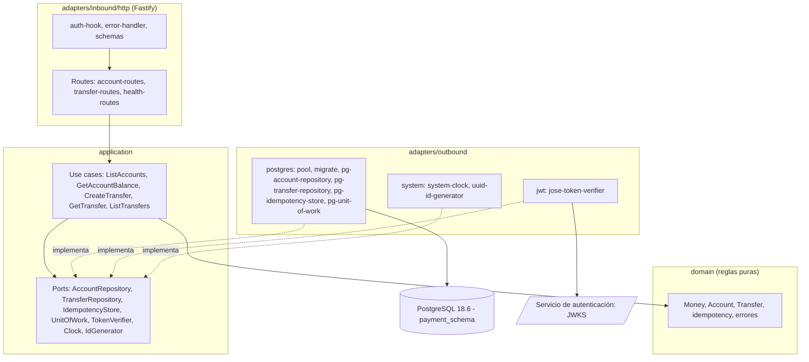

# Technical Design Document: Transferencias internas (servicio de pagos `services/payments`)

## 1. Metadata & Traceability
- **Spec:** `transferencias-internas-payments`
- **Requirements Ref:** `requirements.md` (spec: `transferencias-internas-payments`)
- **Target Stack:** Node.js 24.22.0 (`node:24.22.0-alpine`), TypeScript 6.0.3 ESM estricto, Fastify 5.12.7, pg 8.23.1, node-pg-migrate 9.0.0, jose 6.2.12, PostgreSQL 18.6 (`postgres:18.6-alpine`), Vitest 5.0.5, tsx 4.23.15, @types/pg 8.23.1.
- **Versiones:** exactas, sin `^` ni `~`, en `services/payments/package.json`. El tooling de la raíz (ESLint, Prettier, lefthook, `typescript`, `@types/node`, `tsconfig.base.json`, `.npmrc`, `.gitattributes`, `.dockerignore`, `.gitignore`) lo crea el spec `autenticacion-usuarios-auth`; este spec lo consume tal cual y no lo recrea ni lo modifica.
- **Host:** solo Docker y Git; todo comando de compilación, prueba y ejecución corre en contenedores.
- **Modelo de dominio:** [`../domain-model.md`](../domain-model.md) (Contexto Delimitado de Pagos). **Esquema DB:** [`db-design.dbml`](db-design.dbml).

---

## 2. Architecture & System Overview

### 2.1 Architectural Approach
Arquitectura hexagonal. El dominio queda aislado de la infraestructura y del framework:

- `src/domain`: reglas puras (`Money`, `Account`, `Transfer`, clave y huella de idempotencia, errores). Sin imports de Fastify, `pg` ni `jose`; el único módulo externo permitido es `node:crypto`.
- `src/application`: puertos en `ports/` (interfaces TypeScript, un archivo por puerto), casos de uso en `use-cases/` (clases con método `execute`, dependencias por constructor), vistas (`views.ts`) y cursor de paginación (`transfer-cursor.ts`). Solo dependen de `src/domain` y de los puertos.
- `src/adapters/inbound/http`: adaptador de entrada Fastify (rutas, esquemas JSON, hook de autenticación, manejo de errores).
- `src/adapters/outbound/postgres`, `jwt` y `system`: adaptadores de salida que implementan los puertos.
- `src/compose.ts`: raíz de composición (adaptadores, casos de uso y app); lo usan `src/main.ts` y las pruebas de aceptación. `src/config.ts`: variables de entorno. `src/main.ts`: arranque.

Las carpetas se llaman `inbound` y `outbound` (nunca `in`). Convenciones: ESM con `module NodeNext` (imports relativos con extensión `.js`), `verbatimModuleSyntax` (`import type` para tipos), identificadores en inglés.

Puertos de este spec (todos los usa hoy): `AccountRepository`, `TransferRepository`, `IdempotencyStore`, `UnitOfWork` (transacción única para el efecto monetario y la respuesta de idempotencia), `TokenVerifier`, `Clock`, `IdGenerator`.

### 2.2 Component Diagram / Module Interaction


### 2.3 Entorno de ejecución en contenedores

El host solo tiene Docker y Git. El Compose de este servicio es `services/payments/compose.dev.yaml` (proyecto `fluxone-payments-dev`), independiente de cualquier otro Compose del repositorio. La tarea 1.1 crea los servicios `postgres` y `dev`; la tarea 4.1 añade el servicio `payments`.

| Servicio | Imagen / build | Puertos | Volúmenes | Healthcheck | Propósito |
|:---|:---|:---|:---|:---|:---|
| `postgres` | `postgres:18.6-alpine` | ninguno publicado | `tmpfs` en `/var/lib/postgresql`; `./docker/postgres-init` en `/docker-entrypoint-initdb.d` (solo lectura) | `pg_isready` cada 5 s (`start_period` 10 s, 5 reintentos) | PostgreSQL de desarrollo y pruebas; el script de inicialización crea el rol `payment_svc` y el esquema `payment_schema` |
| `dev` | build de `services/payments/Dockerfile`, etapa `dev`, contexto = raíz del repositorio | ninguno | raíz del repositorio en `/app`; volúmenes con nombre `node_modules_root`, `node_modules_payments`, `npm_cache` | ninguno | Ejecuta instalación, compilación, lint, tipos y pruebas |
| `payments` (tarea 4.1) | build de `services/payments/Dockerfile` (etapa runtime), contexto = raíz | `3002:3002` | ninguno | `wget` a `/health/ready` cada 5 s (`start_period` 10 s, 10 reintentos) | Servicio de pagos en ejecución |

**Comandos.** Prefijo: `docker compose -f services/payments/compose.dev.yaml`. Sin DB: `run --rm --no-deps dev <cmd>`; con DB: `run --rm dev <cmd>` (levanta `postgres` y espera su healthcheck).

| Acción | Comando |
|:---|:---|
| Instalar (genera `package-lock.json` en 1.2) / reproducible | `docker compose -f services/payments/compose.dev.yaml run --rm --no-deps dev npm install` / `docker compose -f services/payments/compose.dev.yaml run --rm --no-deps dev npm ci` |
| Compilar | `docker compose -f services/payments/compose.dev.yaml run --rm --no-deps dev npm run build -w services/payments` |
| Tipos | `docker compose -f services/payments/compose.dev.yaml run --rm --no-deps dev npm run typecheck -w services/payments` |
| Lint (solo esta unidad) | `docker compose -f services/payments/compose.dev.yaml run --rm --no-deps dev npx eslint services/payments --max-warnings 0` |
| Formato (solo esta unidad) | `docker compose -f services/payments/compose.dev.yaml run --rm --no-deps dev npx prettier --check services/payments` |
| Pruebas `unit` | `docker compose -f services/payments/compose.dev.yaml run --rm --no-deps dev npm run test -w services/payments -- --project unit` |
| Pruebas `db` (integración + aceptación) | `docker compose -f services/payments/compose.dev.yaml run --rm dev npm run test -w services/payments -- --project db` |
| Todas las pruebas | `docker compose -f services/payments/compose.dev.yaml run --rm dev npm run test -w services/payments` |
| Construir imagen (4.1) | `docker compose -f services/payments/compose.dev.yaml build payments` |
| Levantar servicio (4.1) | `docker compose -f services/payments/compose.dev.yaml up -d --wait payments` |
| Limpiar | `docker compose -f services/payments/compose.dev.yaml down -v` |

**Red y volúmenes.** Los servicios comparten la red del proyecto Compose: se llega a PostgreSQL por `postgres:5432` (la DB no publica puertos). `node_modules` vive en volúmenes con nombre (`node_modules_root` en `/app/node_modules`, `node_modules_payments` en `/app/services/payments/node_modules`) y la caché de npm en `npm_cache` (`/root/.npm`). Los archivos que `dev` escribe en el árbol (lockfile, `dist`) los crea `root` dentro del contenedor.

**Contenido exacto de `services/payments/compose.dev.yaml` (tarea 1.1).** Las credenciales son valores de desarrollo desechables, sobreescribibles por variable de entorno; no son secretos del proyecto porque la DB no publica puertos ni persiste datos. YAML con comillas simples (por `singleQuote: true` de `.prettierrc`).

```yaml
name: fluxone-payments-dev

services:
  postgres:
    image: postgres:18.6-alpine
    environment:
      POSTGRES_USER: postgres
      POSTGRES_PASSWORD: ${POSTGRES_PASSWORD:-postgres_dev_pw}
      POSTGRES_DB: fluxone
      PAYMENT_DB_PASSWORD: ${PAYMENT_DB_PASSWORD:-payment_dev_pw}
    tmpfs:
      - /var/lib/postgresql
    volumes:
      - ./docker/postgres-init:/docker-entrypoint-initdb.d:ro
    healthcheck:
      test: ['CMD-SHELL', 'pg_isready -U $${POSTGRES_USER} -d $${POSTGRES_DB} -h 127.0.0.1 -p 5432']
      interval: 5s
      timeout: 3s
      retries: 5
      start_period: 10s

  dev:
    build:
      context: ../..
      dockerfile: services/payments/Dockerfile
      target: dev
    working_dir: /app
    environment:
      DATABASE_URL: postgres://payment_svc:${PAYMENT_DB_PASSWORD:-payment_dev_pw}@postgres:5432/fluxone
    volumes:
      - ../..:/app
      - node_modules_root:/app/node_modules
      - node_modules_payments:/app/services/payments/node_modules
      - npm_cache:/root/.npm
    depends_on:
      postgres:
        condition: service_healthy

volumes:
  node_modules_root:
  node_modules_payments:
  npm_cache:
```

**Servicio `payments` (tarea 4.1).** Se añade bajo `services:`:

```yaml
  payments:
    build:
      context: ../..
      dockerfile: services/payments/Dockerfile
    environment:
      PORT: '3002'
      DATABASE_URL: postgres://payment_svc:${PAYMENT_DB_PASSWORD:-payment_dev_pw}@postgres:5432/fluxone
      AUTH_JWKS_URL: ${AUTH_JWKS_URL:-http://auth:3001/.well-known/jwks.json}
    ports:
      - '3002:3002'
    depends_on:
      postgres:
        condition: service_healthy
    healthcheck:
      test: ['CMD-SHELL', 'wget -q -O /dev/null http://127.0.0.1:3002/health/ready']
      interval: 5s
      timeout: 3s
      retries: 10
      start_period: 10s
```

`/health/ready` solo consulta la DB; el JWKS se descarga de forma perezosa en la primera verificación de token, por lo que el servicio queda sano sin el servicio de autenticación.

**Contenido exacto de `services/payments/docker/postgres-init/01-payments-role-schema.sh` (tarea 1.1).** LF; el entrypoint de `postgres` lo ejecuta solo con el directorio de datos vacío.

```sh
#!/bin/sh
# Rol y esquema de payments para desarrollo y pruebas en Compose (solo este servicio).
set -eu
psql -v ON_ERROR_STOP=1 --username "$POSTGRES_USER" --dbname "$POSTGRES_DB" <<EOSQL
REVOKE CREATE, USAGE ON SCHEMA public FROM PUBLIC;
REVOKE CONNECT ON DATABASE ${POSTGRES_DB} FROM PUBLIC;
CREATE ROLE payment_svc LOGIN PASSWORD '${PAYMENT_DB_PASSWORD}' NOSUPERUSER NOCREATEDB NOCREATEROLE NOINHERIT;
GRANT CONNECT ON DATABASE ${POSTGRES_DB} TO payment_svc;
CREATE SCHEMA payment_schema AUTHORIZATION payment_svc;
ALTER ROLE payment_svc IN DATABASE ${POSTGRES_DB} SET search_path = payment_schema;
EOSQL
```

**Etapa `dev` de `services/payments/Dockerfile` (tarea 1.1),** primera etapa del archivo:

```dockerfile
FROM node:24.22.0-alpine AS dev
RUN apk add --no-cache git \
  && git config --system --add safe.directory /app
WORKDIR /app
```

### 2.5 Decisiones cerradas (heredadas de IDEA)
- Arquitectura hexagonal en todo servicio: aísla el dominio del framework y la infraestructura.
- Stack y versiones exactas de §1; TypeScript 6.0.3 por compatibilidad de typescript-eslint.
- Puerto 3002; errores con forma `{error:{code,message}}`; OpenAPI 3.1 en `services/payments/openapi.yaml`.
- Fastify con esquemas JSON y `inject` para pruebas; `pg` sin ORM para controlar transacciones y bloqueos.
- Verificación de `Authorization: Bearer` con `jose` (`createRemoteJWKSet` sobre `AUTH_JWKS_URL`, por defecto `http://auth:3001/.well-known/jwks.json`), EdDSA, `iss` = `urn:fluxone:auth`, `aud` = `urn:fluxone:api`, `clockTolerance` 5 s; `sub` = id de usuario.
- Esquema propio `payment_schema` con rol `payment_svc`, sin FK entre esquemas.
- Migraciones con node-pg-migrate 9 en SQL, ejecutadas al arrancar (`pgmigrations` en `payment_schema`); semilla de tres cuentas.
- Dinero: `numeric(18,2)` en DB, `bigint` de centavos en dominio, `string` decimal en JSON; nunca `float`.
- Bloqueo `SELECT ... FOR UPDATE` de las dos cuentas en orden ascendente de id; débito condicional.
- Idempotencia: la clave se inserta en la misma transacción del efecto, con `SET LOCAL lock_timeout`/`statement_timeout` de 5 s; ámbito (usuario, operación, clave); huella sha256 del JSON canónico concatenado con la operación.
- Logs JSON (pino de Fastify) con redacción de datos sensibles; health `live` y `ready`.
- Pruebas con Vitest sobre la PostgreSQL 18.6 del Compose; el nombre de cada prueba incluye su ID `[AC-TRI-NN]`.
- Ambiente 100 % Docker (constitución): compilación, pruebas y ejecución en contenedores con el Compose propio del servicio.
- Monorepo con npm workspaces `apps/*` y `services/*`; saltos de línea LF.

### 2.6 Riesgos y mitigaciones

| Riesgo | Impacto | Mitigación |
|:---|:---|:---|
| Doble débito por reintento o solicitudes simultáneas | Pérdida de dinero | Clave de idempotencia insertada en la misma transacción del efecto; la fila de la clave serializa solicitudes con la misma clave |
| Interbloqueo en A→B y B→A simultáneos | Transferencias colgadas | Bloqueo de cuentas en orden ascendente de id (ordenado por la aplicación) |
| Saldo negativo por carrera | Violación del invariante | `FOR UPDATE` + débito condicional (`WHERE balance >= monto`) + `CHECK (balance >= 0)` |
| Espera indefinida por una clave retenida | Solicitudes colgadas | `SET LOCAL lock_timeout`/`statement_timeout` = 5 s; el vencimiento de la espera sobre la clave responde 409 `IDEMPOTENCY_KEY_IN_PROGRESS` |
| Ajv de Fastify por defecto elimina campos adicionales y coacciona tipos | Se aceptaría un monto numérico o campos no definidos | `ajv.customOptions` con `removeAdditional: false`, `coerceTypes: false` (§4.3) |
| Pérdida de precisión de `created_at` en el cursor (microsegundos de PG frente a milisegundos de JS) | Páginas con repeticiones u omisiones | `created_at` lo fija la aplicación con `Clock` (milisegundos) y se guarda como parámetro; nunca `now()` de la DB |
| El JWKS del servicio de autenticación no está disponible | Toda solicitud autenticada responde 401 | Falla cerrada, con log `warn` `auth.token_rejected` y código de error de `jose`; el JWKS se cachea en memoria |
| CRLF de Windows rompe scripts y Dockerfiles | Fallos en contenedor | `.gitattributes` raíz con LF forzado |
| Volumen de datos de PostgreSQL 18 | Datos perdidos | Montar `/var/lib/postgresql` (no `/var/lib/postgresql/data`) |
| Pruebas `db` comparten una sola base de datos | Carreras entre archivos | `fileParallelism: false` en el proyecto `db`; `unit` sigue en paralelo |
| Credenciales de desarrollo por defecto en `compose.dev.yaml` | Exposición | Desechables: la DB no publica puertos ni persiste datos |
| Bind mount en Docker Desktop | Instalaciones y pruebas lentas | `node_modules` y caché de npm en volúmenes con nombre |
| Claves de idempotencia sin purga | Crecimiento de la tabla | Fuera de alcance; se acepta |

### 2.7 Directrices del proyecto
- `Global`: arquitectura hexagonal en todo servicio, con dominio sin dependencias de framework, DB ni HTTP.
- `Global`: stack Node 24.22.0 + TypeScript 6.0.3 ESM con npm workspaces y versiones exactas fijadas en los specs.
- `Global`: dinero en COP, `numeric(18,2)` en DB, `bigint` de centavos en dominio y `string` en JSON, nunca `float`.
- `Global`: toda operación monetaria con efecto exige `Idempotency-Key` con ámbito (usuario, operación) y se guarda en la misma transacción del efecto.
- `Global`: cada servicio usa solo su esquema y su rol, sin FK entre esquemas.
- `Global`: logs JSON con identificador de correlación, nunca secretos, tokens ni cabeceras de autorización.
- `Unidad: services/payments`: todo comando de compilación, prueba y ejecución corre en contenedores con `docker compose -f services/payments/compose.dev.yaml` (servicio `dev`); la DB de pruebas es el servicio `postgres` de ese Compose.
- `Unidad: services/payments`: consultas siempre parametrizadas y con nombres calificados `payment_schema.<tabla>`; las cuentas de una transacción se bloquean en orden ascendente de id.
- `Unidad: services/payments`: se crea el modelo de dominio de este BC en `../domain-model.md` (Contexto Delimitado de Pagos).

### 2.8 Sujeto a actualización futura
- `transferencias-externas-payments` — §4 Interfaces — `POST /transfers` aceptará `type: EXTERNAL` con `toExternalAccount` y los estados PENDING y UNKNOWN.
- `reversos-transferencias-payments` — §4 Interfaces — `GET /transfers/{id}` añadirá el estado REVERSED y el objeto `reversal`.
- `auditoria-transferencias-payments` — §5 Implementation Target Structure — los casos de uso de creación insertarán un evento outbox en su misma transacción.

---

## 3. Data Models & Schema Design

> Los datos van primero: todo esquema de esta sección está declarado antes en [`../domain-model.md`](../domain-model.md) y [`db-design.dbml`](db-design.dbml); un cambio de esquema entra primero en esos dos documentos.

### 3.1 Domain Entities (Core Business Objects)

```typescript
// src/domain/money.ts  (Money = bigint de centavos COP)
export type Money = bigint;
export const MAX_AMOUNT_CENTS = 999999999999999999n; // 9999999999999999.99
// Valida ^(0|[1-9][0-9]{0,15})(\.[0-9]{1,2})?$ sobre un string, > 0 y <= MAX_AMOUNT_CENTS.
// Cualquier otro valor (número, null, undefined, string fuera de formato) -> InvalidAmountError.
export function parseAmount(raw: unknown): Money;
export function formatMoney(m: Money): string; // siempre 2 decimales: 100n -> "1.00"
export function moneyFromDb(text: string): Money; // numeric(18,2) como texto ^[0-9]+\.[0-9]{2}$

// src/domain/account.ts
export interface Account {
  id: string; // 'ACC-NNN'
  ownerUserId: string; // uuid = claim sub
  currency: 'COP';
  balance: Money;
  createdAt: Date;
  updatedAt: Date;
}
// Puras. debit lanza InsufficientFundsError si balance < amount (balance == amount es válido y deja 0n).
export function debit(account: Account, amount: Money, now: Date): Account;
export function credit(account: Account, amount: Money, now: Date): Account;

// src/domain/transfer.ts
export type TransferStatus = 'COMPLETED' | 'FAILED';
export type FailureReason = 'INSUFFICIENT_FUNDS';
export interface Transfer {
  id: string; // uuid
  ownerUserId: string; // iniciador = dueño de la cuenta origen
  type: 'INTERNAL';
  fromAccountId: string;
  toAccountId: string;
  amount: Money;
  currency: 'COP';
  status: TransferStatus;
  failureReason: FailureReason | null; // no nulo si y solo si status = FAILED
  correlationId: string | null;
  createdAt: Date;
  updatedAt: Date;
  completedAt: Date | null; // = createdAt si COMPLETED; null si FAILED
}
export interface TransferOutcome { transfer: Transfer; from: Account; to: Account }
// Pura. Lanza SameAccountError si from.id === to.id. Si from.balance < amount -> FAILED
// INSUFFICIENT_FUNDS con from/to sin cambios; si no -> COMPLETED con debit(from) y credit(to).
export function executeInternalTransfer(input: {
  id: string; ownerUserId: string; from: Account; to: Account;
  amount: Money; correlationId: string | null; now: Date;
}): TransferOutcome;

// src/domain/idempotency.ts
export const CREATE_TRANSFER_OPERATION = 'CREATE_TRANSFER';
// Valida ^[\x21-\x7E]{1,255}$ sobre un string; ausente (undefined), vacío, largo o con otros caracteres -> IdempotencyKeyRequiredError.
export function parseIdempotencyKey(raw: unknown): string;
// JSON con claves de objeto ordenadas recursivamente (orden de unidades de código), arreglos en su orden.
export function canonicalJson(value: unknown): string;
// sha256 hexadecimal (64 caracteres) de canonicalJson(body) + operation.
export function computeRequestHash(operation: string, body: unknown): string;
```

Errores en `src/domain/errors.ts` (extienden `Error`, fijan `name` al nombre de la clase): `ValidationError` (message = detalle), `InvalidAmountError`, `IdempotencyKeyRequiredError`, `InsufficientFundsError`, `SameAccountError`, `AccountNotFoundError`, `DestinationNotFoundError`, `TransferNotFoundError`, `IdempotencyKeyPayloadMismatchError`, `IdempotencyKeyInProgressError`, `AccessTokenInvalidError`.

**Pertenencia de datos, tabla por tabla:**

| Tabla | Cómo se determina la pertenencia | Predicado SQL |
|:---|:---|:---|
| `accounts` | La fila es del usuario si `owner_user_id` = `sub` del token | `WHERE owner_user_id = $sub` (listado); `WHERE id = $id AND owner_user_id = $sub` (saldo y cuenta origen). Inexistente y ajena son indistinguibles (404 idéntico) |
| `transfers` | Sin columna de usuario consultable: es visible si el usuario es dueño de la cuenta origen o de la destino, por unión con `accounts`. `owner_user_id` es el iniciador y no se usa para filtrar | `WHERE EXISTS (SELECT 1 FROM payment_schema.accounts a WHERE a.owner_user_id = $sub AND a.id IN (t.from_account_id, t.to_account_id))` |
| `idempotency_keys` | La fila es del usuario si `user_id` = `sub`; la clave primaria compuesta `(user_id, operation, idempotency_key)` hace independientes a los usuarios | Toda lectura y escritura incluye `user_id = $sub` y `operation` en la clave |
| `pgmigrations` | Sin dueño: tabla interna de node-pg-migrate; el servicio no la expone | No se consulta desde código de negocio |

No hay valores centinela ni excepciones: ni cuentas del sistema ni usuario nulo. `owner_user_id` y `user_id` son siempre un `sub` real (uuid) validado por el verificador de token.

### 3.2 Database Schema & Persistence
- **Target Database / Storage:** PostgreSQL 18.6, esquema `payment_schema` (rol `payment_svc`), declarado en `db-design.dbml`.
- **Esquema y rol:** el servicio NO los crea (los provee el entorno; el rol no tiene `CREATE` en la DB). El runner de migraciones usa `createSchema: false`. En desarrollo y pruebas los crea `01-payments-role-schema.sh` (§2.3); `tests/global-setup.ts` solo migra.
- **Consultas:** nombres calificados `payment_schema.<tabla>` y parámetros posicionales (`$1`, `$2`, ...); nunca se concatenan valores en SQL. Importes se envían como string con `$n::numeric` y se leen con `col::text`. `pg` devuelve `timestamptz` como `Date`, `jsonb` como objeto y `smallint` como número.
- **Migración 1** `services/payments/migrations/1792108800000_create-payment-tables.sql` (formato node-pg-migrate SQL con marcadores `-- Up Migration` y `-- Down Migration`):

```sql
-- Up Migration
CREATE TABLE payment_schema.accounts (
  id varchar(20) PRIMARY KEY,
  owner_user_id uuid NOT NULL,
  currency char(3) NOT NULL DEFAULT 'COP',
  balance numeric(18,2) NOT NULL,
  created_at timestamptz NOT NULL DEFAULT now(),
  updated_at timestamptz NOT NULL DEFAULT now(),
  CONSTRAINT accounts_id_chk CHECK (id ~ '^ACC-[0-9]{3,}$'),
  CONSTRAINT accounts_currency_chk CHECK (currency = 'COP'),
  CONSTRAINT accounts_balance_chk CHECK (balance >= 0)
);
CREATE INDEX accounts_owner_user_id_idx ON payment_schema.accounts (owner_user_id);

CREATE TABLE payment_schema.transfers (
  id uuid PRIMARY KEY,
  owner_user_id uuid NOT NULL,
  type varchar(10) NOT NULL,
  from_account_id varchar(20) NOT NULL REFERENCES payment_schema.accounts (id),
  to_account_id varchar(20) NOT NULL REFERENCES payment_schema.accounts (id),
  amount numeric(18,2) NOT NULL,
  currency char(3) NOT NULL DEFAULT 'COP',
  status varchar(16) NOT NULL,
  failure_reason varchar(40),
  correlation_id varchar(64),
  created_at timestamptz NOT NULL DEFAULT now(),
  updated_at timestamptz NOT NULL DEFAULT now(),
  completed_at timestamptz,
  CONSTRAINT transfers_type_chk CHECK (type = 'INTERNAL'),
  CONSTRAINT transfers_amount_chk CHECK (amount > 0),
  CONSTRAINT transfers_currency_chk CHECK (currency = 'COP'),
  CONSTRAINT transfers_status_chk CHECK (status IN ('COMPLETED', 'FAILED')),
  CONSTRAINT transfers_failure_reason_chk CHECK (failure_reason IS NULL OR failure_reason = 'INSUFFICIENT_FUNDS'),
  CONSTRAINT transfers_distinct_chk CHECK (from_account_id <> to_account_id),
  CONSTRAINT transfers_failure_chk CHECK ((status = 'FAILED') = (failure_reason IS NOT NULL))
);
CREATE INDEX transfers_from_account_idx ON payment_schema.transfers (from_account_id, created_at DESC, id DESC);
CREATE INDEX transfers_to_account_idx ON payment_schema.transfers (to_account_id, created_at DESC, id DESC);

CREATE TABLE payment_schema.idempotency_keys (
  user_id uuid NOT NULL,
  operation varchar(80) NOT NULL,
  idempotency_key varchar(255) NOT NULL,
  request_hash char(64) NOT NULL,
  status varchar(16) NOT NULL,
  response_status smallint,
  response_body jsonb,
  resource_id uuid,
  created_at timestamptz NOT NULL DEFAULT now(),
  completed_at timestamptz,
  PRIMARY KEY (user_id, operation, idempotency_key),
  CONSTRAINT idempotency_keys_status_chk CHECK (status IN ('IN_PROGRESS', 'COMPLETED'))
);

-- Down Migration
DROP TABLE payment_schema.idempotency_keys;
DROP TABLE payment_schema.transfers;
DROP TABLE payment_schema.accounts;
```

- **Migración 2 (semilla)** `services/payments/migrations/1792108800001_seed-demo-accounts.sql`. Al registrarse en `pgmigrations` se ejecuta una sola vez; `ON CONFLICT DO NOTHING` la hace además inofensiva si se reejecuta su SQL:

```sql
-- Up Migration
INSERT INTO payment_schema.accounts (id, owner_user_id, currency, balance) VALUES
  ('ACC-001', '11111111-1111-4111-8111-111111111111', 'COP', 1000000.00),
  ('ACC-002', '22222222-2222-4222-8222-222222222222', 'COP', 500000.00),
  ('ACC-003', '33333333-3333-4333-8333-333333333333', 'COP', 0.00)
ON CONFLICT DO NOTHING;

-- Down Migration
DELETE FROM payment_schema.accounts WHERE id IN ('ACC-001', 'ACC-002', 'ACC-003');
```

- **Ejecución al arrancar** (`src/adapters/outbound/postgres/migrate.ts`, `runMigrations(databaseUrl: string): Promise<void>`):

```typescript
import path from 'node:path';
import { runner } from 'node-pg-migrate';

await runner({
  databaseUrl,
  dir: path.resolve(import.meta.dirname, '../../../../migrations'),
  direction: 'up',
  schema: 'payment_schema',
  createSchema: false,
  migrationsTable: 'pgmigrations',
});
```

  La ruta `../../../../migrations` resuelve a `services/payments/migrations` tanto desde `src/adapters/outbound/postgres/` como desde `dist/adapters/outbound/postgres/`.
- **Mapeo fila ↔ entidad:** `snake_case` ↔ `camelCase` (`owner_user_id` ↔ `ownerUserId`, `from_account_id` ↔ `fromAccountId`, `failure_reason` ↔ `failureReason`, `correlation_id` ↔ `correlationId`, `created_at` ↔ `createdAt`, `updated_at` ↔ `updatedAt`, `completed_at` ↔ `completedAt`); `balance`/`amount` ↔ `Money` vía `moneyFromDb`/`formatMoney`.
- **Mapeo de errores PG (solo en `PgIdempotencyStore.begin`):** `55P03` (lock_timeout) o `57014` (statement_timeout) producidos por la inserción de la clave → `IdempotencyKeyInProgressError`. Cualquier otro error de DB se propaga sin traducir (500 `INTERNAL_ERROR`).

---

## 4. Interfaces, Contracts & API Specifications

### 4.1 Internal Service Interfaces / Ports

Un archivo por puerto en `src/application/ports/`:

```typescript
// clock.ts
export interface Clock { now(): Date }

// id-generator.ts
export interface IdGenerator { newId(): string } // uuid v4

// token-verifier.ts
// Lanza AccessTokenInvalidError ante cualquier fallo (ausente, expirado, firma, iss, aud, alg, sub no uuid).
export interface TokenVerifier { verify(token: string): Promise<{ userId: string }> }

// account-repository.ts
export interface AccountRepository {
  findByOwner(userId: string): Promise<Account[]>; // ORDER BY id
  findOwned(id: string, userId: string): Promise<Account | null>; // id y owner_user_id = userId
  // Ordena los ids de forma ascendente y ejecuta un SELECT ... WHERE id = $1 FOR UPDATE por id, en ese orden.
  // Devuelve solo las cuentas existentes.
  lockByIds(ids: string[]): Promise<Account[]>;
  // UPDATE ... SET balance = balance - $2::numeric, updated_at = $3 WHERE id = $1 AND balance >= $2::numeric; true si actualizó 1 fila.
  debit(id: string, amount: Money, now: Date): Promise<boolean>;
  credit(id: string, amount: Money, now: Date): Promise<void>; // UPDATE ... SET balance = balance + $2::numeric, updated_at = $3
}

// transfer-repository.ts
export interface TransferCursor { createdAt: Date; id: string }
export interface TransferRepository {
  insert(transfer: Transfer): Promise<void>;
  findVisibleById(id: string, userId: string): Promise<Transfer | null>; // predicado de visibilidad de §3.1
  // Hasta `limit` filas visibles, ORDER BY created_at DESC, id DESC; si after != null:
  // AND (t.created_at, t.id) < ($createdAt::timestamptz, $id::uuid)
  listVisible(userId: string, page: { limit: number; after: TransferCursor | null }): Promise<Transfer[]>;
}

// idempotency-store.ts
export interface IdempotencyScope { userId: string; operation: string; key: string }
export type BeginResult =
  | { kind: 'ACQUIRED' }
  | { kind: 'REPLAY'; status: number; body: unknown }
  | { kind: 'MISMATCH' };
export interface IdempotencyStore {
  // INSERT ... ON CONFLICT (user_id, operation, idempotency_key) DO NOTHING con status IN_PROGRESS.
  // 1 fila insertada -> ACQUIRED. 0 filas -> SELECT de la fila ya confirmada: hash distinto -> MISMATCH; igual -> REPLAY.
  // Lanza IdempotencyKeyInProgressError si la espera vence (55P03 / 57014).
  begin(scope: IdempotencyScope, requestHash: string, now: Date): Promise<BeginResult>;
  // UPDATE ... SET status='COMPLETED', response_status, response_body, resource_id, completed_at.
  complete(scope: IdempotencyScope, response: { status: number; body: unknown; resourceId: string }, now: Date): Promise<void>;
}

// unit-of-work.ts
export interface TransactionScope {
  accounts: AccountRepository;
  transfers: TransferRepository;
  idempotency: IdempotencyStore;
}
export interface UnitOfWork {
  // BEGIN; SET LOCAL lock_timeout = '5s'; SET LOCAL statement_timeout = '5s'; work(scope); COMMIT.
  // Si work lanza: ROLLBACK y relanza (si el ROLLBACK falla, el cliente se descarta con release(error)). El cliente se libera siempre.
  run<T>(work: (scope: TransactionScope) => Promise<T>): Promise<T>;
}
```

Los repositorios Postgres reciben un `Queryable` (objeto con `query`): `Pool` para las lecturas (`GET`) y el cliente de la transacción dentro de `PgUnitOfWork`.

**Vistas** (`src/application/views.ts`; el cuerpo de respuesta de la API y el cuerpo guardado para idempotencia):

```typescript
export interface AccountView { id: string; currency: 'COP'; balance: string }
export interface BalanceView { accountId: string; currency: 'COP'; balance: string }
export interface TransferView {
  id: string;
  type: 'INTERNAL';
  fromAccountId: string;
  toAccountId: string;
  amount: string; // 2 decimales
  currency: 'COP';
  status: 'COMPLETED' | 'FAILED';
  failureReason?: 'INSUFFICIENT_FUNDS'; // presente solo si status = FAILED
  createdAt: string; // ISO 8601 UTC con milisegundos
  completedAt: string | null; // null si FAILED
}
export interface TransferPage { items: TransferView[]; nextCursor: string | null }
```

**Cursor** (`src/application/transfer-cursor.ts`): `encodeCursor(c: TransferCursor): string` = base64url de `{"c":"<createdAt ISO>","i":"<uuid>"}`; `decodeCursor(raw: string): TransferCursor` lanza `ValidationError` si no es base64url/JSON válido, si `c` no es un ISO con `new Date(c).toISOString() === c` o si `i` no es un uuid.

#### Casos de uso (`src/application/use-cases/`)

Clases con método `execute`; dependencias por constructor.

| Caso de uso | Entrada → Salida | Comportamiento (en orden) | Errores |
|:---|:---|:---|:---|
| `ListAccounts({accounts})` | `{userId}` → `AccountView[]` | `findByOwner`; mapea saldo con `formatMoney`; `[]` si no hay | ninguno |
| `GetAccountBalance({accounts})` | `{userId, accountId}` → `BalanceView` | `findOwned(accountId, userId)`; si es `null` | `AccountNotFoundError` |
| `GetTransfer({transfers})` | `{userId, transferId}` → `TransferView` | Si `transferId` no es uuid (`^[0-9a-f]{8}-[0-9a-f]{4}-[0-9a-f]{4}-[0-9a-f]{4}-[0-9a-f]{12}$`, sin distinguir mayúsculas) o `findVisibleById` devuelve `null` | `TransferNotFoundError` |
| `ListTransfers({transfers})` | `{userId, limit?: string, cursor?: string}` → `TransferPage` | `limit` ausente = 20; si no cumple `^[0-9]+$` o no está entre 1 y 100 -> `ValidationError`; `decodeCursor` si hay cursor; `listVisible(userId, {limit: limit + 1, after})`; si volvieron más de `limit` filas, recorta a `limit` y `nextCursor` = cursor de la última fila devuelta; si no, `null` | `ValidationError` |
| `CreateTransfer({unitOfWork, clock, ids})` | `{userId, idempotencyKey, body: {type, fromAccountId, toAccountId, amount}, correlationId}` → `{replayed: boolean, transfer: TransferView}` | Ver flujo siguiente | `InvalidAmountError`, `SameAccountError`, `AccountNotFoundError`, `DestinationNotFoundError`, `IdempotencyKeyPayloadMismatchError`, `IdempotencyKeyInProgressError` |

**Flujo de `CreateTransfer.execute`:**
1. `amount = parseAmount(body.amount)` (fuera de la transacción).
2. Si `fromAccountId === toAccountId` → `SameAccountError`.
3. `requestHash = computeRequestHash(CREATE_TRANSFER_OPERATION, body)`; `scope = {userId, operation: CREATE_TRANSFER_OPERATION, key: idempotencyKey}`.
4. `unitOfWork.run(async ({accounts, transfers, idempotency}) => ...)`:
   1. `idempotency.begin(scope, requestHash, clock.now())`. `MISMATCH` → `IdempotencyKeyPayloadMismatchError`. `REPLAY` → devuelve `{replayed: true, transfer: body guardado}` sin escribir nada.
   2. `accounts.lockByIds([fromAccountId, toAccountId])`. Origen ausente o con `ownerUserId !== userId` → `AccountNotFoundError`; destino ausente → `DestinationNotFoundError`.
   3. `now = clock.now()` (después de los bloqueos, para que `created_at` siga el orden de confirmación); `executeInternalTransfer({id: ids.newId(), ownerUserId: userId, from, to, amount, correlationId, now})`.
   4. Si el resultado es COMPLETED: `accounts.debit(from.id, amount, now)` (si devuelve `false` lanza un `Error` de invariante: 500) y `accounts.credit(to.id, amount, now)`. Si es FAILED no se mueve ningún saldo.
   5. `transfers.insert(transfer)`.
   6. `idempotency.complete(scope, {status: 201, body: view, resourceId: transfer.id}, now)` con `view` = `TransferView`.
   7. Devuelve `{replayed: false, transfer: view}`.
5. Cualquier error dentro de `run` revierte la transacción: ni saldos, ni transferencia, ni clave quedan guardados (los rechazos sin efecto no se almacenan).

#### Adaptadores de sistema y JWT
- **`SystemClock`** (`system/system-clock.ts`): `now()` = `new Date()`. **`UuidIdGenerator`** (`system/uuid-id-generator.ts`): `newId()` = `randomUUID()`.
- **`JoseTokenVerifier`** (`jwt/jose-token-verifier.ts`), constructor `{jwksUrl: string, issuer: string, audience: string, clock: Clock}`: crea una vez `createRemoteJWKSet(new URL(jwksUrl))`; `verify` llama `jwtVerify(token, jwks, {issuer, audience, algorithms: ['EdDSA'], clockTolerance: '5s', currentDate: clock.now()})` y devuelve `{userId: payload.sub}`. Si `sub` no es un string uuid o cualquier paso falla (incluido un JWKS inalcanzable) → `AccessTokenInvalidError`. El claim `email` no se usa en este servicio.

### 4.2 External API / RPC / Event Schemas

**Reglas comunes**
- Formato de error siempre `{"error":{"code":"...","message":"..."}}`, mensajes en español y sin datos sensibles.
- Esquemas de entrada con `additionalProperties: false` (cuerpo, query y params); esquemas de respuesta por código de estado (jamás se serializan campos no declarados).
- `application/json`. El servicio escucha en el puerto 3002; las rutas no llevan prefijo.
- Todo endpoint de negocio exige `Authorization: Bearer <JWT>` (hook `onRequest`, §4.3). Los `health` no la exigen.
- Importes y saldos: string con exactamente 2 decimales.

**Mensajes de error**

| `code` | Status | `message` |
|:---|:---|:---|
| `UNAUTHORIZED` | 401 | `Token de acceso ausente o inválido.` |
| `VALIDATION_ERROR` | 400 | `Solicitud inválida: <detalle en español de la primera violación>` |
| `INVALID_AMOUNT` | 400 | `El monto es inválido: debe ser un texto decimal mayor que 0, con hasta 2 decimales y un máximo de 9999999999999999.99.` |
| `IDEMPOTENCY_KEY_REQUIRED` | 400 | `El encabezado Idempotency-Key es obligatorio: de 1 a 255 caracteres ASCII imprimibles.` |
| `ACCOUNT_NOT_FOUND` | 404 | `Cuenta no encontrada.` |
| `DESTINATION_NOT_FOUND` | 404 | `Cuenta destino no encontrada.` |
| `TRANSFER_NOT_FOUND` | 404 | `Transferencia no encontrada.` |
| `NOT_FOUND` | 404 | `Recurso no encontrado.` |
| `SAME_ACCOUNT` | 422 | `La cuenta origen y la cuenta destino deben ser distintas.` |
| `IDEMPOTENCY_KEY_PAYLOAD_MISMATCH` | 422 | `La clave de idempotencia ya se usó con una solicitud distinta.` |
| `IDEMPOTENCY_KEY_IN_PROGRESS` | 409 | `Hay otra solicitud en curso con la misma clave de idempotencia. Intenta de nuevo.` |
| `INTERNAL_ERROR` | 500 | `Error interno del servidor.` |

El detalle de `VALIDATION_ERROR` se arma desde `error.validation[0]`: `required` → `falta el campo "<campo>"`; `additionalProperties` → `campo no permitido "<campo>"`; otro → `valor inválido en "<ruta>"`. Para errores de ValidationError del dominio (`limit`, cursor) el detalle es su `message`.

#### `GET /accounts`
- **Entrada:** sin cuerpo ni query.
- **Response 200:** arreglo de `AccountView` ordenado por `id`; `[]` si el usuario no tiene cuentas.
```json
[{ "id": "ACC-001", "currency": "COP", "balance": "1000000.00" }]
```
- **Errores:** `401 UNAUTHORIZED`.
- **Pertenencia:** `accounts.owner_user_id = sub`.

#### `GET /accounts/{id}/balance`
- **Entrada:** `id` (string 1 a 64 caracteres) en la ruta.
- **Response 200:** `BalanceView`
```json
{ "accountId": "ACC-001", "currency": "COP", "balance": "1000000.00" }
```
- **Errores:** `401 UNAUTHORIZED`; `404 ACCOUNT_NOT_FOUND` (cuenta inexistente o de otro usuario, respuesta idéntica).
- **Pertenencia:** `accounts.id = $id AND owner_user_id = sub`.

#### `POST /transfers`
- **Entrada:** header `Idempotency-Key` (1 a 255 caracteres ASCII 0x21 a 0x7E) y cuerpo:
```json
{ "type": "INTERNAL", "fromAccountId": "ACC-001", "toAccountId": "ACC-002", "amount": "150000.50" }
```
  Esquema: `type` `const: "INTERNAL"`, `fromAccountId` y `toAccountId` `string` (1 a 64 caracteres), todos requeridos salvo `amount`; `amount` sin restricción de tipo en el esquema (su validación la hace el dominio para producir `INVALID_AMOUNT` incluso si falta o es un número JSON); `additionalProperties: false`. Un id de cuenta con formato distinto de `ACC-NNN` no es un error de forma: simplemente no existe (404).
- **Response 201** (`TransferView`; también para FAILED por fondos insuficientes):
```json
{
  "id": "5b0b5f55-7f45-4b9a-bf0a-0a0f2f2a1d11",
  "type": "INTERNAL",
  "fromAccountId": "ACC-001",
  "toAccountId": "ACC-002",
  "amount": "150000.50",
  "currency": "COP",
  "status": "COMPLETED",
  "createdAt": "2026-10-15T14:00:00.000Z",
  "completedAt": "2026-10-15T14:00:00.000Z"
}
```
  FAILED: `"status": "FAILED"`, `"failureReason": "INSUFFICIENT_FUNDS"`, `"completedAt": null`.
- **Repetición** (misma clave y mismo payload): mismo status y body originales más el header `Idempotent-Replayed: true`. Las respuestas no repetidas no llevan ese header.
- **Errores y precedencia** (la primera que aplica): `401 UNAUTHORIZED` → `400 IDEMPOTENCY_KEY_REQUIRED` (hook `preValidation`, antes de validar el cuerpo) → `400 VALIDATION_ERROR` (cuerpo no objeto, JSON mal formado, campos faltantes salvo `amount`, campos adicionales, `type` distinto de `INTERNAL`) → `400 INVALID_AMOUNT` → `422 SAME_ACCOUNT` → dentro de la transacción: `422 IDEMPOTENCY_KEY_PAYLOAD_MISMATCH`, `404 ACCOUNT_NOT_FOUND` (origen inexistente o ajeno), `404 DESTINATION_NOT_FOUND`; y `409 IDEMPOTENCY_KEY_IN_PROGRESS` si la espera por la clave supera 5 s. Ningún rechazo 4xx se almacena.
- **Pertenencia:** origen con `owner_user_id = sub` (verificado tras `FOR UPDATE`); la clave se guarda con `user_id = sub`; la transferencia guarda `owner_user_id = sub`.
- **Log:** éxito `request.log.info({event: 'transfer.created', transferId, status, userId})`; repetición `request.log.info({event: 'idempotency.replayed', userId})`; conflicto de payload `request.log.warn({event: 'idempotency.mismatch', userId})`.

```mermaid
sequenceDiagram
    participant C as Cliente
    participant H as HTTP (Fastify)
    participant U as CreateTransfer
    participant T as UnitOfWork / Postgres
    C->>H: POST /transfers + Bearer + Idempotency-Key
    H->>H: verificar JWT (401), validar clave (400), validar cuerpo (400)
    H->>U: execute(userId, key, body, requestId)
    U->>U: parseAmount (400), mismo origen/destino (422)
    U->>T: BEGIN; SET LOCAL lock_timeout/statement_timeout = 5s
    U->>T: INSERT clave IN_PROGRESS ON CONFLICT DO NOTHING
    alt clave ya confirmada
        T-->>U: 0 filas; SELECT de la fila
        alt hash distinto
            U-->>H: MISMATCH -> ROLLBACK
            H-->>C: 422 IDEMPOTENCY_KEY_PAYLOAD_MISMATCH
        else hash igual
            U-->>H: REPLAY -> ROLLBACK (sin escrituras)
            H-->>C: status y body guardados + Idempotent-Replayed: true
        end
    else clave retenida por otra transacción > 5 s
        T-->>U: 55P03 / 57014 -> ROLLBACK
        H-->>C: 409 IDEMPOTENCY_KEY_IN_PROGRESS
    else clave nueva
        U->>T: SELECT ... FOR UPDATE de las dos cuentas en orden ascendente de id
        alt origen ajeno o inexistente / destino inexistente
            U-->>H: error -> ROLLBACK (nada guardado)
            H-->>C: 404 ACCOUNT_NOT_FOUND / DESTINATION_NOT_FOUND
        else saldo suficiente
            U->>T: débito condicional + crédito + INSERT transfers COMPLETED
            U->>T: UPDATE clave COMPLETED con respuesta 201; COMMIT
            H-->>C: 201 COMPLETED
        else saldo insuficiente
            U->>T: INSERT transfers FAILED INSUFFICIENT_FUNDS (sin mover saldos)
            U->>T: UPDATE clave COMPLETED con respuesta 201; COMMIT
            H-->>C: 201 FAILED
        end
    end
```

#### `GET /transfers/{id}`
- **Entrada:** `id` (string 1 a 64 caracteres) en la ruta; no exige `Idempotency-Key`.
- **Response 200:** `TransferView` (`failureReason` solo si FAILED).
- **Errores:** `401 UNAUTHORIZED`; `404 TRANSFER_NOT_FOUND` (inexistente, id sin formato uuid, o el usuario no es dueño de la cuenta origen ni de la destino; respuesta idéntica).
- **Pertenencia:** predicado de visibilidad de `transfers` (§3.1).

#### `GET /transfers`
- **Entrada:** query opcional `limit` (string `^[0-9]+$`) y `cursor` (string de hasta 512 caracteres); `additionalProperties: false`.
- **Response 200:** `TransferPage`, ordenado por `created_at` descendente e `id` descendente; incluye enviadas y recibidas del usuario.
```json
{ "items": [ { "id": "...", "type": "INTERNAL", "...": "..." } ], "nextCursor": "eyJjIjoi...In0" }
```
  `nextCursor` es `null` si no hay más; `{"items": [], "nextCursor": null}` si el usuario no tiene transferencias.
- **Errores:** `401 UNAUTHORIZED`; `400 VALIDATION_ERROR` (`limit` no entero, menor que 1 o mayor que 100, parámetro desconocido o repetido, cursor inválido).
- **Pertenencia:** predicado de visibilidad de `transfers` (§3.1).

#### `GET /health/live` y `GET /health/ready`
- `GET /health/live` → 200 `{"status":"ok"}`.
- `GET /health/ready` → 200 `{"status":"ok"}` si `SELECT 1` funciona; si no, 503 `{"status":"unavailable"}`.
- Sin autenticación.

#### Rutas inexistentes y errores no controlados
- Ruta o método inexistente → 404 `NOT_FOUND`.
- Error no controlado → 500 `INTERNAL_ERROR`: se registra el error en el log y el cuerpo es genérico.

### 4.3 Configuración, composición y servidor HTTP

**Configuración (`src/config.ts`).** `loadConfig(env: NodeJS.ProcessEnv): Config` falla con un `Error` claro (nombra la variable, sin imprimir valores secretos) si falta algo obligatorio o es inválido.

| Variable | Obligatoria | Default | Regla |
|:---|:---|:---|:---|
| `PORT` | No | `3002` | entero 1–65535 |
| `DATABASE_URL` | Sí | — | la compone el entorno con el rol `payment_svc`; en Compose: `postgres://payment_svc:<contraseña>@postgres:5432/fluxone` |
| `AUTH_JWKS_URL` | No | `http://auth:3001/.well-known/jwks.json` | URL absoluta válida |
| `JWT_ISSUER` | No | `urn:fluxone:auth` | no vacío |
| `JWT_AUDIENCE` | No | `urn:fluxone:api` | no vacío |
| `LOG_LEVEL` | No | `info` | nivel válido de pino |

```typescript
export interface Config {
  port: number;
  databaseUrl: string;
  authJwksUrl: string;
  jwtIssuer: string;
  jwtAudience: string;
  logLevel: string;
}
export function loadConfig(env: NodeJS.ProcessEnv): Config;
```

**Composición (`src/compose.ts`):** `composeApp({config, pool, logStream?}): Promise<FastifyInstance>`: crea `SystemClock`, `UuidIdGenerator`, `JoseTokenVerifier`, los repositorios Postgres sobre `pool` (lecturas), `PgUnitOfWork(pool)`, instancia los casos de uso y llama `buildApp({config, useCases, tokenVerifier, isDatabaseReady, logStream})` con `isDatabaseReady = async () => { try { await pool.query('SELECT 1'); return true; } catch { return false; } }`.

**Arranque (`src/main.ts`):** `loadConfig(process.env)` → `runMigrations(config.databaseUrl)` → `createPool(config.databaseUrl)` (`pool.ts`, `max: 10`, con handler `pool.on('error')` que escribe una línea JSON a stderr) → `composeApp` → `app.listen({host: '0.0.0.0', port: config.port})` → cierre ordenado (`app.close()` y luego `pool.end()`) en `SIGINT`/`SIGTERM`. Si un paso falla, escribe el error (sin secretos) y `process.exit(1)`.

**Servidor (`src/adapters/inbound/http/app.ts`):** `buildApp(deps)` crea Fastify con:

```typescript
Fastify({
  logger: {
    level: config.logLevel,
    redact: ['req.headers.authorization', 'req.headers.cookie', 'res.headers["set-cookie"]'],
    stream: logStream, // opcional, solo para que las pruebas capturen logs; si es undefined no se pasa la propiedad
  },
  requestIdHeader: 'x-request-id',
  genReqId: (req) => {
    const h = req.headers['x-request-id'];
    return typeof h === 'string' && /^[A-Za-z0-9._-]{1,64}$/.test(h) ? h : randomUUID();
  },
  ajv: { customOptions: { removeAdditional: false, coerceTypes: false, useDefaults: false } },
});
```

- Un hook `onSend` devuelve el id de solicitud en el header `X-Request-Id`; ese id se guarda como `correlation_id` de la transferencia.
- Registra el manejador de errores, el de rutas inexistentes, las rutas de `health` y, en un contexto encapsulado, el hook de autenticación y las rutas de negocio (`account-routes`, `transfer-routes`).
- `auth-hook.ts`: hook `onRequest` que exige `Authorization` con esquema `Bearer` y token no vacío; llama `tokenVerifier.verify`; si falla registra `request.log.warn({event: 'auth.token_rejected', code})` (código de error de `jose` o `MISSING`) y lanza `AccessTokenInvalidError`; si pasa, fija `request.userId`. Declara `declare module 'fastify' { interface FastifyRequest { userId: string } }`.
- `POST /transfers` añade un hook `preValidation` que llama `parseIdempotencyKey(request.headers['idempotency-key'])`.
- Los esquemas de respuesta incluyen `additionalProperties: false` y el 2xx de `TransferView` omite `failureReason` si no está presente.
- El manejador de errores traduce errores de dominio (§7.1), los `error.validation` de Fastify y los errores `FST_ERR_CTP_*` (JSON mal formado, cuerpo vacío o demasiado grande) a 400 `VALIDATION_ERROR`.

---

## 5. Implementation Target Structure (File Mapping)

Rutas relativas a la raíz del repositorio. Todos los archivos son "Crear", salvo los marcados "Modificar". Esta lista es exacta (ni un archivo más ni uno menos).

**Estructura de `services/payments/`:**
```
services/payments/
├── package.json, tsconfig.json, tsconfig.build.json, vitest.config.ts, openapi.yaml, Dockerfile, compose.dev.yaml
├── docker/postgres-init/01-payments-role-schema.sh
├── migrations/ (1792108800000_create-payment-tables.sql, 1792108800001_seed-demo-accounts.sql)
├── src/
│   ├── config.ts, compose.ts, main.ts
│   ├── domain/ (errors, money, account, transfer, idempotency)
│   ├── application/ (views.ts, transfer-cursor.ts, ports/ (7 puertos), use-cases/ (5 casos de uso))
│   └── adapters/
│       ├── inbound/http/ (app, auth-hook, error-handler, schemas, routes/)
│       └── outbound/ (postgres/, jwt/, system/)
└── tests/ (global-setup.ts, support/, unit/, integration/, acceptance/)
```

| Archivo | Acción | Propósito | Tarea |
|:---|:---|:---|:---|
| `services/payments/compose.dev.yaml` | Crear | Compose de desarrollo y pruebas: `postgres` y `dev` | 1.1 |
| `services/payments/docker/postgres-init/01-payments-role-schema.sh` | Crear | Crea el rol `payment_svc` y el esquema `payment_schema` | 1.1 |
| `services/payments/Dockerfile` | Crear | Etapa `dev` (Node + `git`) | 1.1 |
| `services/payments/package.json` | Crear | Workspace `@fluxone/payments`: dependencias y scripts | 1.2 |
| `services/payments/tsconfig.json` | Crear | TypeScript del servicio (typecheck, sin emitir) | 1.2 |
| `services/payments/tsconfig.build.json` | Crear | Compilación a `dist` | 1.2 |
| `services/payments/vitest.config.ts` | Crear | Proyectos Vitest `unit` y `db` | 1.2 |
| `package-lock.json` | Modificar | Regenerado por `npm install` en el contenedor `dev` (añade el workspace) | 1.2 |
| `services/payments/migrations/1792108800000_create-payment-tables.sql` | Crear | Tablas `accounts`, `transfers`, `idempotency_keys` | 1.3 |
| `services/payments/migrations/1792108800001_seed-demo-accounts.sql` | Crear | Semilla de las tres cuentas | 1.3 |
| `services/payments/tests/global-setup.ts` | Crear | Migraciones sobre la PostgreSQL de Compose | 1.3 |
| `services/payments/tests/support/db.ts` | Crear | `createTestPool()` y `resetData()` | 1.3 |
| `services/payments/tests/integration/migrations.test.ts` | Crear | Verifica tablas, restricciones, índices y semilla | 1.3 |
| `services/payments/tests/integration/environment.test.ts` | Crear | Verifica versión de PostgreSQL, rol, host y límites del rol | 1.3 |
| `services/payments/src/domain/errors.ts` | Crear | Errores tipados | 2.1 |
| `services/payments/src/domain/money.ts` | Crear | `Money`, `parseAmount`, `formatMoney`, `moneyFromDb` | 2.1 |
| `services/payments/src/domain/account.ts` | Crear | Entidad `Account`, `debit`, `credit` | 2.1 |
| `services/payments/src/domain/transfer.ts` | Crear | Entidad `Transfer` y `executeInternalTransfer` | 2.1 |
| `services/payments/src/domain/idempotency.ts` | Crear | Clave, JSON canónico y huella | 2.1 |
| `services/payments/tests/unit/money.test.ts` | Crear | Pruebas de `Money` | 2.1 |
| `services/payments/tests/unit/account.test.ts` | Crear | Pruebas de `debit`/`credit` e invariantes | 2.1 |
| `services/payments/tests/unit/transfer.test.ts` | Crear | Pruebas de `executeInternalTransfer` | 2.1 |
| `services/payments/tests/unit/idempotency-key.test.ts` | Crear | Pruebas de `parseIdempotencyKey` | 2.1 |
| `services/payments/tests/unit/request-hash.test.ts` | Crear | Pruebas de `canonicalJson` y `computeRequestHash` | 2.1 |
| `services/payments/src/application/ports/clock.ts` | Crear | Puerto `Clock` | 2.2 |
| `services/payments/src/application/ports/id-generator.ts` | Crear | Puerto `IdGenerator` | 2.2 |
| `services/payments/src/application/ports/token-verifier.ts` | Crear | Puerto `TokenVerifier` | 2.2 |
| `services/payments/src/application/ports/account-repository.ts` | Crear | Puerto `AccountRepository` | 2.2 |
| `services/payments/src/application/ports/transfer-repository.ts` | Crear | Puerto `TransferRepository` y `TransferCursor` | 2.2 |
| `services/payments/src/application/ports/idempotency-store.ts` | Crear | Puerto `IdempotencyStore` | 2.2 |
| `services/payments/src/application/ports/unit-of-work.ts` | Crear | Puerto `UnitOfWork` y `TransactionScope` | 2.2 |
| `services/payments/src/application/views.ts` | Crear | Vistas de API y funciones de mapeo dominio → vista | 2.2 |
| `services/payments/src/application/transfer-cursor.ts` | Crear | `encodeCursor` y `decodeCursor` | 2.2 |
| `services/payments/tests/unit/transfer-cursor.test.ts` | Crear | Pruebas del cursor | 2.2 |
| `services/payments/src/application/use-cases/list-accounts.ts` | Crear | Caso de uso `ListAccounts` | 2.3 |
| `services/payments/src/application/use-cases/get-account-balance.ts` | Crear | Caso de uso `GetAccountBalance` | 2.3 |
| `services/payments/src/application/use-cases/get-transfer.ts` | Crear | Caso de uso `GetTransfer` | 2.3 |
| `services/payments/src/application/use-cases/list-transfers.ts` | Crear | Caso de uso `ListTransfers` | 2.3 |
| `services/payments/tests/support/fakes.ts` | Crear | Fakes en memoria de los repositorios y del reloj | 2.3 |
| `services/payments/tests/unit/list-transfers.test.ts` | Crear | Pruebas de `limit`, cursor y `nextCursor` | 2.3 |
| `services/payments/tests/unit/get-transfer.test.ts` | Crear | Pruebas de `GetTransfer` (id inválido, ajena, visible) | 2.3 |
| `services/payments/src/application/use-cases/create-transfer.ts` | Crear | Caso de uso `CreateTransfer` | 2.4 |
| `services/payments/tests/support/fakes.ts` | Modificar | Añadir fakes de `UnitOfWork`, `IdempotencyStore` e `IdGenerator` | 2.4 |
| `services/payments/tests/unit/create-transfer.test.ts` | Crear | Pruebas de `CreateTransfer` con fakes | 2.4 |
| `services/payments/src/adapters/outbound/postgres/pool.ts` | Crear | `createPool` | 3.1 |
| `services/payments/src/adapters/outbound/postgres/migrate.ts` | Crear | `runMigrations` | 3.1 |
| `services/payments/src/adapters/outbound/postgres/pg-account-repository.ts` | Crear | `AccountRepository` en Postgres | 3.1 |
| `services/payments/src/adapters/outbound/postgres/pg-transfer-repository.ts` | Crear | `TransferRepository` en Postgres | 3.1 |
| `services/payments/src/adapters/outbound/postgres/pg-idempotency-store.ts` | Crear | `IdempotencyStore` en Postgres | 3.1 |
| `services/payments/src/adapters/outbound/postgres/pg-unit-of-work.ts` | Crear | `UnitOfWork` en Postgres | 3.1 |
| `services/payments/src/adapters/outbound/system/system-clock.ts` | Crear | Reloj del sistema | 3.1 |
| `services/payments/src/adapters/outbound/system/uuid-id-generator.ts` | Crear | Generador de uuid | 3.1 |
| `services/payments/tests/integration/pg-account-repository.test.ts` | Crear | Integración de cuentas (bloqueo ordenado, débito condicional) | 3.1 |
| `services/payments/tests/integration/pg-transfer-repository.test.ts` | Crear | Integración de transferencias (visibilidad, keyset) | 3.1 |
| `services/payments/tests/integration/pg-idempotency-store.test.ts` | Crear | Integración de idempotencia (begin, replay, mismatch, espera) | 3.1 |
| `services/payments/src/adapters/outbound/jwt/jose-token-verifier.ts` | Crear | Verificación de JWT EdDSA con JWKS remoto | 3.2 |
| `services/payments/tests/support/jwks-server.ts` | Crear | Servidor JWKS efímero y firmador de tokens Ed25519 para pruebas | 3.2 |
| `services/payments/tests/integration/jose-token-verifier.test.ts` | Crear | Integración del verificador | 3.2 |
| `services/payments/src/config.ts` | Crear | `loadConfig` | 3.3 |
| `services/payments/src/compose.ts` | Crear | `composeApp` | 3.3 |
| `services/payments/src/main.ts` | Crear | Arranque del proceso | 3.3 |
| `services/payments/src/adapters/inbound/http/app.ts` | Crear | `buildApp` con plugins y rutas de salud | 3.3 |
| `services/payments/src/adapters/inbound/http/auth-hook.ts` | Crear | Hook de autenticación Bearer | 3.3 |
| `services/payments/src/adapters/inbound/http/error-handler.ts` | Crear | Tabla error → status/code | 3.3 |
| `services/payments/src/adapters/inbound/http/schemas.ts` | Crear | Esquemas JSON de entrada y salida | 3.3 |
| `services/payments/src/adapters/inbound/http/routes/health-routes.ts` | Crear | `GET /health/live` y `/health/ready` | 3.3 |
| `services/payments/tests/support/fixtures.ts` | Crear | Constantes de usuarios y cuentas semilla | 3.3 |
| `services/payments/tests/support/build-test-app.ts` | Crear | Compone la app real con JWKS de prueba | 3.3 |
| `services/payments/tests/unit/config.test.ts` | Crear | Pruebas de `loadConfig` | 3.3 |
| `services/payments/tests/acceptance/seed.test.ts` | Crear | Aceptación de la semilla y del rol limitado | 3.3 |
| `services/payments/src/adapters/inbound/http/routes/account-routes.ts` | Crear | `GET /accounts` y `GET /accounts/{id}/balance` | 3.4 |
| `services/payments/src/adapters/inbound/http/app.ts` | Modificar | Registrar el hook de autenticación y `account-routes` | 3.4 |
| `services/payments/tests/acceptance/auth.test.ts` | Crear | Aceptación de autenticación | 3.4 |
| `services/payments/tests/acceptance/accounts.test.ts` | Crear | Aceptación de cuentas y saldo | 3.4 |
| `services/payments/src/adapters/inbound/http/routes/transfer-routes.ts` | Crear | `POST /transfers` | 3.5 |
| `services/payments/src/adapters/inbound/http/app.ts` | Modificar | Registrar `transfer-routes` | 3.5 |
| `services/payments/tests/acceptance/create-transfer.test.ts` | Crear | Aceptación de la creación | 3.5 |
| `services/payments/tests/acceptance/idempotency.test.ts` | Crear | Aceptación de idempotencia | 3.5 |
| `services/payments/tests/acceptance/concurrency.test.ts` | Crear | Aceptación de concurrencia A→B / B→A | 3.5 |
| `services/payments/src/adapters/inbound/http/routes/transfer-routes.ts` | Modificar | Añadir `GET /transfers/{id}` y `GET /transfers` | 3.6 |
| `services/payments/tests/acceptance/get-transfer.test.ts` | Crear | Aceptación de la consulta | 3.6 |
| `services/payments/tests/acceptance/list-transfers.test.ts` | Crear | Aceptación del historial | 3.6 |
| `services/payments/tests/acceptance/operability.test.ts` | Crear | Aceptación de health, errores y logs (sin archivos de producción nuevos; solo ajustes si hay fallos) | 3.7 |
| `services/payments/openapi.yaml` | Crear | Contrato OpenAPI 3.1 | 3.7 |
| `services/payments/tests/acceptance/openapi.test.ts` | Crear | Verifica `openapi.yaml` | 3.7 |
| `services/payments/Dockerfile` | Modificar | Añadir las etapas `build` y runtime | 4.1 |
| `services/payments/compose.dev.yaml` | Modificar | Añadir el servicio `payments` | 4.1 |

La tarea 4.2 no crea ni modifica archivos (verificación global).

**Archivos raíz compartidos (footprint).** Solo `package-lock.json` se modifica (regenerado por npm al añadir el workspace; el glob `services/*` de `package.json` ya lo cubre). `package.json`, `tsconfig.base.json`, `eslint.config.js`, `.prettierrc`, `.prettierignore`, `.npmrc`, `.gitattributes`, `.dockerignore` y `.gitignore` existen por el spec de autenticación y se consumen sin cambios. `.gitignore` no se modifica: su bloque `# Proyecto` ya ignora `node_modules/`, `dist/`, `coverage/`, `.env` y `*.log`, que es todo lo que genera este servicio. `lefthook.yml` no lleva tarea: existe por el spec de autenticación y este servicio no agrega entradas.

**Nota de paralelismo.** Este spec toca solo `services/payments/**` y `package-lock.json`. NO modifica archivos de `services/auth`, `services/bank-rail` ni `apps/web`. Sus comandos de lint, formato, tipos y pruebas se acotan a `services/payments` para no depender del estado de otras unidades.

### Contenido exacto de la configuración del workspace (tarea 1.2)
- **`services/payments/package.json`:** `name: "@fluxone/payments"`, `private: true`, `type: "module"`; `dependencies`: `fastify` 5.12.7, `pg` 8.23.1, `node-pg-migrate` 9.0.0, `jose` 6.2.12; `devDependencies`: `vitest` 5.0.5, `tsx` 4.23.15, `@types/pg` 8.23.1 (versiones exactas). Scripts: `build` = `tsc -p tsconfig.build.json`, `dev` = `tsx watch src/main.ts`, `start` = `node dist/main.js`, `typecheck` = `tsc --noEmit -p tsconfig.json`, `test` = `vitest run`.
- **`tsconfig.json`:** `extends: "../../tsconfig.base.json"`, `compilerOptions.noEmit: true`, `include: ["src", "tests", "vitest.config.ts"]`.
- **`tsconfig.build.json`:** `extends: "./tsconfig.json"`, `compilerOptions: {noEmit: false, rootDir: "src", outDir: "dist"}`, `include: ["src"]`, `exclude: ["tests"]`.
- **`vitest.config.ts`:** `test.projects` con `unit` (`include: ['tests/unit/**/*.test.ts']`, sin DB) y `db` (`include: ['tests/integration/**/*.test.ts', 'tests/acceptance/**/*.test.ts']`, `globalSetup: ['./tests/global-setup.ts']`, `testTimeout: 60000`, `hookTimeout: 120000`, `fileParallelism: false`); `environment: 'node'`, sin `globals`.

### Soporte de pruebas (tarea 1.3)
- **`tests/global-setup.ts`:** lee `DATABASE_URL` (si falta, lanza `DATABASE_URL no definida: ejecuta las pruebas con docker compose run dev`) y ejecuta `runner` con los mismos parámetros de §3.2 apuntando a `services/payments/migrations`. No crea esquema ni contenedores.
- **`tests/support/db.ts`:** `createTestPool(): Pool` (usa `process.env.DATABASE_URL`) y `resetData(pool): Promise<void>`: `TRUNCATE payment_schema.idempotency_keys, payment_schema.transfers` y restablece los saldos semilla (1000000.00, 500000.00, 0.00) con `UPDATE payment_schema.accounts`.
- **`tests/integration/environment.test.ts`:** afirma `[AC-TRI-27]` `SHOW server_version` empieza por `18.6`, `current_user` = `payment_svc`, `CREATE SCHEMA` y `CREATE TABLE public.x` fallan con `42501`, y `DATABASE_URL` tiene host `postgres` y puerto `5432`.

### Dockerfile (tarea 4.1)
La etapa `dev` (tarea 1.1, §2.3) es la primera; la tarea 4.1 añade después `build` y runtime, de modo que `docker compose -f services/payments/compose.dev.yaml build payments` (servicio sin `target`) produce la imagen runtime.
- Etapa `build`: `FROM node:24.22.0-alpine AS build`; `WORKDIR /app`; `COPY . .` (contexto = raíz, filtrado por `.dockerignore`; el `.npmrc` copiado aplica `ignore-scripts`); `RUN npm ci --workspace=services/payments --include-workspace-root`; `RUN npm run build -w services/payments`; `RUN rm -rf node_modules && npm ci --omit=dev --workspace=services/payments --include-workspace-root=false`.
- Etapa runtime (final): `FROM node:24.22.0-alpine`; `ENV NODE_ENV=production`; `WORKDIR /app`; copia desde `build`: `node_modules`, `package.json`, `services/payments/package.json`, `services/payments/dist`, `services/payments/migrations`; `USER node`; `EXPOSE 3002`; `CMD ["node","services/payments/dist/main.js"]`.
- Contingencia: si aparece el bug de npm "Exit handler never called" en Alpine, usar `node:24.22.0-bookworm-slim` en ambas etapas.

### Contenido de `openapi.yaml` (tarea 3.7)
OpenAPI `3.1.0`, `info.title: FluxOne Payments API`, `servers: [{url: http://localhost:3002}]`, YAML con comillas simples. `components.securitySchemes.bearerAuth` (`http`, `bearer`, `bearerFormat: JWT`) aplicado a todos los endpoints de negocio. Rutas y métodos: `/accounts` GET, `/accounts/{id}/balance` GET, `/transfers` GET y POST, `/transfers/{id}` GET, `/health/live` GET, `/health/ready` GET. `POST /transfers` declara el header `Idempotency-Key` (obligatorio, `string`, `minLength: 1`, `maxLength: 255`, `pattern: '^[\x21-\x7E]{1,255}$'`) y la respuesta `201` con el header `Idempotent-Replayed` documentado (presente solo en repeticiones). Esquemas: `AccountView`, `BalanceView`, `CreateTransferRequest` (`additionalProperties: false`), `TransferView`, `TransferPage`, `ErrorResponse`, y respuestas de error 400, 401, 404, 409, 422, 503 con los códigos de §4.2.

### Validación de palabras reservadas (TypeScript/JavaScript)
Segmentos de ruta revisados: `services`, `payments`, `migrations`, `docker`, `postgres-init`, `src`, `domain`, `application`, `ports`, `use-cases`, `adapters`, `inbound`, `outbound`, `http`, `routes`, `postgres`, `jwt`, `system`, `tests`, `unit`, `integration`, `acceptance`, `support`. Ninguno colisiona con palabras reservadas de TypeScript/JavaScript (se usa `inbound`/`outbound` en lugar de `in`, que sí es reservada). Sin renombres.

Todos los archivos son nuevos salvo `package-lock.json`, `app.ts`, `transfer-routes.ts`, `fakes.ts`, `Dockerfile` y `compose.dev.yaml` (modificados por tareas posteriores): no hay directivas de supresión (`eslint-disable`, `@ts-ignore`) preexistentes que revisar.

### 5.1 Barrido de términos críticos
sin términos críticos afectados

### 5.2 Tests afectados por un nuevo corte de migración
sin cortes de migración afectados

---

## 6. Traceability Matrix: Requirements to Design

Rutas relativas a `services/payments/`, salvo `package-lock.json`.

| Requirement ID | Design Section | Implementation File(s) |
|:---|:---|:---|
| REQ-1.1, REQ-1.2 | §4.1 `TokenVerifier`, §4.3 `auth-hook.ts`, §7.2 | `src/adapters/outbound/jwt/jose-token-verifier.ts`, `src/adapters/inbound/http/auth-hook.ts`, `src/adapters/inbound/http/error-handler.ts`, `src/domain/errors.ts` |
| REQ-2.1, REQ-2.2, REQ-2.3 | §3.1 pertenencia `accounts`, §4.2 `GET /accounts`, `GET /accounts/{id}/balance` | `src/application/use-cases/list-accounts.ts`, `src/application/use-cases/get-account-balance.ts`, `src/adapters/outbound/postgres/pg-account-repository.ts`, `src/adapters/inbound/http/routes/account-routes.ts` |
| REQ-3.1, REQ-3.2, REQ-3.3, REQ-3.7 | §3.1, §4.1 flujo de `CreateTransfer`, §4.2 `POST /transfers` | `src/domain/money.ts`, `src/domain/account.ts`, `src/domain/transfer.ts`, `src/application/use-cases/create-transfer.ts`, `src/adapters/outbound/postgres/pg-account-repository.ts`, `src/adapters/outbound/postgres/pg-transfer-repository.ts`, `src/adapters/outbound/postgres/pg-unit-of-work.ts`, `src/adapters/inbound/http/routes/transfer-routes.ts` |
| REQ-3.4 | §3.1 `parseAmount`, §4.2 `POST /transfers` | `src/domain/money.ts`, `src/adapters/inbound/http/schemas.ts`, `src/adapters/inbound/http/error-handler.ts` |
| REQ-3.5 | §4.1 flujo de `CreateTransfer`, §4.2 precedencia de errores | `src/application/use-cases/create-transfer.ts`, `src/domain/transfer.ts`, `src/adapters/inbound/http/error-handler.ts` |
| REQ-3.6 | §4.2 `POST /transfers`, §4.3 `ajv` | `src/adapters/inbound/http/schemas.ts`, `src/adapters/inbound/http/app.ts`, `src/adapters/inbound/http/error-handler.ts` |
| REQ-3.8 | §2.6, §4.1 `lockByIds` | `src/adapters/outbound/postgres/pg-account-repository.ts`, `src/application/use-cases/create-transfer.ts` |
| REQ-4.1 | §3.1 `parseIdempotencyKey`, §4.3 `preValidation` | `src/domain/idempotency.ts`, `src/adapters/inbound/http/routes/transfer-routes.ts` |
| REQ-4.2, REQ-4.3, REQ-4.4 | §4.1 `IdempotencyStore`, §4.2 diagrama de secuencia, §7.2 | `src/domain/idempotency.ts`, `src/adapters/outbound/postgres/pg-idempotency-store.ts`, `src/adapters/outbound/postgres/pg-unit-of-work.ts`, `src/application/use-cases/create-transfer.ts`, `src/adapters/inbound/http/routes/transfer-routes.ts` |
| REQ-4.5 | §3.2 mapeo de errores PG, §4.1 `UnitOfWork` | `src/adapters/outbound/postgres/pg-idempotency-store.ts`, `src/adapters/outbound/postgres/pg-unit-of-work.ts`, `src/adapters/inbound/http/error-handler.ts` |
| REQ-4.6, REQ-4.7 | §3.1 pertenencia `idempotency_keys`, §4.1 flujo de `CreateTransfer` | `src/application/use-cases/create-transfer.ts`, `src/adapters/outbound/postgres/pg-idempotency-store.ts`, `migrations/1792108800000_create-payment-tables.sql` |
| REQ-5.1, REQ-5.2 | §3.1 pertenencia `transfers`, §4.2 `GET /transfers/{id}` | `src/application/use-cases/get-transfer.ts`, `src/adapters/outbound/postgres/pg-transfer-repository.ts`, `src/adapters/inbound/http/routes/transfer-routes.ts` |
| REQ-6.1, REQ-6.2, REQ-6.3, REQ-6.4 | §4.1 `ListTransfers` y cursor, §4.2 `GET /transfers` | `src/application/use-cases/list-transfers.ts`, `src/application/transfer-cursor.ts`, `src/adapters/outbound/postgres/pg-transfer-repository.ts`, `src/adapters/inbound/http/routes/transfer-routes.ts` |
| REQ-7.1 | §2.3, §3.2 | `migrations/1792108800001_seed-demo-accounts.sql`, `migrations/1792108800000_create-payment-tables.sql`, `docker/postgres-init/01-payments-role-schema.sh`, `src/adapters/outbound/postgres/migrate.ts`, `src/main.ts` |
| REQ-8.1 | §4.2 Health, §4.3 | `src/adapters/inbound/http/routes/health-routes.ts`, `src/compose.ts` |
| REQ-8.2 | §4.2 errores, §7.1 | `src/adapters/inbound/http/error-handler.ts`, `src/adapters/inbound/http/schemas.ts`, `src/domain/errors.ts` |
| REQ-8.3 | §4.3 servidor, §7.3 | `src/adapters/inbound/http/app.ts`, `src/adapters/inbound/http/routes/transfer-routes.ts` |
| REQ-9.1 | §5 contenido de `openapi.yaml` | `openapi.yaml` |
| REQ-10.1 | §1, §2.3, §5 configuración del workspace | `package.json`, `package-lock.json` (raíz), `compose.dev.yaml`, `Dockerfile` |
| REQ-10.2 | §2.3, §5 Dockerfile | `Dockerfile`, `compose.dev.yaml` |

---

## 7. Error Handling, Edge Cases & Performance Constraints

### 7.1 Error Strategy & Failure Modes
- **Dominio y aplicación:** lanzan errores tipados (§3.1); no conocen HTTP.
- **Adaptador HTTP:** `error-handler.ts` traduce con `app.setErrorHandler` y `app.setNotFoundHandler`:

| Origen | Status | `code` |
|:---|:---|:---|
| `AccessTokenInvalidError` | 401 | `UNAUTHORIZED` |
| `ValidationError`, `error.validation` de Fastify, `FST_ERR_CTP_*` | 400 | `VALIDATION_ERROR` |
| `InvalidAmountError` | 400 | `INVALID_AMOUNT` |
| `IdempotencyKeyRequiredError` | 400 | `IDEMPOTENCY_KEY_REQUIRED` |
| `AccountNotFoundError` | 404 | `ACCOUNT_NOT_FOUND` |
| `DestinationNotFoundError` | 404 | `DESTINATION_NOT_FOUND` |
| `TransferNotFoundError` | 404 | `TRANSFER_NOT_FOUND` |
| `SameAccountError` | 422 | `SAME_ACCOUNT` |
| `IdempotencyKeyPayloadMismatchError` | 422 | `IDEMPOTENCY_KEY_PAYLOAD_MISMATCH` |
| `IdempotencyKeyInProgressError` | 409 | `IDEMPOTENCY_KEY_IN_PROGRESS` |
| Ruta o método inexistente | 404 | `NOT_FOUND` |
| Cualquier otro error (incluye `InsufficientFundsError` fuera de `executeInternalTransfer`) | 500 | `INTERNAL_ERROR` (se registra el error; cuerpo genérico) |

- **Fondos insuficientes** no es un error HTTP: `executeInternalTransfer` lo convierte en una transferencia FAILED y la respuesta es 201.
- **Infraestructura:** los adaptadores Postgres propagan los errores de DB sin filtrar detalles al cliente; solo `55P03`/`57014` de la inserción de la clave se traducen (§3.2). Si falla `ROLLBACK`, el cliente se descarta del pool.
- **Configuración:** una validación fallida aborta el arranque con código de salida 1.
- **Readiness:** si `SELECT 1` falla, `/health/ready` responde 503 `{"status":"unavailable"}` sin detalle.
- **Rendimiento:** pool de `pg` con `max: 10`; las transacciones de creación se acotan a 5 s por `SET LOCAL`; las listas usan índices `(cuenta, created_at DESC, id DESC)`.

### 7.2 Security & Isolation
- **Autenticación:** JWT EdDSA con `algorithms: ['EdDSA']` fijado (evita confusión de algoritmo), validación de `iss`, `aud`, `clockTolerance` de 5 s y `sub` uuid. Sin token válido no se ejecuta ninguna operación (401 en `onRequest`, antes de validar o tocar la DB).
- **Autorización:** el `sub` es la única fuente del usuario; ningún id de usuario viene del cuerpo ni de la ruta. La pertenencia se resuelve tabla por tabla según §3.1; lo ajeno responde 404 igual que lo inexistente.
- **Inyección:** consultas parametrizadas; esquemas con `additionalProperties: false`; Ajv sin coacción de tipos ni eliminación silenciosa de campos; montos validados por `parseAmount` y enviados como string con `::numeric`.
- **Aislamiento de datos:** el servicio usa solo `payment_schema` con el rol `payment_svc`, sin FK entre esquemas; el rol no tiene `CREATE` en la DB (verificado por `[AC-TRI-27]`). `public` revocado para `PUBLIC`.
- **Logs:** redacción de `authorization`, `cookie` y `set-cookie`; nunca se registran tokens ni cuerpos. Datos personales: solo el id de usuario.
- **Cadena de suministro:** `.npmrc` raíz con `ignore-scripts=true` (del spec de autenticación).
- **Credenciales de desarrollo** de `compose.dev.yaml`: desechables, la DB no publica puertos ni persiste datos.
- **Idempotencia por operación:**

| Operación | Mecanismo |
|:---|:---|
| `POST /transfers` | Fila de `idempotency_keys` (clave primaria `(user_id, operation, idempotency_key)`) insertada en la misma transacción del efecto. Solicitudes simultáneas con la misma clave: la inserción de la segunda espera a la primera (bloqueo de la fila); tras el commit encuentra la fila y repite la respuesta; si la primera revierte, la segunda ejecuta el efecto; si la espera supera 5 s, 409. Huella distinta → 422. `IN_PROGRESS` nunca queda confirmado |
| `GET /accounts`, `GET /accounts/{id}/balance`, `GET /transfers`, `GET /transfers/{id}`, `GET /health/*` | Solo lectura, naturalmente idempotentes |
| Semilla | `INSERT ... ON CONFLICT DO NOTHING` y `pgmigrations` la registra como aplicada |
| Migraciones | `pgmigrations` registra las ya aplicadas |

### 7.3 Observabilidad
- Logs JSON (pino de Fastify); cada línea de solicitud incluye `reqId` = valor de `X-Request-Id` (o uuid generado), devuelto también en el header `X-Request-Id` y guardado como `correlation_id` de la transferencia.
- Eventos de negocio (campo `event`): `transfer.created` (info), `idempotency.replayed` (info), `idempotency.mismatch` (warn), `auth.token_rejected` (warn). Errores inesperados: nivel `error`.
- Salud: `/health/live` y `/health/ready`.

---

## 8. Testing Strategy & Verification Plan

Convención: el nombre de cada prueba incluye su ID, p. ej. `it('[AC-TRI-06] crea la transferencia ...')`; imports explícitos de `vitest` (sin globals). La trazabilidad AC → archivo es la de `requirements.md`.

### 8.1 Unit Tests
Proyecto `unit`, sin I/O ni DB (en paralelo). Comando: `docker compose -f services/payments/compose.dev.yaml run --rm --no-deps dev npm run test -w services/payments -- --project unit`.
- **Dominio:** `money` (límites `0`, `0.01`, `9999999999999999.99` válidos; `"0"`, `"-1"`, `"1.234"`, `"01"`, número JSON, `null` y `10000000000000000` inválidos; `formatMoney` con 2 decimales), `account` (débito con saldo igual al monto deja 0n, mayor lanza, nunca saldo negativo), `transfer` (COMPLETED conserva la suma; FAILED no cambia saldos; misma cuenta lanza), `idempotency` (límites 1/255 y caracteres 0x20/0x7F inválidos; `canonicalJson` independiente del orden de claves; huella de 64 hex que cambia con la operación).
- **Aplicación (con fakes en memoria):** `ListTransfers` (`limit` por defecto, 0/101/`abc` inválidos, `nextCursor` solo si hay más, cursor inválido), `GetTransfer` (id no uuid, ajena, visible), `CreateTransfer` (COMPLETED, FAILED, `REPLAY`, `MISMATCH`, origen ajeno, destino inexistente, errores que no almacenan clave), `transfer-cursor` (ida y vuelta, entradas inválidas), `config`.

### 8.2 Integration Tests
Proyecto `db`, sobre la PostgreSQL 18.6 del servicio `postgres` de Compose (`tests/global-setup.ts` migra con el mismo SQL que producción; archivos en secuencia). Comando: `docker compose -f services/payments/compose.dev.yaml run --rm dev npm run test -w services/payments -- --project db`.
- `environment.test.ts`: versión `18.6`, `current_user` = `payment_svc`, `CREATE SCHEMA` falla con `42501`, host `postgres`.
- `migrations.test.ts`: tablas, restricciones (`accounts_balance_chk`, `transfers_failure_chk`, `transfers_distinct_chk`, `transfers_type_chk`), índices, FKs, clave primaria compuesta y semilla de las tres cuentas.
- `pg-account-repository.test.ts`: `findOwned` con dueño correcto e incorrecto; `lockByIds` devuelve solo las existentes y bloquea; `debit` condicional (`false` si el saldo no alcanza, saldo intacto).
- `pg-transfer-repository.test.ts`: visibilidad para origen y destino y ocultamiento para terceros; orden y cursor keyset con empates de `created_at`.
- `pg-idempotency-store.test.ts`: `begin` `ACQUIRED`/`REPLAY`/`MISMATCH`; ámbito por usuario; dos `begin` simultáneos con la misma clave (uno espera y obtiene `REPLAY`); una clave retenida por otra transacción más de 5 s produce `IdempotencyKeyInProgressError`.
- `jose-token-verifier.test.ts`: contra el servidor JWKS efímero con llaves Ed25519: token válido, expirado, firma de otra llave, `iss` y `aud` incorrectos, algoritmo distinto, `sub` no uuid, JWKS inalcanzable.

### 8.3 Contract / E2E Tests
Proyecto `db`; `tests/acceptance/*.test.ts`; `composeApp` real + Fastify `inject` + PostgreSQL 18.6 del Compose + servidor JWKS efímero (`tests/support/jwks-server.ts`) que firma tokens de alice, bob y carol; `resetData()` entre pruebas. Mismo comando que §8.2.

| Archivo | Criterios |
|:---|:---|
| `auth.test.ts` | AC-TRI-01..02 |
| `accounts.test.ts` | AC-TRI-03..05 |
| `create-transfer.test.ts` | AC-TRI-06..12 (incluye invariante de suma de saldos) |
| `concurrency.test.ts` | AC-TRI-13 (A→B y B→A con `Promise.all`, varias iteraciones, sin 500 y con saldos consistentes) |
| `idempotency.test.ts` | AC-TRI-14..20 (la espera >5 s se prueba reteniendo la fila de la clave en otra transacción abierta) |
| `get-transfer.test.ts` | AC-TRI-21..22 |
| `list-transfers.test.ts` | AC-TRI-23..26 (incluye crear transferencias durante la paginación) |
| `seed.test.ts` | AC-TRI-27 (reejecuta `runMigrations` y el SQL de la semilla tras mover saldos y comprueba 3 cuentas con saldos intactos) |
| `operability.test.ts` | AC-TRI-28..30 (health con DB caída simulada llamando a `buildApp` con un `isDatabaseReady` que devuelve `false`, formato de errores, logs con `logStream`) |
| `openapi.test.ts` | AC-TRI-31 (lee `openapi.yaml` y comprueba con expresiones regulares `openapi: 3.1` y cada ruta y método de §4.2) |

AC-TRI-32 y AC-TRI-33 se verifican con los comandos de `requirements.md`. Comandos del proyecto (ejecutados con el prefijo `docker compose -f services/payments/compose.dev.yaml`):
- `docker compose -f services/payments/compose.dev.yaml run --rm dev npm run test -w services/payments`
- `docker compose -f services/payments/compose.dev.yaml run --rm --no-deps dev npx eslint services/payments --max-warnings 0`
- `docker compose -f services/payments/compose.dev.yaml run --rm --no-deps dev npm run typecheck -w services/payments`
- `docker compose -f services/payments/compose.dev.yaml run --rm --no-deps dev npx prettier --check services/payments`

---

## 9. Design Review Checklist
- [ ] La arquitectura respeta la separación domain/application/infra sin fugas de responsabilidad.
- [ ] No hay sobre-ingeniería: la solución es la más simple que resuelve el requerimiento.
- [ ] El diseño no anticipa funcionalidad futura (sin mocks, stubs, puertos/inversiones de dependencia, flags, parámetros ni ramas "para cuando llegue X"); toda actualización futura figura solo en §2.8.
- [ ] Todo modelo de datos de §3 está declarado en `../domain-model.md` y `db-design.dbml`, y el negocio de §4 y §7 se apoya en él.
- [ ] Todo requerimiento de `requirements.md` tiene un ítem correspondiente en la matriz de trazabilidad.
- [ ] La estrategia de seguridad cubre las amenazas relevantes del caso.
- [ ] Si el spec cambia la semántica de un término crítico, el barrido de §5 cubre TODAS sus menciones en contratos y plantillas y ninguna queda con el modelo viejo.
- [ ] §2.5 recoge todas las decisiones cerradas heredadas de la idea y ninguna se reabrió en el diseño; §2.6 mantiene los riesgos heredados vigentes más los que introduce el diseño.
- [ ] Si el spec añade o modifica un corte de migración, §5.2 lista TODOS los tests cuyo dato de versión queda por debajo del corte nuevo y ninguna fila queda sin marcar; si no aplica, §5.2 declara explícitamente "sin cortes de migración afectados".
