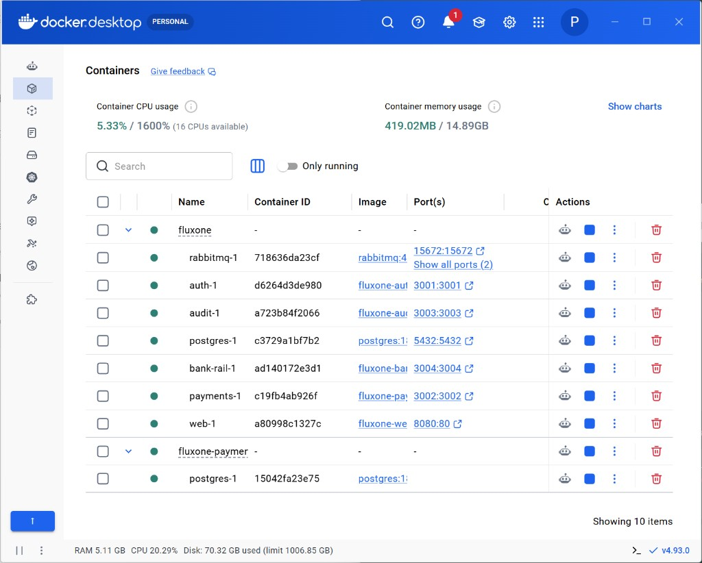
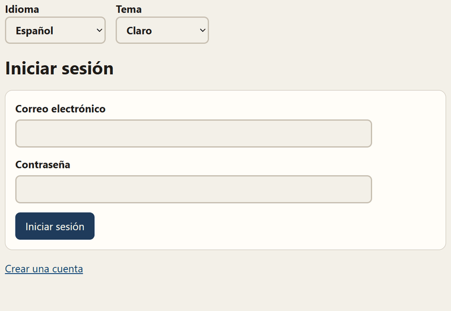
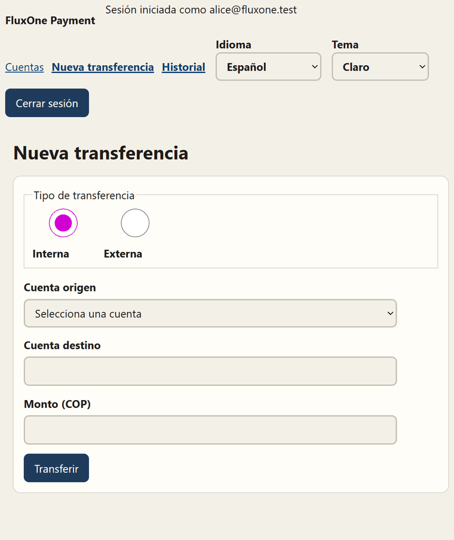

# pagos-flux-one

Portal de pagos en COP. Autenticación, transferencias, riel simulado y auditoría se levantan con Docker.

## Arranque local

Hace falta Docker con Compose. Desde la raíz del repositorio:

```bash
docker compose --env-file infra/.env.example -f infra/compose.yaml up --build
```

El portal queda en http://localhost:8080. Auth, pagos, el riel, auditoría, Postgres y RabbitMQ arrancan en la misma red.



Usuarios de demostración, todos con la clave `Fluxone-Demo-2026!`:

| Correo | Cuenta |
| --- | --- |
| `alice@fluxone.test` | ACC-001 |
| `bob@fluxone.test` | ACC-002 |
| `carol@fluxone.test` | ACC-003 |

Alice y Bob empiezan con saldo. Carol empieza en cero.

### Inicio de sesión

`.makia/docs/gui/inicio-sesion.gif` muestra el ingreso de Alice y sus cuentas.



### Transferencia, estado, auditoría e historial

`.makia/docs/gui/transferencia.gif` muestra una transferencia interna de ACC-001 a ACC-002, el estado completado, la línea de tiempo de auditoría y el historial.


